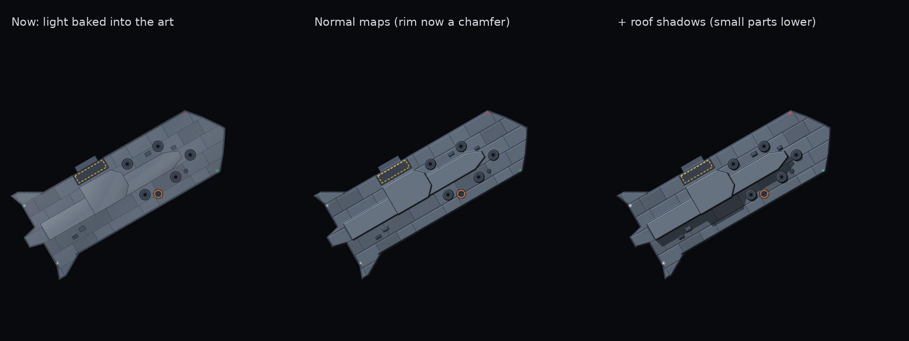

# Art Asset Pack: Style and Naming Guide

## Overview
The game's art is made as SVG in `assets/art`: floors, walls in every join pattern, edge walls and bulkhead doors, ship components in every mount size, state effects, sub-tile decor and interactive objects, weapon turrets, the exterior hulls of ships and stations, crew, projectiles, explosions and the laser beam. SVG is the source format; the game loads raster versions of these files, built by the art pipeline (see **Using the art in the game**).

Open `assets/art/preview.html` in a browser to see every asset, every chassis in `assets/data/chassis.toml` drawn with the tile and component art, and each ship's exterior with its turrets on their hardpoints.

## Scale and orientation
- **One tile is 64 SVG units.** A tile is one meter in game (`tile_size = 1.0`), so 64 units is one meter everywhere, exterior art included.
- **Sub-tile objects sit on a quarter-tile grid of 16 units.** Their canvas is their footprint rounded up to that grid (16x16, 32x16, 32x32, 32x64...).
- **Components are drawn at rotation 0.** SVG up is the grid's +y. A rotation in data is counter-clockwise quarter turns, so code rotates the art the same way.
  - Auxiliary components are drawn in their unrotated size (helm M is 2x3 tiles, 128x192); a rotated mount turns the art 90°.
  - Primary components face +y.
  - Docking ports face +y: frame tiles at both ends, the opening between them, the port door along the top edge.
  - Hull wedges at rotation 0 have their legs on the left and bottom edges and the sloped face toward +x/+y (`HullPiece.Shape.WEDGE`).
  - Wall-mounted decor (lockers, panels, lights, pipes) has the wall at the top of its canvas.
- **Walls are never rotated.** Every join pattern and orientation has its own file, so their light always comes from the top-left.
- **Exterior art is in the body frame.** Ship and station hulls use body coordinates times 64 with y flipped, so the SVG origin is the body origin and the bow points to +x, matching the hardpoints in `ships.toml` and the craft's collision shape. Turrets have their pivot at the SVG origin and the barrel toward +x.
- **Crew, projectiles and explosions are centered on the SVG origin.** Crew face +y (SVG up) and are 0.6 tile across, the size of `CrewBody` (radius 0.3 tile); the `_carrying` crate is neutral grey so code can tint it. Projectiles point their nose toward +x with any streak or exhaust trailing to -x. The laser `beam` is a 64x16 strip stretched along x to the beam's length, and `dock_walkway` is uniform along y, so it can be stretched or tiled across the gap between two collars.

## Layers
Every SVG has up to three top-level groups, and an exterior hull may have three more:

| Group | Holds |
|---|---|
| `<g id="base">` | Everything lit by the scene. |
| `<g id="emissive">` | Everything that gives off its own light: screens, status lamps, reactor and shield glow, live conduits, fire. Drawn over the base. |
| `<g id="meta">` | Invisible shapes for code: `id="collider"` and `id="interact"` (see below). |
| `<g id="collision">` | Exterior hulls only, and optional: what the craft collides on (see **Exterior hulls**). Hidden (`display="none"`), so a browser or editor shows the art and not a black silhouette. |
| `<g id="relief">` | Exterior hulls only: the outline of each part that stands up off the roof, with its height in meters as `data-h`, which casts its shadow (see **Light and shadow**). Hidden (`display="none"`) and never drawn. |
| `<g id="height">` | Exterior hulls only: a height map, gray for height (`data-base` is the bare roof, each step of 1 above it `data-scale` meters higher), which the packer turns into a normal map. Hidden (`display="none"`) and never drawn as art. |

A lamp or screen keeps its unlit glass in the base layer, so with the emissive layer off it reads as dark, not missing. The game can draw the emissive layer additively, use it for a glow or bloom pass, or skip it to show a system without power.

Groups inside the emissive layer say how their glow lights the scene, read by `tools/art/extract_lights.py`: `data-light="glow"` only glows (status lamps, indicator dots, conduits), `point` lights the room around it (reactor cores, shield domes, helm and weapons screens, life support displays), and `cone` lights one side only: the wall light is a 90° half-angle cone, a broad diffuse wash over the half of the room in front of its wall. `data-reach` (tiles), `data-intensity` (0 to 1), `data-direction` and `data-cone` (degrees, 0 = +x, 90 = up the canvas) tune it. An inner group's setting wins over an outer one, so a status lamp inside a lit room stays a glow.

## Powered and unpowered
Every powered object has an `_unpowered` variant: the same art with the emissive layer left out. That covers reactors, shield emitters, turret mounts, helm and weapons consoles, life support, airlocks, docking ports and collars, conduits, bulkhead doors, powered decor (terminal, wall light, bulkhead panel, breaker, med bed) and energy weapons. Cargo bays and tanks are passive and have no variant.

The suffix goes after any state: `docking_port_m_open_unpowered`, `bulkhead_door_sealed_unpowered_h`.

## Damaged and destroyed
Every component size (docking ports in both door states) also has its own damaged and destroyed art, drawn into the machine rather than laid over it:

- `_damaged`: scorch, cracks and a buckled plate, with the glow dimmed. Powered components also have `_damaged_unpowered`, with no glow.
- `_destroyed`: blackened, burned through to the frame and torn, with no glow at all, so it has no unpowered variant.

The game picks them by the system's health: `_damaged` below half (`ArtNames.DAMAGED_BELOW`), `_destroyed` at zero. Collars have no damage states.

## Walls
### Full-tile walls
Each wall tile type (`hull`, `hull_light`, `hull_medium`, `hull_heavy`, `composite_armor_light`, `composite_armor_medium`, `composite_armor_heavy`, `internal_wall`) has 16 files, one for each combination of neighbors it joins: `walls/<id>_<sides>.svg`, where `<sides>` lists the joined sides in the order `n`, `e`, `s`, `w` (up, right, down, left), or `0` for none. A wall joins the neighbors of the same tile type.

| Shape | Files |
|---|---|
| Isolated | `_0` |
| End | `_n`, `_e`, `_s`, `_w` |
| Straight | `_ns`, `_ew` |
| Corner | `_ne`, `_es`, `_sw`, `_nw` |
| T-junction | `_nes`, `_esw`, `_nsw`, `_new` |
| Intersection | `_nesw` |

Joined sides run straight into the neighbor with only a faint seam, and a groove along the middle of the wall carries through, so a run of walls reads as one beam. Open sides show the wall's face, lit from the top-left. Where two joined sides meet, the tile also turns the inner corner of the faces; that assumes the diagonal neighbor is open, as it is for walls one tile thick.

Wedges are `walls/<material>_<weight>_wedge_<w>x<h>.svg` (and `hull_wedge_*` for `hull`), 1x1, 1x2 and 2x1, drawn at rotation 0 and rotated like components. The 2x1 wedge is its own drawing, so the slope and the plating run the right way without mirroring the tall one.

### Hull materials
Each hull material has its own wall art, not a tint: the files start with the material's prefix (`hull` for `hull_steel`, `composite_armor` for `composite_armor`), then the weight.

- **Hull steel** is riveted plate with a groove along the run and bolts at the corners.
- **Composite armor** is a grid of chamfered ceramic tiles over a dark green-grey backing, with no groove and no bolts. Heavier weights have a wider rim.

Full-tile walls, wedges and edge walls all follow the material. A material without its own art falls back to hull steel of the same weight, and a wedge without its exact size falls back to the tall wedge, mirrored.

### Edge walls
Thin walls between tiles are drawn in pieces: a segment for each tile edge and a joint at each grid vertex where segments meet.

- `edges/edge_wall_<material_><weight>_h.svg` (64x16; `<material_>` is empty for hull steel and `composite_armor_` for composite armor) lies along a horizontal edge, which runs along y = 8; `_v` (16x64) along a vertical edge, at x = 8. A segment's ends are open, so segments in a line join with no seam.
- `edges/edge_wall_<material_><weight>_joint_<sides>.svg` (16x16) is centered on a vertex; `<sides>` lists which of the four edges meeting there carry a wall, in the same `nesw` order. An end cap is a single side (`_joint_n`), a corner two at right angles (`_joint_ne`), a T three, a cross all four. Draw it over the segments; where materials or weights meet at a vertex, the joint takes the heaviest wall's art.

### Edge conduits
Power conduits that run along tile edges (inside thin walls, or along full-tile and hull walls) are drawn the same way, over the walls so they stay in sight. Each piece has an `_unpowered` variant without the lit core, which is tagged `data-light="glow"`.

- `edges/edge_conduit_h.svg` (64x16) along a horizontal edge at y = 8, `_v` (16x64) along a vertical edge at x = 8, with open ends.
- `edges/edge_conduit_joint_<sides>.svg` (16x16) is centered on a vertex, `<sides>` as for edge walls: an end cap or straight joint is a clamp, and a corner, T or cross is a junction box with a lamp.
- `edges/edge_conduit_tap.svg` (16x16) is a junction box centered on the middle of an edge, where a tile's `conduit_arm` reaches an edge run. It is square, so it fits horizontal and vertical edges alike.

### Pipes
Pipes carry oxygen, nitrogen and propellant from tanks to the systems that use them. They are steel grey (`#8c96a0`, lit `#b4bec8`, shaded `#5a6470`) with flange bands, are passive and have no unpowered variant, and are drawn over conduits.
- `tiles/pipe_hub.svg` (64x64) is a valve body in the middle of a tile with a pipe across it; `tiles/pipe_arm.svg` (64x64) runs from the middle to the top edge, turned toward each neighbor the pipe joins, like `conduit_arm`.
- `edges/edge_pipe_h.svg` (64x16) and `_v` (16x64) run along an edge, `edges/edge_pipe_joint_<sides>.svg` (16x16) join runs at a vertex, and `edges/edge_pipe_tap.svg` (16x16) is the tee where a tile's pipe arm meets an edge run.

### Doors
Bulkhead doors take the place of an edge wall segment: `edges/bulkhead_door_<state>[_unpowered]_<h|v>.svg`, state `sealed` or `open`. A powered door's lamp is red when sealed and green when open; an unpowered door has dark lamps.

## Components
Each size of a component is its own design, not the small one repeated: a bigger reactor is a different machine (canister, fission pile, tokamak, fusion plant), a bigger helm is a bigger room (a pilot's seat, a two-seat cockpit, a bridge, a command bridge). Parts, palette and accent stay the same across sizes.

The **turret mount** is the turret's base and its operator's station: a bearing ring with a traverse drive and the ammunition or power feed, and the gunner's console and seat (bigger mounts add a loader's station). The ring is centered on the mount, and so is the turret drawn on the exterior: a hardpoint in `ships.toml` sits on the center of the turret mount its weapon is wired to.

**Escape pods** (`escape_pod`, S-XL) are lifeboats in their bays: a capsule with an orange band, crash couches facing the hatch (4, 8, 20 and 48 of them) and a status panel on the pod's own battery. The hatch is at the +y end, and that end overlaps the outer hull it launches through (the row under it stays hull); the rest of the pod lies inside. The bay around the capsule is walkable deck.

**Tanks** (`tank`, `oxygen_tank`, `nitrogen_tank`, S-XL) are cylinders in cradles with a band in their fluid's color: amber for propellant, blue for oxygen, grey-blue for nitrogen. They are passive.

## Exterior hulls
A ship or station hull is the roof over its decks, seen from above, built on its chassis grid so the outside matches the inside without showing the deck plan. The whole footprint (the grid's tiles and any outline past it) is plated in staggered courses of plates a meter and a quarter wide and one and a half to three and a half long, each a shade lighter or darker than the next, with a rim of heavier plate along the edge and a sheen lighting it from the top-left (baked light, which the game's own lighting leaves out: see **Light and shadow**); the tile grid itself is not drawn. Raised superstructure stands on the roof, with no shadow drawn under it: each warship has its own (`SUPERSTRUCTURE` in `generate_svgs.py`: the corvette's spine and bridge, the gunship's armored citadel and ram plate, the frigate's keel, bridge and drive housing, the raider's canopy ridge, the corsair's off-center bridge and outrigger armor, the picket's sensor dome), and every other ship gets a spine down its middle. Superstructure keeps a tenth of a meter clear of every exterior system's footprint, so no block sits under a turret, port or hatch: the automatic spine breaks around them, and the generator refuses a hand-drawn shape that covers one. Small fittings (vents, boxes, hatches, conduit runs) are scattered over bare roof, seeded by the chassis id so the art is the same each run. Only the systems that reach the outside of the hull show on it (`EXTERIOR` in `generate_svgs.py`); the helm, weapons console, reactor, life support, cargo bays and tanks are inside the decks and stay under the plating. Each exterior system's fitting sits over its footprint:

| System | Exterior |
|---|---|
| Turret mount | Turret ring at the mount's center |
| Shield emitter | Emitter dome |
| Airlock | Hatch |
| Escape pod | Round hull hatch ringed in orange, with its explosive bolts |
| Docking port | Port frame, and the collar half a tile outside |

Parts of the hull past the grid are drawn with it (`OVERHANG`), so each ship has a silhouette of its own and not the grid's box: the corvette a two-stage prow, swept fins aft and a fairing between its engines; the gunship a hammerhead ram, gun sponsons and an armored skirt aft; the frigate a long tapering bow, sponsons forward and broad wings aft; the raider forked mandibles and swept delta wings; the picket a rounded sensor nose and a blister either side; the corsair a lopsided raked bow, an outrigger to starboard and one fin to port. Outlines keep clear of docking ports and engines. Engines hang outside the hull, so the hull art leaves their slots out, and the game draws each engine over its slot (below); a ship with no engine systems carries engine mounts on the aft (-x) edge instead, one for every three rows. The corvette has two Small engines on its stern and the freighter two Medium ones. Navigation lights mark the corners: red to port (+y), green to starboard.

A ship collides on its layout: every tile that is not void, with each wedge as its triangle. A hull SVG may instead say what the craft collides on with a `<g id="collision">` layer (in Inkscape, a layer labelled `collision`); when it has one, that layer wins over the tiles. It holds `<polygon>`, `<rect>` and straight-line `<path>` shapes in the body frame like the rest of the art, and may use `transform`s. Shapes can overlap; a concave one is cut into triangles, so a few convex shapes collide best. The layer is never drawn, and is read from the SVG itself, so a craft collides the same whether or not the art pack is built. Each ship with an outline past its grid collides on that outline; the freighter has none and collides on its tiles.

## Engines
The engine is a component (`E`, behavior `ENGINE`) in the rectangular auxiliary slots, so it comes in the same four sizes: S 1x2, M 2x3, L 3x7 and XL 5x12. It has two kinds of art.

- **Inside**, `components/engine_<size>.svg` (or `components/<model>_<size>.svg` for a model in another maker's style) is the engine filling its slot, with the nozzle toward +y at rotation 0 and the mounting flange (bolted plate, hazard band, fuel and oxidizer couplings) at the far end. The flange runs right to the slot's edge, square, so it lies flat against the hull with no strip of space between them. An engine mounts outside the hull, so the art has no deck or housing behind it: what is not engine is clear, and its damage is clipped to its outline. It has the usual `_unpowered`, `_damaged` and `_destroyed` states.
- **Outside**, `engines/nacelle_<size>.svg` (or `engines/<model>_nacelle_<size>.svg`) is the same drawing, which the game draws over the engine's slot turned with it; `_unpowered` turns its status lamp off; the nozzle itself carries no glow, the exhaust plume does. `engines/exhaust_<size>.svg` (or `engines/exhaust_<model>_<size>.svg`) is the plume from the middle of its slot's nozzle end while it burns, all emissive and tagged `data-light="glow"`, pointing -x from its origin and scaled along x with the throttle.

`tools/art/engine_svgs.py` draws the engine in three styles, one for each maker (`MODELS` maps each engine component to its style): the bell for Halvorsen Propulsion, the plain engine art; the armoured nacelle for Imbrium Heavy Foundry; and the linear aerospike for Aster Dynamics. Run alone it writes a sheet of all three for comparing them. Each style has its own plume, drawn for vacuum (no shock diamonds), with soft edges from stacked, fainter copies: the bell's is a tight blue-white jet with a faint halo spreading a few degrees; the Imbrium's a denser, warmer white-to-amber jet, shorter and wider, with film-cooling streaks; the aerospike's starts back on the plug, a bright sheet on each face down to the truncated end that runs on past it and closes into the hot core behind it, sheets and core drawn as one shape under one gradient so nothing doubles up where they meet, inside a wide, faint violet-blue fan opening outward from the cell row, since nothing bounds its outer edge. Bells follow the Rao thrust-optimised contour of real high-expansion de Laval nozzles (a short arc out of the throat to 36°, then a parabola closing to 7° at the exit, expansion 5 to 10 in radius), filling the slot's width on a thrust frame back to the flange; the aerospike's plug (evenly shaded, no lit face) tapers on a parabola, steep at its thrust cells and parallel at its truncated end, and the whole aerospike sits back against a short thrust frame. A craft with no engine systems keeps the older bolt-on engine (`engines/engine_s`, origin on the hull edge, nozzle -x) in each engine mount its hull art draws, with `exhaust_s` from its nozzle.

RCS blocks are bolted onto hull edges that face space (`rcs` in `chassis.toml`), so they are outside art only. `engines/rcs_linear.svg` is a single-nozzle block and `engines/rcs_quad.svg` one with three nozzles: its main one and one each way along the hull. Both point their main nozzle -x with the origin at the middle of the hull edge they sit on, standing a fifth of a tile proud of it; `_destroyed` is the scorched stub left when its hull tile is gone. `engines/rcs_puff.svg` is the small cold-gas jet a nozzle shows while it fires, all emissive and tagged `data-light="glow"`, pointing +x from its mouth and scaled with how hard it fires. The game draws the blocks over the hull and under the engines. Plumes and jets are drawn in a pass of their own after the light map, additively, spooling up and down and flickering, and each lights the scene around it as strongly as it burns (see Flames in `documentation/lighting/Design.md`).

## Style
Top-down, orthographic, flat-shaded vector art with dark outlines. Light comes from the top-left: a lighter line along the top and left inside edges of a raised part, a darker one along the bottom and right. No perspective and no drop shadows: tiles butt together cleanly, and a shadow cast by something raised is the lighting's to draw, not the art's.

### Light and shadow
A prototype, on the exterior hulls only: the game lights the hulls itself, from one key light at a fixed direction in the world (a far star), so the lit side swings round as a ship turns and every ship in view agrees. F7 in the game cycles the baked art, normal maps alone, and normal maps with roof shadows; `-Dhull.lighting=baked|normals|shadows` picks one at start, and `HullShading` (core, `render`) holds the light's bearing, elevation and the shadows' strength.

- **Baked light is marked.** Every element that paints light or shade on (a `bevel()` edge, the roof sheen, the plates' lit lips, a superstructure block's highlight) carries `data-baked="1"`. The packer leaves those out of the hull's flat art, `flat/hulls/<id>`, which the lit shader draws; the baked art is still `hulls/<id>`. Deck art is marked the same way, but nothing draws it lit yet.
- **Normal maps.** The packer blurs the `height` layer a little (so each edge is a bevel, not a cliff), takes its slopes and eases the steep ones, and writes `normal/hulls/<id>` with the same size as the art. The shader lights the flat art by it, as bright as the art was at plain roof, so the light map over the hulls works as before.
- **Roof shadows.** Each part in the `relief` layer is swept away from the key light by its height over the tangent of the light's elevation, marked in the stencil buffer, and the roof drawn darkened there, so a shadow falls only on the hull and never on space. Then `raised/hulls/<id>`, only the elements marked `data-raised="1"` (and the emissive layer, which no shadow darkens), is drawn again over it, so a part's shadow falls past it and not on it. Heights: a spine 0.5 m, blocks 0.6 to 0.9 m (each in `SUPERSTRUCTURE`), the picket's dome 1.2 m, a turret ring 0.1 m, a shield emitter 0.08 m, a box 0.06 m, a vent 0.05 m, a conduit run 0.04 m, a hatch 0.02 m. The rim of heavier plate is a chamfer in the height layer (`CHAMFER`), sloping a tenth of a meter down toward the outer edge. Hatches, airlocks and docking port frames set in the roof get their own plate in the height layer (`HATCH_HEIGHT`), so the plating's seams stop at their edge and don't show through them.

- **Stills.** `gradlew :lwjgl3:hullLightingShots -Phulls=corvette,frigate -Pangle=30` draws each hull lit all three ways side by side into `lwjgl3/build/hull-lighting`.

- **Outlines:** `#10141a`, 2 units on tiles and components, 1-1.5 on small details, 3 on exterior hulls.
- **Detail density:** read clearly at 32 px a tile (half size). Rivets, seams and screens are details; the silhouette and the accent color must carry the meaning.
- **Glow:** emissive parts use the accent color with a white-hot center or a soft radial gradient. Gradients are the only place colors blend.

### Palette
| Role | Color |
|---|---|
| Outline | `#10141a` |
| Deck base / plate / seam / highlight | `#3a434f` / `#444e5b` / `#2a3039` / `#566170` |
| Steel light / mid / dark / highlight | `#5b6675` / `#4b5563` / `#373f4b` / `#7d8898` |
| Machinery housing / highlight | `#2f3641` / `#465060` |
| Screen glass / unlit lamp | `#0c1a26` / `#1b2028` |
| Power (conduits, junctions) | `#f2b134` |
| Hazard stripe (doors, airlocks, ports, seals) | `#f2c230` on outline black |
| Status lamps | sealed or off `#ff4d4d`, open or on `#4dff88` |

Each system has an accent, used for its glow, screens and status lamps, and nowhere else:

| System | Accent |
|---|---|
| Reactor | `#ff9a3c` |
| Shield emitter | `#4fd1ff` |
| Turret mount | `#ff5a5a` |
| Life support | `#5ee08a` |
| Helm | `#6aa8ff` |
| Weapons console | `#c58cff` |
| Cargo | `#c8a26a` |
| Airlock, docking port | `#f2c230` (hazard) |
| Escape pod | `#ff7a2a` |

These match the `color` a tile type or component carries in data where one is set, so the editor's flat colors and the art agree.

## Naming
File names are lowercase `snake_case` and start with the id in data, so code can find the art from a definition without a lookup table. Suffixes come in this order: size, state, `damaged` or `destroyed`, `unpowered`, orientation.

| Folder | Name | Example |
|---|---|---|
| `tiles/` | the floor tile type's id in `tiles.toml`; coverings as `covering_<covering>`; `pipe_hub`, `pipe_arm` | `floor`, `conduit`, `conduit_arm`, `covering_carpet` |
| `walls/` | `<tile id>_<sides>`; wedges as `<tile id>_wedge_<w>x<h>` | `hull_heavy_nes`, `composite_armor_light_ew`, `internal_wall_0`, `hull_medium_wedge_2x1` |
| `edges/` | `edge_wall_<material_><weight>_<h\|v>`, `edge_wall_<material_><weight>_joint_<sides>`, `bulkhead_door_<state>_<h\|v>`, `edge_conduit_<h\|v>`, `edge_conduit_joint_<sides>`, `edge_conduit_tap`, `edge_pipe_<h\|v>`, `edge_pipe_joint_<sides>`, `edge_pipe_tap` | `edge_wall_light_joint_ne`, `edge_wall_composite_armor_heavy_v`, `bulkhead_door_open_unpowered_v`, `edge_conduit_joint_unpowered_es` |
| `components/` | `<component id>_<size>`, size `s`, `m`, `l` or `xl` | `reactor_xl`, `helm_m_unpowered`, `docking_port_l_open`, `life_support_m_damaged_unpowered`, `reactor_s_destroyed`, `docking_collar_s` |
| `effects/` | the state it shows; animation frames as a number suffix | `fire_medium`, `breach`, `explosion_3`, `beam` |
| `decor/` | the object | `crate_small`, `pipe_run`, `wall_light_unpowered` |
| `interactive/` | the object; levels as a number suffix | `fire_extinguisher`, `cargo_stack_2` |
| `turrets/` | the weapon id in `weapons.toml` | `railgun_mk1`, `harpoon_launcher` |
| `hulls/` | the chassis id in `chassis.toml` | `corvette`, `station_hub`, `thruster_plume` |
| `engines/` | `nacelle_<size>`, `engine_<size>`, `exhaust_<size>`, `<model>_nacelle_<size>` and `exhaust_<model>_<size>` for an engine component drawn in another maker's style, size `s`, `m`, `l` or `xl` (the engine component's slot size); `rcs_<kind>`, kind `linear` or `quad`; `rcs_puff` | `engine_m`, `engine_xl_unpowered`, `exhaust_s`, `rcs_quad_destroyed` |
| `crew/` | `crew_<who>`, lying as `_down` or `_dead`, holding a crate as `_carrying` (standing only); wounds over a figure as `wound_<light\|serious\|critical\|stabilised>`, `_down` for one lying | `crew_ship`, `crew_station_carrying`, `crew_player_down`, `crew_ship_dead`, `wound_critical_down` |
| `projectiles/` | the projectile | `railgun_slug`, `autocannon_round`, `missile`, `decoy_flare`, `harpoon` |

Tile ids are the ones in `tiles.toml`: `floor` (`.`), `conduit` (`+`), `hull` (`#`, medium), `hull_light`/`hull_medium`/`hull_heavy` (`1`/`2`/`3`), `armor_light`/`armor_medium`/`armor_heavy` (`4`/`5`/`6`, composite armor), `internal_wall` (`I`); `void` has no art. Each tile type names its art with an `art` key in `tiles.toml` (`art = "walls/composite_armor_heavy"`): a floor's full region, or a wall's family that the join suffix is added to. Without one, the art is found from the tile's id, then its material and weight. Component ids are the ones in `components.toml`: `reactor`, `shield_emitter`, `turret_mount`, `life_support`, `helm`, `weapons`, `cargo`, `airlock`, `engine`, `docking_port`, `tank`, `oxygen_tank`, `nitrogen_tank`, `escape_pod`. A new component made in data (say `fusion_core` with behavior `REACTOR`) gets its own `fusion_core_<size>.svg`; until it has one, code can fall back to the art of its behavior's built-in component.

In the game every file is a region of one texture atlas, named by its folder and file name without the extension: `tiles/floor`, `components/reactor_xl`, `hulls/corvette`. `assets.toml` names the atlas once, as `atlas_art`, so a mod can swap the whole pack by overriding that key.

## How the parts fit together
- **Conduits** autotile: draw the tile's `floor` and any covering, then the `conduit` junction over them, then `conduit_arm` once for each neighboring conduit tile, turned toward it (0 up, 1 left, 2 down, 3 right). The junction has no deck of its own, so carpet under a conduit stays in sight.
- **Components** cover their whole footprint and are drawn over the floor. None of them draws a deck of its own: where the art leaves the footprint open (a helm or weapons room, a cargo bay's tie-downs, the deck round a tank, an escape pod or a docking port's opening), the tile's own floor and covering show through. The others are machinery housings.
- **Docking ports**: `docking_port_<size>` has the door sealed, `_open` open. The latch collar is not on the grid: `docking_collar_<size>` sits half a tile (32 units) outside the outer edge, centered on the port.
- **Effects** are overlays: fire by `Tile.FireSize`, `scorch` once a fire burns out, `breach` on a hull tile at integrity 0, `damage_light` below half integrity (where leaks start) and `damage_heavy` below a quarter, `bulkhead_seal` on a sealed tile, `hull_patch` over a leaking tile the crew patched in the field (`Tile.isPatched`), `short_circuit` over a shorted conduit tile and the middle of a shorted system's footprint (`Tile.shorted`, `SubsystemComponent.shorted`), `propellant_spill` on bare deck holding fuel a burst tank pooled there.
- **Cargo stacks**: `cargo_stack_1` to `_3` are one bay tile's stack at a third, two thirds and full of `CargoHoldComponent.STACK_HEIGHT`.

## Colliders and interaction points
Decor and interactive objects that block movement or can be used carry two invisible shapes in their `meta` group, so code can read them straight from the SVG:

- `id="collider"`: a `<rect>` or `<circle>` giving the collision shape in the same units as the art.
- `id="interact"`: a `<circle>` whose center is where crew stand or reach to use the object.

## Using the art in the game
libGDX does not draw SVG, so the `art-pipeline` module rasterizes these files at build time. `gradlew :art-pipeline:packArt` renders every SVG at 64 px a tile (with [JSVG](https://github.com/weisJ/jsvg)), packs them into `art/art.atlas` with libGDX's TexturePacker, and writes `art/art.json` beside it. The game's run tasks (`runGame`, the demos, the editor) run it first, and only when an SVG changed; its output lands in `art-pipeline/build/generated/art` and is on the game's classpath, so nothing generated is committed and the SVGs stay the only source.

- **Regions.** One per file, named `<folder>/<name>`. The `meta` layer is left out. A file with an `emissive` layer also gets that layer alone as `glow/<folder>/<name>`, for a glow or bloom pass: the deck view draws them again over the light map, so what is lit shows lit in a dark room (see `documentation/lighting/Design.md`).
- **`art.json`.** For each region, its SVG `viewBox` (`x`, `y`, `w`, `h`), so exterior art keeps its body origin and turrets their pivot, and the `collider` and `interact` shapes from its `meta` layer, in SVG units; for a hull, its `relief`, each raised part as `[height, x0, y0, x1, y1, ...]`.
- **Lit twins.** A file with a `height` layer also gets `flat/<folder>/<name>`, `raised/<folder>/<name>` and `normal/<folder>/<name>` (see **Light and shadow**).
- **In code.** `ArtLibrary` loads the atlas (or nothing, if it was never built, and then everything is drawn in the old flat shapes), `ArtNames` turns game state into region names, `DeckArt` draws a deck and `ExteriorArt` a craft from outside.

What the game draws with the pack:

| Where | What |
|---|---|
| Deck view (V in the game, the docking and interior demos) | Floors, carpet, conduits joined to their neighbors (dark without power), walls joined to their neighbors of the same type, wedges, every system in its mount (its `_unpowered` art when it is not working, its `_damaged` art below half health and `_destroyed` at zero), walls and wedges in their material's art, docking ports open while a dock through them can be crossed, collars, thin walls and their joints, bulkhead doors (dark when the craft has no working reactor), damage below half and a quarter integrity, breaches, seals, fire by size, and cargo stacks tinted toward their commodity. Pressure loss and smoke are still drawn as a tint over the art. |
| Outside | Each craft's hull by the chassis it was built from (`ShipGridComponent.chassis`, saved with the grid), its turrets on their hardpoints turned to where they aim (unpowered when their system is down), and each engine over its slot outside the hull with its exhaust while the main engine burns. Craft without hull art keep their outline. |
| Ship editor | The layout as the deck will look; A toggles back to flat colors. |
| Crew (deck view) | `crew_ship`, `crew_station` or `crew_player`, turned the way they last walked; carrying, the `_carrying` art with its crate tinted to the commodity. Their state picks the figure (`ArtNames.CrewPose`): standing, `_down` on their back (unconscious, or put down by a serious or critical wound), or `_dead` where they fell. A wound is drawn over the figure, turned with it (`ArtNames.crewWound`): a dressing and a graze when light, a soaked wound when serious, blood running onto the deck when critical, blinking while it bleeds out, and dressed once stabilised. So injured crew are on their feet with a light wound, wounded crew down with a serious or critical one, unconscious crew down unhurt. A pack without that art draws the standing figure, greyed while down, a disc in the wound's color beneath, and a grey cross for the dead. |
| Combat (outside) | Rounds and missiles by their art (`art` in `[projectile.*]` and `[missile.*]`, else the id, else `missile`), drawn at least a few pixels long when zoomed out; decoy flares; laser beams as the `beam` strip, added to the light under them; explosions frame by frame. |
| Docks | `dock_walkway` across each open dock, in place of the flat walkway. |

The game, the docking demo and the interior demo draw decks through one `DeckRenderer` (core, `render`), so they look the same; the demos add their own markings on top (the docking demo's ports and collars, the interior demo's wounds and wear). Outside, they draw hulls, outlines, rounds, missiles, beams, decoys, explosions and fast passes through one `ExteriorRenderer` (core, `render`): the docking demo picks out its collars through the renderer's outline style, and the interior demo draws what is in flight in its ship's frame. A fast pass (a body crossing the bubble too fast for Box2D) is drawn as a streak fading back along its flight, as wide as the body.

Behind the game's exterior view, faint "space snow" (`SpaceSnow`, core, `render`) shows the player how fast they are moving. Its reference frame is a circular orbit at the ship's current altitude, turning the ship's way, around the body whose sphere of influence the ship is in: a ship in a circular orbit sees the snow hang still, and any eccentricity, burn or intercept shows as drift, each mote streaking back along it. It lies in three layers for parallax (the nearest at the true relative speed, the deeper ones at 0.65 and 0.4 of it, dimmer), laid out in screen pixels so zooming doesn't thin or thicken it, and it fades out when it moves too far between frames to follow (time warp). The physics bubble's grid, which follows the falling bubble and so says little about speed, is only a developer overlay (`grid` in the debug menu); `snow` there hides the snow. Still drawn as shapes: the other demos and the minimap. Furnishings (the recreation decor in `furnishings.toml`) are drawn at their own spot and angle over the floor, rugs first, darker as a fire scorches them; the other decor and interactive objects (other than cargo stacks) have no placement in the data yet, so nothing places them. A chassis a yard has refitted still shows the hull art of its chassis as built. `scorch` waits on the grid remembering where a fire burned.

## Regenerating
The first pass was drawn by `tools/art/generate_svgs.py`, which keeps the many variants consistent and builds the hulls from `chassis.toml` and `ships.toml`; the furnishings are drawn by `tools/art/furnishing_svgs.py`, which it runs and which also runs alone. The SVGs are the source: edit them in any vector editor (Inkscape, Illustrator, Figma). Re-running the script clears and rewrites `assets/art`, so once a file is edited by hand, take it out of the script.

`tools/art/make_preview.py` rebuilds `assets/art/preview.html`; `--inline` embeds the SVGs so the page is one shareable file.

## Asset list
- **Tiles (9):** floor, conduit and conduit arm (powered and unpowered), pipe hub and arm, carpet covering, dock walkway.
- **Walls (149):** `hull`, `hull_light`, `hull_medium`, `hull_heavy`, composite armor light, medium and heavy, and `internal_wall` in all 16 join patterns, and 1x1, 1x2 and 2x1 wedges for each weight of both materials.
- **Edges (146):** edge wall segments (horizontal and vertical) and 15 joints for each weight of hull steel and composite armor; bulkhead doors sealed and open, powered and unpowered, both orientations; edge conduit segments, 15 joints and the tap, powered and unpowered; edge pipe segments, 15 joints and the tap.
- **Components (208):** reactor, shield emitter and turret mount (S-XL); helm, weapons console, life support, cargo bay, airlock, engine and the propellant, oxygen and nitrogen tanks (S-XL); docking port S-L sealed and open, and the collar for each size; with an unpowered variant of each powered one, and damaged and destroyed states of each.
- **Engines (20):** main engine S, M, L and XL seen from outside (the nacelle over its slot, and the older bolt-on engine), powered and unpowered, and an exhaust plume for each. The same engines inside are with the components.
- **Effects (14):** fire small, medium and large, scorch, breach, light and heavy damage, bulkhead seal, explosion (one frame, and four frames `explosion_1` to `_4`), laser beam.
- **Decor (36):** vent grate, floor hatch, pipe run, pipe valve, cable tray, wall light, hazard stripe, floor arrow, small and large crates, barrel, locker, bunk, table, mess table, chair, plant; and the furnishings the yards sell for the crew's downtime: couch, armchair, beanbag, coffee table, card table, chess table, pool table, arcade cabinet, dartboard, media screen, aquarium, jukebox, keyboard, bookshelf, exercise bike, weight bench, planter and rug. A furnishing's canvas is its footprint in `furnishings.toml` (64 units a tile), drawn with its back toward the top of the canvas and its front toward the bottom; screens and lamps on the arcade cabinet, media screen, jukebox, keyboard, exercise bike and aquarium are in the emissive layer.
- **Interactive (14):** fire extinguisher, bulkhead panel, breaker, terminal, emergency locker, repair kit, med bed, cargo stacks at three levels.
- **Turrets (6):** railgun, autocannon, laser and harpoon launcher, and unpowered railgun and laser.
- **Hulls (5):** corvette, freighter, outpost and hub stations, thruster plume.
- **Crew (20):** ship crew, station dock hand and the player, each standing, carrying a crate, down and dead; and four wounds (light, serious, critical, stabilised), each for a standing figure and one lying down.
- **Projectiles (5):** railgun slug, autocannon round with tracer, missile, decoy flare, harpoon.

## Decided
- **Armor types change tile art** (2026-10-19): each hull material gets its own tile art, not just a tint, in this pack and in the deck renderer. Built for hull steel and composite armor (see **Hull materials**).
- **Hull colliders** (2026-10-19): a ship's hull SVG may carry a `collider` shape in its `meta` layer; when it does, that is the ship's collision polygon, and otherwise the polygon is generated from the layout's outer hull tiles.
- **Pipes and tanks** (2026-10-19): pipes are laid in tile centers or along tile edges like conduits, and tanks are placed in the grid, so both need art in this pack (see Life Support in `documentation/interior-grid/Design.md`).

## Open Questions
- Hull lighting prototype (**Light and shadow**): keep it, and if so, light the turrets, engines and deck art the same way, let point lights (engines, muzzle flashes) light by the normal maps too, and drop the baked hulls from the atlas. Today it costs three more regions per hull. Not handled yet: turrets and engines cast no shadow, shadows are not warped with a dented hull, and a taller part's shadow is not drawn on a lower part it falls across.
- Walls more than one tile thick show a small notch at inner corners; the 47-tile blob set would remove it if thick walls become common.
- Hull steel and composite armor are the only materials with art. New materials need their own look decided before they get files.
