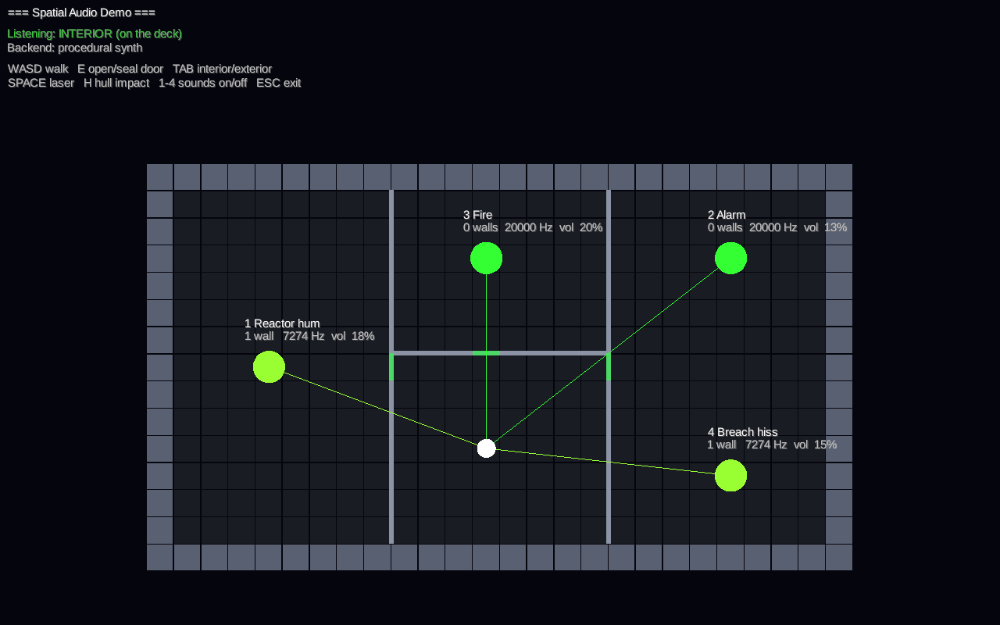

# Spatial Audio Module Design

## Overview
The `audio-spatial` module manages all sound reproduction. Due to the hard sci-fi nature of the game, audio plays a massive role in immersion, utilizing DSP low-pass filters to contrast the muffled, pressurized ship interior with the silence of the vacuum of space.

## Implementation Dependencies
- **`core-engine`**: Ashley ECS for tracking audio emitters.
- **`physics-exterior`**: Needs Box2D world coordinates for 3D spatialization of exterior sounds.
- **`interior-grid`**: **Hard Dependency for Muffling.** Needs to calculate lines-of-sight and wall obstructions on the 2D grid to apply acoustic low-pass filters.
- **External Libraries:** OpenAL Soft (LGPL), through LWJGL's `lwjgl-openal`, the same OpenAL libGDX's desktop backend plays through. Its EFX extension supplies the low-pass filters and its HRTF the headphone spatialization.

## Implementation Guide
The original plan, kept for the reasoning; **Implemented** below says what was built. Where they differ, the implementation wins: the listener is placed by `AudioUpdateSystem` (there is no separate listener system), and muffling uses two sound paths rather than a single line (see **Decisions made while building it**).

1. **Audio Backend:**
   - Play through OpenAL Soft on libGDX's OpenAL context, one source per playing sound.
   - Create a global `AudioManager` wrapper to abstract backend calls (e.g., `playOneShot("event:/weapons/laser", x, y)`).

2. **3D Listener Positioning:**
   - Sync the listener position to the current active Camera position every frame.
   - In *Exterior Mode*, the listener is at the ship's center. In *Interior Mode*, it tracks the player character's grid coordinate.

3. **Emitter Tracking:**
   - Create an `AudioEmitterComponent` holding an active event instance.
   - Create an `AudioUpdateSystem` that syncs the instance's position to the entity's `TransformComponent`.

4. **Acoustic Occlusion (Muffling) Algorithm:**
   - When the player is in *Interior Mode*:
     - For every active `AudioEmitterComponent` on the ship, draw a Bresenham line on the 2D grid from the emitter to the player listener.
     - Count the number of walls/closed bulkheads intersected by the line.
     - Set the instance's `Occlusion` parameter based on the wall count. The backend turns it into a low-pass filter, cutting high frequencies and "muffling" the sound based on how many rooms away it is.
   - When the player is in *Exterior Mode*:
     - Internal sounds are aggressively clamped to maximum occlusion.
     - External sounds (like weapon impacts on the hull) use standard distance attenuation without occlusion, representing sound vibrating through the ship's frame (the "Spacer Ears" mechanic).

## Implemented Components
- `AudioEmitterComponent`: attached to entities (engines, weapons, fires, breaches) holding the event path, where it plays (exterior at the entity's transform, or interior at a ship-local position), extra parameters and playback state.
- `AudioListenerComponent`: where the player hears from, interior or exterior, and aboard which ship.

## Implemented Systems
- `AcousticOcclusionSystem` (priority 900): works out each interior emitter's Occlusion, Transmission and Pressure from the ship's grid.
- `AudioUpdateSystem` (priority 1000): places the listener and emitters, starts and stops instances and advances the backend.
- `InteriorHazardAudioSystem`: gives fires, breaches, alarms and doors their sounds from each ship's grid. Its emitters are transient, so a loaded game rebuilds them.

## Prototype Status
The module builds and is tested headlessly (`gradlew :audio-spatial:test`). The game talks to an `AudioBackend` interface. On desktop it plays through OpenAL Soft; until sounds are recorded, every event plays a procedural placeholder.

**Run the demo:** `Audio demo.bat` (or `gradlew :lwjgl3:runAudioDemo`). Walk a small ship with WASD and hear the reactor, alarm, fire and breach hiss muffle as walls and doors come between you. E opens or seals the nearest door, TAB switches between interior and exterior listening, SPACE fires a laser and H hits the hull. Headphones help with the panning.

What exists (`com.ringsofiron.audiospatial`):
- **`AudioManager`** wraps the backend: `playOneShot(path, x, y[, intensity])`, `createInstance`, `setGlobalParameter`, `loadBank`. `AudioManager.createDefault()` picks OpenAL when libGDX's desktop audio is running, otherwise the synth backend when some other libGDX audio runs, otherwise headless.
- **Backends** (`backend` package): `AudioBackend` / `AudioEventInstance` are the engine and one playing sound. `HeadlessAudioBackend` plays nothing but records every instance and its computed mix, for tests and servers. `SynthAudioBackend` plays procedural placeholder sounds through libGDX's `AudioDevice` on a mixer thread with distance rolloff, stereo pan and a real 12 dB/octave low-pass for occlusion; it is the fallback where OpenAL is not running.
- **`OpenAlAudioBackend`** plays through OpenAL Soft. See **OpenAL backend** below.
- **`AcousticModel`** is the one place the mix curves live: inverse distance rolloff faded to silence at max distance, a low-pass cutoff falling exponentially from 20 kHz (clear) to 350 Hz (fully muffled), a Transmission volume factor from the occlusion pass, and volume ∝ √pressure. Both audible backends use it, so they sound alike.
- **`AudioEventCatalog`** maps event paths (`event:/ship/reactor_hum`, `event:/weapons/laser`, ...) to loop/one-shot, duration and distances. modding-data's `[audio_event]` table can feed it later.
- **Components:** `AudioEmitterComponent` (event path, `EXTERIOR` at the entity's transform or `INTERIOR` at a ship-local position aboard a ship, extra parameters, auto-start, self-removing one-shots) and `AudioListenerComponent` (`mode` EXTERIOR/INTERIOR, `ship`, ship-local position).
- **Systems:** `AcousticOcclusionSystem` (priority 900) then `AudioUpdateSystem` (priority 1000), plus `InteriorHazardAudioSystem` for hazard sounds.
- **Bridges:** `ImpactAudio.attach(physics)` listens to `PhysicsManager.collisions` and `fastPassImpacts` and plays hull impacts scaled by approach speed. `AudioUpdateSystem.worldShiftListener()` listens to `PhysicsManager.worldShifts` so a floating-origin rebase is not heard as a burst of speed. `AudioEmitters.spawnInteriorOneShot` plays a muffled one-shot (a door, a crack) inside a ship.

Decisions made while building it:
- **Two sound paths** (`SoundPropagation`), added as power. Counting walls on a single ray made loudness jump as the player moved one tile (a ray grazing along a wall counts it; one tile over it does not), so a ship-interior sound now reaches the listener two ways:
  - **Direct path:** the straight line, traced as a beam of 5 parallel rays two tiles wide and averaged (`GridOcclusion` walks each with Bresenham). It loses 20 dB per wall or sealed door and 6 dB per open doorway it threads, so it falls off fast once walls intervene. Entering a wall tile, sealed bulkhead tile, void or off-grid counts one wall (a thick wall counts once); a blocking edge wall counts one; destroyed walls let sound through.
  - **Room path** (`SoundField`): a shortest-path flood over the tiles from the source, losing 3 dB at each open doorway, 15 dB at each sealed door and 20 dB at each wall (+4 dB per extra tile of thickness), with distance rolloff over the route's length. So loudness falls with the distance and the number of rooms between, and open doors cost less. The field is cached per emitter and rebuilt only when the emitter's tile or the ship's walls and doors change.
  - The room path is weighted 0.7 so the same room is not doubled. Muffling is the power-weighted blend of each path's: walls and sealed doors muffle, open doorways do not. Walking a room behind two walls now changes loudness by under 1.5 dB per tile (tested in `PropagationTest`).
- **Sound needs air.** An interior emitter's Pressure parameter is the lower of the pressure at the emitter and at the listener (from interior-grid's compartments), so a fire in a vented room goes silent. An emitter inside a wall tile uses its best-pressurised neighbour. Before compartments are built the pressure is taken as 1.
- **Exterior mode** clamps every interior sound to full occlusion; so does listening from inside a different ship. Exterior emitters are never occluded ("Spacer Ears").
- **Velocity** for Doppler is derived from position change per frame; no physics body is read.
- Positions are world (bubble) meters; interior positions go through the ship's `TransformComponent` (rotation in degrees CCW, as physics-exterior writes it).

Integration owed by other modules (agreed through the scheduler):
- **ui-hud** sets `AudioListenerComponent.mode` and `ship` when the view switches.
- **ai-crew / core wiring** copies the player avatar's ship-local position into `localX` / `localY`.
- **combat-sys, interior-grid, ai-crew** attach `AudioEmitterComponent`s (weapons, fires, breaches via `grid.airflow`, alarms, voices) or call `AudioManager` for one-shots.

### OpenAL backend
`OpenAlAudioBackend` shares the OpenAL context libGDX's desktop backend opens, so it needs nothing installed: OpenAL Soft ships in LWJGL's natives.

- **What plays:** an event plays a recorded clip from `assets/audio/events/` when one exists, named after its path (`event:/weapons/laser` is `audio/events/weapons/laser.wav`). Clips are 8- or 16-bit PCM WAV, mixed down to mono because OpenAL only places mono sources in space. A recorded one-shot lasts as long as its recording. An event with no clip streams its synth placeholder, rendered on the game thread, so clips can be added one event at a time. OGG support can come later.
- **Mix:** each source's gain comes from `AcousticModel` (distance rolloff, Transmission, Pressure, Intensity) with OpenAL's own distance attenuation turned off. **Occlusion** drives an EFX low-pass on the source; EFX filters take a gain at 5 kHz rather than a cutoff, so `AcousticModel.lowPassGainHf` gives the gain a 12 dB/octave low-pass at the model's cutoff would have there. Without EFX, sounds play unmuffled and a warning is logged.
- **Placement:** sources are placed relative to the listener, which faces world +y with +x on its right, each its event's minimum distance above the plane so a sound on top of the listener comes from the middle. The listener and libGDX's own sounds are left alone. Velocity is not passed on, so there is no Doppler shift, as with the synth.
- **HRTF:** OpenAL Soft turns HRTF on by itself when it detects headphones. `-Daudio.hrtf=on` or `off` forces it. The startup log names the OpenAL version, EFX and the HRTF state.
- **Limits:** up to 128 sources at once, leaving the rest of OpenAL Soft's 256 to libGDX; past that, new sounds are dropped silently. Every OpenAL call is made on the game thread.
- **Smoke test:** `xvfb-run -a ./gradlew :lwjgl3:audioSmokeTest` (CI runs it) boots the audio demo and the game with sound on, played through OpenAL Soft into its wave writer instead of a sound card (`lwjgl3/build/smoke-audio/<app>.wav`). It fails if either app throws, does not pick the OpenAL backend, or the audio demo records silence. `-PsmokeFrames=4000` gives about ten seconds of the demo to listen to.
- **Tests** render through an OpenAL Soft loopback device, so they run in CI without a sound card and check what actually comes out: audibility, streaming past the queued buffers, muffling, panning, distance, vacuum and clips.

FMOD Studio was the original choice and had a backend written for it, but it is proprietary and was never run against real banks. It was removed in favour of OpenAL Soft.
