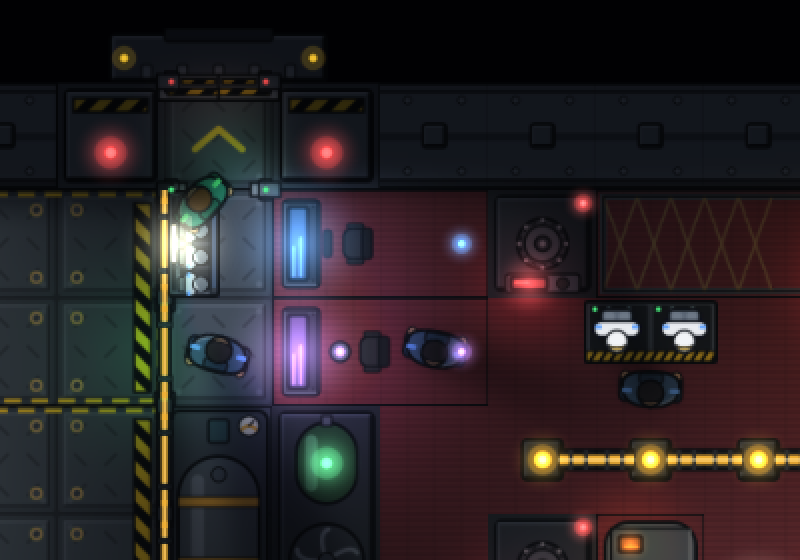
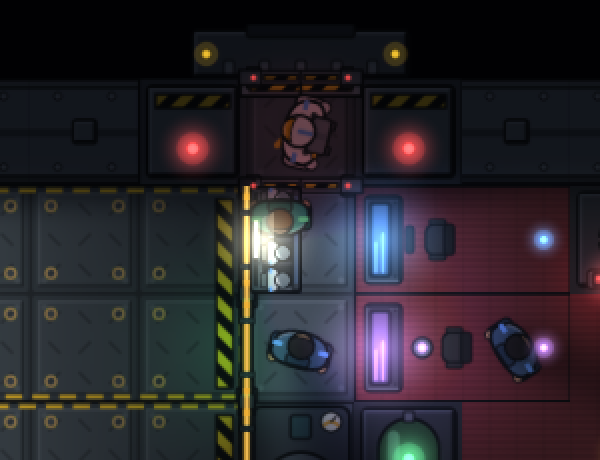
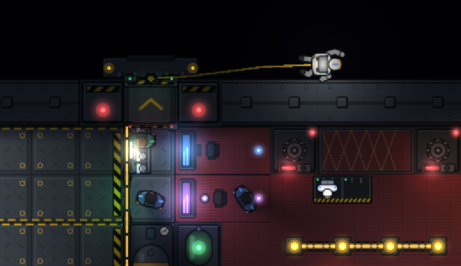
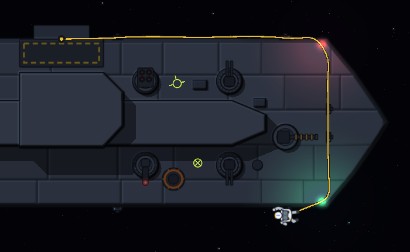
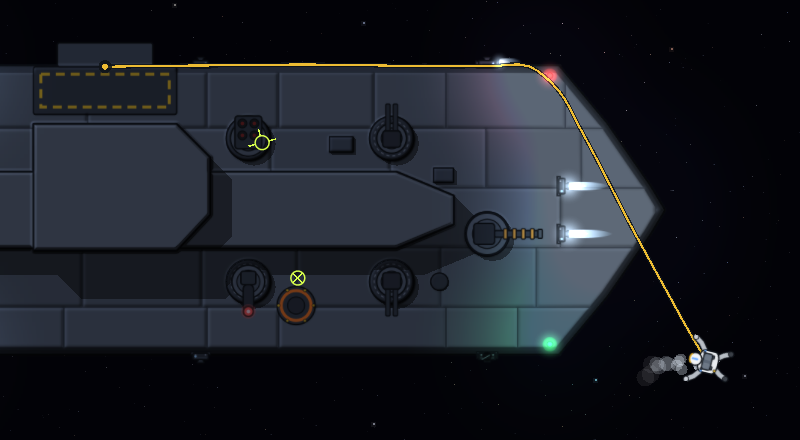
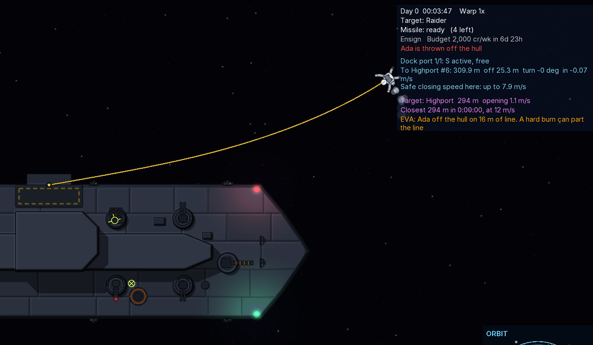
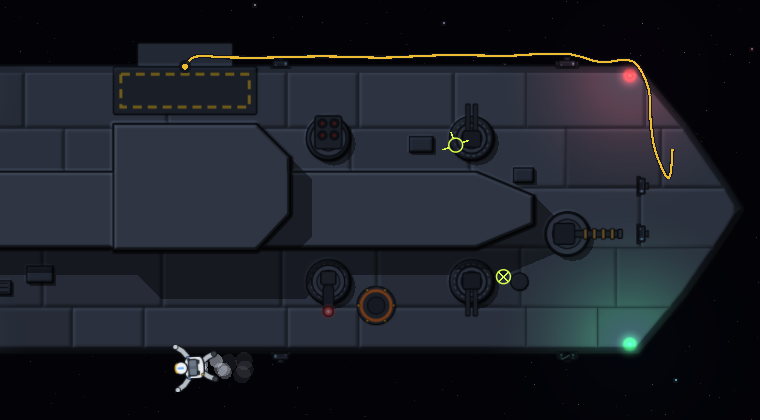
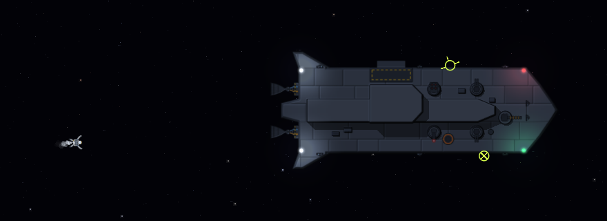

# EVA: suits, airlocks and work outside the hull

Crew leave the ship physically to do work that can only be done from outside: framing back up the
wrecked hull tile under an RCS block so the block fires again, plating over a holed hull tile,
working a jammed docking collar free, mounting a salvaged weapon on a hardpoint, and going out on a
line for a shipmate adrift. Nothing about it is abstracted. The suits are objects that hang in
lockers, the docking ports are airlocks that pump down and fill again, the crew member crawls round
the outside of the hull hand over hand or hops on a jetpack with a limited tank, and the tether is
a rope that drapes, wraps round corners, goes taut and can snap. What the ship does while they are
out (a burn, a turn, a collision) acts on them through their grip and their line, and its main
engines' exhaust on anyone behind them. One whose line parts and who can't get back stays out
there, adrift, until the ship comes back for them or their air runs out. The player can hold the
crew in, send one out, or call one back.

| Where | What |
|---|---|
| `interior-grid` `crew/Suit`, `SuitLockers`, `SuitOutfit` | Suits as objects; lockers; fitting a ship out with them |
| `interior-grid` `Airlock`, `DockingPortLayout` | A docking port's chamber, inner hatch, outer door and their cycle |
| `interior-grid` `HullSurface` | The ring of empty tiles hugging the hull that crew crawl along |
| `interior-grid` `HullPlating` | What the work on a holed hull tile does, an RCS block's included: framed back up to `FIELD_REPAIR` and plated |
| `ai-crew` `EvaSystem`, `EvaComponent`, `EvaEvent` | The simulation outside: grip, crawl, jetpack, rope, reel, falls, airlocks, adrift, a shipmate in tow |
| `ai-crew` `EngineExhaust` | The main engines' exhaust: how hard it pushes and burns where |
| `ai-crew` `OutsideTask`, `RetrieveTask`, `TaskRules` | Work outside the game posts (a collar, a part to mount); fetching one adrift; what waits at battle stations |
| `ai-crew` `EvaOrders` | The player's say: the ship's hold on going out, send one out, call one in |
| `ai-crew` `btree/EvaTasks`, `btree/SuitErrand` | The behavior: who goes, which port, suiting up, fetching a part, the work, coming back |
| `core` `game/Spacewalks` | The game's side: floating origin, rails warp guard, notices, morale, markers for those adrift, the orders |
| `core` `game/JammedCollars`, `CollarWear` | Collars jammed by hits, and the work outside to free them |
| `core` `game/FieldRefits`, `YardWork` | A salvaged weapon mounted from outside, ordered from the Y window away from a yard |
| `core` `game/CrewRoster`, `ui-hud` `CrewWindow`, `YardWindow` | The crew window's EVA orders; the field refit |
| `core` `render/Spacewalkers`, `DeckRenderer`, `art/DeckArt` | Drawing it: suits, crawl and float poses, tether, jetpack puffs, crates, lockers |
| `tools/art/suit_svgs.py`, `furnishing_svgs.py` | The art |

## Suits are objects

A suit is a `Suit` (kind, seconds of air, jetpack delta-v). One not being worn hangs in a locker
(`Furnishing.suits`), so a crew member who wants one walks to a locker that has one, stands at its
front and takes the suit's time to get into it; taking it off, they walk to a locker with room
and hang it up. A locker tops up the suits in it from the ship's oxygen and the jetpacks from its
propellant (`SuitLockerSystem`).

| | Pressure suit (IVA) | EVA suit |
|---|---|---|
| Locker | `suit_locker`, 4 bays, 1 x 0.5 tiles | `eva_locker`, 2 bays, 1.25 x 0.6 tiles |
| Air | 600 s | 2,400 s (40 min) |
| Getting in | 5 s | 40 s (`EVA_DON`) |
| Walking, working | normal | 60% speed, 65% work pace inside (`EVA_SPEED`, `EVA_WORK`) |
| Jetpack | none | 200 m/s of delta-v (`JET_DV`) |
| Outside | no | yes |

Ships are fitted out when they are built, and older saves when they load (`SuitOutfit`): a
pressure suit for each crew member and a spare, in lockers beside the helm and weapons posts and
spread through the rooms; and an EVA locker with two EVA suits just inside each docking port.
Crew under threat of losing the air reach for the nearest pressure suit, and take an EVA suit only
when no pressure suit can be had and the air still holds long enough to get into one.

Drawn: suited crew wear the suit's art (the clear bubble helmet and air pack of the pressure suit;
the white EVA suit with its gold visor and jetpack), standing, down and dead; a locker shows each
suit hung in it, so an empty bay is an empty bay.

## Docking ports are the airlocks

A docking port's opening (`DockingPortLayout`) is its chamber: the outer door, a sealed bulkhead
facing space, and now an inner hatch across the opening's inner edge, open at rest. Saves from
before ports had hatches get them on load. A port docked to another craft is not an airlock.

`Airlock` runs one port's cycle:

```
IN --(someone going out)--> SEALING_HATCH -> PUMPING -> OPENING_DOOR -> OUT
OUT --(someone coming in)--> SEALING_DOOR -> FILLING -> OPENING_HATCH -> IN
```

Doors take 2 s. Pumping draws the chamber's air back into the ship (time constant 4 s, done below
3% of a full atmosphere or after 30 s); filling bleeds it back in (1.5 s, done at 95% or 20 s). The
cabin keeps its air through a cycle. Anyone else in the chamber holds the hatch open; the outer
door stays open while anyone is out on the port's reel, so a crew member's line is never cut by it.
An airlock a load caught part way through a cycle brings itself back to rest. The pump runs on the
port's power, which reaches it through the opening; the hatch's frame carries it, so shutting the
hatch never cuts it (`PowerRoutingSystem`). A port with no power opens its door on the chamber's
air, which vents.

## Who goes out, and when

Every job outside is a task on the ship's board (`CrewTask.Kind.isEva`):

| Job | Posted by, when | Worked from | Work, at the EVA suit's pace |
|---|---|---|---|
| Frame an RCS block's wrecked hull tile back up (`REPAIR_RCS`) | `ShipHazardScanSystem`: the tile wrecked (integrity 0) but not crushed flat (that is yard work) | the ring beyond the edge the block sits on | `rcsRepairTime`, 40 s: framed back up so the block fires and, while the ship has patch kits, plated airtight as below |
| Plate over a holed hull tile (`PATCH_HULL`) | `ShipHazardScanSystem`: any other hull tile wrecked, not crushed, with a side open to space | the ring beside it | `hullPatchTime`, 30 s: framed back up and, while the ship has patch kits, plated airtight (`HullPlating`) |
| Free a jammed docking collar (`FREE_COLLAR`) | `JammedCollars`: a port whose collar a hit jammed | the ring outside the port's door | `collarTime`, 60 s |
| Mount a salvaged weapon (`MOUNT_PART`) | `FieldRefits`: the player's order | the ring tile nearest the hardpoint's turret mount | `mountTime`, 45 s for each tile of the mount |
| Fetch a shipmate adrift (`RETRIEVE`) | `EvaSystem`: one adrift who can't get back alone, within reach | the ring tile nearest them, then out to them on the jetpack | until they have hold of them |

Engineers (and a yard's technicians) do the work on the hull; crewmen don't. Anyone who rescues
goes out for a shipmate adrift, engineers first. At battle stations the jobs stay on the board but
nobody takes one unless the player sends them out (below).

A crew member takes a job only when they wear suits, an EVA suit with at least half its air and
half its jetpack is aboard (`EvaTasks.fitToGoOut`), and a port can cycle (`EvaTasks.suitReady`).
They hang up any pressure suit they wear, or an EVA suit too spent to go out in, get into an EVA
suit fit to go out in, and pick the port to go out by (`EvaTasks.plan`): one that can cycle, whose
door opens onto the hull's ring, and from which the hull runs round to the job within the line's
reach (40 m less 2 m spare), choosing by the walk inside plus the crawl outside (a tile of hull
costs as much as 3.5 tiles of deck). They queue for a busy airlock at its hatch.

Outside, `Spacewalk` holds the task: along the hull to the job's ring tile, the work there, then on
to another job within reach, or back in. They come back in:

- as soon as battle stations sound, unless the player sent them out;
- when the player calls them in, or holds everyone in;
- once their line has parted: nobody works untethered, so the job waits for a trip out on a new one;
- once their air is down to what the way back takes, the airlock cycle and 300 s more, and what is
  left of the work;
- when the job is gone (done by someone else, or no longer needed), or out of reach;
- after a load (the task is not saved; they finish the way back).

Back in, they hang the suit up in a locker with room.

## The player's say

Left alone, crew go out for work outside as it comes, but not at battle stations. The crew window
(I) gives the player a say over that (`EvaOrders`, `Spacewalks.order`):

- **EVA: Change**, at the top, holds everyone in: nobody goes out on their own, and anyone out
  comes back in. Change it again and they go out for work as it comes.
- **Send out**, on a crew member who wears suits and has work outside in their trade: they put
  down what they are doing and go out for it, at battle stations or held in all the same, and take
  nothing else until they are back in. With nothing outside left for them, the order lapses.
- **Call in**, on one out or on their way: back in now, leaving the work where it stands, and kept
  in. **Let out** lets them go out for work as it comes again.

## Mounting a salvaged weapon

A weapon stripped off a taken craft comes home as a crate in the hold (`part:<weapon>`, 1 m³,
250 kg; `Salvage`). Docked at a yard, its technicians fit it. Away from one, Y opens the field
refit: the yard window with only the ship's hardpoints, the salvaged weapons in the hold to pick
from for each, and **Mount on EVA**. The order is saved with the ship (`FieldRefitComponent`).

An engineer lifts the crate out of the hold, suits up and carries it out through the airlock
(`EvaTasks.FetchPart`). Out there it is part of them: its 250 kg goes with their 180 kg, so their
hold on the hull, the pull on their line and what their jetpack's delta-v buys are all reckoned for
430 kg. With it in hand their 600 N grip holds against only 1.4 m/s² of the hull pulling away. It
trails behind them on its strap. At the ring tile nearest the hardpoint's turret mount they clip it
on and work, unbolting the weapon there and bolting the new one on; the new one comes in at a used
part's condition, as from a yard, and the old one comes off in a crate they carry back in and stow
in the hold (`EvaTasks.StowCrate`).

Called in before they reach the hardpoint, they bring the crate back in and stow it. Called away at
the hardpoint, they leave it clipped on there, and the work done stands for whoever goes out next,
straight out with nothing to fetch. While the crate is still inside the order can be called off;
one lost with whoever had it (left behind adrift) ends it. A save made with a crate in hand loads
with it back in the hold. A yard's refit of the same hardpoint takes over an order whose part is
still inside, and waits for one already out.

## Jammed docking collars

A heavy hit on a docking port's footprint (a fifth of a tile's strength or more, `CollarWear`) jams
its collar, unless the craft is a station. A jammed port won't arm or latch ("the collar is
jammed"; the docking panel lists it as "collar jammed", and the helm's dock order says so and offers
the next port) until an engineer works it free from outside (`JammedCollars`), a minute at the ring
outside its door, or a yard's collar repair makes it whole. The player hears when one of their ports
jams and when it is freed.

## Out on the hull

`HullSurface` is the ring of empty tiles that touch the hull. A crew member clinging to the hull
(`ON_HULL`) is at a hug point on that ring and crawls from tile to tile at 0.4 m/s, or, when the
straight way is clear and saves at least 4 tiles of crawling and the jetpack has fuel to spare
(40 m/s kept back), hops at 2 m/s.

**Holding on.** Each tick, the force that keeps them moving with the hull point they hold is their
mass (180 kg with suit and pack) times that point's acceleration: the ship's thrust, its turn and
spin, a collision. Their line's pull is taken off it. The hull itself gives the part along its
outward normal by pushing on them: a burn that drives the hull into them only presses them to it.
What is left, a pull off the hull or a drag along it, their grip has to give: 600 N, about a third
of a g. The pull past it adds up as strain (newton-seconds), and once it reaches 15% of their grip
over a second (90 N·s) the hold breaks and they come off with the hull point's velocity. So the
corvette's RCS strafe away from them (2.5 m/s², 450 N) they hold through; its burn astern (5 m/s²)
or its main engine (12 m/s²) away from them throws them off; a collision's jolt can too.

## Off the hull

Off it (`FREE`), they are a point mass in the physics world's frame, moved by their line, their
jetpack and the hull they hit. The jetpack (90 N) flies them to where they are going or, after a
fall, back to the nearest point of the hull, and they catch hold once within 0.3 m and slower than
0.8 m/s relative to it (not in the half second after letting go), so long as the hull isn't
dragging past them harder than their grip alone could hold: through a hard burn they hang on the
line until it eases, rather than catching hold and being thrown off again. (Their line doesn't
count toward the hold: it pulls one way and then another as they swing.) Caught hold short of the
ring tile's hug point, they pull themselves over to it at crawling speed. With no fuel left they
pull themselves in along the line, 0.3 m/s. Hitting the hull stops their speed into it and some
along it; faster than 3 m/s it wounds them (12 hit points per m/s over).

## The main engines' exhaust

A ship's main engines burning throw a cone of exhaust out of each nozzle, as wide as the nozzle at
its mouth and spreading 15° either side of its axis (`EngineExhaust`). The engine's thrust is the
momentum the exhaust carries through every cross-section of the cone, so what falls on a crew
member in it is the thrust times their broadside (0.6 m²) over the cone's cross-section where they
are. Right behind the corvette's nozzles at full throttle that is hundreds of kilonewtons; a hundred
meters back, a few hundred newtons. It pushes them away from the nozzle, on the hull (their grip has
to bear it with everything else) or off it, and it burns: past 300 N, 15 health a second for each
kilonewton more. Right behind a nozzle it throws them off and kills them at once. A line through the
exhaust where it pushes harder than 20 kPa burns through (`TETHER_BURNED`).

Crawling along the hull, a crew member holds back at the edge of an engine's exhaust while it
burns ("waiting for the main engines' burn to end"), and goes on once it stops. The status panel
warns the helm before a burn of anyone, or anyone's line, behind an engine: "EVA: Ada is in the way
of the main engines' exhaust". An engine's thrust is the ship's at the stick's throttle, shared
among its working engines by nozzle area and health.

## Adrift

Off the hull with no line (it parted, or burned through), a crew member jets back to the hull,
faster the further out they are (up to 10 m/s, at a pace that would bring them back in about a
minute), so long as their pack has the delta-v to match the ship's speed and stop again, and the
ship isn't under way harder than the pack could follow. Otherwise they hold off and wait for the
ship to come back for them (an `ADRIFT` event): they stay in the world, drifting on the orbit their
speed gives them with the bubble's tidal gravity on them as on the ship, breathing their suit's air
until it runs out (`AIR_OUT`). Each of the player's crew adrift has a marker on the HUD, and rails
warp waits for them.

With the ship back near enough and slow enough, they jet back on their own. One who can't (out cold,
or a pack that can't bring them back) is fetched (`RetrieveTask`) once they are within a line's reach
of a port's reel (38 m round the hull and straight out) and drifting off slower than 0.5 m/s: a
shipmate goes out on a line, crawls to the ring tile nearest them, pushes off to them on the jetpack,
takes hold within 0.6 m and slower than 0.8 m/s, and brings them in on the line, the two of them one
mass (`TAKEN_IN_TOW`). More than 25 km from their ship (out of the physics bubble), or adrift through
a rails jump, they are left behind for good (`LEFT_BEHIND`), and taken out of the world.

## The tether

The line runs from a reel beside the airlock's outer door, 40 m at most. It is a rope of 20
segments (Verlet integration, length constraints only, 16 iterations a tick sweeping both ways,
each point pushed out of the hull): it floats slack, drapes, wraps round the hull's corners and
goes taut.

- **The reel** takes up slack on its spring at 2 m/s, so a loose line doesn't hang about in loops,
  and pays the line out as it is drawn, but locks like a seatbelt when it is drawn out faster than
  1.5 m/s, and frees again once the line has gone slack.
- **The line** stretches when it is drawn past what is paid out, locked or run out, and pulls
  back: 4,000 N per meter of stretch plus 1,200 N·s/m of damping on how fast it stretches (the
  stretch smoothed over 0.05 s, since the rope's shape jitters as it slides over the hull). It
  pulls the crew member and, equally and opposite, the ship at the reel.
- **It parts** under a pull it can't bear for long. It holds 1,750 N, a little under a g on a crew
  member, for as long as it is asked to; past that it gives, and once the pull past 1,750 N adds up
  to 100 N·s it parts, as a hold on the hull gives way past the grip. The corvette's full burn
  (12 m/s²) parts the line of anyone it throws off after about a second and a half. A burn astern
  (5 m/s²), however long, swings them round the hull's corner with the line's pull peaking near
  1,900 N, but each peak passes too quickly to part it. It parts at their clip: the loose line
  whips back and the reel's spring winds it in. Untethered and adrift, they jet
  back to the hull while the pack has fuel, and crawl back to the airlock.
- **Adrift**: with no line and no way back, they wait out there for the ship (above).
- **Winched in**: one who can't climb (out cold, or dead) is wound in by the reel at 0.5 m/s while
  their weight on the line is under the motor's 400 N, and pulled into the airlock at the door.

A burn of 4 m/s² away from a crew member on the side of the hull throws them off: the reel locks, and they
swing on the line like a pendulum round the hull's corner, the line's pull peaking at the bottom of
each swing above their 720 N weight in the burn. When the burn ends they jet back to the hull.

## In the game

`Spacewalks` (core) hooks the crew module's EVA to the game:

- The exterior world's floating origin shifts carry crew off the hull along with it, rope and all.
  A ship's body made again (the bubble rebuilt) or new (come into the bubble) re-anchors them from
  where they are relative to the ship.
- **Rails warp waits** while any of the player's crew are on an EVA, in the airlock or outside: "Crew
  are out on EVA: Ada is outside". Other ships' crew outside at a rails jump are taken to be back
  in by its end (their job put down), or left behind if their port is gone.
- **Notices**: out on EVA, back in, thrown off the hull, caught hold again, the tether parted or
  burned through, caught in the exhaust, adrift (and for how long, once they are back), taken in
  tow, out of air, left behind. Someone left behind costs the rest of the crew morale as a death
  does.
- **The status panel** says who is out and where while anyone is ("EVA: Ada on the hull, 16 m of
  line out. A hard burn can throw them off the hull"; off it, "A hard burn can part the line"), so
  the helm knows before it burns.
- **The vacuum alarm** leaves out a docking port's chamber while its hatch is shut for a cycle
  (`ShipAlerts.chamber`): pumped down for someone going out, it is empty on purpose, so the HUD no
  longer counts a room at vacuum and reads the cabin as VACUUM all the while someone is out.
- Saved: the phase, where they are and how fast they move relative to the ship, the line paid out
  and the port. The world-frame state and the rope's shape are rebuilt after a load.

Drawn, in the deck view and from outside: the figure in the crawl's two alternating frames, turned
along the hull, or floating free, seen from behind with the jetpack on their back; the tether as a
yellow line with a dark edge from the reel, curved through the rope's points; the jetpack's puffs
blown against its push; and in the deck view, where the light map leaves the outside of the hull
dark, the suit's lamps lighting the plating round them.

`tools/playtest/eva.sh` plays it through in a real window and takes the screenshots;
`tools/playtest/eva-jobs.sh` plays the other jobs, the crew window's orders, and a crew member
thrown off, caught in the exhaust and fetched.

## Screenshots

From `tools/playtest/eva.sh` on the patrol corvette, with the hull tile under its starboard bow
RCS block wrecked.

The engineer at the EVA locker by the bridge, getting into one of its two suits:



In the docking port's chamber with the inner hatch shut behind them, while the pump draws the air
back into the ship:



Out on the hull in the deck view, the line running back to the reel by the door; one suit is left
in the locker:



From outside, at work at the starboard bow block, the line round the bow:



A burn astern, the bow blocks firing, throws them off ahead of the bow; they hang on the line round
its corner and jet back:



A second after the burn, swung up over the bow on the line, which holds; the status panel warns the
helm:



A full burn ahead parts the line at their clip and the reel winds it in, while they fall astern:



Well astern with no line, jetting after the ship. They catch hold, go in, come out again on a new
line and finish the block:



## Judgment calls

- **The docking ports are the airlocks.** The chassis data has an `airlock` auxiliary part, but no
  ship uses it and it has no layout of its own; every ship has a docking port, and a port's opening
  is already a chamber between the deck and space. Adding the inner hatch made it an airlock.
- **Tiles are 1 m**, so the corvette's 18 x 6 hull is 48 m round: the 40 m line reaches most of
  it from the one port, and the crew pick the shortest way round.
- **The hull they crawl on is the deck plan's outline**, the one the RCS blocks are bolted to, not
  the hull art's. Seen from outside, the corvette's nose stands proud of it, so a crawl round the
  bow crosses the nose's plating, as the bow's RCS blocks already sit on it; and at the stern the
  outline runs about a meter behind the plating between the engine bells, so crew holding on
  there look to be hanging off it.
- **Grip and line numbers.** The grip is a suited human's: a third of a g to hold on with. The
  line is weaker than a real one, so that a tether parting is something the ship the player flies
  can do: the corvette's full burn parts it, and the swing from a burn astern doesn't. Two
  playtests set it. With a line that simply snapped at 2 kN, the hull's rub on the crew member
  took enough of a full burn that the line held. At 1.6 kN, a 3 s burn astern swung one round the
  bow hard enough to part it. Measuring the line through each manoeuvre showed a full burn's pull
  stays high while a swing's only peaks, hence a line that bears its rated pull indefinitely and
  parts on how long it is pulled past it.
- **The knocked-out are winched in** rather than left: a reel motor is the obvious safety feature,
  and the alternative is a body on a line until someone else suits up.
- **Not at battle stations**, and called back in when they sound, as the original ask said; but
  the player can send one out all the same, so the jobs wait on the board instead of coming off it.
- **The crate is part of the crew member.** It isn't a body of its own on a line of its own: it is
  clipped to their harness, so it moves with them and adds to their mass. A turret's base stands on
  the hull over its mount, a tile or two in from the hull's side, so it is worked from the nearest
  ring tile, as the other jobs are.
- **The old weapon fires until the swap.** As at a yard, the weapon on a hardpoint stays in action
  until the new one goes on.
- **The exhaust is a cone of momentum**, not a gas simulation: enough to say where it is lethal,
  where it only pushes, and where a line burns, which is what the crew and the helm need.
- **An RCS block's tile is plated like any holed hull tile.** Mending a block from outside used to
  frame its tile back up and leave it leaking till a yard. The corvette's starboard bow block sits
  on a hull tile behind the machinery in the bow corner, where nobody inside can reach to patch it,
  so a hit there emptied the cabin for good, and with the cabin empty nobody could change into an
  EVA suit to fetch a shipmate (a suit comes off only where the air is fit). The engineer out there
  now plates it while the ship has patch kits.
- **An EVA suit goes out with half its jetpack as well as half its air.** In a playtest, an
  engineer fetched in off an empty pack went straight back out to her job on it, and thrown off
  again would have been adrift again with no way back. Now she hangs it up to fill (a locker fills
  a pack from empty in 5 minutes) and goes out in a fuller suit, or waits for one.
- **The airlock chamber is lit from the deck it opens off.** With the hatch it became a room of its
  own with no wall to hang a light on; the stock chassis keep their lights.

## Tests

- `AirlockTest` (interior-grid): the cycle both ways, the cabin's air, a crowded chamber, the door
  held open on a line, a load mid-cycle, the port keeping its power with the hatch shut.
- `EvaRepairTest` (ai-crew): the whole job on a ship standing still, the block's tile plated with
  a kit (framed and leaking with none), called back by a fight, never at battle stations, crewmen
  leave it to engineers, no suit aboard, a port that can't cycle, a crushed tile, one knocked out on
  the hull winched in, a suit with its pack spent changed for a full one, and nobody out till a
  locker has filled a pack halfway.
- `EvaPhysicsTest` (ai-crew): the ship as a Box2D body: a gentle burn held through, a hard one into
  them only pressing them on, one past their grip throwing them off to swing on the line and jet
  back, one along the hull too hard to catch hold through (once thrown off, they stay off on the
  line until it ends), a full one along the hull parting the line and the reel winding the loose
  line in, a full burn snapping it and leaving them behind, a short one parting it so they come in
  and go out again on a new line, a floating-origin shift.
- `SpacewalksTest` (core): the patrol corvette's engineer mending a block with rails warp waiting,
  the notices and the status line, the corvette's full burn parting the line of one at its bow
  block while the swing from a long burn astern doesn't, and a save made while they are outside
  loading with them still out there.
- `EvaJobsTest` (ai-crew): a holed hull tile plated from outside, work the game posts, the jobs
  waiting at battle stations.
- `EvaRetrieveTest` (ai-crew): one adrift jetting back once the ship comes back for them, one out
  cold fetched on a line and brought in, nobody going out beyond a line's reach, air running out.
- `EvaExhaustTest` (ai-crew): the exhaust's push near the nozzle and far back, one behind a nozzle
  thrown off and burned to death, a crawler holding back from a burn and going on after it, a line
  past a nozzle burning through.
- `EvaOrdersTest` (ai-crew): sent out at battle stations, held in but sent, called in and kept in
  till let out, the hold calling everyone in, no work in their trade.
- `EvaCrateTest` (ai-crew): a part fetched from the hold, carried out with its mass on them, set
  down at the work and the old one brought back in; called in with it, back in the hold; called away
  at the work, the part and the work left for the next trip.
- `JammedCollarsTest` (core): the corvette's jammed port won't arm until an engineer frees it from
  outside; held in from the crew window, nobody goes until one is sent.
- `FieldRefitsTest` (core): a salvaged railgun mounted on the corvette's nose from outside and the
  coilgun brought in to the hold; a save with the crate out in hand.
- `SpacewalksTest` (core) also: one adrift with a marker and the notices, and one on the hull behind
  an engine warned of and killed by a burn.
- `PlayerShipStatusTest` (core): the corvette's airlock pumped down for someone going out is no
  vacuum alarm, and the cabin reads full.
- `ArtNamesTest`: every suited, crawling and floating figure and every furnishing has its art.

## Not yet

- A body adrift isn't fetched: only the living are.
- RCS jets don't push or burn anyone; only the main engines do. Ships whose engines are drawn in
  their hull art, with no engine systems in their layout, have no exhaust either.
- A crate is clipped to whoever carries it; one let go of has no body of its own to drift away.
- Mounting is for weapons only: the yard's other refits (systems, decks) aren't field work.
