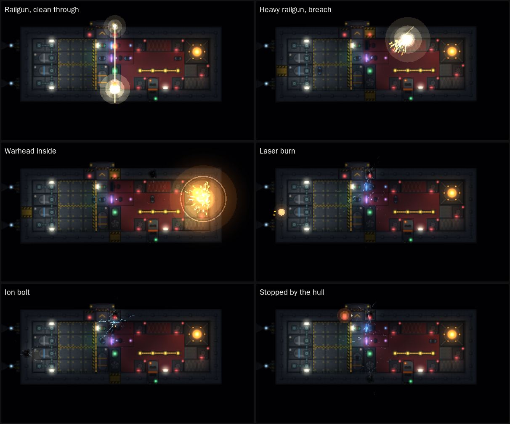

# Lighting: Box2D lights from the art's emissive layers

## What it does
- **Inside a craft** (deck view), most of a room's light comes from **wall lights** (`decor/wall_light`), each washing the half of the room in front of its wall with broad light while the craft has power. Every glowing part of the other art drawn on a deck is a light too: each mounted system's lamps, screens and glow, live power conduits, and fires. Wall lights and the bigger parts cast [box2dlights](https://github.com/libgdx/box2dlights) rays, so walls, hull and shut doors throw shadows; the small ones (status lamps, conduit studs) only glow.
- **Crew** cast shadows: each crew member in view is a small circle in the shadow world (half their size, so the light's soft edge still falls across them and they are not left in their own shadow).
- **Bulkhead doors** light the floor either side of them in their lamps' color, red shut and green open, a short way (1.6 tiles, at 0.35), while the craft has power. Door lamps are added after every other light on a deck, so when a scene has more lights than can cast at once (`SceneLighting.MAX_LIGHTS`) they are the first left out.
- **Power** decides what is lit. A system's lights are on while it runs (`SubsystemComponent.isOperational`), so a wrecked, unpowered or switched-off system goes dark. With no reactor running, the ambient light drops from cabin light to near darkness.
- **Outside**, a hull's emissive layer (navigation lights, bridge glazing, reactor and shield glow) is drawn as a glow on the craft, hull art or not. A light over a system's footprint follows that system; navigation lights follow the craft's power.
- **Outside**, the hull art is also lit (`ExteriorLighting`): a dim starlight ambient (`ExteriorLighting.AMBIENT`), brightened and colored by what gives off light near it (see [Light outside](#light-outside)).
- **O** turns the lighting off and on, in the deck view and outside alike.

## Where the lights come from
`tools/art/extract_lights.py` reads the `<g id="emissive">` group of every SVG in `assets/art` and writes `assets/art/lights.json`. Shapes that touch are one light (a lamp's white center, colored body and halo), its color the most saturated one among them (the accent), its size the group's bounding box. Re-run it whenever the art changes; a test fails when `lights.json` and the SVGs disagree about which art glows.

Entries are keyed `<folder>/<name>`, in SVG units with y up and the SVG origin at (0, 0); `canvas` gives the art's bottom-left corner and size, so art placed from its corner (components, tiles) subtracts it.

## How bright a light is
The art says, with attributes on any shape of the light or on a `<g>` around its shapes inside the emissive group:

| Attribute | Meaning | Without it |
|---|---|---|
| `data-light` | `glow` (lights nothing around it), `point` or `cone` | Judged by size: parts of at least 8 SVG units can light the room |
| `data-reach` | How far its light reaches, tiles (meters outside) | 0.6 + 2.2 per tile of the part's size, up to 7 |
| `data-intensity` | How strong it is, 0-1 | 0.35 + 0.65 x the part's opacity |
| `data-direction` | A cone's direction, degrees, 0 = +x, 90 = up the canvas | -90 (away from a wall at the top) |
| `data-cone` | A cone's half-angle, degrees | 45 |

A system lights the room from at most 3 of its parts, those marked `point` or `cone` first, then the biggest; the rest only glow. So a designer tunes a light where it is drawn (in `tools/art/generate_svgs.py` for the base art), and the extractor copies the settings into `lights.json`. The wall light, for one, is a cone 90° each side, so a half circle against its wall, reaching 6 tiles at 0.7. The game turns the settings into a light the same way everywhere, and the room's ambient light (`SceneLighting`) sets how dark the unlit corners are.

## Heat
Hot steel gives off light as a black body (`BlackBody`). A deck tile above the Draper point (798 K) glows, power or not: a dull red at first, brightening with the fourth power of its temperature through orange to about a fully involved fire's 1500 K, where it is at full strength. The color follows the Planckian locus (Tanner Helland's fit). Every glowing tile is a glow spot over itself, its size and opacity rising with the square root of the brightness so faint heat still reads; once it is at 15% brightness or more it also lights the deck around it, up to 2.5 tiles at 0.7. Heat lights come after the fires and before the door lamps, so in a big fire the door lamps are the first left out. Heat too cool to glow, and its spread, is the developer console's `heat` overlay (see `documentation/dev-console/Design.md`); thin air is told by sound, not drawn.

## Wall lights
A wall light hangs on one edge of a floor tile, shining into that tile; it takes no room, so the tile stays free for a system, a door or anything else. Its art's top edge sits against the wall, and the art turns with the wall it hangs on.

`DeckArt` draws `decor/wall_light` (or `wall_light_unpowered` when the craft has no power) at each one. A layout lists them in `chassis.toml`:
```toml
lights = [
  { x = 3, y = 2, side = "TOP" },   # the tile, and which of its edges the light hangs on
]
```
`lights = []` means none. A layout without the key gets lights worked out from its rooms (`WallLightLayout`, in `interior-grid`): each room gets lights on its walls until every floor tile is within 3.5 tiles in front of one, the wall lighting the most dark tiles first, never two within 3 tiles, and never behind a system. The ship editor's **Auto-place lights** writes exactly that into the layout, so it can be adjusted by hand from there, and its **Light** tool hangs or takes down one at a time (see `documentation/ship-editor/Design.md`). The base layouts carry their auto-placed lights. A saved game keeps a deck's lights with its grid. `WallLightLayout.lightsOf(grid)` gives the lights a deck has either way, for anything that draws or lights them.

## Light outside
`ExteriorRenderer` (with `setLighting`) lays a box2dlights light map over the hull art each frame, from:

| Source | Light |
|---|---|
| A hull's own emissive lights that reach past their glow (navigation lights, glazing, reactor glow) | As the art says, at the hull's pose; on with the system or the craft's power |
| Each main engine's plume (`ThrusterFlames`, from `ExteriorArt.engineNozzles`) | `DRIVE`, the blue-white of the plume art, pushed a little down the exhaust, reach 8x the nozzle's width (6 m at least), as strong as the plume is long |
| A burning missile's plume | `ENGINE`, orange-white (a chemical rocket), 8 m |
| A gun firing: each round the first frame it is seen, where it left the gun | A flash, 9 m (4 m for point defense), gone in 0.15 s (0.08 s) |
| Both ends of a firing beam | Pale blue, 5 m at the gun and 8 m where it lands |
| A decoy flare | White, 10 m |
| A warhead going off or a missile shot down (`ExteriorRenderer.explode`) | A flash, 45 m, fading over 0.9 s |
| Each RCS jet (`ThrusterFlames`, from `RcsNozzles.nozzles`) | `THRUSTER`, the cold blue-white of `rcs_puff`, 4 m, as strong as the jet is long; it also glows in the glow pass |
| A hit a craft's shield cloud took part of (`ShieldParticles.collect`, from the cloud's hit log) | A flash of shield cyan where it met the cloud, 6 to 20 m and 0.25 to 0.5 s by how much the cloud took |

### Flames
`render/ThrusterFlames` gives every main engine and RCS nozzle one figure a frame, its level, and both its flame and its light come from it, so they always agree. The level follows how hard the nozzle fires, but not at once: a main drive spools up from cold to full in 0.35 s and dies down in 0.2 s; an RCS jet opens in 0.04 s and shuts in 0.07 s, and a jet opening from cold kicks 35% past full for 0.09 s, as a valve popping does. A main engine's plume follows the thrust `EngineThrust` gives it: none while it is switched off, unpowered or disabled, shorter as it is damaged, and none with the tanks dry. On top, each flame flickers by its own seed (6% either way for a drive, 12% for a jet), the same flicker for its length and its light. A barely firing flame is drawn narrower and fainter. Nothing moves while no time passes.

Flames are drawn after the light map, additively, so the light map does not darken them and they glow over what is behind them. A craft drawn as its outline shows its firing RCS as short orange lines instead.

### Shield particles
`render/ShieldParticles` draws each craft's shield as the cloud the simulation keeps (`ShieldCloudComponent`, combat-sys Design 5.11): one fleck per 0.4 kg of its emitters' capacity (400 to 5,000), each 5 cm across and soft (solid at its heart, fading smoothly to its rim), on the same curve the hits are resolved on, in the body frame. At rest the flecks are sparse dark gunmetal, lying as the cloud's resting layer does (thick where emitters overlap or the crew trim it, thin where an emitter has died: each fleck's place in its orbit is a share of the layer's mass, so they bunch and thin as it settles), drifting along the curve at 0.6 to 2.2 m/s either way while each swings slowly in and out of it and above and below the hull's plane; those below are drawn under the hull art, those above over it, both before the light map so it lights them, and they shade and shrink a little below the plane. Where the emitters gather a region, as many flecks as it holds mass stream in from nearest (at most 30 m/s), packed by the region's raised cosine, and glow shield cyan (`#4fd1ff`) the denser it is. Each hit in the cloud's log flashes white and cyan where it met the cloud and lights the hull there; the flecks it plowed through are thrown along the shot, white-hot and cooling, the lost ones fast and fading over 1.4 s, the kept ones slowed and pulled back in over the cloud's 5 s rejoin. A beam burns its flecks where they are. Flecks for the mass adrift leave the ship's frame, those where no working emitter holds the curve first: they keep the velocity they had (their orbit's, plus the ship's spin and motion) in space and dim, so a ship that turns or burns leaves them behind, and they fade as the mass is lost or stream back when it is recaptured. They are kept as offsets from the ship along the world's axes, so the floating origin moving (a jump of over 30 m/s in a frame) takes nothing with them. Lowered shields stream into the nearest emitter and vanish into it; raised, they come out of it and swing back out to their orbits. Each emitter's projector glows on the hull, brighter as it draws, toward orange as it heats, and blinks red-orange while tripped. The glow is drawn after the light map, additively, with the flames. Flecks are drawn at least 1.2 pixels across, fainter when that is bigger than they are, and fade out as the view zooms out from 0.2 to 0.4 m a pixel, where they would only be noise; the bubble, the infill and the glow of hits stay. A faint bubble traces the curve, smoothed round its center (a Gaussian over 3 of its 96 samples, never more than 0.6 m inside the shield's own curve) so it doesn't follow every step of the hull: a thin cyan line over a soft band the cloud's depth wide, drawn as one continuous strip whose stretches share their edges, so nothing doubles up where they meet, as bright as the share of the cloud held, dimmer where the resting layer is thin (a dark notch where an emitter has died) and brighter where it is thick, and up to five times brighter where a region packs it, so it fades as the cloud drifts loose or is torn away. An infill fills the bubble, faint at its center and rising toward its rim (as the fraction of the way out cubed), as bright as the share of the cloud held: the bottom one (0.11 at the rim) under the hull, kept off it by marking every hull's fixtures in the stencil buffer, and the top one (0.05) over it. The deck view shows the shield round the craft drawn as decks too, with its bottom infill and the flecks below the hull's plane kept off the deck the same way, and no top infill. The flecks only show the simulation and never feed back into it. `tools/playtest/shields.sh` parks a gunship beside the player, fires an autocannon round from 2 km and a railgun slug from 6 km into it and turns its reactors off, with screenshots. `tools/playtest/shield-emitters.sh` fits two more emitters to that gunship, wrecks the stern one so its share leaves from astern and opens a weak spot there, mends it, and trims the cloud to the bow and back. `tools/playtest/shield-look.sh` flies a gunship out, closes in from outside and from the deck, and zooms far out.

Nothing casts shadows outside: every light is x-ray (see open questions), so the light map only colors and brightens the hulls near a light, and lifts space itself a little around a blast. The order is hull art, then the light map, then the flames, then everything that is its own light or a marker (outlines, rounds, beams, explosions, the glow pass), so the light map never darkens those. Up to `ExteriorLighting.MAX_LIGHTS` lights a frame, hull and engine lights first, then flashes; at most `MAX_FLASHES` flashes fade at once, the oldest dropped first. Flashes age with the frame's delta, so they hold still while the game is paused.

### Hits seen from the deck
`render/DeckImpacts`, drawn by `DeckRenderer`, shows each `HullHitEvent` (combat-sys 5.8) on the deck of the craft it struck, wherever that craft is in view, by what struck and what it did. A round the hull stops rings it: a flash and sparks back off the outside, the struck plate glowing orange and cooling over up to 1.8 s, and a few flakes of spall off its inner face (a shower from a hard hit). A glancing round skips off in sparks along its reflection. A round that gets in bursts through: a flash inside that lights the room through `SceneLighting.addFlash` (shadowed by the walls, and cast before the decks' own lights so the light cap never drops it), sparks, molten droplets, torn plating and dust thrown on along its path; one that goes clean through leaves a streak across the deck for 0.25 s and bursts out of the far side too. A warhead that went off inside is a fireball out to its blast radius, a shock ring running a tile past it, and sparks, debris, droplets and smoke every way; one that went off on the outside is a burst against the hull (its fragments are hits of their own). Lasers and beams melt rather than shatter: the plate glows white hot and cools through orange to dull red over 2 to 4 s while droplets keep coming off it, inside as well once it has burned through. An ion bolt breaks nothing: blue arcs crawl from where it landed over the 2 tiles it stunned for 1.1 s, flickering, with a blue light. A ram or a crash is mostly wreckage and dust. A hit the shields took entirely shows nothing inside. Everything scales with the hit's severity. Particles thrown into the ship slow in the air and bounce off walls and closed doors; out through a breach or off the outside they fly on. Dust and wreckage are drawn with the deck, under the light map; flashes, glowing plate, sparks, droplets, fireballs, streaks and arcs after it, additively. They are cosmetic, with a random source of their own, and age with the frame's delta, so they hold still while the game is paused. `tools/playtest/deck-hits.sh` stops the world, fires each kind of round at the player's ship and sets off a warhead in its hold, stepping a few frames at a time with screenshots.



## Code
All in `core`, package `com.hawkwing.RingsOfIron.lighting`:

| Class | Does |
|---|---|
| `EmissiveLights` | Loads `lights.json`. |
| `DeckLightRig` | Places a deck's lights in its body frame: wall lights at their wall, systems at their mount and rotation, conduits, fires (which flicker), hot tiles. |
| `BlackBody` | The color and brightness of a body at a temperature, for hot tiles. |
| `HullLightRig` | Places a hull's lights in its body frame. |
| `HullArt` | Which chassis (and so which hull art) a craft wears. |
| `LightBarriers` | The deck edges that stop light, as merged segments. |
| `SceneLighting` | Owns the shadow world and the `RayHandler`; each frame takes the decks and hulls in view, draws the light map, then the glow pass. |
| `ExteriorLighting` | The light map outside: its own `RayHandler` of x-ray lights over a starlight ambient, from hull lights, nozzles and fading flashes. |

Shadows use a Box2D world of their own in world meters, apart from the crew's interior worlds (tile units, one per deck) and the flight world (10 m units): one static body per deck in view, its barrier edges as fixtures, moved to the craft's pose each frame and rebuilt when a door or wall changes, and one small circle per crew member in view, moved onto them each frame. Mounted systems cast no shadows, since their lights sit inside them.

Lighting uses diffuse mode: the light map multiplies the scene, so art under full light shows as drawn. Anything drawn from an emissive layer belongs **after** the light map (between `renderLights` and `renderGlow`), or the light map darkens what should be a light. So after the light map, `DeckArt.glow` draws the `glow/` region (the emissive layer alone) of everything on the deck that is lit: running systems, live conduits, powered doors and wall lights, and fire. A system without power is skipped, so its dark art stays dark.

## Open questions
- Sunlight and shadows outside: wanted in principle, but still to be decided, and nothing is built for it until then. A directional light over the flight world would shadow each hull's own art, since box2dlights darkens everything past an occluder's edge, and flat 2D hull art has no height for the light to fall across.
- Doors carry no power state of their own: their lamps follow the craft's power.
