# Ship hulls

The hull art of the shaped ship types, drawn by `tools/art/generate_svgs.py` from their layouts in
`assets/data/chassis.toml` (the collision layer left out). Bow to the right; one tile is 1 m.

| Hull | Owner | Size | In the game |
|---|---|---|---|
| Interceptor | Patrol | 15 x 7, 91 tiles | sold to an Ensign |
| Courier | Selene | 17 x 9, 99 tiles | sold |
| Surveyor | Selene | 24 x 9, 170 tiles | sold |
| Ore Barge | Selene | 18 x 13, 199 tiles | sold |
| Marauder | Void Raiders | 26 x 12, 215 tiles | spawned by name |
| Hospital Ship | Selene | 26 x 19, 310 tiles | spawned by name |
| Propellant Tanker | traders | 38 x 11, 356 tiles | spawned by name |
| Destroyer | Patrol | 33 x 19, 453 tiles | spawned by name |
| Reaver | Void Raiders | 45 x 17, 548 tiles | spawned by name |
| Heavy Cruiser | Patrol | 42 x 23, 592 tiles | spawned by name |
| Bulk Carrier | traders | 46 x 15, 612 tiles | spawned by name |
| Passenger Liner | traders | 42 x 19, 674 tiles | spawned by name |
| Carrier | Patrol | 50 x 33, 1122 tiles | spawned by name |

## Interceptor

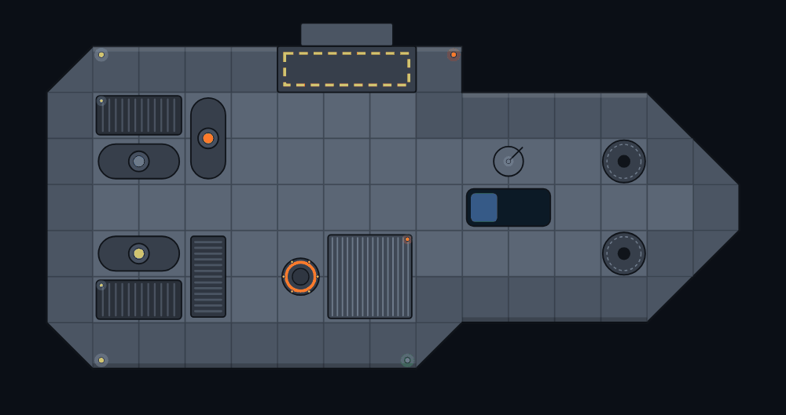

## Courier

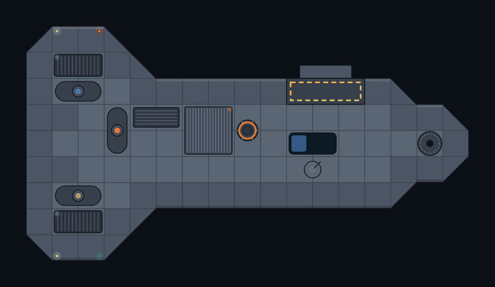

## Surveyor

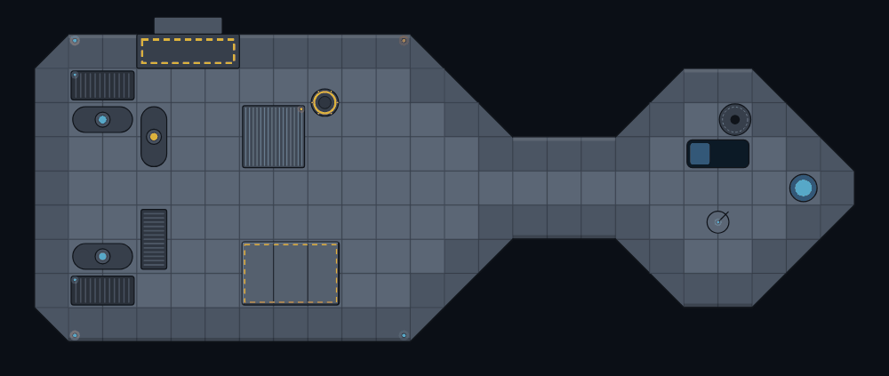

## Ore Barge

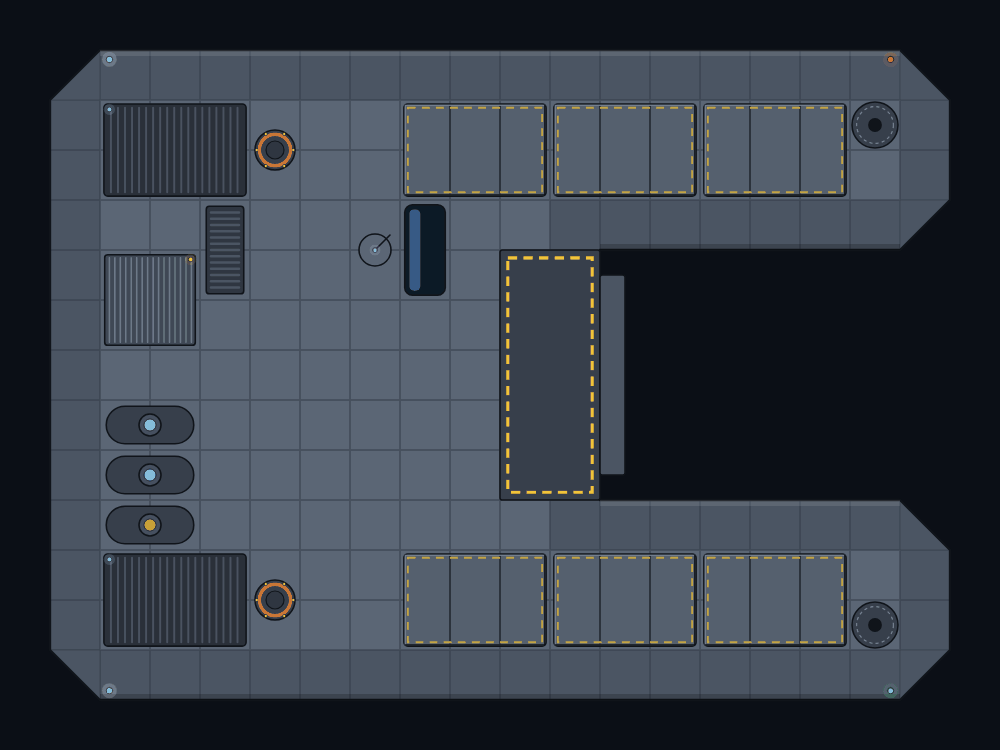

## Marauder

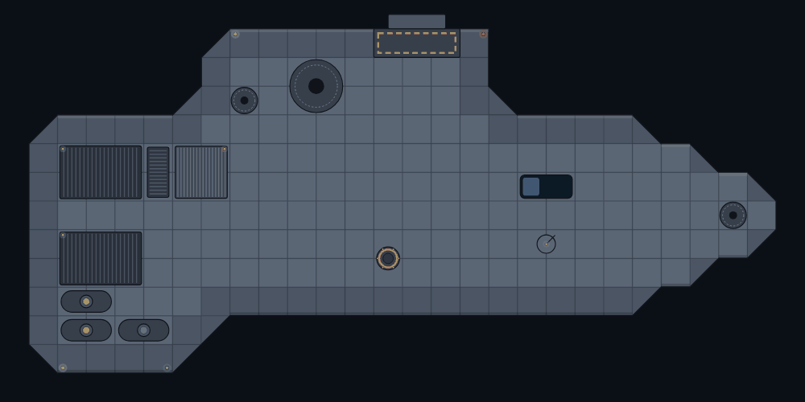

## Hospital Ship

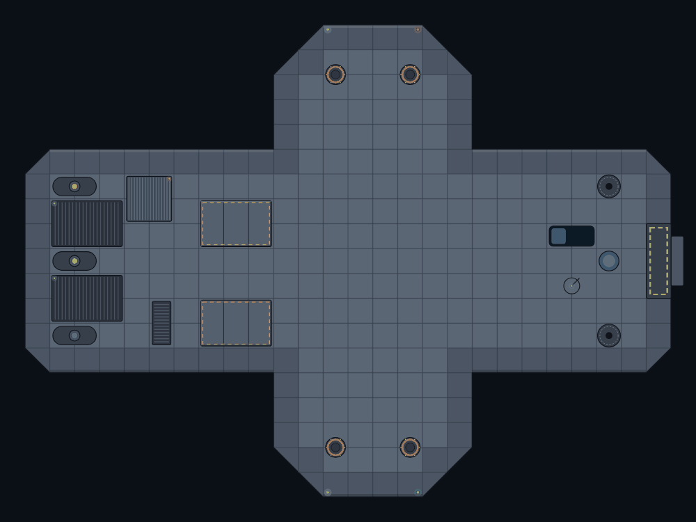

## Propellant Tanker

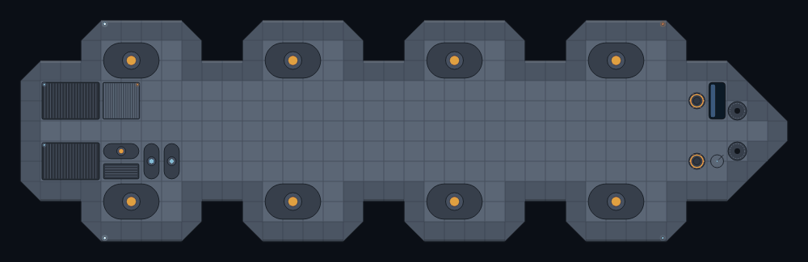

## Destroyer

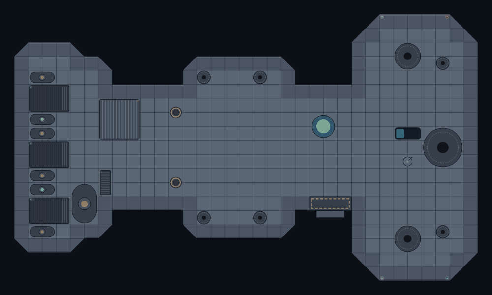

## Reaver

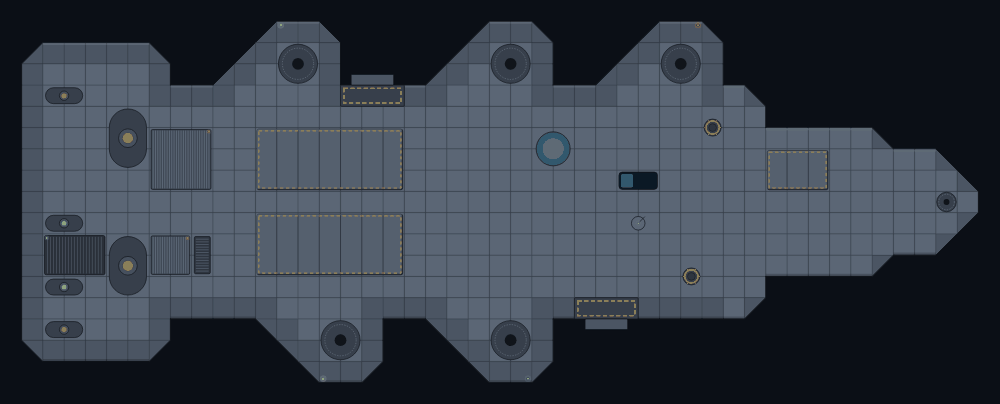

## Heavy Cruiser

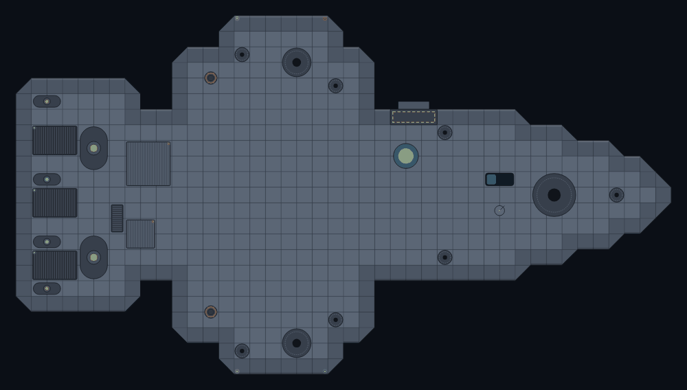

## Bulk Carrier

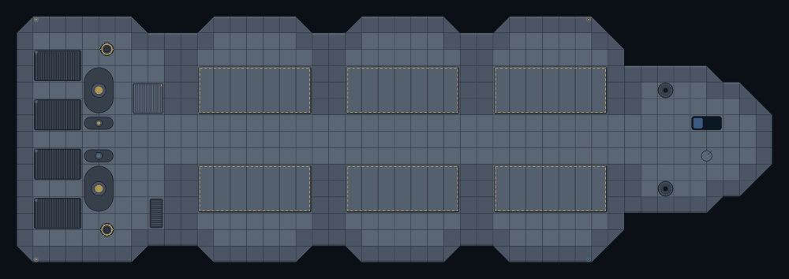

## Passenger Liner

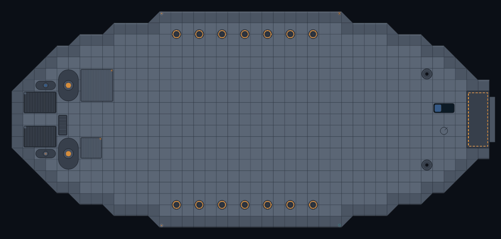

## Carrier

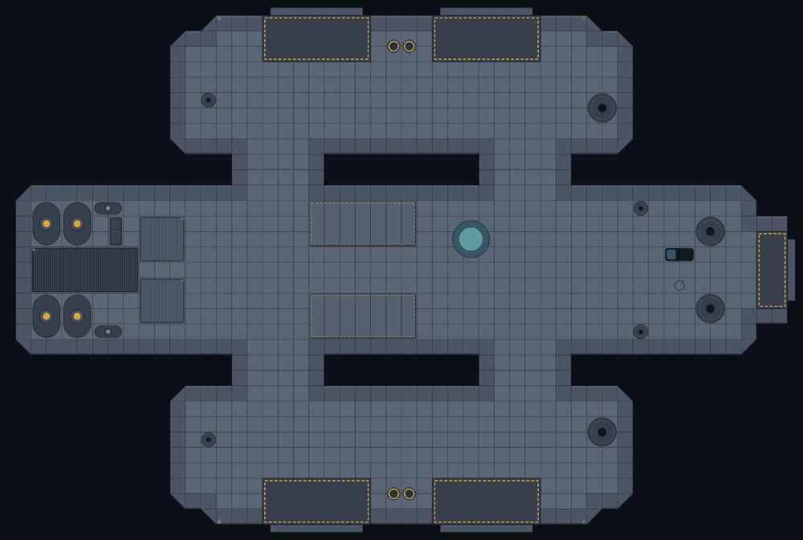
