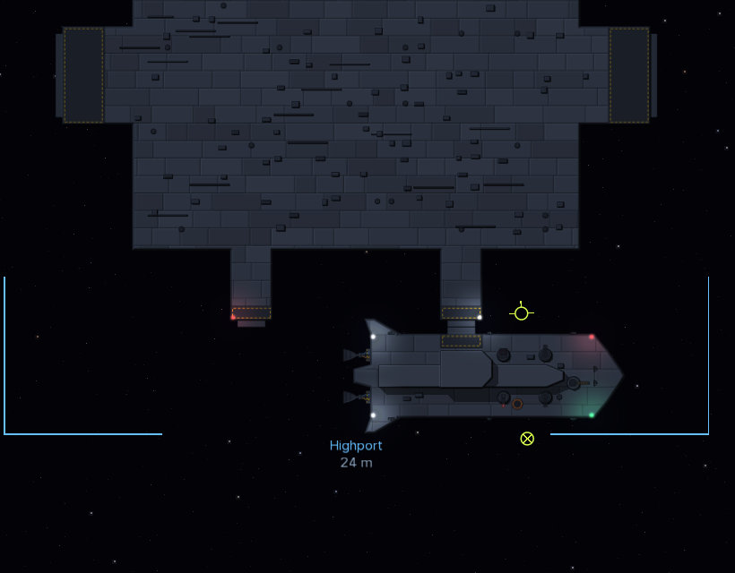
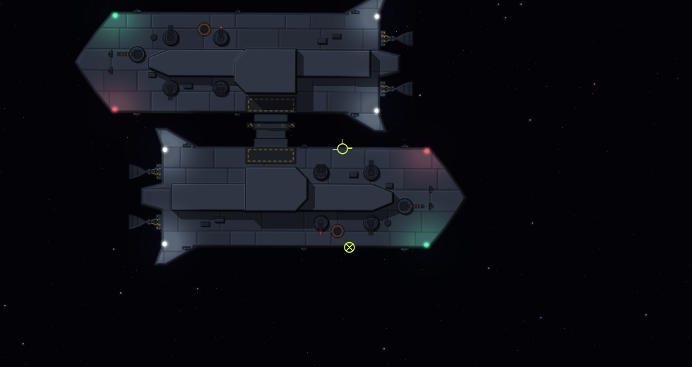
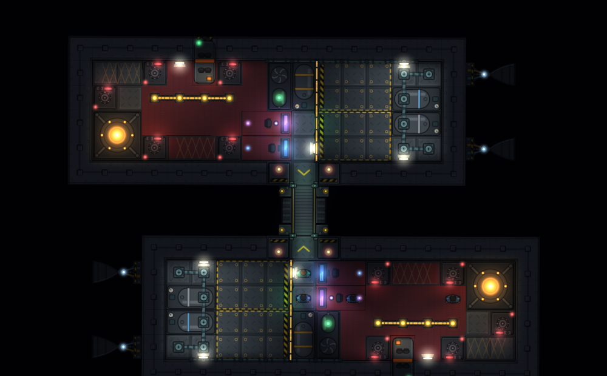
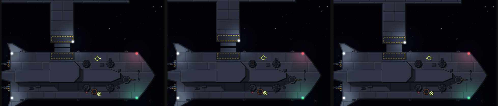
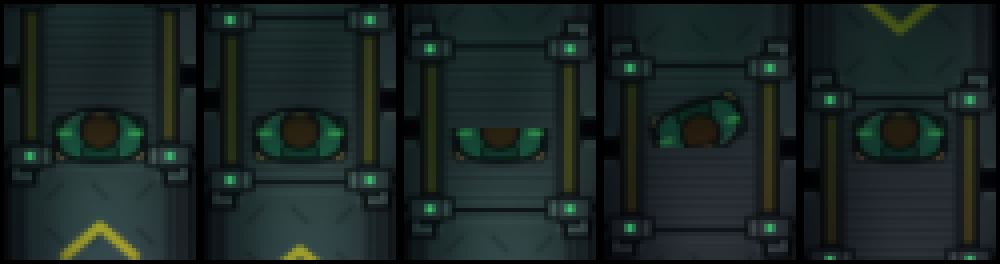
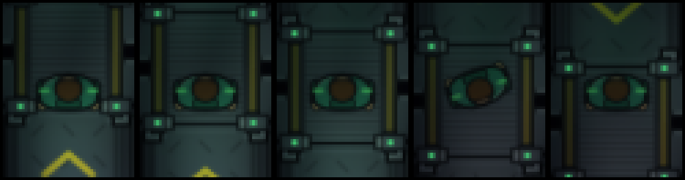

# Stations & Docking Design

## Overview
Stations are physical places, not menus. A station is a full interior grid that the player and crew walk through, built from a station blueprint, with its own NPC crew. Ships reach a station (or another ship) by flying a docking port onto a matching port until the two latch. Everything that crosses the connection (cargo, refit parts, people) is carried through the joined airlocks tile by tile, and it takes time.

This document collects the design decisions for stations, docking ports, the docked connection, moving goods across it, forcing doors, and refitting while docked. It spans several modules; the sections below name which module owns each part.

## Implementation Dependencies
- **`interior-grid`**: station grids, the docking port subsystem and its footprint, doors and power.
- **`physics-exterior`**: magnets, spring joints, weld joints, break limits.
- **`macro-sim`**: stations on rails, markets, the abstract dock for freighters off-bubble, docked pairs on rails.
- **`ai-crew`**: station crew and loaders, carrying cargo and parts, forcing doors, refit work.
- **`modding-data`**: station blueprints and docking port definitions.
- **`ui-hud`**: arming ports, docking alignment readouts, the refit UI.

## What Exists Today
Stages 1 (station grids and docking ports), 2 (walking and air across a dock), 3 (station crew carrying cargo across), 4 (forcing doors and faction standing), 5 (refit and repair) and 6 (freighters docking under their own power) are in. The new `stations-docking` module holds the docking logic; the other modules gained the pieces it needs.

- **Station grids.** `ChassisDef.station` marks a station layout and `StationTypeDef.blueprint` names it (`station_outpost` and `station_hub` in `chassis.toml`). `DockingData.buildStation` gives a station entity its walkable grid, systems, cargo bays and docking ports. In the bubble, `StationBodies` gives each station a kinematic Box2D body shaped like its grid, which `KinematicTransientSystem` moves along the station's orbit, so ships collide and dock with it. Stations still stay on rails.
- **Docking ports.** A `docking_port` mount is a port of any of the three sizes (`DockingPortLayout`), a `DOCKING_PORT` subsystem with a frame, an opening onto the deck and a sealed door. Ports are passive unless their mount says `active = true`. The corvette's Small port is active, so its collar can take hold of another ship's port, armed or not, as well as a station's: ship-to-ship docking for boarding works with G as at a station (no station within clearance range just arms the port), and the dock is without leave (`permitted` false) unless the other ship armed its port. Ships get their chassis' ports when they spawn; macro-sim's freighters, which fly a default hull, get a passive Medium port on the nose.
- **Docking physics** (`DockingSystem`). Each port has a density-0 collar fixture half a tile deep. An armed port's magnets pull its face towards a same-size free port within a few meters (two magnets across the face, so they also square it up, with eddy damping) and latch on contact within tolerance. An armed active port puts out a collar head (1 m for Small, 2 m Medium and Large) on a guide and a soft spring. The head carries the magnet, slides along what it touches (collars have almost no friction) and tilts up to 20 degrees on a centering spring, so it lies flat on a port that is turned away. Once it sits face on face, square to within 2 degrees and centered, it captures that port and is pulled flush onto it; it then draws in while its tilt spring turns the craft into line, and locks only when home and square (home is all the way in, or whole tiles out when the hulls would otherwise meet: see Locking Out). Fully drawn in, the two craft's own collars meet: that contact is the hard stop, so thrusting into a collar pushes the other craft rather than the collar into the hull. Passive magnets latch under the same 2 degree tolerance. A latch seats the pair with a damped pull at the port faces (rotation assist stands down meanwhile) and puts them exactly face to face before welding, so docked decks always line up as one. Undocking drops the weld and pushes the craft apart, and the two collars collide again at once (Box2D is asked to look for contacts between shapes that were already touching); pulling past a port size's break force or torque tears both collars off and damages the hull and door around each port. Tuning per size is in `DockingTuning`. Every polygon (hulls, station boxes, collars and heads) is made a little smaller than its outline and drawn grown back out (`PolygonSkin`), since Box2D collides on a thin skin around a polygon: ports pushed together touch where they are drawn instead of resting 0.15 m apart.
- **Clearance.** `requestClearance` asks the nearest station. One that grants it arms its nearest free port of the same size for the asking craft (for 10 minutes), and that port's collar reaches out unless the craft brings its own active collar. One that refuses keeps its ports unarmed and its collar in. A craft can still latch with its own magnets or collar, but is then docked without leave (`DockingPort.permitted` is false).
- **Rails warp.** A collar still drawing a ship in, or a latch still settling, holds rails warp back. A docked pair goes onto the rails as one body (the follower rides the leader's orbit; a station always leads) and comes back latched (`DockingBubbleHandoff`).
- **Saves.** Port state and latches are saved with the entity; the joints are rebuilt on load, so a docked ship stays docked.
- **Walking and air across** (stage 2). When the weld forms, `DockLinks` pairs each opening tile of one port with the opening tile facing it on the other as an interior-grid `GridLink` (one per pair, so a Small dock has one link and a Large dock five). Each port door opens only if its own side agreed to the dock (`DockingPort.consented`: the port was armed, and for that craft if it was armed for one); a station that refused clearance keeps its door shut. While both doors are open, air moves between the two craft's rooms through the link and the avatar walks across (`CrewMovementSystem`): out over the two collars (the link's `gap`, one tile between the hulls, drawn as floor in deck view), aboard the other craft from halfway over; a linked edge never vents to space. Undocking, tearing loose or losing the weld removes the links and shuts both doors (a door torn away stays open, and that port vents). Links are runtime only and are rebuilt whenever the weld is, so they come back after a load or rails warp.
- **Carrying cargo** (stage 3). Every station has dock hands (`StationCrew`): `LOADER` crew, one a docking port and at least two, who stand by the station's cargo bays and work for it (`CrewMemberComponent.home`). Crew now plan paths across a link (`CrewAgent.travel`): to reach another craft they walk to the nearest open link onto it and over the collars, and crew away from home take only carry jobs and otherwise walk back. When the player trades with a station that has loaders while both craft have cargo bays (`CargoLoading.canCarry`), a buy or sale is an order on the ship (`CargoOrdersComponent`) rather than an instant trade. `CargoLoading` posts each order as carry trips (`CarryTask`, one load each) on the station's task board; a loader walks to a bay of the craft the goods are leaving, takes up a load (2 m³, more slowly walking while laden), carries it across the dock and sets it down by a bay of the other craft. Each load is settled as it lands (`CargoLoading.Settlement`): in the game, `MarketCargo` buys or sells it through macro-sim's market at that moment's price, so goods are paid for only when they arrive. The trade window shows what is still on its way ("12 (+40)"). Undocking closes the orders and a load in hand goes back; U refuses to undock while a dock hand is aboard and calls the loading off, so they walk home first. Docked but on the rails together (no walkway), the loading goes on at the pace the loaders would keep. Station crew are their own faction.
- **Pressure doors** (`PortSeals`, round 2 playtest). A port door its side opened shuts by itself when the air beyond it is too thin (at or below 0.75 of standard) and thinner than its own side's, so a ship latched onto a holed one keeps its air rather than venting through the port. Shut for pressure, it still opens for whoever walks through (`EdgeWall.opensForCrew`, which `GridLink.canCross` counts as a way across) and shuts 1 s after the last one is through (`DockingSystem.crossing`, which the game points at its crew: `CrewDoors.crossingPort`), so each crossing loses a puff of air. Once the two sides' air is alike again (within 0.05, the far side above 0.75) it stays open. Each side's door holds its own air; the thin side's door is left as it was, and a door its side never opened, or one blown away, is not touched. Which doors are held for pressure is read from the doors, so nothing extra is saved. **Chosen while Joe was away** as the default most like the rest of the simulation (interior doors already open for crew and shut behind them); an airlock cycle through the collar is the later option.
- **Forcing doors** (stage 4). Standing in its own port's opening, a crew member faces the other craft's port door across the collars (`DoorForcing.target`). A shut door there is `UNPOWERED` or `LOCKED` (powered) by its port system's power (`DockingSystem.doorState`). `DoorForcing` times the work (`ForceMethod`): prying an unpowered door takes 8 s, cutting any shut door 20 s and leaves it at 0.4 integrity (so it leaks once shut again), hacking a powered one 45 s; stepping off the tile, being knocked out or the door changing stops it. Then `DockingSystem.forceDoor` opens the door (`DockingPort.forced`, saved, so it is open again after a load or rails warp, and cleared on undocking, when it shuts) and reports `DockingEvent.Kind.DOOR_FORCED`. In deck view, F pries or hacks as the door's power allows and B cuts.
- **Faction standing** (stage 4). Every forced door is a hostile act against the craft's faction (a station's, or its crew's task-board faction): `FactionStanding` takes 10 standing for prying or hacking and 25 for cutting, kept in the career (`ServiceRecord`, the `"factions"` save module; see `documentation/progression/Design.md`). Below -15 that faction's stations refuse the player docking clearance ("you forced their doors", through `DockingSystem.clearance`), and at -50 or below its crew fight the player's (`CrewService.hostility`). Two ships' crews of different factions fight as before.
- **Repair** (stage 5). Every station's yard (`StationYard`) has two `TECHNICIAN` crew besides its loaders. Ordering repairs on a docked ship (`orderRepairs`) has them work through everything damaged aboard (`StationYard.damage`): hull tiles and pieces, edge walls, systems and a torn docking collar, each a `YardTask` on the station's task board. A technician walks across the dock to the damage and works it tile by tile at the crew repair rate; each bit of work is paid for as it is done (hull 400 cr a tile, a wall 150, a system 3,000, a collar 5,000, scaled by how damaged it is). Damage no one can walk to from the dock (`StationYard.reachable`, a flood fill from the dock's links) is worked from outside at one technician's pace. When the work is done, the yard puts the air back (round 8): every room aboard is brought up to station pressure and the standard oxygen share from the station's air, at the refill's oxygen and nitrogen prices, on the same bill (`StationYard.topUpAir`; the order's quote includes it). **Chosen while Joe was away.**
- **Refit** (stage 5). A refit swaps the weapon on one hardpoint (`orderRefit`) for one the yard sells (`WeaponDef.price`), new or used (half price, and the mount is left at 0.6 condition). A loader carries the part (a crate of `part:<weapon>`) from the station's bays to the floor tile nearest the mount, and it is paid for as it lands; the technicians then fit it one mount tile at a time, and the old weapon goes back to the yard for a quarter of its price. A mount no one can walk to is fitted from outside. Undocking calls the work off and refunds a part that is aboard but not fitted. Docked but on the rails together, the work goes on in the background at the technicians' pace (a part takes 30 s to come aboard). The orders (`YardOrdersComponent`) are saved with the ship; the tasks in hand are posted again after a load. In the game, Y opens the yard window while docked: what is damaged and what repairing it costs, a button to order it, and a row per hardpoint with the weapon fitted, a weapon to fit instead, and buttons to order it new or used. **Rebuild decks** there opens the ship editor on the ship's layout, and the yard rebuilds the ship's interior to what is drawn (`ShipRefit`; see Refit from a station yard in `documentation/ship-editor/Design.md`).
- **Refills.** The yard also fills a docked ship's oxygen, nitrogen and propellant tanks (`StationYard.orderRefill`) at once, paid by the kilogram: propellant 0.5 cr, oxygen 2 cr, nitrogen 1 cr. Short of credits, every tank gets the same share of what it lacks. The yard window shows each fluid's level and a button with the price. NPC freighters (`FreighterRefueling`) fill theirs the same way, out of their own credits, whenever they are latched to a station or idle at one on the rails.
- **Freighters docking under their own power** (stage 6). `BerthingSystem` flies a craft with a `BerthingComponent` in to dock and out again on its own thrusters, through its `FlightControlComponent` as a pilot would. Within 4.5 km of its station it arms its port and asks for clearance (waiting 300 m off the hull, and asking again every 20 s, while refused or with no port free); it flies round the station rather than through it to a point 40 m in front of the port it was given, turns square on, and closes along the port's centerline, slower the nearer it gets (2.5 m/s down to 0.15 m/s), steering back onto the line, until the station's collar takes it. Speeds are limited by what its weakest thrusters can stop it from. Told to leave (`depart`), it undocks, backs 60 m off the port at 2 m/s, turns its nose out and flies away at 40 m/s. In the game, `FreighterTraffic` hands macro-sim's freighters to it: one in the bubble flying to a station that is in the bubble too is taken off its rails plan and berthed there; once docked it loads or unloads as it would on arriving on the rails (`FreighterController.berthedInBubble`). A freighter docked in the bubble with nothing to do now takes orders like one on the rails, and one with somewhere else to go (`destinationUuid`) waits `UNDOCK_DELAY` (120 s), then undocks and flies off until it leaves the bubble, where macro-sim plans the rest of its leg. A freighter that comes into the bubble already at its station (`StationTraffic`) is berthed too, so it leaves the same way. The berthing state is saved with the craft.
- **Ships passing a station** (round 9, `TransitClearance` in core): a ship flying its rails plan through the bubble steers sideways when its course in the next 90 s would come within 25 m (`BerthingSystem.CLEARANCE`) of a station's hull or a ship docked there. On career seed 4 a passing trader tore the player's corvette off Crisium's berth.
- **The game.** Every station in the starting scenario has its interior and ports; Highport is turned so its Small ports face the player. A freighter that comes into the bubble while sitting at a station is latched to a free Medium port there (`StationTraffic`) instead of appearing inside the hull. G arms the selected port and asks for clearance, H picks the next port, U undocks, and a readout shows how the port lines up with the nearest free port of its size. In deck view the camera follows the avatar and draws every docked craft's deck, so the player can walk onto a station, and any other craft in view as it looks outside (lit as the art is, since the deck's light map lies under it); switching between deck view and outside eases the zoom and slides the camera between the ship and the avatar over 0.3 s (`ZoomEase`, ui-hud); U refuses to undock while the avatar is aboard the other craft. Trading needs the ship docked at the station with its clearance; `MacroSimulation.dockableStation`'s range check is no longer used for the player.
- **Demo.** `demos/Docking demo.bat` (`gradlew :lwjgl3:runDockingDemo`) has ten scenes (1-9, then 0): passive latch, active collar, station clearance, clearance refused, tearing loose, a hub with traffic (the hauler Osprey flies itself in round the hub to a Medium port while the berthed Kestrel then undocks and flies off; the panel shows what each is doing), walking aboard a station, loading cargo (L orders water carried aboard from the outpost's hold, K sends it back, moved hold to hold by `HoldTransfer` without a market), and forcing a door (latched onto the outpost without clearance: F hacks its powered door, B cuts it, and O switches the outpost's reactor off so F pries it; the panel shows the door, the work and the standing), and the yard (docked at the outpost battered: J orders repairs, N refits the nose with the next weapon new and M used; the panel shows the credits, the damage, its cost and the work under way). P flies the approach until the magnets or collar take over; V switches to deck view, where WASD walks the avatar (W is up the screen aboard either craft, as in the game's deck view), port doors show green open and red shut, and mounted systems, which crew walk over, are drawn as grey blocks. Cargo shows as a crate per bay tile in its commodity's color, station hands are orange, and anyone carrying a load has a crate on them.
- **Across a link:** line of sight (`GridRayTraversal.hasLineOfSight(grid, x, y, other, ox, oy)`) runs out of one craft over the edge of a link both of whose doors are open, across the collars and on into the other, so crew spot, shoot and close on hostiles aboard a docked craft (`CrewService.canSee`, `CrewService.distance`). Fire jumps between the two tiles of an open link as between neighbours, and heat crosses it by convection (`GridHazardSystem.exchangeAcrossLinks`). Sound takes the best route through the rooms of both craft, losing each port door's dB on the way (3 open, 15 sealed), and is heard as a room path (`AcousticOcclusionSystem`).
- **Ship crew carry too:** the ship's own crew who take carry trips (crewmen, `CargoLoading.carriers`) help the station's loaders. Trips go on the station's board while a loader is free, then on the ship's board while a carrier is free, so a station with no loaders is traded with by hand by the ship's crew alone (`canCarry` needs loaders or carriers). Ship crew who go over get the ship as their home and walk back after. Undocking waits while any of them are still aboard the station (`CargoLoading.crewAway`), as it does for dock hands aboard the ship.
- **Crew ordered to force a door:** `DoorForcing.order(ship, cut)` posts a `ForceDoorTask` (ai-crew, priority 30: below hazards and casualties, above manning consoles) on the ship's board for the first shut port door across a dock; marines take it first (1.5), then engineers (1.2) and crewmen (1). The one who takes it walks to the opening across from the door and starts the same pry, hack or cut work the avatar does, with the same hostile act at the end. In the game, F or B away from a docked opening orders the crew instead of the avatar.
- **Freighters fly round other craft:** on its way in, `BerthingSystem.avoid` bends a berthing craft's course round any ship in the bubble it would pass within `CLEARANCE` (25 m) of beyond both hulls in the next 30 s (or before it arrives, if sooner), working out where the two get nearest against the other's own velocity and adding the sideways speed that opens the gap out to that in the time left; one already too close is backed away from. Craft docked at a station are not swerved round (they sit at its ports, and the approach already flies round the station), nor is anything without a grid such as rocks, and the final run down a port's centerline does not swerve.
- **Round 5: yard work through a blip.** Yard work on a ship that comes loose waits `StationYard.LOOSE_GRACE` (10 s) for the latch to take hold again (`YardOrdersComponent.looseSince`, saved) before it is called off. Undocking with U calls it off at once (`StationYard.undocked`), and so does latching onto another craft.
- **Round 5: a heavy ship holds at a berth far from the anchor.** A station's kinematic body steps along its orbit at the velocity that reaches next tick's point. Taken in floats a kilometre or two from the bubble's anchor, that step rounded to the nearest ulp, and the velocity jumped about 7 mm/s every few ticks. A gunship or frigate latched on took each jump through its weld, and the filtered strain passed the break torque within seconds: a ship docked for yard work tore loose on every order. `KinematicTransientSystem` now takes the step in doubles.
- **Round 5: venting at the berth** (`BerthVenting`). A ship docked at a station with any opening to space aboard, however little air still goes through it, is warned about once ("Highport: your ship is venting at the berth") and rails warp is refused until the crew patch it or the yard repairs it. The reason names which. Since round 6 the warning waits 30 frames after a load (`BerthVenting.WARN_AFTER_FRAMES`), so it no longer fires on the moment of loading. Out in the black only venting faster than `VENTING_HAZARD_FLOW` holds warp back. That let a slow leak, or a room already emptied, run life support down at the berth over a long wait.
- **Round 5: the player's ship berths itself.** The helm's dock order flies the player's ship in with `BerthingSystem.pilot`, which flies a craft that does not carry its own `BerthingComponent`. A berthing craft marked `uninvited` makes for another ship's nearest free port of its size without asking for clearance. See `documentation/orbital-mechanics/Navigation.md`.
- **Not yet:** station stock kept in the station's own bays (the market's stock is still macro-sim's, and the station's bays are only where loaders pick up and set down); station crew doing anything but loading, repairing and refitting; picking where a refit part is installed, and parts other than weapons; standing recovering, or bought back. (Freighters' crews and cargo bays were built in #227: a freighter that comes into the bubble is outfitted as a Hauler with a crew of three, and its goods are carried across the dock by hand.)

## Decisions on the Open Questions
- **Ports per station type:** every station carries all three sizes, so any ship can berth. The outpost layout has one of each, the hub two of each. All station ports are active, so a station that grants clearance reaches out with its collar.
- **Which door opens:** each side's own, by its own consent. A craft that armed its port (for anyone, or for this craft) opens its door; one that did not keeps it shut. So docking without clearance opens your door onto the station's shut one, and only forcing it (stage 4) gets you in. A ship that has struck its colours (`Struck`: surrendered, or a fallen base's silenced battery) gives way to anyone (`DockingSystem.yields`): its ports count as armed for whoever latches on, so the dock has its leave and its door opens, and one that strikes while latched opens its door then. Arming beside one tells the player it opens its port to them, and no station is asked for clearance. Boarding it needs no forced door, so it costs only the boarding's own standing.
- **The collar space:** no compartment of its own. Each pair of opening tiles is linked door edge to door edge, and the doors are what holds the air; a torn-off collar shuts both doors unless a door was torn away too.
- **Docked to a craft with thin air:** each side's port door shuts on the pressure difference and opens only for people walking through (pressure doors, above), rather than both craft sharing the air through an open port. An airlock cycle in the collar is the later option.
- **Station crew:** moved to stage 3 with the loaders, since both need crew planning paths across a link.
- **Who carries:** the station's loaders, not the ship's crew, so a trade needs no crew aboard the ship. Loaders reach into a hold from any floor tile beside it, and fall back to any bay of a hold they can reach.
- **When a trade completes:** load by load, at the price when the load lands. A station without loaders, or a craft without cargo bays, still trades at once.
- **Station stock:** stays in macro-sim's market for now. The station's bays are only the pickup and drop spots; keeping the stock on the station's tiles is a later step.
- **Station crew everywhere:** station crew are simulated wherever the station is, not only in the bubble, since there are few of them.
- **Hostile acts and faction standing:** each forced door costs standing with its craft's faction, more for cutting (25) than for prying or hacking (10); docking without clearance costs nothing by itself. One cut, or two pries, and the faction's stations refuse clearance; two cuts and its crew fight the player's. Each station belongs to the faction that owns it (`stations` in `[faction.<id>]` in `factions.toml`: Highport and Deepwell Depot the sponsor's, Shackleton Ice Selene's), so forcing one faction's doors leaves the other's stations open.
- **What a refit is:** a different weapon on an existing hardpoint. The mount's tiles are fixed by the chassis, so there is no install tile to pick; the yard fits the part to the mount the hardpoint already has. A used part is half price and worn (0.6 condition); the old weapon is taken back for a quarter of its price.
- **Paying for yard work:** repairs as each bit is done, a part when it comes aboard. Undocking stops the work and refunds a part not yet fitted; repairs already done stay paid for.
- **Work no one can reach:** the yard's technicians work from outside, at one technician's pace, where nothing aboard is reachable from the dock (behind a sealed door, say). Mounted systems don't block the way: crew walk over every one.
- **Which freighters fly themselves in:** those whose next station is in the bubble too, wherever in the bubble they are; one bound for a station out of the bubble keeps flying its rails plan. A freighter waits in the bubble for 120 s after docking before it leaves, as on the rails.
- **Leaving the bubble:** a departing freighter flies straight out from its port until it is out of the bubble; macro-sim then plans its leg from wherever it is, as for any ship leaving the bubble.
- **Which methods fit which door:** prying needs the door unpowered and hacking needs it powered; cutting works on either. A door forced open stays open until the craft undock.

## Stages
1. Station grids, docking ports, docking physics, clearance, the docked pair in rails warp, the demo. **Done.**
2. `DockLink` and doors: port doors opening for the sides that agreed, air and walking across, the demo's walk-aboard scene. **Done.**
3. Carrying cargo: station crew, crew paths across a link, and loaders moving market goods tile by tile; trades complete as units arrive. **Done.**
4. Forcing doors and hostile acts (pry, cut, hack) and faction standing. **Done.**
5. Refit and repair while docked: station technicians, repairs tile by tile, weapon refits with parts carried aboard, the yard window. **Done.**
6. NPC freighters docking physically in the bubble under their own power. **Done.**

## Stations
- A station is an interior grid like a ship's: rooms, corridors, hull, conduits, systems, docking ports, cargo bays and vendor areas.
- Its layout comes from a chassis blueprint marked as a station. Each `StationTypeDef` names its blueprint, so every station type has its own layout and ports.
- Stations have an NPC crew run by `ai-crew`. Some of them work as **loaders** who move cargo between the station's bays and docked ships.
- Stations can be damaged and boarded exactly like ships: the same grid damage, air and fire hazards, breaches and internal combat rules.
- Station markets keep their stock in physical cargo-bay tiles on the station grid, so goods bought or sold move between real tiles.
- Each of a station's docking ports stands at the end of a **pier** (a blister, for a Large port: it is three tiles deep itself), a corridor as wide as the port with its outer edge 5 tiles out from the hull. Whatever a ship has beside its own port (an engine, a wing, a turret) then sits beside the pier and clears the station's hull. Both layouts, Outpost and Hub, are built this way in `chassis.toml`.
  

## Docking Ports
A docking port is a new subsystem: an airlock built into the hull edge, with a facing direction and a latch collar.

### Sizes
| Size | Footprint | Opening width |
|---|---|---|
| Small | 3×1 | 1 tile |
| Medium | 5×2 | 3 tiles |
| Large | 7×3 | 5 tiles |

- Ports only attract and dock with ports **of the same size**.
- The latch collar sticks out half a tile past the hull. Two mated collars form one full tile between the craft.
- The opening is the airlock's door into the grid; once docked, the two openings join into one passage.

### Passive and Active Ports
- **Passive** ports, while armed, have a small magnetic attraction toward same-sized ports on the other vessel. Most ships only have passive ports.
- **Active** ports, while armed, extend a **telescoping latch collar**. The collar head is magnetically attracted to the other port (the collar of an active port, or the latching surface of a passive one). It rides on Box2D spring joints that absorb impact and transfer torque.
- When an active port captures a target, it contracts its springs until it locks into the same profile as a passive port, forming a rigid connection.
- A collar that cannot draw all the way in without putting the two hulls into each other **stays out and locks there**, a whole number of tiles out, so the hulls stay a whole number of tiles apart and the decks still line up (see Locking Out below).
- Outside, an active port's collar head is drawn with its craft's art (`components/docking_collar_head_<size>`), and a pleated tunnel (`components/docking_tunnel_<size>`, a tile of pleats a meter, stretched to fit) runs from the collar on the hull out to it, while the head reaches out, while it draws in and while it stays locked out.

### Locking Out
- On capture, `CollarReach` tries the latched pose with the collar in all the way, then one tile out, then two, up to as far as it reaches. It stops at the first where no piece of either hull overlaps the other (the hulls' own outlines, not their collars, as drawn and as Box2D collides on them: each fixture grown back out by its skin, within 5 cm). Two starter corvettes port to port show why the skin counts: their fixtures clear by 2 cm, but each one's tail fins rest on the other's hull, so the collar locks a tile out. The collar draws in to the extension found (`DockingPort.lockAt`). If no pose clears, the collar locks at its full reach.
  
- What the test cannot see (a hull that has changed since, a shape that is not a polygon) is caught as it happens. A collar that stops drawing in for 1.5 s (`DockingTuning.STALL_TIME`) locks at the next whole tile out from where it stopped. One that is home but held turned off square for that long goes a tile further out.
- The locked extension is saved on the port (`DockingPort.lockedExtension`) and moves the port's collar face out by that much. The latched pose, the seating, the weld, the rails-warp ride and the walkway's length all follow from the face, so they allow for it. The walkway (`GridLink.gap`) is the two collars plus the tunnel, 1 + n tiles. Undocking or tearing sets it back to 0.
- Two active ports, both armed, would both put their heads out and push each other off for good. Only one collar ever reaches: when an armed head faces another armed head within its reach, the port armed first (`DockingPort.armedAt`; armed together or before a load, the craft with the lower UUID) keeps its collar out, and the other draws its collar in (`holdCollar`, `yieldedTo`) and waits as a passive port does, as a station's port does for a craft that brings its own collar. The one that reaches does all the drawing in and is the one that locks out; the other's collar stays home. Once the reaching port disarms or either latches elsewhere, the held collar is free to come out again. Both were armed, so the dock has both sides' leave and both doors open: the gangway in deck view runs the whole way across, 1 + n tiles, with the tunnel's side walls (`dock_tunnel_wall`) down both sides where the collar is out past the two collars on the hulls.
  
- Every collar's full reach is a whole number of tiles (Small 1 m, Medium 2 m, Large 2 m), so a collar locked all the way out still leaves the hulls a whole number of tiles apart.

### Docking Sequence
1. Arm a port. The pilot flies the ship to line up port with port.
2. Magnets pull the ports together (weakly for passive pairs, through the collar for active ports).
3. On contact within tolerance, the ports latch. An active collar then contracts on its springs. It draws the craft in with a push along the port's axis at the middle of each craft's mass (`DockingSystem.drive`), not with the slider's motor. The motor pulled at the port, and on a ship whose port is meters from its middle the pull turned the ship harder than the tilt spring could hold it square.
4. The latched craft are **seated**: a critically damped spring (`DockingSystem.pullIntoSeat`, `DockingTuning.SEAT_RATE`) draws the port faces together and the craft square, pushing at each craft's middle of mass and turning it about that. A rope joint that is never drawn taut keeps the hulls from colliding meanwhile. It used to be a Box2D motor joint. That joint holds its second body's origin at an offset in its first body's frame, and solves as if that frame did not turn. With the ship as the first body, a ship latched right after undocking was swung forwards into the station and turned several degrees, until the seating ran out of time (3 s) and put it straight.
5. The connection becomes rigid: a weld joint between the two bodies.

   Undocked and re-armed at once: latched, drawn in and seated without swinging (as of the seating fix).
   

### Undocking
The active port's magnets disengage and the spring force pushes the two craft apart.

## Permission
Docking permission is not required to dock. Without it:
- The target's active ports will not arm, so docking relies on your own port and is harder (most ships have no active ports).
- Once docked, the port on the other ship or station will not open unless forced (see Forcing Doors).

## The Docked Connection
- In the bubble, Box2D keeps simulating the ship, held to the station or other ship by a **weld joint**.
- During rails warp, the docked pair goes onto rails as **one body**, and splits back into two welded bodies when the bubble resumes.
- Each port size has a **break force and break torque**: Small 1.5 MN and 20 MN·m, Medium 3 MN and 40 MN·m, Large 6 MN and 80 MN·m. Going past either tears the collar and damages the hull around the port, and the two craft separate. A docked ship can fire all its RCS without tearing loose (the most any ship has is 1 MN and 8 MN·m), but a main engine against a station tears a Small latch. The collar's draw-in, tilt spring and seating work at a separate, lower working force and torque, so the stronger latch does not dock any harder.
- Since round 6 a single hit doesn't tear a latch. One step's strain counts toward the filtered strain only up to 3 times the break limit (`DockingTuning.STRAIN_SPIKE_CAP`), so a round striking a ship welded to a station is a shock the latch rides out; thrust, a shove or a dense volley kept up still tears it. A single step past 40 times the limit (`SHOCK_LIMIT`, an impulse worth about two thirds of a second at the break load, as from a ram) tears it at once. The limits scale with the weaker collar's integrity, except that a collar torn off altogether (only ever latched in place, by the tug, the yard's berth or a re-dock) is held at full strength: scaled to nothing it tore every step, and a ship could never stay at the yard that mends it. In the real window one heavy round (18.6 kN·s about 10 m off centre, about 19 times a Small weld's torque limit for one step) had torn a towed ship loose at Deepwell.
- Since round 7 combat wears collars (`CollarWear` in core). A hull hit within one tile (`REACH`) of a port's mount takes the hit's severity off that port's `collarIntegrity`, the same share the struck plate loses, so a worn collar tears under less load. A hit never takes it below `CollarWear.FLOOR` (0.1): wear weakens a latch but only load tears it. A latch made in place (`dockInPlace`: a tug, a yard's berth, a boarding latch) is marked `clamped` and held by its clamps as a whole collar would be, so a prize shot up to the floor can still be boarded; the flag is saved and cleared on release. Ion bolts and hits with no severity wear nothing. The wear is a plain field on the port and is saved with the entity; the yard lists a worn collar as a `COLLAR` repair.
- A latch adopted from a save or brought back from the rails keeps its doors shut until its weld holds and the walkway is joined again (round 7). Before, the docked port's opening stood open to space for the few frames the latch seated after a load, and the berth lost air.
- Round 7's Deepwell ram (a ship towed in was rammed by a fast pass and torn off its latch) was not the latch's fault: a pirate's burn planned during the tow's three-day skip fired at the skip's end and carried it through the depot. The cause is fixed on the rails (see macro-sim's Design.md); a tow also drops whatever was after the ship (`HostileTrafficController.playerTakenAway`).
- `DockingSystem.towLocked` lets the game exempt a link from tearing. Core's shipyard sets it for a taken prize latched to the player's ship, so the tow weld never breaks under thrust.
- `DockingSystem.dockInPlace` latches two ports at once without flying them together (a rescue or tow bringing a ship in, a freighter arriving docked). Latching a port that already holds a latch lets go of the old one first, and latching the same pair again does nothing (round 6): before, the old link kept its weld after the port's records moved on, so undocking left the ship welded to where it had been, as on seed 7's Moon trip.
- Tolerances, magnet strengths, spring constants and break limits are tuning values to set during the prototype.

## Representing the Half-Tile Collar
The grid works in whole tiles, but each collar sticks out half a tile past the hull, and two mated collars make one full tile between two separate grids. The collar is modeled as part of the port, and joined collars as a portal:

- The collar is part of the port subsystem: its integrity, extension and magnet state live on the port, and its Box2D shape is an extra fixture half a tile deep on the hull side of the port's footprint (for active ports, a separate body on the spring joints until it locks).
- Neither grid gets a tile for it. Once locked, a `DockLink` pairs the opening tiles of the two ports one to one, so pathfinding, line of sight and air treat each pair as neighbours across the link.
- The joined collar space has no compartment of its own (see Decisions above): air moves straight from the room behind one door to the room behind the other, and only while both doors are open.
- Fits the existing edge-wall and compartment model with the fewest grid changes. Cross-grid links are needed for cargo carrying anyway.

- In the deck view `DeckRenderer` draws every craft's deck first and everyone aboard after, over all of them. Crew out on the walkway lie past their own grid's edge, and a figure is wider than the half-tile collar, so when each craft drew its crew straight after its deck, the next craft's collar covered whoever was crossing from the first: half a body showed at the seam. `tools/playtest/dock-crossing.sh` stands the avatar along the walkway at Highport and takes a screenshot at each point (below, before and after the fix; the player's ship is at the bottom).

  
  

Rejected alternatives: giving each port a full collar tile that overlaps its mate when docked (two copies of the same space), and spawning a bridge grid on docking (every system would have to handle a third grid that comes and goes).

## Moving Cargo Across
- Cargo crosses physically: ship crew or station loaders carry each unit from cargo-bay tiles, through the joined airlocks, to cargo-bay tiles on the other side. It takes time.
- Buying and selling through the station market sets up these carry jobs; the trade completes as units arrive.

## Forcing Doors and Ports
Crew can force doors and docking ports with tools. All of these take time:

| Door state | Method | Damage | Hostile act |
|---|---|---|---|
| Unpowered | Pry open | No | Yes |
| Locked | Cut through | Damages the door | Yes |
| Powered and locked | Hack | No | Yes |

Hacking takes longer than cutting. All three count as hostile acts.

## Refit and Repair While Docked
- Refit parts are bought used or new from vendors on stations, as physical cargo.
- The player picks the install tile in the refit UI. Crew carry the part there and do the work tile by tile.
- Repairs work the same way: crew work through damaged tiles.
- Skipping forward in time completes refit and repair work in the background, in proportion to the time passed.
- **Furnishings** (`FurnishingStore`, core): the yard window's Furnish row sells furniture and decor from `furnishings.toml`. Buy and place closes the window and puts the piece on the player's deck under the pointer: the wheel or Q and E turn it (15°, or 1° with Shift), it shows green where it fits and red where it doesn't, and a click orders it at that exact spot and angle (`FurnishingPlacement`). The order holds the spot; one of the station's loaders carries the piece across the dock (`CarryTask`, set down at the nearest tile reachable from the dock) and it is paid for and set down when it lands. On the rails it comes aboard after 30 s; if no loader comes for it in two minutes, the yard's hands bring it. Leaving first calls the order off, unpaid. Arrange aboard moves the pieces already aboard for free (click one, then where it goes) and X sells the one under the pointer back for 40% of its price times what a fire left of it. A deck rebuild keeps every piece the new layout has room for and sells the rest back. Orders on their way are not saved.

## NPC Freighters
- Inside the bubble, freighters dock physically with ports, like the player.
- Out on rails they keep the abstract, time-based load and unload in `FreighterController`.
- Round 6 (real-window pass): a freighter waiting for a port waits clear of the station (its port's reach plus twice its nose and a clearance) and leaves straight out (`NpcPilotComponent.departDirection`); waiting within a hull length and leaving across the station tore docked freighters loose after a tow. The tug docks a towed ship only at a free port.
- `dockedWithClearance` agrees with `dockedTo`: a port latched to something no longer in the engine is not docked (it crashed the gunship save's load).

## Open Questions
- Station attitude: stations hold a fixed attitude in the bubble (`StationComponent.angle`). Whether some should spin, and how docking works with a spinning station, is open.
