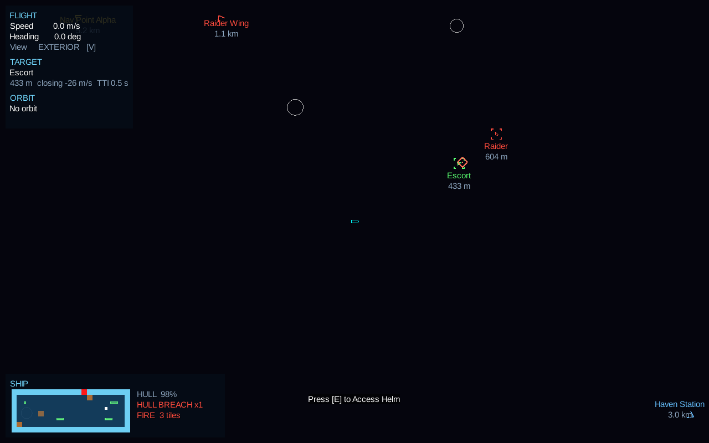
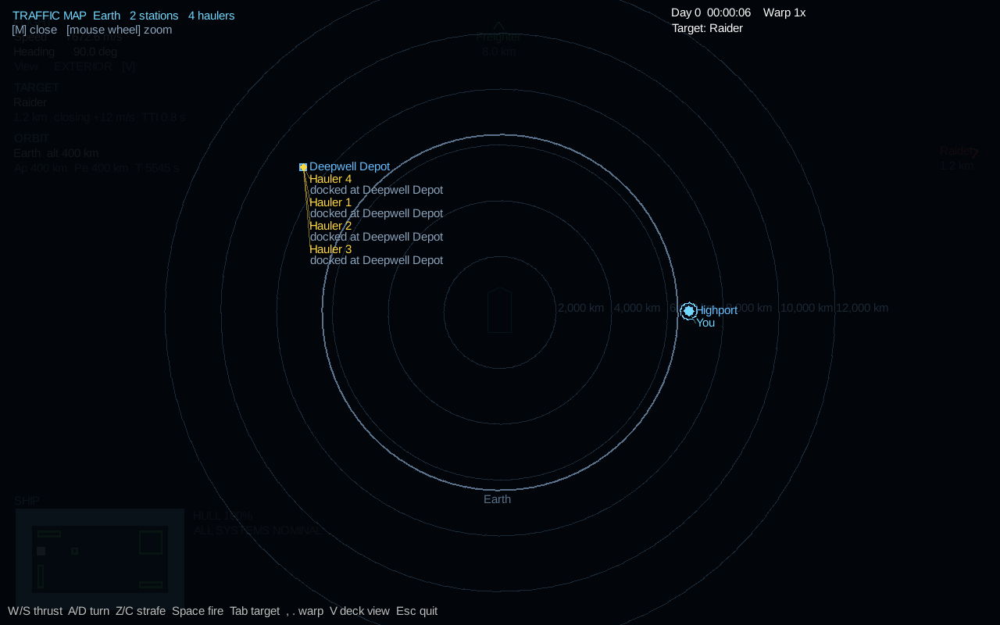

# UI & Viewports Module Design

## Overview
The `ui-hud` module handles all visual rendering that isn't directly part of the physical game world. This includes menus, piloting HUDs, interior interaction prompts, and viewport scaling management.

## Implementation Dependencies
- **`core-engine`**: Ashley ECS to track entities needing UI markers.
- **`physics-exterior`**: Needs the `WorldCamera` to project Box2D world coordinates into screen coordinates.
- **`interior-grid`**: Needs access to the ship's 2D tile layout to generate the wireframe mini-map.
- **External Libraries:** LibGDX `Scene2D.UI`.

## Implementation Guide
To implement this module independently (mocking data providers):

1. **Viewport & Camera Management:**
   - Create a `ViewportManager` class.
   - Initialize a `WorldCamera` coupled with an `ExtendViewport` (for rendering space/grid).
   - Initialize a `UICamera` coupled with a `ScreenViewport` (for crisp 1:1 pixel UI rendering).
   - Ensure the `resize(width, height)` method updates both viewports properly to handle window scaling.

2. **Scene2D Setup:**
   - Initialize a LibGDX `Stage` using the `ScreenViewport`.
   - Load a standard `Skin` generated via a TextureAtlas defining 9-patch borders, fonts, and button styles.

3. **Exterior Piloting HUD (Projections):**
   - Create a `HudRenderSystem`.
   - For spatial UI elements (e.g., target lead reticles, station nameplates), grab the target entity's world position.
   - Use `worldCamera.project(worldCoords)` to translate the Box2D coordinate to a screen pixel coordinate.
   - Position a Scene2D `Image` or `Label` widget at that calculated pixel coordinate. Update this every frame.

4. **Interior Wireframe Overlay:**
   - Create a custom Scene2D `Widget` called `WireframeMinimap`.
   - Pass the player's `ShipGridComponent` data to this widget.
   - Override the `draw(Batch batch, float parentAlpha)` method. Iterate through the grid bounds and draw colored rectangles or lines representing rooms.
   - Color code tiles based on their state (e.g., orange by `fireIntensity`, darker as the compartment's pressure falls, grey haze for smoke). Render this widget in the bottom-left corner of the `Stage`.

5. **Context Menus:**
   - Implement a system that checks the distance between the player's avatar and interactable consoles on the grid.
   - If distance < `INTERACT_RADIUS`, spawn a contextual "Press [E] to Access" tooltip via Scene2D.

## Proposed Components
- `HudMarkerComponent`: Attached to entities that need a UI marker (e.g., enemies, mission waypoints).
- `InteractableConsoleComponent`: Defines the UI menu layout to open when a player triggers this interior tile.

## Proposed Systems
- `HudRenderSystem`: Projects 3D/2D world coordinates to UI space and updates widget positions.
- `WireframeSyncSystem`: Reads ship state and feeds it to the Scene2D wireframe minimap.

## Prototype Status

Run it with `gradlew :lwjgl3:runHudDemo` (or `HUD demo.bat`). Fly with W/S, A/D, Z/C; Tab cycles the target lock; V toggles exterior/interior view; I/J/K/L walk the avatar; E uses a console; M opens the traffic map; O shows the mod-script prompt; F/B/H start a fire, breach the hull or take a hit so the minimap has something to show.

Entry point: `com.ringsofiron.uihud.UiHud` builds the stage, skin and systems. Call `addTo(engine)`, forward input to `getInputProcessor()`, and call `draw(delta)` after drawing the world.

| Class | Role |
|---|---|
| `ViewportManager` | World camera (ExtendViewport, meters) and UI camera (ScreenViewport, pixels); `worldToUi` / `uiToWorld` |
| `HudRenderSystem` | Brackets, nameplates and ranges for `HudMarkerComponent` entities; edge arrows off screen; lead reticle |
| `WireframeMinimap`, `WireframeSyncSystem` | Live blueprint of the player ship's `ShipGridComponent` with an alert list (fire, breaches, venting, smoke, hull %) |
| `InteractPromptSystem`, `ConsoleWindow` | "Press [E] to Access ..." within `INTERACT_RADIUS` tiles of an `InteractableConsoleComponent`; per-console layouts via `registerConsoleLayout` |
| `FlightReadoutSystem` | Speed, heading, view mode, target range/closing/time-to-impact, orbit |
| `ViewModeController` | EXTERIOR / INTERIOR view mode with change listeners |
| `modding.ModTrustDialog` | modding-data's `ModTrustPolicy` as a dialog: asks before mod scripts run with full access; can remember the answer per mod set and version (O in the demo) |
| `TrafficMap` | Full-screen map (M) of stations and haulers on rails around the body you orbit, with range rings; the wheel zooms toward you |

### Interfaces other modules fill in

These live in `com.ringsofiron.uihud.providers`. The adapters that implement them are written in the game wiring layer (core), so combat-sys, orbital-mechanics and ai-crew do not depend on ui-hud.

- `TargetingProvider` (combat-sys): locked target, lead point, time to impact. `SimpleTargetingProvider` is the stand-in.
- `OrbitInfoProvider` (orbital-mechanics): body name, altitude, apoapsis, periapsis, period, impact warning.
- `InteractorProvider` (ai-crew): the avatar's ship and fractional tile position.
- `TrafficMapProvider` (macro-sim): the frame body, its moons, stations, haulers with a one-line status, and the player. The game fills it from `RailsModel.snapshot()` in `RailsTrafficMap`.
- `ViewModeController.Listener`: the wiring layer bridges view-mode changes to audio-spatial's listener mode.
- `UiHud.flashHullHit(tileX, tileY)`: call from combat-sys's hull-hit event to flash the hit on the minimap.
