# UI & Viewports Module Design

## Overview
The `ui-hud` module handles all visual rendering that isn't directly part of the physical game world. This includes menus, piloting HUDs, interior interaction prompts, and viewport scaling management.

## Implementation Dependencies
- **`core-engine`**: Ashley ECS to track entities needing UI markers.
- **`physics-exterior`**: Needs the `WorldCamera` to project Box2D world coordinates into screen coordinates.
- **`interior-grid`**: Needs access to the ship's 2D tile layout to generate the wireframe mini-map.
- **External Libraries:** LibGDX `Scene2D.UI`.

## Implementation Guide
To implement this module independently (mocking data providers):

1. **Viewport & Camera Management:**
   - Create a `ViewportManager` class.
   - Initialize a `WorldCamera` coupled with an `ExtendViewport` (for rendering space/grid).
   - Initialize a `UICamera` coupled with a `ScreenViewport` (for crisp 1:1 pixel UI rendering).
   - Ensure the `resize(width, height)` method updates both viewports properly to handle window scaling.

2. **Scene2D Setup:**
   - Initialize a LibGDX `Stage` using the `ScreenViewport`.
   - Load a standard `Skin` generated via a TextureAtlas defining 9-patch borders, fonts, and button styles.

3. **Exterior Piloting HUD (Projections):**
   - Create a `HudRenderSystem`.
   - For spatial UI elements (e.g., target lead reticles, station nameplates), grab the target entity's world position.
   - Use `worldCamera.project(worldCoords)` to translate the Box2D coordinate to a screen pixel coordinate.
   - Position a Scene2D `Image` or `Label` widget at that calculated pixel coordinate. Update this every frame.

4. **Interior Wireframe Overlay:**
   - Create a custom Scene2D `Widget` called `WireframeMinimap`.
   - Pass the player's `ShipGridComponent` data to this widget.
   - Override the `draw(Batch batch, float parentAlpha)` method. Iterate through the grid bounds and draw colored rectangles or lines representing rooms.
   - Color code tiles based on their state (e.g., orange by `fireIntensity`, darker as the compartment's pressure falls, grey haze for smoke). Render this widget in the bottom-left corner of the `Stage`.

5. **Context Menus:**
   - Implement a system that checks the distance between the player's avatar and interactable consoles on the grid.
   - If distance < `INTERACT_RADIUS`, spawn a contextual "Press [E] for the ... panel" tooltip (the game adds "[V] sit and fly" at the helm and weapons consoles) via Scene2D.

## Implemented Components
- `HudMarkerComponent`: Attached to entities that need a UI marker (e.g., enemies, mission waypoints).
- `InteractableConsoleComponent`: Names the console layout to open when the avatar uses this interior tile.

## Implemented Systems
- `HudRenderSystem`: Projects world coordinates to UI space and updates widget positions.
- `WireframeSyncSystem`: Reads ship state and feeds it to the Scene2D wireframe minimap.
- `InteractPromptSystem`: Shows the "Press [E]" prompt near consoles and opens them.
- `FlightReadoutSystem`: Speed, heading, target and orbit readouts.

## Prototype Status

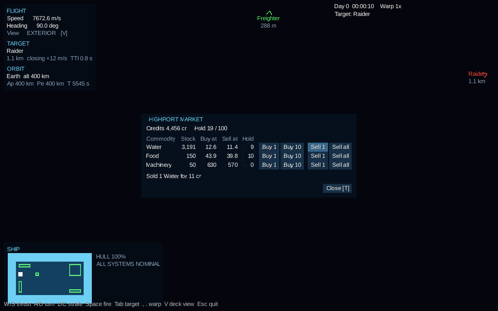

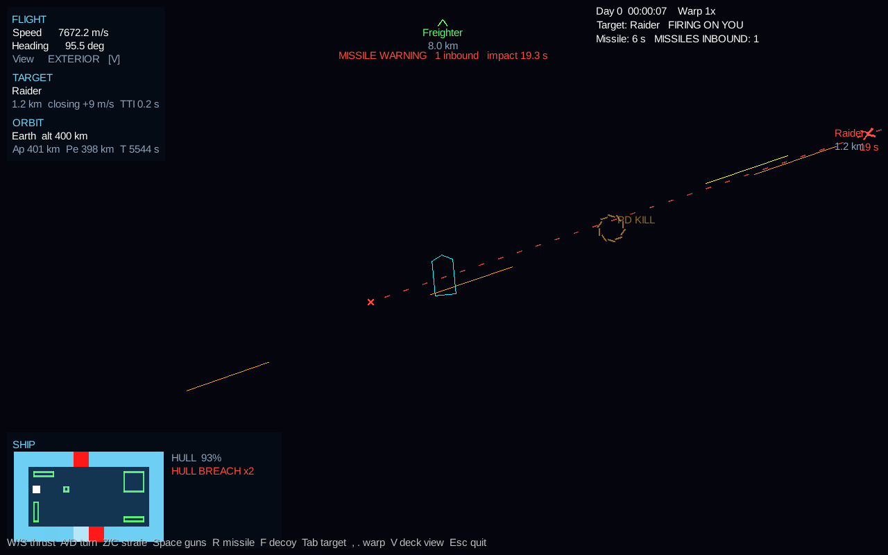

The HUD runs in the game (`gradlew :lwjgl3:runGame` or `Play Rings of Iron.bat`); the standalone HUD demo has been retired.

Entry point: `com.ringsofiron.uihud.UiHud` builds the stage, skin and systems. Call `addTo(engine)`, forward input to `getInputProcessor()`, and call `draw(delta)` after drawing the world.

| Class | Role |
|---|---|
| `ViewportManager` | World camera (ExtendViewport, meters) and UI camera (ScreenViewport, pixels); `worldToUi` / `uiToWorld`; `easeViewMeters` eases the zoom (`ZoomEase`: 0.3 s, eased in and out, even in ratio) |
| `HudRenderSystem` | Brackets, nameplates and ranges for `HudMarkerComponent` entities; edge arrows off screen; lead reticle |
| `WireframeMinimap`, `WireframeSyncSystem` | Live blueprint of the player ship's `ShipGridComponent` with an alert list (fire, breaches, venting, smoke, hull %) |
| `InteractPromptSystem`, `ConsoleWindow` | "Press [E] for the ... panel" within `INTERACT_RADIUS` tiles of an `InteractableConsoleComponent`; per-console layouts via `registerConsoleLayout` |
| `FlightReadoutSystem` | Speed, heading, view mode, target range/closing/time-to-impact, orbit |
| `ViewModeController` | EXTERIOR / INTERIOR view mode with change listeners |
| `modding.ModTrustDialog` | modding-data's `ModTrustPolicy` as a dialog: asks before mod scripts run with full access; can remember the answer per mod set and version (O in the demo) |
| `ThreatOverlay` | Missiles over the exterior view: dashed predicted paths (red incoming, cyan yours, amber others), a cross where an incoming one meets you, edge arrows with seconds to impact, a blinking MISSILE WARNING banner under 5 s, and a ring ("PD KILL") where point defense hits a missile |
| `TradeWindow` | Station market (T while in trading range, which a hint under the clock announces): credits, hold volume (m3), and per commodity the stock, buy and sell prices, what you carry, and Buy 1 / Buy 10 / Sell 1 / Sell all |
| `YardWindow` | A station's yard (Y while docked): repairs priced and ordered by the damage, and refits of a weapon mount, new, used or salvaged |
| `MissionWindow` | The mission board (J): the player's rank and standing with the station's faction, while docked the station's contracts with their pay, standing and time and a button to take each (or why it can't be taken yet), and always the contracts held, with a button to give each up |
| `BoardingWindow` | The ship the player's is latched to (K): how it stands, a button to send the boarding party or call it back, and once taken, a row per system that can come off with its sale price and a button to strip it, and a row per cargo with a button to carry it over. Closes when the ships part |
| `ManeuverMap` | The full-screen orbit map (M, the Orbits tab): the game's `OrbitMap` at any zoom, panned by dragging and zoomed about the pointer by the wheel, with the apsides, changes of sphere of influence and impacts labelled, and a moon the path meets drawn where it will be with the path on around it. A click on the path plans a burn there; the selected burn has prograde, retrograde, radial out and radial in handles, dragged out to add delta-v (more the farther, Shift for a tenth); dragging the burn slides it along its orbit. The side panel has the orbit, the selected burn and the plan, and buttons to warp to the burn, have the helm fly the burns, start the autopilot, and plan, accept or discard a transfer to the navigation target. See below |
| `TrafficMap` | Full-screen map (M, the Traffic tab) of stations and haulers on rails around the body you orbit, with range rings; the wheel zooms toward you |
| `ShipGauges` | Under the flight readout: propellant (with kg), structure, power (store charge and reactor output) and oxygen bars, amber below 50% and red below 25%. With no oxygen tanks the oxygen bar shows the air in the worst room |
| `RadarScope`, `RadarSystem` | Under the ship gauges, compact and out of the middle of the view: every marked contact around the ship, north up like the view, tinted like its marker, the locked target ringed, the ship's heading as a line. Contacts out of range sit on the rim as smaller, faded dots; only the locked target gets a ring. The − and + buttons either side of the range step it through 0.5, 2, 10, 50, 250 and 1,000 km. A click on a contact locks it as Tab would, or makes it the navigation target if it is a station or other object that is not a sensor contact |
| `NavMarkers`, `NavMarkerSystem` | Prograde (circle with ticks) and retrograde (circle with a cross) 70 px from the ship in the exterior view, along the ship's orbital velocity: its velocity in the bubble plus the bubble's own, the same velocity the speed readout shows. While a target with a body in the bubble is locked (Tab), they follow the velocity relative to it instead, drawn magenta with a "TGT" tag by each; the flight readout's "Markers" line names the frame (orbit, or TARGET with the relative speed) |

### Interfaces other modules fill in

These live in `com.ringsofiron.uihud.providers`. The adapters that implement them are written in the game wiring layer (core), so combat-sys, orbital-mechanics and ai-crew do not depend on ui-hud.

- `TargetingProvider` (combat-sys): locked target, lead point, time to impact. The game uses combat-sys's tracking through `CombatTargetingProvider`; `SimpleTargetingProvider` is for the demos.
- `OrbitInfoProvider` (orbital-mechanics): body name, altitude, apoapsis, periapsis, period, impact warning.
- `OrbitPathProvider` (orbital-mechanics): the orbit map's paths, burns and their axes, other bodies and craft, and the path's marks and legs past a change of sphere of influence. The game fills it in `PlayerOrbitPath`, with `MapTrajectory` for the patched conics.
- `ManeuverPlannerProvider` (core's burn planner and navigation): what the orbit map's clicks, drags and buttons do. The game fills it in `MapManeuvers`.
- `InteractorProvider` (ai-crew): the avatar's ship and fractional tile position.
- `TrafficMapProvider` (macro-sim): the frame body, its moons, stations, haulers with a one-line status, and the player. The game fills it from `RailsModel.snapshot()` in `RailsTrafficMap`.
- `ThreatProvider` (combat-sys): each missile's position, path end, side and time to impact; `UiHud.flashIntercept` takes combat-sys's intercept events. The game fills it in `CombatThreats`.
- `ShipStatusProvider` (interior-grid): the player ship's propellant and oxygen tank levels, hull integrity, power store charge and reactor output, and the worst room's pressure. The game fills it in `PlayerShipStatus`.
- `TradeProvider` (macro-sim): the station in range, its board, the player's credits and hold, and buy/sell. The game fills it from `MacroSimulation.dockableStation` and `market()` in `MarketTrade`, using the player ship's `TraderComponent`.
- `YardProvider` (stations-docking): the yard's repair and refit offers and orders. The game fills it in `YardWork`.
- `MissionProvider` (core's contracts): the career line, the station's offers and the contracts held, and take or give up. The game fills it in `ContractMissions`.
- `BoardingProvider` (core's boarding and salvage): the latched ship's state, its parts and cargo, and the orders. The game fills it in `BoardingWork`.
- `ShipyardProvider` (core's shipyard): the ships for sale where the player is docked with their price after the trade-in and why one is locked, and the prize in tow with its sale and turn-in terms. The game fills it in `ShipyardWork`; `ShipyardWindow` shows it, opened from the yard window's Ships for sale button, or on [Y] off a station with a prize to hand over.
- `ViewModeController.Listener`: the wiring layer bridges view-mode changes to audio-spatial's listener mode.
- `UiHud.flashHullHit(tileX, tileY)`: call from combat-sys's hull-hit event to flash the hit on the minimap.

## Orbit map

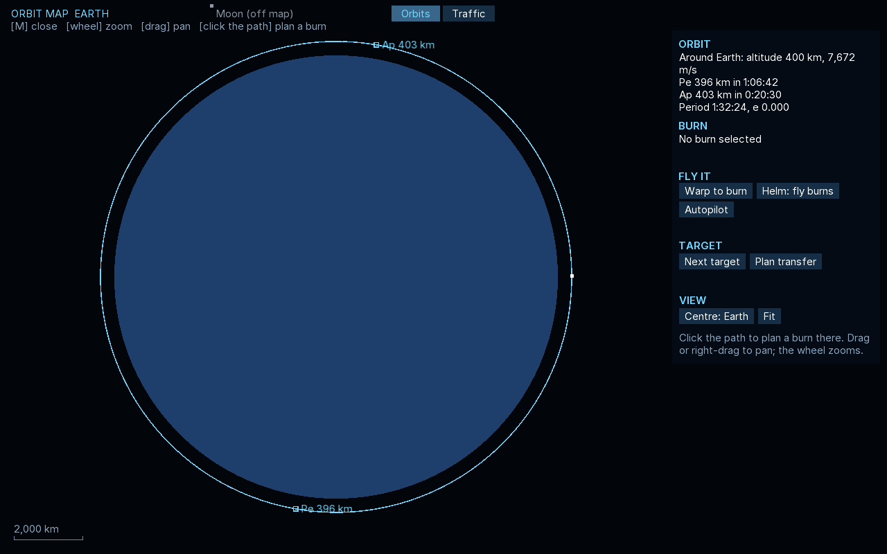

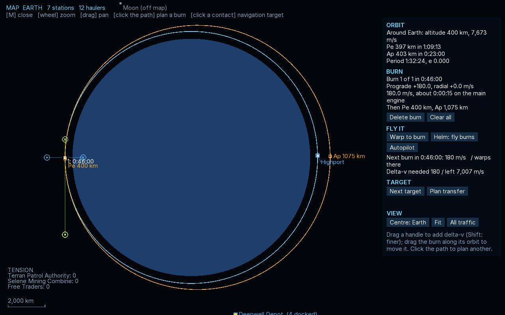

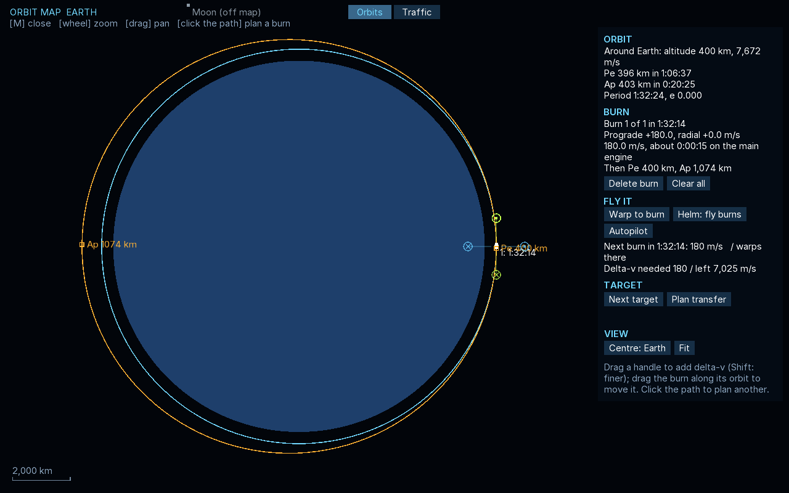

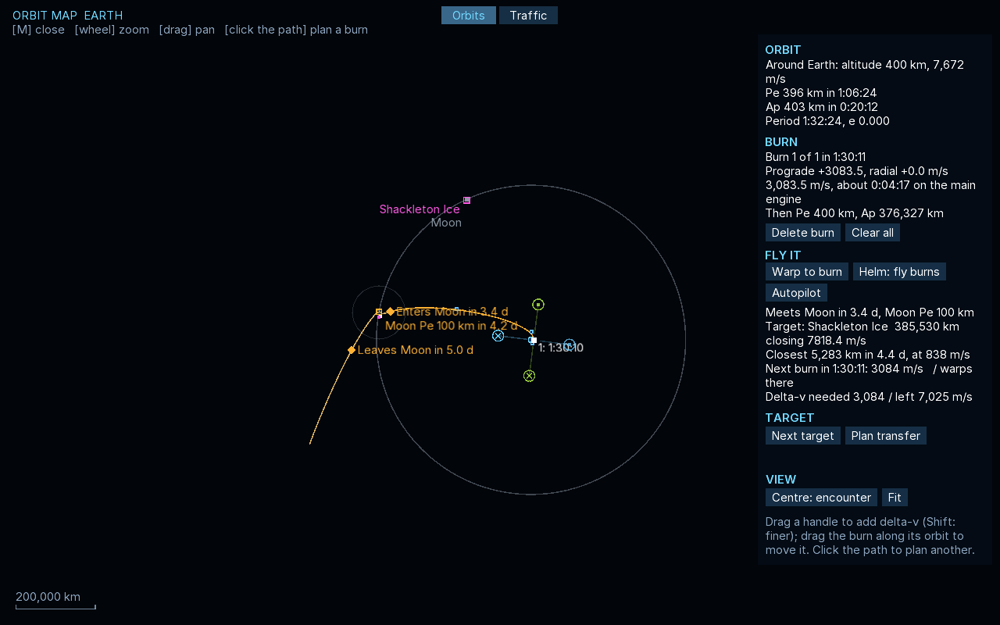

M opens the map on the Orbits tab, and the Traffic tab next to it shows the traffic map; M opens whichever was shown last. The path that matters is the one after the plan's last burn, or the orbit now with none: it is cut where it meets a moon's sphere of influence, the surface or the edge of the body's own, and goes on from there as patched conics (orbital-mechanics' `SoiPredictor`, as the rails fly it), through the moon's sphere and back out, three legs at most. A pass through a moon's sphere is drawn where the ship really goes, the moon moving on under it, so the path runs on unbroken; the moon's outline and sphere are drawn where it is at the closest approach. A ship the moon catches has its orbit there drawn about that point. Its periapsis and apoapsis are marked with their heights, and the panel says what it meets ("Meets Moon in 2.4 d, Moon Pe 1,302 km"), as does the small orbit panel under its burn readout.

Mouse planning places a burn at the time the ship passes nearest the click on the path it will fly: the orbit now until the first burn, then the orbit each burn leaves. The handles sit along the burn's own axes (prograde and radial out as `KeplerOrbit.withBurn` reads them), so they do not turn as its delta-v changes. The keys still work alongside (N, B, arrows, [ ], Del at the helm). The burns are flown as before: by themselves as an impulse when due, by the helmsman with the engines (Helm: fly burns, or 1), or by the autopilot on a transfer (6); Warp to burn (/) drops out a minute before the next one. `tools/playtest/orbit-map.sh` takes the screenshots above.

## Game shell

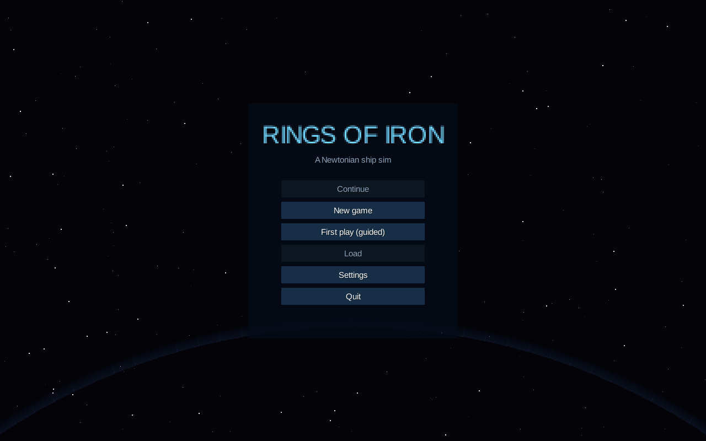

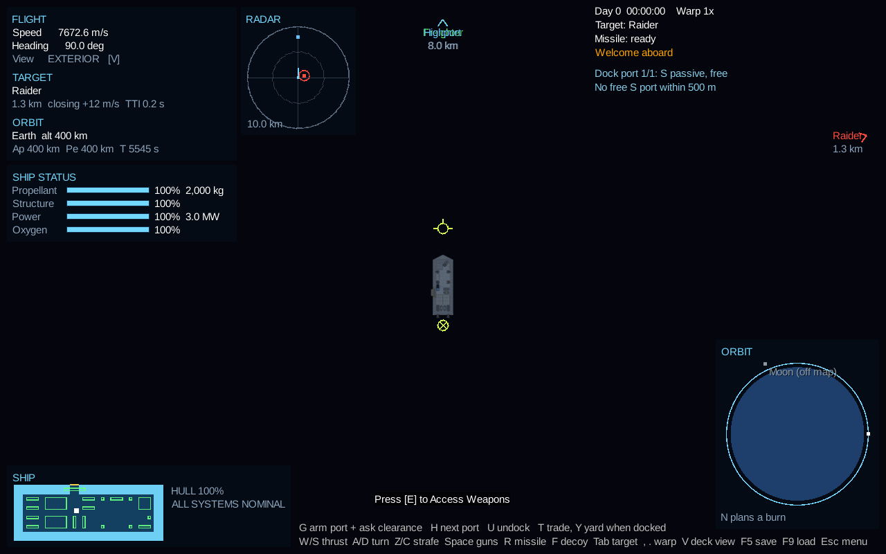

With no target the markers follow the orbit (yellow-green, "Markers  orbit"); with a target locked they follow the velocity relative to it (magenta, tagged TGT, "Markers  TARGET" with the relative speed):

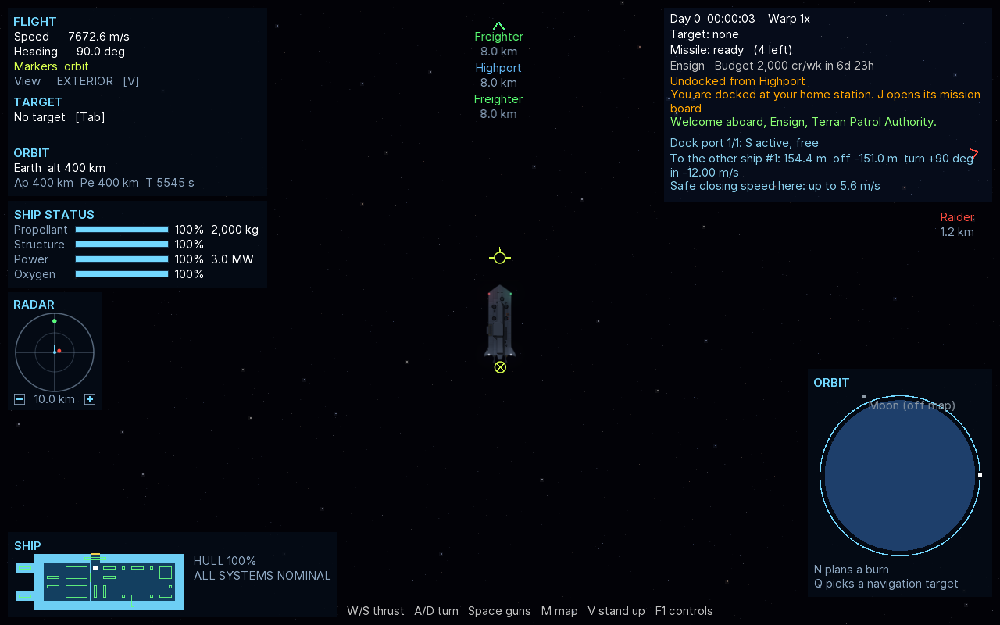

The radar has since moved under the gauges at a smaller size, its rings drawn as smooth, soft-edged bands (`HudDraw.ring`, `HudDraw.disc`), shown here at 3x:

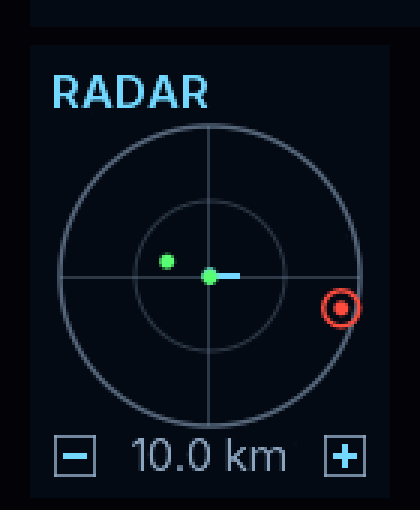

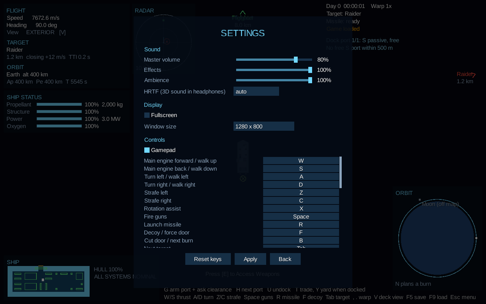

The game starts at a main menu (`com.hawkwing.RingsOfIron.shell.GameShell` in core, built with this module's skin): Continue (the newest save), New game, First play (guided), Load, Settings and Quit. In the game, Esc closes an open map, market, yard, mission board, boarding window or console first; with none open it pauses the game under a menu of Resume, Save, Load, Settings, Quit to menu and Quit game. `RingsOfIronGame` runs inside the shell unchanged apart from not quitting on Esc and standing still while paused. `gradlew :lwjgl3:runFirstPlay` still starts the guided first play directly.

| Class | Role |
|---|---|
| `GameShell` | Owns the menus and the running game; creates it on New game or Load, disposes it on Quit to menu |
| `ShellMenus` | The main and pause menus, the load list, the save panel and the settings window |
| `SaveSlots`, `SaveSummary` | Named saves in `saves/` (under `assets/` when run from Gradle). Each is one file, core-engine's save `<name>.json`, opening with a summary of the name, when it was saved, the game time, the ship and the credits, which is all of the save the load list reads. F5 writes the slot `quicksave`, so it is listed too |
| `GameSettings` | Master, effects and ambience volume, HRTF (auto, on, off), fullscreen and window size, the gamepad switch and the key bindings, in `saves/settings.json`. The launcher reads it to open the window; Apply writes it |
| `KeyBindings`, `RemappedInput` | Rebinding. The game still asks for its default keys; `RemappedInput` stands in `Gdx.input` and answers with the key the player bound. Binding a key that is already used swaps the two actions. Esc can't be bound |
| `GamepadKeys` | A gamepad through libGDX Controllers, read as the game's keys (below) |

Gamepad (standard mapping): left stick thrust and turn, or walk on deck; right stick left/right or the bumpers strafe; right stick click rotation assist; A or the right trigger fire (A also uses a console); B missile; X decoy or force a door; Y deck or outside view; left trigger next target; d-pad up/down time warp, left arm port and ask clearance, right undock; Start pause menu; Back the map (orbits and traffic). Sticks count past 40%.

The `shell` smoke test (`gradlew :lwjgl3:smokeTestShell`) drives a session through the menu: new game, pause, save to a slot, quit to the menu, continue that save, settings, resume. With `-PsmokeShots=<dir>` it saves the screenshots above.

## Type and UI scale

The HUD and menus are set in Inter (`assets/fonts`, SIL Open Font License), rasterised by FreeType in `HudFonts`: body and panel titles at 15 units, banners and menu headings at 22, the main menu's title at 44. Every layout is written in UI units for a 1280x800 window, and `UiScale` makes one unit 1x to 3x screen pixels. Auto follows the window's height (1x at 1080 lines, 1.25x at 1440, 2x at 2160); Settings offers fixed scales too. A scale is held to what keeps 1280x800 units on screen, so the panels never crowd each other, and never goes under 1x. The fonts are drawn again for a new scale in place (`HudSkin.rescale`), so text stays sharp.

The missile warning has one place on screen: the banner, set between the flight panel and the status column. Its notice is still heard and kept in the notice log (L), but the status column leaves it out. `tools/playtest/ui-tour.sh [out] [WxH] [scale]` screenshots the menus and HUD at any window size; `documentation/ui-hud/polish/` has the before and after from the change that brought this in.
