# Nasa-punk HUDs

The three Nasa-punk HUD variants (`nasapunk.task`, `nasapunk.stations`, `nasapunk.context`) are drawn
with one kit in `ui-hud/.../variants/nasapunk`: `NpKit` holds the fonts (B612) and `NpCanvas`, which
draws the mockups' shapes, text and hardware (`NpHardware`: bezels, fasteners, glass, plates, soft
keys) in UI units with y down, so a number in the mockups (`documentation/ui-overhaul/nasapunk/mockups`)
is the same number in the code. `NpColors` is the palette.

## The menus and the map

The three HUDs give the game's menus and its map one look between them, through the shared screens
hook (`Variants.md`): `NpScreens` holds what each hands on, and frees it on `detach`. The mockups are
`documentation/ui-overhaul/variations/nasapunk-shell` (the menus) and the map screens C5, T4 and S4.

**The menus** (`NpShellLook`) are pages of one flight computer, CDU-1. Before a game the unit sits in
a console with the game's name engraved on it, over the stars and the Earth's limb; over a paused
game the deck keeps 40 per cent of its light. Each menu keeps the game's rows, buttons, keys and
order: it is built from `NpShellSkin`, whose styles carry the classic names and draw the computer's
parts (`NpDrawable` paints each through the canvas), and `dress` lays the built page out as the
computer's, with `NpShellFrame` drawing the furniture behind the rows:

| The game's | On CDU-1 |
|---|---|
| Menu | A page: the unit (`NpCdu`) with FLIGHT OPERATIONS on its bezel, the title at the top of the glass, the build on its plate as the part number |
| Button | A prompt, `<` and its word; on the main and pause menus down the glass's left edge, a line-select key either side of each, the left one pressing it when clicked |
| A button that cannot be used | Its word dim, with no caret |
| Focus | The cyan cursor box round the field (the game's focus tint is read, and kept off the words) |
| Held down | Reverse video, the field shaded |
| One of a group (a sponsor) | Dim, cyan when picked |
| A section's name (`title`) | Between dashed dividers |
| Dim line | A label line, under the prompt's words |
| Text field, choice, list | Entry fields on a shade over the glass: typed text cyan, the choice cyan with a caret, a list's pick in the cursor |
| Check box, slider | A green square lit or a hollow one; a white bar with a soft key for its knob |
| The message line | The scratchpad along the glass's foot, over a rule, with a dim hint of the keys while it is empty |
| Mod scripts dialog | A page of its own, its title at the top of the glass |

The fonts carry the capitals and the letter spacing themselves (`NpFonts.create` with caps and
track), so Scene2D measures each word as it is drawn. A page too tall for the window (the settings
in an 800-line window) closes its rows up until it fits.

**The map** (`NpMapPainter`) is the system plot: glass, the orbit now white, the planned path magenta,
a proposed one white and dashed until it is taken, burns as diamonds (the selected one cyan, with
cyan handles), the Earth a dark disc ringed blue, a moon grey, contacts in their affiliation's shapes
and the target a magenta ring. The title and the row of keys sit over the canvas's top-left, the keys
on caps; a body or the target pulled in to the map's top edge comes down clear of them, its name
with it. Circles far bigger than the canvas are drawn only where they cross it.

`tools/playtest/shell-nasapunk.sh <task|stations|context>` drives the menus, a paused game, the map
and the mod scripts dialog in a real window. From its run under the context HUD at 1280x800, where
the HUD itself is still the classic one:

| | |
|---|---|
| 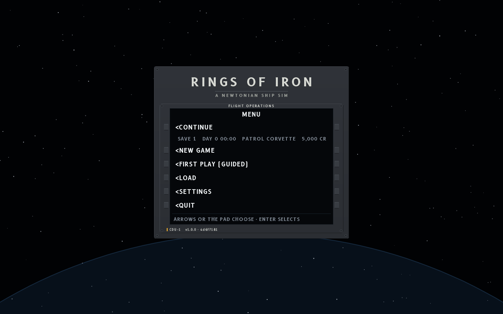 | 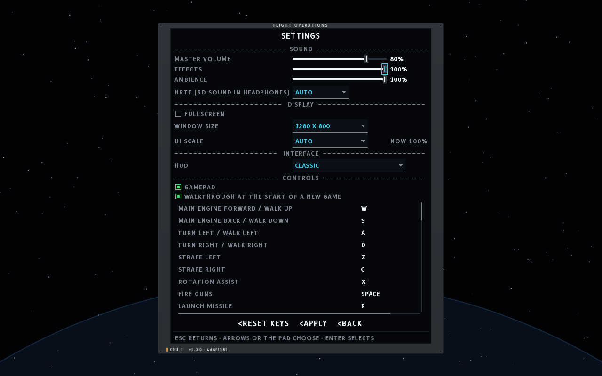 |
| 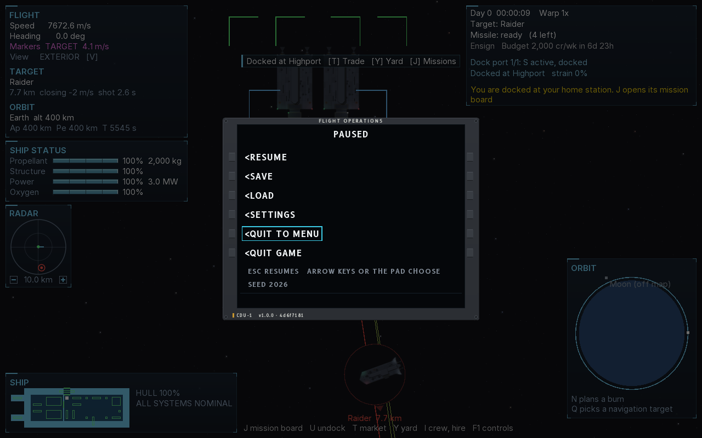 | 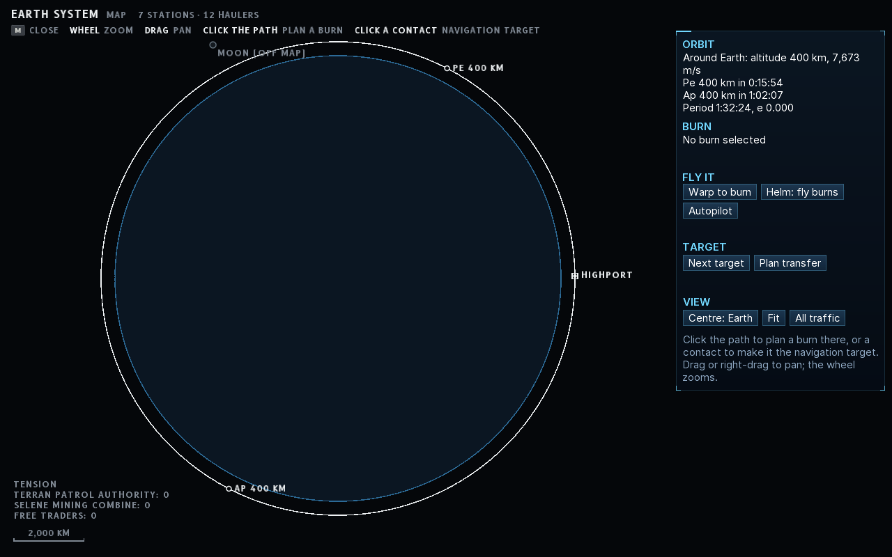 |
| 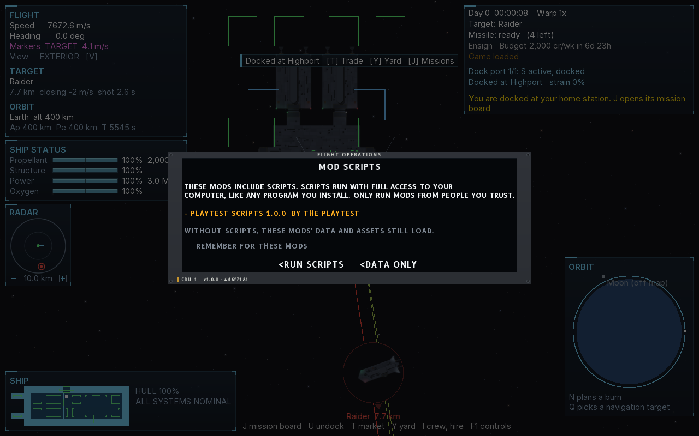 | |

## The game's windows

The three HUDs show the game's windows in place of the classic ones, through the screens hook's
`replaces`, `open`, `showing` and `close` (`Variants.md`, Screens in place of the windows): the
market, the yard, the shipyard, the mission board and the contracts held, the hiring hall, the
crew, the crew's refit away from a yard, boarding, the notice log, the controls and the ship-lost
card. The map and the console stay the game's. What the three share is in `variants/nasapunk/screens`:

- **The pages.** Each window is a `Page`: parts (`Sect`) of rows under their columns' heads, each
  row with its own orders (`Act`) and the page with its own (REPAIR ALL), built afresh from what the
  classic windows read (`Boards`) four times a second and straight after each order. The cursor keeps
  its row by the row's id. An order that can't be given is barred and says why once; a guarded one
  (GIVE UP a contract, LET GO one of the crew) asks for a second press. One page for each window:
  `MarketPage`, `YardPage`, `ShipyardPage`, `OffersPage` (the board), `HeldPage` (the contracts
  taken), `HirePage`, `CrewPage`, `LoadoutPage` (the field refit), `BoardingPage`, `LogPage` and
  `HelpPage` (the controls, leaving out a part the deck's key hints already show whole).
- **One table drawer.** `Tables` draws any part in the box a combination gives it: the title and its
  orders, the heads, the rows with their buttons (as wide as their longest word), filters, bars,
  notes, and a scroll bar when the rows run past the box. `stack` shares a box between parts, the
  tallest giving way first; `flow` packs them into columns; `pageActs` lines the page's own orders up
  along a foot. `Ui` holds the pieces: the text sizes, key caps, the lit push buttons and the
  barber-pole strip of a barred order, the cyan cursor.
- **The workings.** `ScreenModes` is what each combination builds its modes on: which page a
  window's key opens and which tabs come with it, the number keys turning the tabs (a number past
  the last tab stays the game's), the arrows and Enter going to the page, clicks (`Hits`) and the wheel,
  and the feed at the foot (`Feed`): an order's words for five seconds, then the game's newest notice.
  A mode closes when the station it needs is left behind, when the map opens, or when the console's
  window does. The combination draws the frame and says which mode each window opens.
- **The ship-lost card.** `LostCard`: every display on the deck shows its red X, and CDU-1 says what
  happened, with the ways on under their keys.

`tools/playtest/windows-nasapunk.sh <context|task|stations>` walks the windows in a real window:
docked at Highport, the station's market with a buy and each of its tabs, then each window's own key;
the crew's refit away from the station; boarding a raider that has surrendered, before and after the
party goes across; and the career over.

### Under the context HUD

The context HUD's windows are its spec's modes (`context/ModeScreen`; the mockups are
`documentation/ui-overhaul/variations/nasapunk-context`, C6 to C10). Each is a console under P1: a
title row of glass with the mode's name and its tabs on their number caps, the page's display units,
and a foot row with the feed and the keys that close it. M3, the station, is the one that leaves the
docked view in sight: a panel 1 120 wide and as tall as its tab needs, with a rail every tab shares
(credits, standing, the hold with what is on order, the tanks). A mode hides the HUD under it but P1.

| The game's window, and its key | The mode, on its tab | Its other tabs |
|---|---|---|
| Market (T) | M3 STATION, MARKET | YARD, SHIPYARD where ships are sold, MISSIONS, HIRE |
| Yard (Y) at a berth | M3 STATION, YARD | as above |
| Yard (Y) away from one | M2 SHIP, LOADOUT: the crew's field refit | CREW |
| Contracts (J) | M3's MISSIONS while M3 shows, else M5 RECORD, CONTRACTS | LOG |
| Boarding (K) | M4 BOARDING: the salvage beside the boarding's state and orders | |
| Crew (I) | M2 SHIP, CREW: the roster beside the standing orders and the prisoners | LOADOUT away from a yard |
| Notice log (L) | M5 RECORD, LOG: its filters over the list | CONTRACTS |
| Controls (F1) | M6 CONTROLS: every key in four columns | |

A tab the game won't open now is left out, and leaving the station closes M3 whatever its tab.
From the playtest at 1280x800:

| | |
|---|---|
| 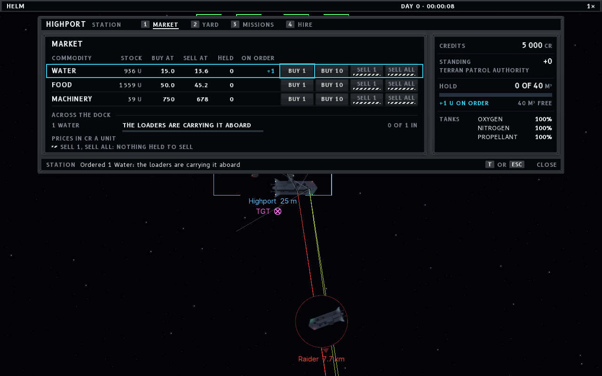 | 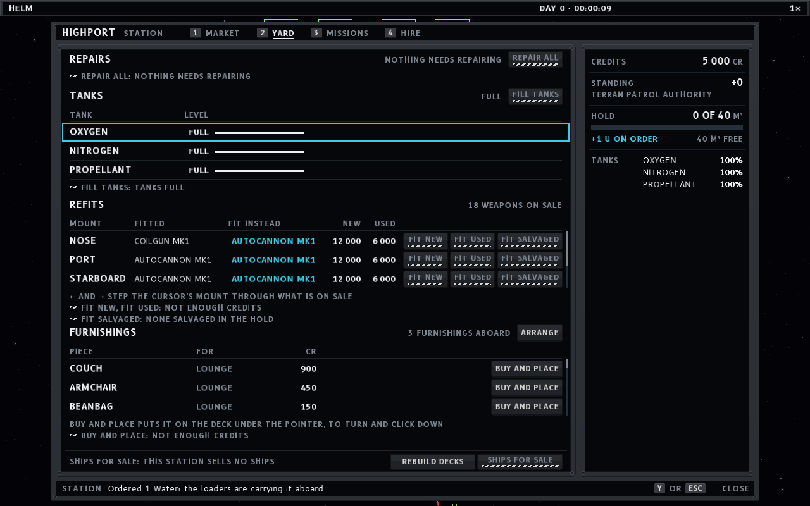 |
| 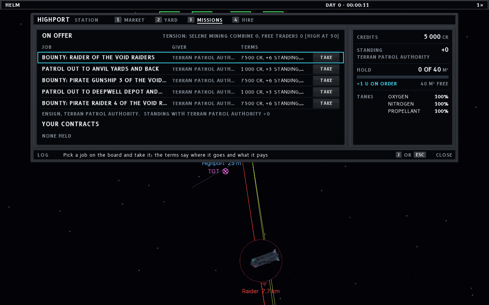 | 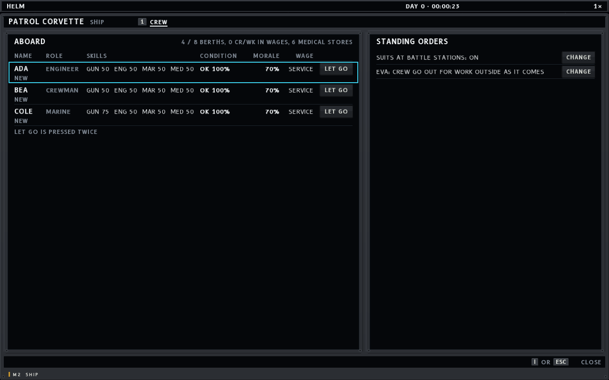 |
| 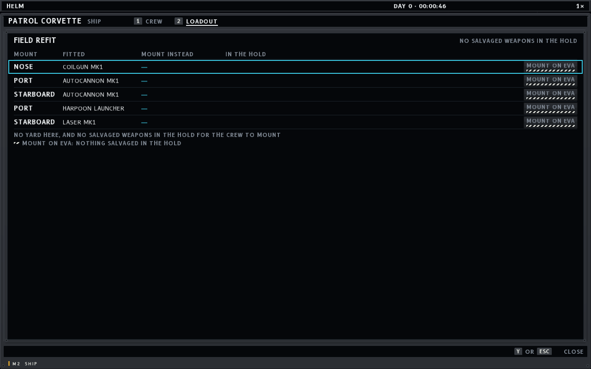 | 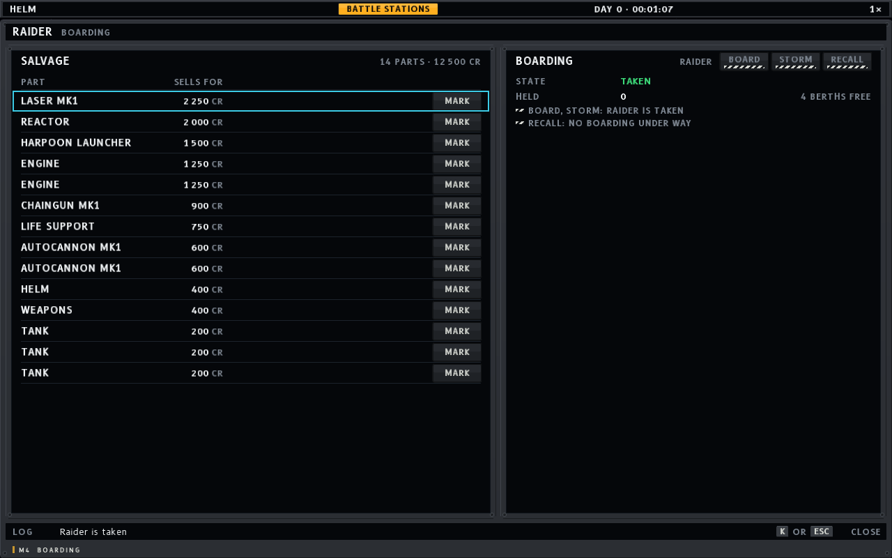 |
| 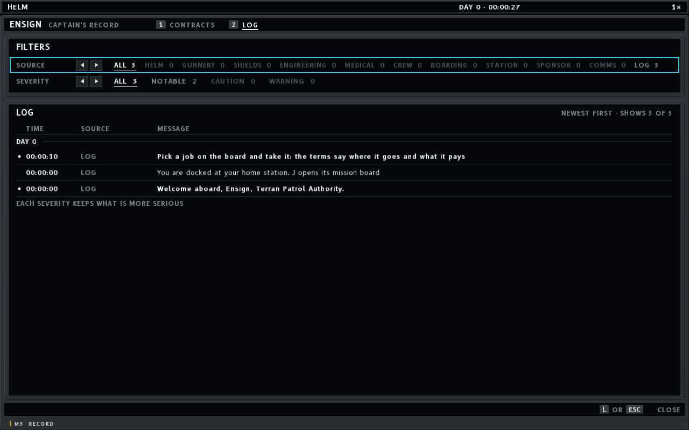 | 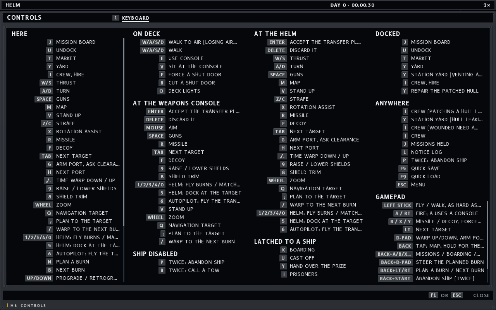 |
| 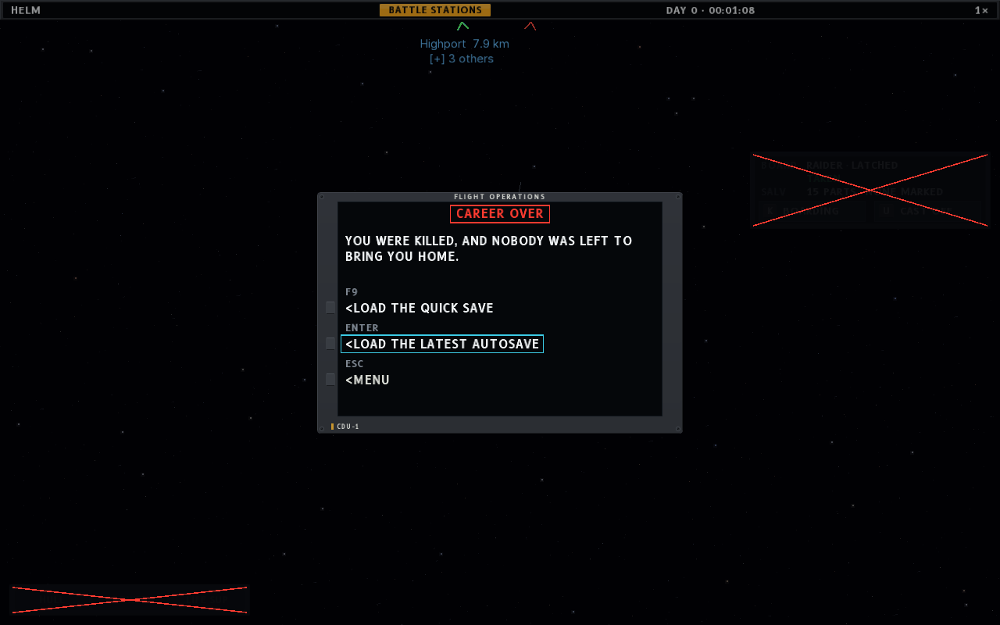 | |
