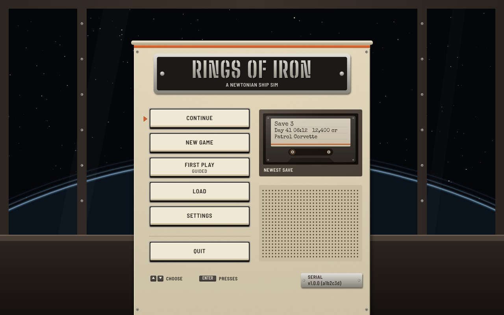
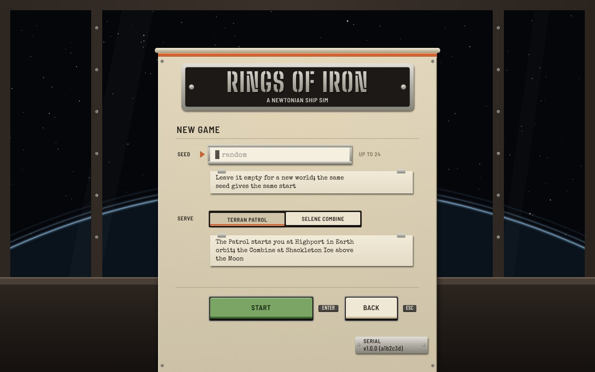
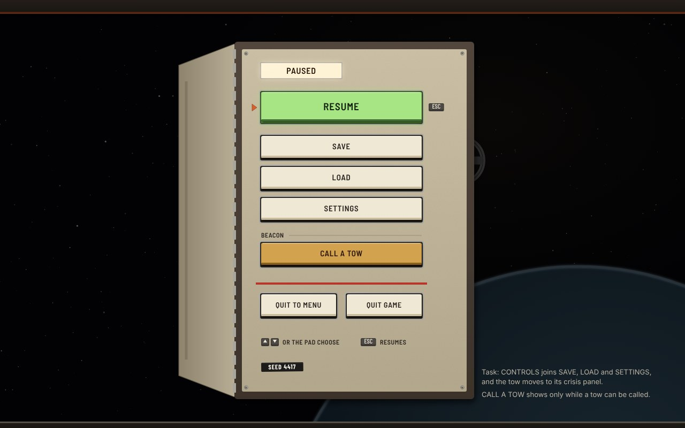
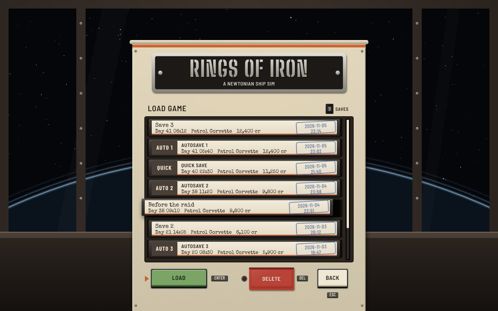
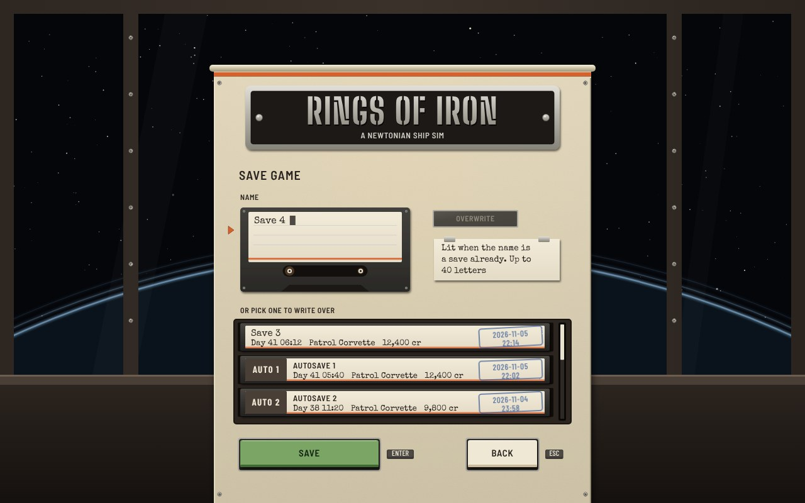
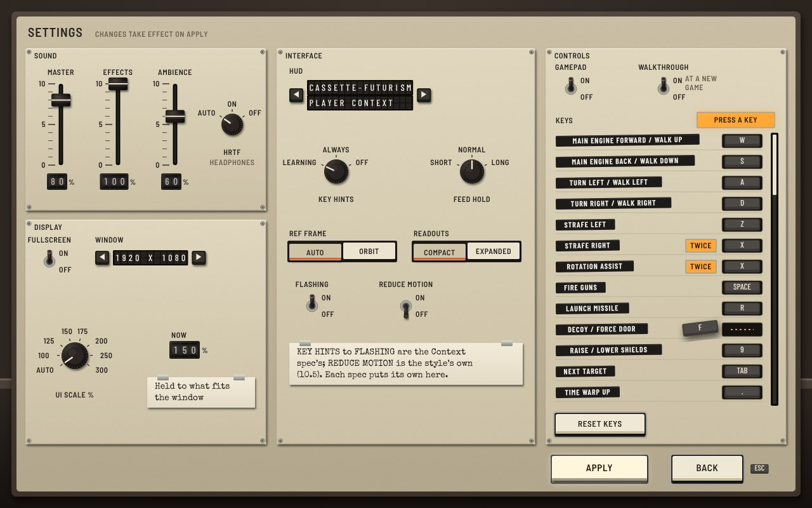
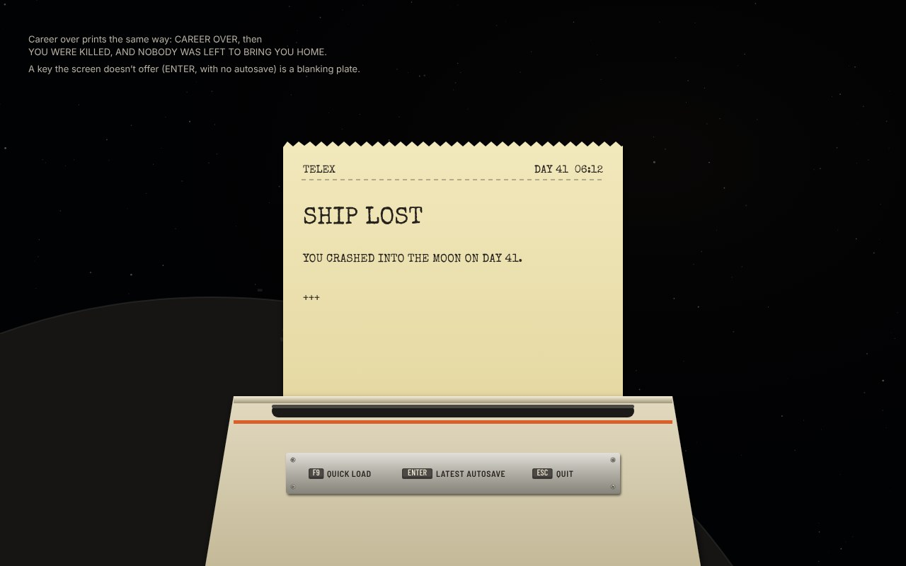
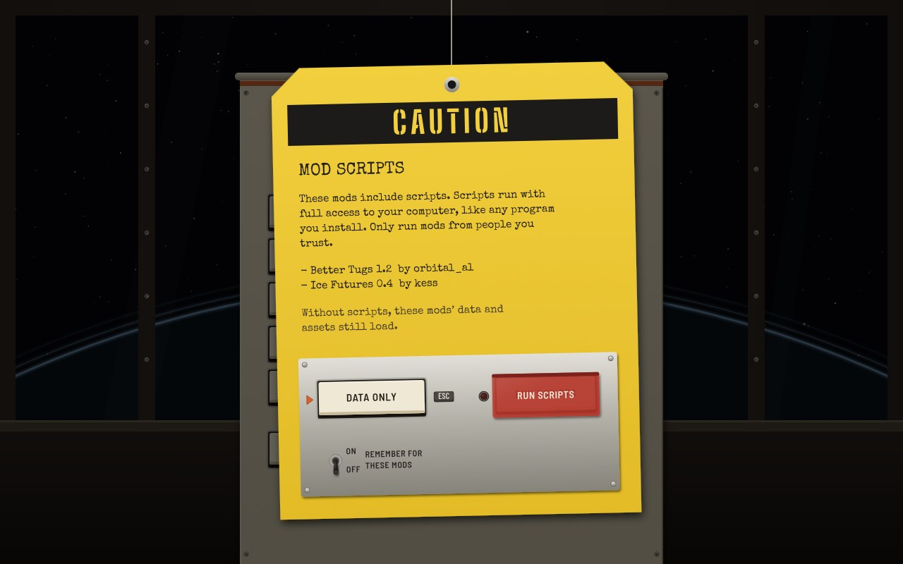
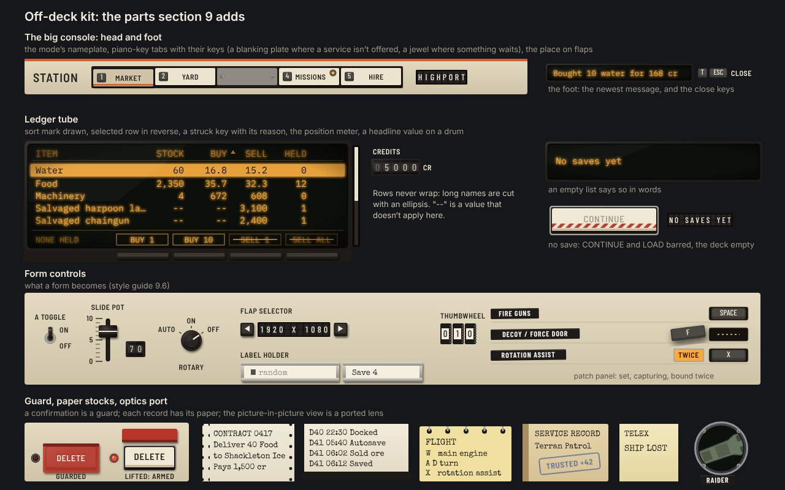

# The shell in Yard Standard

The screens every spec shares, drawn on the game's 1280 × 800 grid by the rules in
[section 9 of the style guide](../../style-cassette.md#9-off-the-flight-deck-modes-panels-lists-forms-and-the-shell).
The source is `shell.html`, rendered with `node ../render.js shell.html 1 jpeg`.

The shell stands outside the fiction, so it isn't anyone's ship. It is a **yard office at night**: a desk
console in Yard Standard under a big window, and today's menu backdrop (the drifting stars and the
planet's limb in blue rings) is the view through that window. Every screen of the shell is a faceplate on
that console, so the player never meets a window or a dialog box. Pause is the one exception: it opens
in the ship's own console, over the game.

The words and choices are today's (`ShellMenus`, the crash screen in `GameHudText`, `ModTrustDialog`).
Where a spec changes them, the caption says so. The arrow keys and Enter work every screen, and the
orange pointer tab shows the focus (style guide 10.2).

## S1 Main menu

A cast builder's plate carries the title. The six choices are large push buttons, QUIT set apart below
a rule. The newest save sits in a tape deck beside CONTINUE, its name and details typed on the cassette's
label, so the player sees what CONTINUE will load before pressing it. The version is stamped on a serial
plate. With no save, the deck is empty and CONTINUE and LOAD are barred, with NO SAVES YET on flaps
(drawn on K4). Task calls NEW GAME "new career"; the button is the same.

## S2 New game

The console's bay becomes the commission panel. The seed is typed on a card in a label holder, with
`random` pencilled in while it is empty, and the focus starts there, as it does today. The sponsor is a
pair of interlocked keys. The game's own notes are typed on cards clipped under each control.

## S3 Pause

The ship's console opens a maintenance hatch: the faceplate swings out on its hinge, the game dims
behind it, and the PAUSED lens lights. RESUME is the big lit button. CALL A TOW appears only while a tow
can be called, as today, under an engraved BEACON. The two quits stand apart behind a painted red line,
and the world's seed is on Dymo tape. Task adds CONTROLS under SETTINGS and moves the tow to its crisis
panel.

## S4 Load

The tape library. Each save is a cassette in a rack: its name and details typed on the spine's label,
and the date it was saved in a blue rubber stamp. The game's own saves have printed labels (QUICK and
AUTO 1 to 3), so they read differently from the player's. The selected cassette slides half out of the
rack; LOAD acts on it, and DELETE is under a red guard (style guide 9.7), since it can't be undone. The
count is on a drum, and the meter on the rack's right shows how much of the list is in view.

## S5 Save

A blank cassette with the next free name typed on its label, and the rack under it to pick a save to
write over instead. **New:** the OVERWRITE lens lights while the name is a save already; today the game
overwrites without saying so.

## S6 Settings

The maintenance panel, one bay for each of today's groups. Volumes are slide pots with their exact value
on drums; HRTF and the UI scale are rotaries; the window size, a set the game builds from the screen, is
a flap selector; check boxes are bat toggles. The interface bay holds today's HUD choice plus the
settings the Context spec adds (KEY HINTS, FEED HOLD, REF FRAME, READOUTS, FLASHING) and the style's own
REDUCE MOTION (style guide 10.5); each spec puts its own settings there with the same controls.

The key bindings are a patch panel: a row for each action, its name on Dymo tape, its key on a keycap.
Here the player is rebinding DECOY / FORCE DOOR: its keycap is lifted out of the socket and PRESS A KEY
is lit. **New:** STRAFE RIGHT and ROTATION ASSIST share X, so both light TWICE; the game doesn't check for
a key bound twice today.

## S7 Ship lost

An ending arrives as a telex. The message prints in capitals, as a telex did, and the keys the screen
offers are on the teleprinter's plate. Career over prints the same way. A key the screen doesn't offer
(Enter, when there is no autosave) is a blanking plate, which says the same as today's text, which
leaves it out.

## S8 Mod scripts

The one question the game must ask is a caution tag hung on a wire over the dimmed menu, like a lock-out
tag on a switch. Its words and the list of mods are typed on it; the answers are on a plate riveted to
its foot. DATA ONLY is the safe answer, and `Esc` gives it. RUN SCRIPTS is under a guard, and REMEMBER is
a bat toggle.

## K4 Off-deck kit

The parts section 9 adds, in their states: the big console's head (the nameplate, piano-key tabs with
their keys, a blanking plate and a waiting jewel, the place on flaps) and its foot (the one-line feed and
the keys that close the mode); the ledger tube (a drawn sort mark, the selected row in reverse, keys
struck with their reason, a cut name, `--`, the position meter, a headline drum), with Highport's goods
as on Context's sheet 10, and an empty list; the barred CONTINUE; the form
controls; the patch panel's three states; the guard closed and lifted; the five paper stocks; and the
optics port for the picture-in-picture views.
