# UI Overhaul: Functional Design by Player Context

Functional design 1 of 3 for the ground-up UI and UX overhaul. This one starts from the player's
**context**: where the captain is, what is happening around the ship, and what they are trying to do.
Every widget, window and world marker here is defined by what it shows, where it sits and when it is
on screen. Nothing here sets a look: the three art directions (NASA-punk, 90s VFD, cassette-futurism)
skin and adapt it. Section 12 is the contract for them.

Wireframes are grey boxes at the 1280 x 800 UI-unit layout the HUD already uses (`UiScale`), in
[`wireframes/`](wireframes/). Positions and sizes are in UI units. `wireframes/wireframes.html` draws
them and `node documentation/ui-overhaul/wireframes/render.js` renders them again.

**Version 17.** The design is revised in rounds with the three art directions; the revision log is at
the end.

## Contents

1. [The design in one page](#1-the-design-in-one-page)
2. [What the UI shows today](#2-what-the-ui-shows-today)
3. [What is wrong with it](#3-what-is-wrong-with-it)
4. [The context model](#4-the-context-model)
5. [Screen grammar](#5-screen-grammar)
6. [The persistent layer](#6-the-persistent-layer)
7. [Seat instruments](#7-seat-instruments)
8. [Situation panels](#8-situation-panels)
9. [World overlays](#9-world-overlays)
10. [Full-screen modes](#10-full-screen-modes)
11. [Context walkthroughs](#11-context-walkthroughs)
12. [Contract for the art directions](#12-contract-for-the-art-directions)
13. [What is cut, and why](#13-what-is-cut-and-why)
14. [What the simulation must provide](#14-what-the-simulation-must-provide)
15. [Input, focus and the Esc stack](#15-input-focus-and-the-esc-stack)
16. [Building it](#16-building-it)
17. [Questions for Joe](#17-questions-for-joe)

---

## 1. The design in one page

**The seat defines the screen.** The captain is a person on a ship. They see outside only from a seat:
the helm, the weapons console or a gun. On deck they see the ship itself. So the first question for any
piece of information is *which seat needs it*. The helm gets flight and navigation instruments; fire
control gets weapons, the lock and the shields; the deck gets almost nothing, because the deck is the
display: fire, smoke, crew and damage are drawn in the world.

**Situations modify the seat.** On top of the seat, the game is always in one or more situations:
cruising, under time warp, approaching a port, docked, in combat, boarding, or in an emergency. Each
situation brings its own instrument forward and pushes others back, automatically. The player never
arranges panels.

**Dark cockpit.** Borrowed from airliner flight decks: when everything is normal, nothing is lit. A
ship at full health shows four quiet status lights, not four bars at 100% and "ALL SYSTEMS NOMINAL".
Detail appears when something departs from normal, and goes away when it recovers.

**One home per datum.** Each piece of information has exactly one place on screen in a given context.
Today the locked target appears in three places and the missile warning in three; here each appears
once. The alerting chain is the one deliberate overlap, as on an airliner: the master alert cue and
the emergency card may *name* a condition that P2 lists, to catch the eye and say what to do, but a
value (a time, a distance, a setting) still has one home.

**Conditions are not events.** Something that *is true now* (a fire, low propellant, a missile
inbound) goes to the caution and warning panel and stays while it is true. Something that *happened*
(a contract paid, a crewman back in from EVA) goes to the message feed and fades. Today both share one
column and one timer.

**The captain's question is "is someone on it?"** The crew fight fires, seal breaches and treat the
wounded on their own. So a fire is shown with whether crew are on it, not only where it is.

**Four layers**, top to bottom:

| Layer | What | Who controls visibility |
|---|---|---|
| Interrupt | Threat alert (missiles inbound), emergency card | The situation, always on top |
| Persistent | Status strip, caution and warning panel, message feed, objective | Always present, sizes to content |
| Context | Seat instruments and situation panels | Seat and situation, automatically |
| On demand | Full-screen modes (map, ship, station, boarding, captain's record, controls) and the orders menu | The player |

**Progressive disclosure.** Every instrument has a compact face (the default) and an expanded face
(hover, or hold the detail key) with the secondary numbers enthusiasts want: heading in degrees, the
period in seconds, kilograms of propellant. Those numbers are not removed from the game; they are
removed from the default face.

---

## 2. What the UI shows today

Everything the player can see, from `ui-hud`, core's `GameHudText` and the render overlays, after
PR #258. The verdict column says what this design does with it; section 13 gives the reasons for cuts.

### 2.1 Always-on HUD panels (exterior view)

| Element | Where now | Data | Verdict |
|---|---|---|---|
| FLIGHT panel (`FlightReadoutSystem`) | Top left | Speed (m/s, orbital), heading (deg), markers frame (orbit / TARGET + rel. speed), view mode "EXTERIOR [V]" | Speed and frame merge into H1 Flight display. Heading to expanded face. View mode cut (the seat indicator replaces it) |
| TARGET section, same panel | Top left | Lock name, range, closing, "shot 1.3 s" | Moves to H6 Lock card |
| ORBIT section, same panel | Top left | Body, altitude, Ap, Pe, period (s) | Moves to H2 Navigation block; period to expanded face, formatted as time |
| SHIP STATUS gauges (`ShipGauges`) | Top left, second panel | Propellant % + kg, structure %, power % + MW, oxygen % or EMERGENCY kg | Split: propellant to H1 (as delta-v), the rest to H4 Ship condition with a dark-cockpit compact face |
| RADAR (`RadarScope`) | Top left, third panel | Contacts, lock ring, heading line, range buttons | Becomes H5 Contact scope, bottom right, shown when it has something to show |
| SHIP panel (`WireframeMinimap` + `AlertList`) | Bottom left | Deck plan with hazards; HULL %, BREACH, FIRE, VACUUM, LOW PRESSURE, SMOKE, or ALL SYSTEMS NOMINAL | Plan goes into H4's expanded face; alerts go to P2 Caution and warning panel. "ALL SYSTEMS NOMINAL" cut |
| ORBIT panel (`OrbitMap` small) | Bottom right | Small orbit plot, caption hints ("N plans a burn", "Q picks a navigation target"), burn readout | Cut. The map is one key away; the next burn and next apsis go to H2 |
| Missile warning banner (`ThreatOverlay`) | Top centre | MISSILE WARNING, n inbound, impact s | Becomes P3 Threat alert |
| Dock banner | Top centre | "Docked at Highport [T] Trade [Y] Yard [J] Missions" | Becomes X1 Station panel |
| Interact prompt (`InteractPromptSystem`) | Bottom centre, fixed | "Press [E] for the Helm panel [V] sit and fly" | Becomes P6 Prompt, anchored to the object |
| Key hint line (`HintRegistry.line`) | Bottom edge | Up to 5 key hints for the context, then "F1 controls" | Becomes learning-mode hints in P6; off once learned |

### 2.2 The status column (core's `GameHudText.drawStatus`), top right, line by line

| Line | Example | Verdict |
|---|---|---|
| Clock and warp | "Day 0 00:00:33  Warp 1x (rails)" | P1 Status strip |
| Lock | "Target: Raider (gun reloading) FIRING ON YOU" | Third copy of the lock. Cut here; H6 has it, and "firing on you" becomes a lock state |
| Missile status | "Missile: ready (4 left)" | H7 Armament strip, in combat only |
| Career | "Ensign Budget 2,000 cr/wk in 6d 23h" | M5 Captain's record; payday becomes a feed message |
| On-deck missile warning | Large red line on deck | P3 Threat alert (same widget on deck and outside) |
| Abandon ship | "ABANDON SHIP: crew to the pods (P launches now)" | X3 Emergency card |
| Ship disabled | "SHIP DISABLED: reason  P twice abandons ship, B twice calls a tow" | X3 Emergency card |
| Notices (4 newest) | Mixed info, important and warnings | Split: conditions to P2, events to P4 Message feed |
| Docking readout | "Dock port 1/1: S active, free"; "To Highport #6: 3,015.1 m off -2.2 m turn -0 deg in -0.08 m/s"; "Safe closing speed here: up to 24.6 m/s"; "Docked at Highport strain 0%" | H3 Docking display (graphical), only while approaching. Strain cut unless high |
| Navigation readout | Nav target, distance, closing; closest approach; next burn and later burns; helm order; autopilot; delta-v needed | H2 Navigation block; helm order and autopilot to P1 |
| Contracts held | "Deliver ...: 1.4 d left, 340 km" | P5 Objective (the tracked one); all in M5 |
| First Play objective, opening guide | Gold text | P5 Objective |
| Bridge line | "Helm: the helmsman holds the heading" / "nobody; the ship drifts" | P1 Status strip, helm authority |
| EVA line | "EVA: Ada on the hull, 16 m of line out. A hard burn can throw them off" | P2 caution "Crew outside" while it matters; detail in M2 Crew |

### 2.3 World overlays (exterior view)

| Element | Data | Verdict |
|---|---|---|
| Brackets, nameplates, ranges, edge arrows (`HudRenderSystem`) | Every marked entity: name and range | W1 Contact markers, with label priority and decluttering |
| Lead reticle (`LeadReticle`) | Lock's lead point | W5, kept |
| Prograde / retrograde (`NavMarkers`) | Orbit frame or target frame (magenta, TGT) | W2 Velocity markers, frame shared with H1 |
| Burn arrows with countdown labels (`NavOverlay`) | Each planned burn's direction, number and countdown | W3 Burn cues, next burn only by default |
| Docking approach corridor (`NavOverlay`) | Safe / fast / danger along the port's axis | W4, kept |
| Fire arcs and hit lanes (`FireArcOverlay`) | Arcs, dodge lanes coloured by hit chance | W5, kept |
| Missile paths, impact crosses, edge arrows, PD KILL rings (`ThreatOverlay`) | Each missile | W6, kept; edge arrows merge with W1's |
| Picture-in-picture bubbles (`PictureInPicture`) | Own ship, lock, nav target magnified; "[+] 3 others" lists | W7 Inset views, kept, at fixed slots |

### 2.4 Windows

| Window | Key | Data | Verdict |
|---|---|---|---|
| Console window (`ConsoleWindow`) | E at a console | Console id, system type, health, on/off switch; "Take fire control" | Replaced: D2 Inspect card (system switch) and the seat itself |
| Map (`ManeuverMap` + `TrafficLayer`) | M | Orbits, burns and handles, traffic, tension readout, side panel of orbit, burn and plan text, buttons | M1 Map, restructured panels and a timeline |
| Market (`TradeWindow`) | T | Credits, hold, per commodity stock / buy / sell / held | M3 Station, Market tab |
| Yard (`YardWindow`) | Y | Repairs, tanks, refits per hardpoint, furnishings, Rebuild decks, Ships for sale | M3 Station, Yard tab; field refit moves to M2 Loadout |
| Shipyard (`ShipyardWindow`) | Via yard, or Y with a prize | Ships for sale, trade-in, prize sale or turn-in | M3 Station, Shipyard tab |
| Mission board (`MissionWindow`) | J | Career line, tension, offers, held contracts | Offers to M3 Missions tab; held contracts and career to M5 |
| Boarding (`BoardingWindow`) | K | Latched ship's state, party orders, parts to strip, cargo | M4 Boarding |
| Crew roster (`CrewWindow`) | I | Berths, wages, each member, EVA orders, suits, prisoners, hires | M2 Ship, Crew tab; hires to M3 Hire tab |
| Notice log (`HudText.drawLog`) | L | Last 50 notices with day and time | M5, Log tab, filterable |
| Controls (`HudText.drawHelp`) | F1 | Every hint by context | M6 Controls, current context first |
| Crash / career over | - | SHIP LOST / CAREER OVER and load options | Shell, kept |

### 2.5 Shell and developer

| Element | Verdict |
|---|---|
| Main menu, pause menu, save panel, load list, settings (`ShellMenus`) | Kept. Settings gains an Interface section (section 10.7) |
| Mod trust dialog (`ModTrustDialog`) | Kept as a shell dialog |
| Lighting toggle (O) | Moves to Settings, Graphics; the key goes to the developer layer |
| Developer console (~), debug menu (F3), overlays (heat and others), scenario tools | Developer layer only, section 10.8 |
| "Scenario: ...", "Content loaded with errors" notices | Developer layer |

---

## 3. What is wrong with it

Findings from the inventory and the screenshots in `documentation/ui-hud/polish/`. Each one is a rule
in the design that follows.

1. **Everything is always on.** In open space with nothing near, the flight panel, gauges, radar, ship
   panel, orbit panel and status column all show, about 40 lines of text, most of it unchanging. →
   Context decides visibility (section 4).
2. **The same datum in several places.** The lock: flight panel, status column ("Target: Raider"),
   navigation readout. The orbit: flight panel and orbit panel. Missiles: banner, notices, deck line. →
   One home per datum per context.
3. **Two different "targets" with the same word.** "Target" in the flight panel is the fire-control
   lock (Tab); "Target" in the navigation readout is the navigation target (Q). → Two names
   everywhere: **Lock** and **Nav** (section 4.4).
4. **Numbers where a picture is needed.** Docking is flown from "off -2.2 m turn -0 deg in -0.08
   m/s" and a second line with the safe speed. → A graphical docking display (H3).
5. **Numbers that never change.** Orbital speed 7,672 m/s, heading 0.0 deg, period 5545 s, strain 0%.
   → The default face carries what changes decisions; the rest is one key away.
6. **Conditions and events share one list and one timer.** A fire posted as a notice fades after 8 s
   while the ship still burns. → Caution and warning panel for conditions, message feed for events.
7. **Debug data reads as game UI.** "Dock port 1/1: S active, free", "strain 0%", "Markers orbit",
   "View EXTERIOR [V]", "Lighting on". → Cut or moved to the developer layer.
8. **The ship's real state has no display.** Shields have no gauge (the combat design notes "the HUD
   gauge and coverage overlay" as not built); the captain's own suit air and wounds are only a notice;
   who is manning what, battle stations, and whether crew are handling a fire are invisible. → New
   instruments (F3, D1, P1, P2 handling state).
9. **Station services are scattered.** Market, yard, shipyard, missions and hiring are five windows
   with five keys, plus a dock banner, plus hints. → One station terminal with tabs (M3) and one docked
   panel (X1).
10. **Key hints compete with information.** The bottom line and the orbit panel caption permanently
    teach keys the player already knows. → Learning-mode hints that retire (P6).
11. **The deck view borrows the flight HUD.** On deck the flight panel and gauges stay up, though the
    captain can't fly from there. → The deck gets its own small set (D1 to D3).
12. **Contact labels pile up.** Several contacts at similar bearings stack names and ranges at the
    screen edge. → Label priority and clustering (W1).

---

## 4. The context model

The UI's state is three independent things: the **seat** (where the captain is), the set of
**situations** (what is happening), and the **mode** (a full-screen view, if one is open).

### 4.1 Seats

| Seat | Entered by | View | Primary task |
|---|---|---|---|
| **Helm** | Sitting at the helm console (V beside it) | Exterior | Fly, navigate, dock; may also fire guns (Space) and missiles (R) |
| **Fire control** | Sitting at the weapons console | Exterior | Aim and fire every gun, missiles, decoys, shields |
| **Gun** | Taking a turret mount | Exterior | Aim and fire one gun |
| **Deck** | Standing up (V), or unseated | Interior | Walk, use objects, inspect, carry, survive |

`-PviewAnywhere` (`GameSession.VIEW_ANYWHERE`) is treated as Helm when the view is exterior.

Deck applies aboard any craft: the player's ship, a station across a docked walkway, or a ship being
boarded. Aboard anything but the player's own ship, P1 names the craft ("DECK · Highport").

The seat comes from the game's `Bridge` (`playerAtHelm`, `playerOnGuns`) and `ViewModeController`.
The UI gets it as one value, not by inferring it from the view mode.

### 4.2 Situations

Several can hold at once. Each has an entry and exit rule with hysteresis so panels don't flicker.

| Situation | Enters when | Leaves when | Brings forward |
|---|---|---|---|
| **Cruise** | No other situation holds | Any other enters | Navigation, objective |
| **Warp** | Time warp above 1x (physics or rails) | Warp back to 1x | Upcoming events, warp limit reason |
| **Approach** | A free compatible port within 5 km (`PlayerDocking.READOUT_RANGE`) **and** one of: the nav target is that craft, a port is armed, or the helm has a dock order | Over 5.5 km, docked, or the trigger is gone for 3 s | Docking display, scope at 2 km |
| **Docked** | Port state DOCKED at a station | Undocked | Station panel; flight instruments retire |
| **Combat** | Own ship at battle stations (`ShipTaskBoardComponent.battleStations`), or missiles inbound, or a hostile locked within weapons range | None of those for 10 s | Lock, armament, scope, ship condition expanded |
| **Boarding** | The boarding window is available: latched to another ship (docked to it), or a beaten ship within 300 m to reach on EVA | Not available | Boarding panel. While latched the ship can't fly, so the flight instruments retire as when docked |
| **Emergency** | Ship disabled (unless power is due back by itself: X3), abandoning, or the captain's suit air under 240 s away from breathable air (`AirWatch.WARN_AT`) | Condition cleared | Emergency card; everything non-essential dims |
| **Guided** | First Play or the opening walkthrough is running | It ends | Objective shows the step; hints on |

Precedence, when two want the same slot: Emergency > Combat > Approach > Boarding > Docked > Warp >
Cruise. Combat during an approach keeps the docking display but adds the lock card and threat alert;
the scope takes the combat range.

### 4.3 Modes

A mode is a full-screen view the player opens. One at a time; opening another replaces it. The game
keeps running underneath (it is real time), and the interrupt and persistent layers stay on top.

| Mode | Key (unchanged where possible) | Available |
|---|---|---|
| M1 Map | M | Always |
| M2 Ship (Systems, Crew, Cargo, Loadout) | I | Always |
| M3 Station (Market, Yard, Shipyard, Missions, Hire) | T, Y, J while docked | Docked |
| M4 Boarding | K | Boarding situation |
| M5 Captain's record (Career, Standing, Contracts, Log) | J away from a station; L opens the Log tab | Always |
| M6 Controls | F1 | Always |

Using a console on deck (E) opens what that console belongs to. The game puts consoles on the helm,
the weapons console, each gun, the reactor and life support (`ShipConsoles.USABLE`): E at the first
three sits the captain there; E at the reactor or life support opens Ship › Systems at that system.
The keys open the same modes from anywhere: walking to a console is the diegetic route, not a tax.

### 4.4 Lock and Nav

Two selections, always named apart:

- **Lock**: the fire-control target (Tab, or a click on a ship). Weapons, lead reticle, hit lanes and
  the lock card follow it.
- **Nav**: the navigation target (Q, a click on a station or ship, or the map). Closest approach,
  transfers, helm orders and the docking display follow it.

A click on a ship sets both, as now. Each has its own marker shape in the world, on the scope and on
the map (section 12 lists them as semantic tokens), and its own block. Neither is ever labelled just
"Target".

### 4.5 The reference frame

Speed, closing speed and the velocity markers share one reference frame, shown on the flight display:

| Frame | Chosen automatically when | Speed shown |
|---|---|---|
| PORT | Approach situation | Closing speed to the port |
| NAV | Nav target in the bubble (within 50 km) | Speed relative to it |
| LOCK | Lock in the bubble and no nav target there | Speed relative to it |
| ORBIT | Otherwise | Orbital speed |

The player can pin a frame (a key cycles Auto, Orbit, Nav, Lock). Today the markers follow the lock
only; this widens it (see question 1).

An automatic change of frame never happens while the player is thrusting or turning: it waits until
the controls are released, so the number under the player's eye doesn't jump mid-manoeuvre. When the
frame changes, the frame tag on H1 and on the velocity markers is highlighted for 2 s.

### 4.6 The visibility matrix

● shown in full · ◐ compact face · ! only while its own condition holds · – hidden.
"Full-screen" means any of M1 to M6 is open (M3 is a panel, but the HUD treats it the same).

| Widget | Helm cruise | Helm warp | Helm approach | Helm combat | Fire control | Gun | Deck | Deck combat or emergency | Docked | Full-screen |
|---|---|---|---|---|---|---|---|---|---|---|
| P1 Status strip | ● | ● | ● | ● | ● | ● | ● | ● | ● | ● |
| P2 Caution and warning | ! | ! | ! | ! | ! | ! | ! | ! | ! | chip in P1 |
| P3 Threat alert | ! | ! | ! | ! | ! | ! | ! | ! | ! | ! |
| P4 Message feed | ! | ! | ! | ! | ! | ! | ! | ! | ! | ! (1 line) |
| P5 Objective | ◐ | ● | – | !¹ | !¹ | !¹ | ◐ | – | ◐ | – |
| P6 Prompt and hints | ! | – | ! | – | – | – | ! | ! | ! | – |
| H1 Flight display | ● | ◐ | merged into H3 | ● | – | – | – | – | – | – |
| H2 Navigation | ● | ● | – | ◐ | – | – | – | – | ! (planned departure) | – |
| H3 Docking display | – | – | ● | ● | – | – | – | – | – | – |
| H4 Ship condition | ◐² | ◐² | ◐² | ◐² | ◐² (with F3) | ◐² | ! | ! | ◐² | – |
| H5 Contact scope | ! | – | ● | ● | ● | ● | – | – | – | – |
| H6 Lock card | ! | – | ! | ● | F1 instead | F1 instead | – | – | – | – |
| H7 Armament strip | – | – | – | ● | F2 instead | F2 (one gun) | – | – | – | – |
| F1 Lock card, full | – | – | – | – | ● | ● | – | – | – | – |
| F2 Weapons rack | – | – | – | – | ● | ◐ | – | – | – | – |
| F3 Shield control | – | – | – | – | ●³ | – | – | – | – | – |
| F4 Threat list | – | – | – | – | ! | ! | – | – | – | – |
| D1 Captain vitals | – | – | – | – | – | – | ! | ! | ! | – |
| D2 Inspect card | – | – | – | – | – | – | on hover | on hover | on hover (deck) | – |
| D3 Hazard markers | – | – | – | – | – | – | ! | ! | – | – |
| X1 Station panel | – | – | – | – | – | – | – | – | ●⁴ | – |
| C1 Orders menu | on key | on key | on key | on key | on key | on key | on key | on key | on key | – |
| X2 Boarding panel | ! | – | – | ! | ! | – | ! | ! | !⁴ | – |
| X3 Emergency card | ! | ! | ! | ! | ! | ! | ! | ! | ! | ! |
| W1 to W7 world overlays | ● | ◐ (W1 only) | ● | ● | ● | ● | – | – | ◐ | – |

Rows marked "!" have their trigger in their own section.

¹ In combat, P5 shows (compact) only when the tracked objective is itself a fight: a defence, a bounty
or a convoy, with its progress ("2 of 3 beaten").

² H4 shows its compact face while the ship is nominal, and expands by itself when any of its lights is
not (section 7, H4). Combat alone does not expand it: a healthy ship in a fight stays dark.

³ Only on a ship with a shield emitter. The starter corvette has none, so there fire control is F1, F2
and F4, and everything about shields is left out: H4's shields light and bar, H7's shields line, and
the SHIELD conditions (which can't arise). C1 still lists the shield orders, with the reason.

⁴ The Docked column also covers being latched to another ship for boarding: the screen is the same,
with X2 in X1's place (section 8).

---

## 5. Screen grammar

### 5.1 Zones

The screen is divided into fixed zones, so that a widget appearing in one zone never moves a widget in
another. Each widget belongs to one zone and stacks inside it.

```
 0                                                                          1280
 +--------------------------------------------------------------------------+ 0
 | P1 STATUS STRIP  seat | helm authority | battle stations ... clock | warp | 26
 +--------------------+----------------------------------+------------------+ 38
 | L-TOP              |  TOP-CENTRE (interrupts)         | R-TOP            |
 | P2 caution/warning |  P3 threat alert                 | P4 message feed  |
 |                    |  X3 emergency card               |                  |
 +--------------------+  ........................ 212    +------------------+ 188
 | L-MID              |                                  | R-MID            | 194
 | P5 objective       |  :  CENTRE, kept clear       :   | H6/F1 lock card  |
 | H2 navigation      |  :  220 .. 590               :   | H7 armament      |
 | F4 threat list     |  :  no fixed widget, ever    :   | X1 station panel |
 |                    |  :                           :   | X2 boarding      |
 +--------------------+  ................................+------------------+ 552
 | L-BOTTOM           |  P6 prompt (when not anchored)   | R-BOTTOM         | 558
 | H4 ship condition  +----------------------------------+                  |
 | F3 shield control  | BOTTOM-CENTRE                    |  H5 contact scope|
 | D1 captain vitals  | H1 flight / H3 docking / F2 rack |                  |
 +--------------------+----------------------------------+------------------+ 788
   12 .. 320                330 .. 950                       960 .. 1268
```

| Zone | x | y | w | h | Holds, outer edge first |
|---|---|---|---|---|---|
| P1 strip | 0 | 0 | 1280 | 26 | P1 |
| L-TOP | 12 | 38 | 308 | 150 | P2 |
| L-MID | 12 | 194 | 308 | 358 | P5, H2, F4 |
| L-BOTTOM | 12 | 558 | 308 | 230 | H4 or F3 with H4; on deck D1, then H4 above it |
| TOP-CENTRE | 390 | 38 | 500 | 174 | P3, X3 |
| CENTRE (clear) | 360 | 220 | 560 | 370 | nothing fixed |
| BOTTOM-CENTRE | 330 | 598 | 620 | 190 | H1, H3 or F2; C1 opens above it; on deck, docked or latched, only the master alert cue |
| R-TOP | 960 | 38 | 308 | 150 | P4 |
| R-MID | 960 | 194 | 308 | 358 | H6 or F1, H7, X1, X2 |
| R-BOTTOM | 960 | 558 | 308 | 230 | H5, right-aligned |

- **Side columns** are 308 units wide.
- **Bottom-centre** is the primary instrument for the seat: 400 units wide at the helm, up to 620 at
  fire control. It sits directly below the ship, which is drawn at the centre, so the eye travels
  down from the ship to its instrument and back.
- **The centre** holds no fixed widget, ever. World overlays, anchored prompts (P6), hover cards (D2,
  W1) and the orders menu (C1) may enter it.
- At wider aspect ratios the side columns stay at the edges and the centre grows. At UI scales that
  leave fewer than 1280 x 800 units, `UiScale` already holds the scale down.

### 5.2 Stacking and space

- A zone's widgets stack from the zone's outer edge inward, in the order given in each zone above.
- A slot that empties closes up only after 2 s, and only if nothing else is about to fill it, so a
  flickering condition doesn't make the column jump.
- When a zone overflows, the lowest-priority widget in it collapses to its compact face, then to a
  one-line chip.
- Widgets never overlap each other. World overlays may pass under widgets; labels avoid them (as
  today's nameplates already rise clear of the ship panel).

### 5.3 Motion

- Context changes (seat, situation) cross-fade over the same 0.3 s as the view zoom (`ZoomEase`).
- A widget appearing because of a warning arrives at once; anything else may ease in.
- Numbers never animate their layout: a value's width is reserved so changing digits do not shift
  the text around them.
- Flashing is for warnings only, at most twice a second, and only for the first 2 s unless the
  warning is time-critical (inbound missile, suit air, bleed-out). A setting turns flashing off.

### 5.4 Number formats

| Quantity | Format |
|---|---|
| Distance | under 1 km: "850 m"; under 100 km: "12.4 km"; over: "1,240 km" |
| Speed | under 10 m/s: "4.2 m/s"; over: "386 m/s"; closing/opening as words or arrows, never a bare sign |
| Time to go | under 1 min: "T-42 s"; under 1 h: "T-12:05"; under 1 day: "T-3 h 05 m"; over: "T-2.4 d" |
| Elapsed time and clock | "Day 12 · 14:05" (seconds in the expanded face) |
| Delta-v | "1,240 m/s Δv" |
| Mass | "2,000 kg" |
| Percent | "64%" with no decimals; bars carry the fine detail |
| Money | "12,000 cr" |

### 5.5 Room names

The game's rooms (`Compartment`) have no names, but P2, D3, the Log and Ship › Systems need to say
where. A room is named, in capitals and at most 10 characters, by the first rule that applies. The
first two rules are the task-focused design's, so the designs name the same rooms alike.

1. **The room with the helm** is BRIDGE.
2. **Otherwise, the kind of system that fills most of its tiles**: cargo bays → HOLD; reactor →
   REACTOR; engines → ENGINES; tanks → TANKS; life support → LIFE SUP; shield emitter → SHIELDS;
   guns → GUNS; medbay beds → MEDBAY; a docking port's chamber → AIRLOCK.
3. **A room with no system** is named by its place in the hull, from the room's centre against the
   hull's: FWD, MID or AFT, then PORT or STBD when it is off the centreline ("AFT STBD").
4. **Two rooms with the same name** are numbered from the bow: HOLD 1, HOLD 2.

The starter corvette has two rooms: BRIDGE (helm, weapons console, reactor, life support and all five
mounts) and HOLD (the tanks and two cargo bays). The gunship has three: ENGINES, REACTOR and BRIDGE.

Names are worked out when a layout loads or changes and kept with the layout, so they don't change
under the player during a fight. A station's or another ship's rooms are named the same way.

### 5.6 Text budgets

Every text field has a length it must fit at the minimum text size (section 12.4), so a style can
build to it and a translation or a long name can't overflow it. Characters per line, at 13 units in
a monospaced face (the worst case):

| Where | Width | Characters per line |
|---|---|---|
| Side column widget | 308 | 34 |
| Bottom-centre, helm (H1, H3) | 400 | 46 |
| Bottom-centre, fire control (F2) | 620 | 72 |
| Top-centre (P3, X3) | 500 | 58; P3's first line, at 22 units, 34 |
| P1 strip | 1280 | by field: see P1's table |

- **Cell width.** 34 characters in a 308-unit column is a cell 8.7 units wide at 13 tall: a 0.6 em
  monospaced face, or a dot-matrix face drawn as a 5 × 7 matrix in a 6 × 9 cell. A style with wider
  glyphs meets the budget by condensing them, not by cutting the content.
- **Names** (ships, stations, crew, contracts' places) are cut to 16 characters with an ellipsis
  ("Shackleton Ice", "Terran Patrol A…"); the whole name is in the hover text.
- **Every example in this document fits its budget.** A field with no room for its long form uses
  its short form (P2's codes, handling marks) and puts the long form in the hover text and the Log.
- **Lines don't wrap** in instruments; a message in P4 may take two lines.

---

## 6. The persistent layer

### P1 Status strip

**Purpose.** Where the captain is, who is flying, and what time it is. The only widget always on screen.

**Zone.** Top edge, full width, 26 units tall.

**Content, left to right:**

| Field | Max chars | Shows | States |
|---|---|---|---|
| Seat | 14 | HELM · FIRE CONTROL · GUN (bow) · DECK; aboard another craft, "DECK · Highport" | Neutral |
| Helm authority | 36 | Only when someone other than the captain flies, or nobody does: "Helm: Bea · holding heading"; "Helm order: approach Highport 500 m"; "Autopilot → Shackleton Ice"; "Autopilot held: pirates about"; "Helm: nobody". Empty (not "none") when the captain sits at the helm with no order running. When the autopilot is held because warp is held, the reason shows once, in the warp field, and this field reads "Autopilot held" | Neutral; advisory while the autopilot is held. A status, not an alarm: when nobody at the helm is a danger, P2 says so (NO HELM) |
| Battle stations | 15 | "BATTLE STATIONS" while the crew are at them | Caution |
| Caution and warning chip | 10 | In full-screen modes only: "◆ 1 · ▲ 2" (warnings, cautions). It is the master alert cue while a mode is open: a new warning lights it, with the sound, and Acknowledge (`\`) puts it out. A click on it closes the mode, back to P2's rows | Severity of the worst |
| Clock | 16 | "Day 0 · 00:33" | Neutral |
| Warp | 34 | "1x", "10x", "1,000x rails"; with the reason when warp is held or capped: "rails held: crew outside" | Advisory when held |
| Paused | 6 | "PAUSED" | Advisory |

**Data.** `TimeWarpController`, `Bridge.helmsman`, `HelmOrders.describe`, `Autopilot.describe`,
`ShipTaskBoardComponent.battleStations`, `Spacewalks` (warp hold reason).

**Replaces.** Status column clock line, bridge line, navigation readout's helm and autopilot lines,
"View EXTERIOR [V]".

### P2 Caution and warning panel

**Purpose.** Everything that is wrong *now*, ranked so that what needs the captain comes first, with
whether it is being handled.

**Zone.** Left top, 308 x 150: six rows of 24 units. Up to five conditions; when there are more, the
sixth row is "+n more" with as many of the hidden codes as fit its 34 characters ("+ 2 more: SMOKE,
SHIELD DOWN"; "+ 5 more: SMOKE, O2 LOW, …"), and a click on it opens
Ship › Systems at the damage control board. Hidden when there is nothing to show (the dark cockpit).
In full-screen modes it collapses to the chip in P1.

**Row anatomy.** Five fields of fixed width, so that a row is one line of the column's 34 characters
(section 5.6) and the fields line up from row to row:

| Field | Chars | Content |
|---|---|---|
| Severity | 1 | ◆ warning, ▲ caution. The styles draw them; the shape is the colour-free channel |
| Code | 11 | The catalogue's short form, in whole words where they fit. The long form is the hover text and the Log's wording |
| Detail | 10 | Where, who or why: a room (section 5.5), with more rooms as "+n" ("REACTOR +1"); a name, cut to 10; a cause ("stunned"); an amount only when nothing else on screen shows it ("3 aboard") |
| Handling | 3 | YOU when it needs the captain; a dot per crew member on it, up to three ("●●"), and from four "●4"; ‖ while the crew hold back from it (Held, below); blank when the code has no handling |
| Timer | 5 | The time to harm, when the condition has one: "3:20", "12:05"; from an hour, "2 h" |

A condition that clears by itself has no harm timer: its handling and timer fields read together as
the time until it recovers, "back 0:12".

```
◆ BREACH      ENGINES    YOU
◆ CREW CRIT   Ada        ‖   3:40
◆ FIRE        BRIDGE     ●●
◆ NO POWER    stunned    back 0:12
▲ SMOKE       BRIDGE
+ 1 more: O2 LOW
```

This is the gunship (five crew; its rooms are ENGINES, REACTOR and BRIDGE) at battle stations.
Ada is down and two crew fight the fire; the other two are marines, at the weapons console and a gun,
and a marine never seals a breach, so nobody is free to seal it. Ada lies where the hit landed,
so the crew keep clear until Ada has two minutes left. The reactor is stunned: the ship is dark
for 12 s, but its power is due back by itself, so X3 doesn't offer a way out (section 8). Walkthrough
11.7 shows the case where it does.

**Handling** has four states. The art directions draw them as they like (a figure and a count, a
dot per crew member, a flag for nobody); the text forms above are the budget they must fit.

| State | Short form | Means |
|---|---|---|
| Needs you | YOU | Nobody aboard is working on it, or it is something only the captain can act on (the orbit, a collision, the plan) |
| Held | ‖ | The crew leave it for now, as the game's crews do (`TaskRules.waitsOutFire`): at battle stations, work within 2 tiles of where a crew member was hit this fight waits for the fight to end, and so does work outside the hull. Repairs and short resets on what the ship fights and flies with (reactor and power conduits, engines, helm, weapons console, guns, shield emitter) and a casualty with two minutes or less to live never wait. The hover says which, and that standing down from battle stations lifts it |
| Crew on it (n) | ● per crew member | n crew have claimed the task on the ship's task board |
| Clears by itself | back 0:12 | It wears off on a timer: a stun, a short's automatic reset, an emitter's trip |

**Timers** are of two kinds. A **harm** timer counts down to something bad: suit air, bleed-out,
impact, collision, a burn with crew outside, a pirate's take. A **recovery** timer counts down to the
condition clearing itself. Only harm timers rank rows, and only they count as time-critical for
flashing (section 5.3).

**Ordering.** Warnings before cautions. Within each severity: rows that need the captain, then held
rows, then rows crew are on, then rows that clear by themselves. Within each of those, rows with a harm timer come
first, soonest first, then the rest, newest first. Advisories never appear here (they go to the strip
or the feed).

**What P2 leaves to other widgets.** P2 lists what is wrong that the player can't already see. A
condition that an instrument on screen shows as its own reading, with its value, is that
instrument's while it is on screen: the instrument shows it in the condition's severity, and P2
leaves the row out. Each still lights the master alert cue.

| Condition | Shown instead by | While |
|---|---|---|
| The captain's own suit air | X3 under 240 s, D1 above | Always: never a P2 row |
| CAPT WOUND | D1 | On deck |
| FAST APPR | H3's closing gauge | H3 is on screen (the helm in an approach) |
| PLAN SHORT | H2's PLAN line | H2 shows it (the helm in cruise or warp) |
| SHIELD DOWN, SHIELD WEAK | F3 | At fire control |

**Details never repeat a value.** The detail field says where, who or why. It carries an amount only
when no instrument on screen shows it: the hull, oxygen and power figures are on H4's bars, so HULL
DAMAGE, O2 LOW and EMERG O2 have no amount in P2.

**Behaviour.** A new warning row arrives at once and pulses for 2 s; the game's existing UI warning
sound plays with it (`NoticeAudio`). A row stays while its condition holds and leaves when it clears.
Hovering a row (or focusing it with the pad) shows where on the ship it is: in H4's plan, or on deck
by highlighting its D3 markers.

**Master alert cue.** P2 sits at the edge of the screen, away from where the player looks. So a new
warning also lights a cue on the seat's primary instrument (H1, H3 or F2), the way an airliner's master
warning sits in the pilot's eyeline. F2's rows fill its width, so at fire control the cue sits in the
40 units of the bottom-centre zone above the rack. On deck, which has no primary instrument, the cue stands alone at
the centre of the bottom-centre zone, which is otherwise empty there; docked or latched, likewise. In
a full-screen mode the cue is P1's caution and warning chip. The cue has two states, master
warning (with the newest warning's short code) and master caution. It stays lit until the player
**acknowledges** it: a click on the cue, or the Acknowledge action (default `\`, rebindable).
Acknowledging stops P2's pulse and the repeating sound; it does not clear P2's rows, which stay while
their conditions hold. A caution's cue also goes out by itself after 5 s; a warning's does not.

**Room names.** Rows, D3's markers and the Log name rooms by the rule in section 5.5.

**The condition catalogue.** This is the complete list; nothing else may add rows without being added
here.

| Short | Long | Severity | Condition | Detail, at most 10 | Handling | Timer | Source |
|---|---|---|---|---|---|---|---|
| CAPT WOUND | Captain wounded | Warning | Captain bleeding or worse, while seated (on deck D1 shows it) | "bleeding", "serious", "critical" | Crew on it (a medic), or needs you | Harm: bleed-out | Crew health |
| IMPACT | Impact course | Warning | Orbit meets a surface (`OrbitInfo.impactWarning`) and no plan avoids it | The body: "Moon" | Needs you | Harm: time to impact | Orbital |
| COLLISION | Collision | Warning | A craft or rock in the bubble will pass within its radius plus ours in the next 60 s, closing faster than the safe docking speed | What: "Raider", "rock" (where: the hover and the scope) | Needs you | Harm: time to contact | New: closest approach of bubble contacts |
| FIRE | Fire | Warning | Burning tiles > 0 | Room, "+n" | Crew on it (extinguishing) | – | `ShipAlerts`, task board |
| BREACH | Hull breach | Warning | Breaches > 0 | Room, "+n" | Crew on it (sealing) | – | `ShipAlerts`, task board |
| VACUUM | Vacuum | Warning | A room at vacuum (not an airlock cycling) with no breach open in it | Room, "+n" | Crew on it (patching a leak), or none while it refills | – | `ShipAlerts` |
| CREW CRIT | Crew critical | Warning | A crew member critically wounded | Name, "+n": "Ada +1" | Crew on it (a medic) | Harm: bleed-out, the soonest | Crew health |
| CREW AIR | Crew suit air | Warning | A crew member away from breathable air with under 240 s of suit air, and nothing aboard can fill it | Name, "+n" | Needs you (get them to air, or the ship to a station) | Harm: air left, the least | `AirWatch` |
| BOARDERS | Boarders aboard | Warning | Hostile crew aboard | "3 aboard" (where: the hover, the plan, D3) | Crew on it (marines engaging) | – | Crew service |
| LATCHED ON | Pirate latched on | Warning | A pirate latched on for its boarding (`PirateBoarding`) | The pirate's name; the hover says "fire on it to break it off" | Needs you | Harm: time until it casts off with the take (`BOARD_SECONDS`) | `PirateBoarding` |
| NO POWER | No power | Warning | No working reactor feeds the ship | Why: "stunned", "shorted", "damaged", "off" | Clears by itself (stun, short reset), crew on it (repair), or needs you (switched off) | Back: the stun or the reset | Power routing, `DamageStates.AUTO_RESET` |
| EMERG O2 | Emergency oxygen | Warning | Oxygen tanks dry, life support on its reserve | – (the kilograms are H4's) | Needs you (refill at a station) | – | `ShipStatusProvider.emergencyOxygenKg` |
| SYSTEM DOWN | System down | Caution; Warning for the engines or helm in flight | A switched-on vital system is not working: an engine, the helm, the weapons console, a gun, a shield emitter, life support | The system: "ENGINE", "HELM", "LIFE SUP", "SHIELD 2", or a weapon's mount by F2's rule ("NOSE", "FWD PORT"); the weapon and why (damaged, shorted, stunned, cut off from every reactor) in the hover | Crew on it, or clears by itself | Back: the reset or the stun | Subsystems, power routing |
| PRESS LOW | Low pressure | Caution | A room under 70% pressure, with no breach open in it and not at vacuum | Room, "+n" | Crew on it (patching a leak), or none while it refills | – | `ShipAlerts` |
| SMOKE | Smoke | Caution | Thick smoke in a room | Room, "+n" | – | – | `ShipAlerts` |
| HULL DAMAGE | Hull damaged | Caution | Mean hull integrity under the damaged threshold | The worst room: "HOLD" (the percent is H4's) | Crew on it (repairing) | – | `ShipAlerts` |
| POWER LOW | Power low | Caution | Reactor output under 60% of its rating (a damaged reactor gives less), or the store under 25% for 3 s (weapons draining it) | Why: "damaged" or "weapons" (the figures are H4's) | – | – | Power circuits |
| SHIELD DOWN | Shields down | Caution | In combat with shields lowered, or every emitter out | "lowered", "emitters" | Needs you (raise them), or crew on it (repairing emitters) | – | Shield cloud |
| SHIELD WEAK | Shield weak | Caution | Cloud under 25% of capacity, or an emitter tripped | The thin side ("stern") or the emitter ("SHIELD 2") | Clears by itself | Back: the trip's recovery, when an emitter tripped | Shield cloud |
| O2 LOW | Low oxygen | Caution | Oxygen tanks under 25% | – (the percent is H4's) | – | – | Ship status |
| PROP LOW | Propellant low | Caution | `FlightWarnings` low-propellant rule (return trip × 1.25, or 20%) | What the trip home needs: "home 1,240" (what is left is H1's) | Needs you | – | `FlightWarnings` |
| PLAN SHORT | Plan short of Δv | Caution | Planned delta-v exceeds what is left | What the plan needs: "need 1,240" | Needs you | – | `Navigation.deltaVNeeded/Left` |
| CREW OUT | Crew outside | Caution | Crew on EVA while thrusting, or a burn due within 60 s | Name, "+n": "Ada +1" | Needs you | Harm: time to the burn | `Spacewalks` |
| NO HELM | Nobody at the helm | Caution | Nobody at the helm (no captain, no helmsman) while a planned burn is due within 60 s or the ship is turning | – | Needs you | Harm: time to the burn | `Bridge`, `HelmOrders` |
| FAST APPR | Approach too fast | Caution; Warning at twice the safe speed | Closing faster than the safe speed for the distance, while H3 is not on screen (when it is, H3's closing gauge shows it, with the time to contact) | "4 m/s over" | Needs you, or crew on it when the helm flies a dock order | Harm: time to contact | `PlayerDocking.safeSpeed` |
| DOCK STRAIN | Docking strain | Caution | Docking strain over 50% | "64%" | – | – | `DockingSystem.strain` |

**A room's air is one row at a time.** BREACH, VACUUM and PRESS LOW are one hole's course, so a room
counts under the first that holds: BREACH while a breach is open in it, then VACUUM once it is sealed
and the room is still airless, then PRESS LOW while it refills. P2 shows the cause while the crew can
act on it, and its hover says how far the air has gone ("at vacuum"); D3 tags the room's vacuum on the
plan where people walk into it. The Log follows the same course (P4).

**In the Log** a condition takes the source of what it is about, as a notice does (P4), and its row's
severity: hull, air, fire, power, life support and systems, Engineering; a crew member's wound, suit
air or being outside in a burn, Crew; shields, Shields; boarders and a pirate latched on, Boarding;
the orbit, collisions, the approach, propellant, the plan and the helm, Helm. A missile fired at the
ship takes Gunnery, as point defense does, and its lines are warnings, as P3 is an interrupt; the hits
the ship takes from guns are Gunnery too, and notable.

The autopilot's hold is not a condition: nothing is wrong while it waits for the captain's word. It
shows in P1's helm authority field.

**Replaces.** `AlertList`, the ship gauges' "LOW O2 / VACUUM / EMERGENCY" tags, warning notices that
describe conditions, "SHIP DISABLED"/"ABANDON SHIP" lines (those go to X3), "NOT ENOUGH PROPELLANT",
"SLOW DOWN", "IMPACT" in the orbit line, the EVA status line.

### P3 Threat alert

**Purpose.** The one interrupt for incoming fire: missiles inbound. On every seat, on deck and over
every mode.

**Zone.** Top centre, 500 x 60.

**Content.** Two lines:

1. "2 MISSILES INBOUND · T-4 s": the count and the soonest impact, at P3's size (34 characters).
   The impact time must count down with the clock, so it includes the missile's own burn (section
   14); today's estimate runs long while the motor burns and then falls faster than the clock.
2. The decoy, "decoy ready (F)" or "decoy in 2 s" (decoys never run out: a 3 s cooldown,
   `PlayerGunnery.DECOY_COOLDOWN`), at any seat; on deck there is no decoy to throw, so it is left
   out. Then "point defense engaging" while PD is firing at one.

Each missile intercepted shows a brief "1 down" before the count drops. P3 is the decoy's only home: a
decoy matters only while missiles are inbound, which is exactly when P3 shows. At fire control and
gun seats, F4 lists every missile with its impact time, its shooter and point defense, so there P3 keeps
only the count and the decoy.

**When.** From the first inbound missile until none is inbound. On deck it is the same widget (no
separate deck line).

**Data.** `ThreatProvider` (with the impact time changed, section 14), `UiHud.flashIntercept`, the
decoy cooldown.

**Replaces.** `ThreatOverlay` banner, the on-deck missile line, the "MISSILE WARNING" notices.

### P4 Message feed

**Purpose.** Events: things that happened, briefly.

**Zone.** Right top. At most 3 messages, newest on top. In full-screen modes, one line at the foot of
the mode.

**Message anatomy.** Source tag · text. Sources: Helm, Gunnery, Shields, Engineering, Medical, Crew,
Boarding, Station, Sponsor, Comms, Log. A notice takes the source of what it is about: Helm, the
helm's orders, burns and autopilot; Gunnery, hits, kills and the ship's own launches; Shields, raising,
trim and trips; Engineering, power, shorts and repairs; Medical, treatment, stabilising and stores;
Crew, a crew member's own news (a wound, a death, EVA out and in, morale, a promotion); Boarding, the
party and the craft it boards; Station, clearance, trades, the yard, the infirmary and prisoners
handed over; Sponsor, contracts, pay and bounties; Comms, other craft's hails; Log, saves and the
game itself.

**Behaviour.** Routine messages hold 5 s, notable ones 8 s (today's INFO and IMPORTANT). A repeat
within the hold counts ("×3") instead of stacking (as `NoticeLog` already does). Every message goes to
the Log (M5), and so do the events the feed leaves to other widgets, Log-only and at their row's
severity: each P2 condition as it is raised, each step of a room's air (P2's rule) and its clearing,
in the catalogue's long form ("Hull breach: HOLD", then "Vacuum: HOLD" once it is sealed, "Low
pressure: HOLD" as it refills, "Low pressure: HOLD, cleared after 11:04", timed from the first);
each missile P3 counts, when it is fired at the ship and how it ended (shot down, or where it hit);
and the hits the ship takes from guns, merged as the feed merges its own gunnery ("Gunnery: 2 hits
from Raider", opening to where each landed and what it did), so a fight's record says what caused
its damage. A message that only restates a condition in P2 is not posted to the feed.

**Examples.** "Station: clearance granted, port 2"; "Sponsor: payday, 2,000 cr"; "Crew: Ada is back
in from EVA"; "Gunnery: Raider disabled"; "Log: autosaved".

**In combat** the feed would flood with hits and kills, so it summarises: gunnery events from the last
5 s merge into one line ("Gunnery: 3 hits on Raider"), and routine messages from other sources wait in
the Log until combat ends, then show as one line ("4 messages in the log"). Notable messages still
show. Point defense's kills of inbound missiles are not posted at all while P3 is up: P3's "1 down"
and W6's kill ring already show each one (the Log still records them).

**Replies to the captain's own orders** ("Shields: trim bow", "Helm: approach Highport to 1,000 m")
always show at once, in combat too, because they are the only confirmation a key press gets when the
widget that shows the setting is not on screen.

**Replaces.** The notices in the status column.

### P5 Objective

**Purpose.** What the player is trying to do next.

**Zone.** Left middle, top of the column.

**Content.** Exactly one tracked objective:

1. While Guided, the First Play objective or the walkthrough step, keys named from the player's
   bindings (`HintRegistry.withKeys`).
2. Otherwise the tracked contract: its heading, progress ("2 of 3 beaten"), time left, and the
   distance to its waypoint with a "set as Nav" affordance when the waypoint isn't the Nav. When it
   is the Nav, the distance is H2's and P5 leaves it out. The player picks which contract is tracked
   in M5; by default the one with the soonest deadline.

"+2 more contracts" under it when more are held. **Compact face**, two lines: the job ("Deliver 40
Food"), then where and the time left ("→ Shackleton Ice · 5.2 d left"). A contract heading is too long for one
line of the column at the minimum text size.

In combat, P5 shows only when the tracked contract is a fight (a defence, a bounty, a convoy), compact,
with its progress.

**Data.** `ContractBoard.describe/progress`, `FirstPlay.objective`, `OpeningGuide.text`.

**Replaces.** The gold contract lines, the First Play objective and the walkthrough text in the status
column.

### P6 Prompt and learning hints

**Purpose.** What the player can do right here, with which key.

**Zone.** Anchored in the world beside the object it refers to (a console, a locker, a door, a crew
member down), clamped to stay out of the side columns; bottom-centre above the primary instrument when
nothing on screen is the subject.

**Content.**

- **Prompts** (always on): the object's name and up to three verbs with keys: "Helm · [E] sit and
  fly"; "Suit locker · [E] suit up"; "Reactor · [E] systems"; "Door (jammed) · [F] force".
  E is always the object's main action: at a seat it sits (as V does), at a system's console it opens
  Ship › Systems at that system (section 4.3), at a locker it suits up. Today E at the helm opens a
  power panel, which D2 replaces.
- **Learning hints** (by setting): for each action in the context's hint list, the hint shows until
  the player has used that action 3 times, then retires; F1 always lists all. Settings: Learning
  (default), Always, Off.

**Replaces.** The fixed-position "Press [E] for the ... panel" prompt, the bottom key hint line and
the orbit panel's caption hints.

### C1 Orders menu

**Purpose.** Every order the captain can give, in one place, with whether it can be given now. Today
the orders are scattered over keys (1 to 6, 8, 9, P, B) and two windows, and the player has no way to
see which are possible.

**Zone.** Opens above the seat's primary instrument, up to 620 x 250 with its foot on that
instrument's top edge, over the world (section 5.1 lets it into the centre); on deck, standing on the
foot of the bottom-centre zone. It closes on an order, the key again, or Esc, and doesn't pause.

**Key.** O (freed by moving the lighting toggle to Settings). Gamepad: given a button when the pad's
layout is next revised; until then the pad's existing order buttons stay as they are.

**Content,** grouped. Every order shows its key and whether it is running. An order that can't be
given now is shown, not hidden, so the player learns what exists.

| Group | Orders | How they behave | Source |
|---|---|---|---|
| Helm | Fly the planned burns (1) · Match velocity with Nav (2) · Hold position on Nav (3) · Approach Nav (4) · Dock at Nav (5) · Cancel (0) | One at a time: giving one replaces the one running, which is marked, and Cancel ends it. Approach shows its distance beside it, and giving it again steps the distance 500 m → 1,000 m → 2,000 m → 250 m (`HelmOrders.APPROACH_DISTANCES`) | `HelmOrders` |
| Autopilot | Autopilot to Nav (6) | Its own switch beside the helm orders: off, on, or held (why is in P1). On arrival it hands the helm a dock or an approach order | `Autopilot` |
| Shields | Raise or lower (9) · Trim: even, bow, port, stern, starboard (8 steps through them) | Raised or lowered is a toggle; the trim is one of five, the current one marked | `ShieldModel` |
| Crew | Suits at battle stations · Hold everyone in from EVA | Two toggles | `CrewProvider.toggleSuits/toggleEva` |
| Ship | Abandon ship (P) · Call a tow (B), with its fee | Guarded: the first press arms the order and a second within 3 s gives it. An armed order shows as armed here and on X3 | `AbandonShip`, `DistressBeacon` |

**Reasons.** An order that can't be given carries a mark, and the reasons are listed once each at the
menu's foot with the orders they block ("needs a Nav in the bubble: 2 3 4 5"), so five locked orders
don't repeat one sentence five times. Each reason fits one line of 72 characters. A ship with no
shield emitter lists the shield orders with "no shield emitter aboard: 8 9". On deck the helm,
autopilot and shield orders can't be given (the game takes them only at a seat, as today), so there
they carry one reason, "from a seat"; abandon ship and the tow work from anywhere.

**Controls.** Each group maps to a physical control, and a style may build it as one: interlocked keys
for the helm orders (one down at a time, Cancel releases it), a selector or thumbwheel for the
approach distance (each step gives the order again, as a second press of 4 does), a toggle for the
shields, a five-way selector for the trim, toggles for the crew
orders, guarded switches for the ship orders (lifting the guard is the first press). Every control is
at least 24 units in its smaller dimension.

The direct keys keep working without the menu; the menu is how a player finds them.

---

## 7. Seat instruments

### H1 Flight display (Helm)

**Purpose.** Fly the ship: how fast against what, which way it is pushing, how much it has left.

**Zone.** Bottom centre, 400 x 100.

**Compact face:**

| Field | Shows |
|---|---|
| Speed | Speed relative to the frame, with the frame tag and name: "NAV · Highport · 12.4 m/s". The speed alone: closing or opening (the range rate) is the lock card's and H2's, and the velocity markers show the direction |
| Frame | AUTO or pinned; tag ORBIT, NAV, LOCK, PORT. A click on it pins the frame in use, or unpins it; the frame key cycles Auto, Orbit, Nav, Lock |
| Thrust | Which thrusters are firing: main forward and back, turn left and right, strafe left and right |
| Assist | Rotation assist on or off |
| Delta-v | Delta-v left (m/s) with the propellant share as a bar |

**Expanded face** adds heading (deg), turn rate (deg/s), propellant (kg), acceleration available
(m/s²) and mass.

**Warp.** Under warp the compact face shrinks to delta-v and frame only.

**Data.** Physics and `PhysicsManager.getOriginV*` (speed), `FlightControlComponent` (thrust and
assist; needs exposing), `Navigation.deltaVLeft` (delta-v), `ShipStatusProvider` (propellant).

**Replaces.** FLIGHT section, the "Markers" line, the propellant gauge.

### H2 Navigation block (Helm)

**Purpose.** Where the ship is going and what happens next.

**Zone.** Left middle, below P5.

**Face:**

```
ORBIT  Earth · alt 400 km
       Pe 397 km  T-8:40
NAV    Shackleton Ice
       384,000 km · at the Moon
       arrival T-4.2 d
NEXT   burn 1/1 · T-12:05
       3,084 m/s · helm flies it
PLAN   Δv 3,877 · leaves 1,729 m/s
```

Each line fits the 34-character budget. About 175 units tall.

- The ORBIT lines show the time to each apsis. An apsis due after the next burn is left out, since
  the burn changes the orbit before it comes (above, the Ap would come 46 minutes after the Pe, past
  burn 1). The period, the speed at closest approach and the rest are in the expanded face and the
  map.
- The NAV lines appear only with a nav target. For a Nav around the same body as the ship, they give
  the range, closing or opening, and the closest approach along the plan ("1,240 km · closing 220
  m/s", "closest 3.2 km T-2 h 05 m"). For one around another body, the range rate swings with the
  ship's own orbit, and a closest approach worked out on an orbit that leaves out that body's pull
  (as `Navigation.approach` does) means nothing, so the second line names the body ("at the Moon")
  and the third gives the plan's arrival.
- A trip to another body is planned a leg at a time, as the game plans it (`PlayerTransfer`): the
  burn that leaves this sphere of influence now, then the capture and the approach once the ship has
  crossed into the next. So before the crossing the plan holds one burn ("burn 1/1"), the capture
  shows as an event of its own at the planner's estimate (the warp face below), and PLAN's Δv counts
  it.
- The sample is the corvette in Highport's orbit, planning the trip to Shackleton Ice, which orbits
  the Moon 100 km up. The planner's Hohmann transfer takes 3,084 m/s to leave; the ship crosses into
  the Moon's sphere 3.3 days later, is captured at periapsis for about 793 m/s, and meets the station
  one orbit after that (`RoutePlanner`'s arrival estimate), 4.2 days out. The corvette's one Small
  tank holds 2,000 kg of propellant (its 2.6 t of tank contents include 600 kg of oxygen and
  nitrogen), which at 700 km/s gives about 8,750 m/s with an empty hold. The delivery's 40 Food
  weigh 20 t, so with them aboard and the tanks at 72% it has 5,606.
- NEXT names the next event of any kind: a burn, a change of sphere of influence ("Moon SOI T-3.3
  d"), a capture, an impact, an arrival.
- PLAN appears only with burns planned or a leg to come: the Δv the plan needs and what it leaves.
  The Δv left is H1's, so PLAN doesn't repeat it. When the plan needs more than is left the line
  reads "short 380 m/s" in caution, and P2 leaves PLAN SHORT to it.

**Warp face.** ORBIT and NAV shrink to one line each, and NEXT lists the next three events, each on a
row of 24 units with a warp-to key:

```
ORBIT  Earth · alt 333,000 km
NAV    Shackleton Ice · 95,000 km
NEXT   Moon SOI      T-9 h 30 m  ▸
       capture       T-1.2 d     ▸
       arrival       T-1.3 d     ▸
PLAN   Δv 793 · leaves 1,729 m/s
```

(Day 2 of the same trip, coasting after burn 1, with Δv 2,522 left. The capture isn't planned until
the crossing, so its time and Δv are the planner's estimates until then.)

**Compact face** (combat): one line, the most pressing of: the next event if it is due within
30 minutes ("NEXT   burn 1/1 · T-12:05"), else the Nav and its distance ("NAV    Shackleton Ice ·
384,000 km"). Hidden if there is neither. In an approach H2 is hidden: H3 names the station and has the
distance.

**Data.** `OrbitInfoProvider`, `Navigation.readout` pieces (structured, not strings),
`Navigation.approach`, `nextBurn`, `deltaVNeeded/Left`, `SoiPredictor` events, apsis times (new).

**Replaces.** ORBIT section, the navigation readout in the status column, the small orbit panel.

### H3 Docking display (Helm, Approach)

**Purpose.** Fly into a port without reading numbers.

**Zone.** Bottom centre, taking H1's place and growing to 400 x 190. H1's thrust, assist and delta-v
become a strip along its foot. H1's speed is not carried over: in an approach the frame is PORT, so
that speed is the closing speed, and the closing gauge shows it.

**Anatomy.**

| Part | Shows | States |
|---|---|---|
| Port line | "Port 1 of 2 (M) → Highport #6 · armed": our port n of m and its size, their port, armed; clearance: not asked, asked, granted, refused (the reason in the hover) | Neutral; caution on refused |
| Alignment picture | Lateral offset (m) and angle error (deg) as one two-axis picture; centre is aligned | Within tolerance, off, far off |
| Closing gauge | Distance to the port, closing speed against the safe speed for that distance (`PlayerDocking.safeSpeed`), the safe band marked. This is the approach's only distance and closing speed on screen | Safe, fast, danger (the same three as the corridor W4). Fast and danger are the FAST APPR condition: while H3 is on screen P2 leaves it out, and the gauge lights the master alert cue instead |
| Time to contact | "contact T-19 s" | – |
| Capture state | Collar has hold, drawing in; docked | Advisory |
| Helm order | "Helm is docking: aligning" when a dock order flies it | – |

Port selection (H) and arming (G) act on the port line. With one port, the "n of m" is not shown.

**When.** Approach situation. On capture it shows the capture state for 2 s, then X1 takes over.

**Data.** `PlayerDocking.approach` (`DockingSystem.Approach`), port states, clearance (needs
exposing), `HelmOrders`.

**Replaces.** The three docking lines in the status column, "SLOW DOWN".

### H4 Ship condition (Helm, fire control, gun; deck when abnormal)

**Purpose.** The ship's health in one glance; the detail when it matters.

**Zone.** Left bottom.

**Compact face** (dark cockpit), 308 x 40: four status lights with labels, HULL · SHIELDS · POWER ·
LIFE SUP (three on a ship with no shield emitter). Each is nominal (unlit), caution or warning, by the
same thresholds as P2.

**Expanded face**, 308 x 230, when any light is not nominal, or on hover (or the detail key). It
stays expanded for 10 s after the last light goes dark, so a flickering condition doesn't make it
bounce:

- The ship's plan (today's `WireframeMinimap`), with fire, breach, vacuum, smoke, hit flashes,
  disabled and stunned systems, crew positions as dots, and where crew are working.
- Four bars: Hull (integrity); Shields (the cloud as a share of its capacity, "77%", empty while
  stowed; F3 gives it in kilograms); Power (the store as the bar, with its share; the reactors'
  output, "3.0 MW", with the rating beside it only while damage holds the output under it, "1.8 of
  3.0 MW", the rating otherwise in the hover; systems cut off from power, if any); Life support (oxygen tanks,
  or EMERGENCY and the reserve's kilograms; the rooms' pressure is the plan's and P2's). Raised or
  lowered and the trim are settings, not health: they are H7's at the helm and F3's at fire
  control, where F3 also takes the shields bar's place. A ship with no shield emitter has no
  shields bar.

On deck the plan is left out (the deck is the plan) and the face appears only when a light is lit.

**Data.** `ShipStatusProvider`, `WireframeSyncSystem`, shield status (new), power circuits (rating,
output, store, systems cut off; new). The game has no power demand or brown-out: a system is powered
when it touches a circuit with a working reactor, and only weapons draw on the store, so the power
bar shows supply and the store, never load.

**Replaces.** SHIP STATUS gauges (all but propellant), SHIP panel.

### H5 Contact scope (Helm, fire control, gun)

**Purpose.** What is around the ship, and which way.

**Zone.** Right bottom, 200 x 200.

**Content.** Contacts as glyphs by allegiance (own, friendly, neutral, hostile, beaten, stale); the
Lock, Nav and objective marks; missiles inbound and outbound as their own glyphs; the ship's heading;
range rings and the range setting. North up, like the view.

**Range.** Automatic by situation: approach 2 km; combat, the smallest step that holds the lock and
every inbound missile; cruise, the smallest step that holds every contact inside 50 km. The commonest
cruise is leaving a station, and at a fixed 50 km a station 3 km off would sit 6% of the way out,
under the own-ship mark; on the 5 km step it sits 60% out. An automatic range steps out as soon as
something it holds passes the ring, and back in only once everything is inside 80% of the smaller
ring, so a contact on a ring doesn't flick it to and fro. − and + (each at least 24 units) set it by
hand until the situation changes. The steps are `RadarScope.RANGES` with a 5 km step added (0.5, 2, 5, 10, 50,
250, 1,000 km): fights reach 5 km (the corvette's coilgun 5, a kiter holding at 4.5, point defense
4), which on the 10 km step fills only the inner half.

**When.** Approach and combat always. In cruise, only while a contact is inside 50 km; otherwise it
collapses to a 48 x 48 button showing the count of contacts beyond.

**Interaction.** Click a contact: Lock if a ship, Nav if a station or object (as now).

**Replaces.** RADAR panel. Adds missiles and the Nav mark.

### H6 Lock card, compact (Helm)

**Purpose.** What is locked and whether a shot will land.

**Zone.** Right middle, 308 x 110.

**Content.** Name; its current state in one word (HOSTILE, NEUTRAL, FRIENDLY, FLEEING, DISABLED,
SURRENDERED, WRECK); FIRING ON YOU as a flag of its own, lit only while it fires on the ship; range;
closing or opening; time of flight for the guns ("shot 1.3 s", or "no solution"); the best gun's hit
chance as a percentage (`HitChance` gives a probability) with its word.

```
LOCK  Raider
      HOSTILE   ◆ FIRING ON YOU
      3.4 km · closing 12 m/s
      shot 2.2 s · hit 62% fair
```

**When.** Whenever a lock is held at the helm, except under warp, during an approach without combat,
and while latched to the Lock for boarding (X2 names it).

**Data.** `TargetingProvider`, `HostileLabel` states (structured), `HitChance`.

**Replaces.** TARGET section, the status column's lock line and "FIRING ON YOU".

### H7 Armament strip (Helm, combat)

**Purpose.** Can I shoot, and with what.

**Zone.** Right middle, under H6, 308 x 70.

**Content.** Guns: ready, reloading (s), no power, out of arc; who fires them: you, the gunner, or
point defense only. Missiles: how many are left across every launcher, and ready while any launcher
can fire, or the second until one can (a launcher throws one a second, and only a station restocks
it); the split by launcher is F2's. Shields, on a ship with an emitter: raised or lowered,
and the trim. At the helm this is where the shield settings live: H4's bar shows only how much cloud
there is, and the full control is F3. The decoy is P3's, not a row here.

```
GUNS   ready · you fire
MSL    7 left · ready
SHLD   raised · trim bow
```

**Replaces.** "Missile: ready (4 left)", "(gun reloading)".

### F1 Lock card, full (Fire control, gun)

Everything in H6 but the hit chance, plus: speed relative to the ship and its direction; what the
target is known to be doing (closing to range, kiting, flanking, fleeing, from the NPC combat stance
where it is known); and its known condition (disabled systems, surrendered), where sensors allow. Each
gun's arc and hit chance are F2's, one row per mount, so F1 doesn't repeat them. Zone: right middle,
308 x 140.

```
LOCK  Raider
      HOSTILE   ◆ FIRING ON YOU
      3.4 km · closing 12 m/s
      12 m/s rel · course 235°
      shot 2.2 s
      kiting at gun range
      engine damaged
```

### F2 Weapons rack (Fire control; one gun at a gun seat)

**Purpose.** Every mount at a glance, as a row each.

**Zone.** Bottom centre, up to 620 x 150.

**Row anatomy.** Mount · weapon · state (ready, reloading s, no power, damaged, stunned s, out of
arc; for point defense, engaging) · hit chance on the lock · missiles left, for a launcher ·
controller (you, crew, PD). The mounts "in hand" (all but point defense at the console, one at a gun)
are marked. A point-defense mount picks its own targets, so it is never in hand and has no hit chance.

**Mount names** follow the game's rule by facing (`StationYard.hardpointName`): NOSE, PORT, STBD, AFT.
Where two mounts share a facing, FWD or AFT goes before it by where they sit along the hull: the
gunship's are NOSE, FWD PORT, FWD STBD (its point-defense autocannons), AFT PORT and AFT STBD (its
harpoon launchers).

```
▶ NOSE      Heavy cannon  ready            62% fair  you
  FWD PORT  Autocannon    engaging MSL               PD
  FWD STBD  Autocannon    ready                      PD
▶ AFT PORT  Harpoon       ready · 3 left             you
▶ AFT STBD  Harpoon       ready · 4 left             you
```

The decoy is not in the rack: it is P3's. At a gun seat the rack shrinks to that gun's row and any
launcher's.

**Data.** Weapon mounts (`WeaponMountComponent`: state, `ammo`, cooldown), power, `HitChance`, arc
(needs a provider).

### F3 Shield control (Fire control)

**Purpose.** Where the shield is thin, and lean it.

**Zone.** Left bottom, sharing the zone with H4: F3 takes 308 x 186 and H4 the 40 below it. At fire
control H4 leaves out its plan and its shields bar (F3 has the shields), so it is three lights, or
three bars when one is lit; then F3's ring shrinks to give H4 the room.

**Content.**

- A ring around the ship's outline in 8 sectors, each showing the cloud's thickness there (summed from
  `ShieldCloudComponent.line` and `anchored`), so a dead emitter's gap shows.
- Total: the cloud's mass against capacity, "230 of 300 kg" (H4 shows it as a share elsewhere),
  scattered and returning, adrift.
- Raised, lowered, stowing (3 s); lowered for docking.
- Trim: Even, Bow, Port, Stern, Starboard, the current one marked; 8 cycles it. The ring itself may
  be the control: a click on a side leans the shield there, a click on the centre sets it even. A
  style that does this needs no separate trim buttons; one that draws buttons makes each at least 24
  units.
- Emitters: each one's holding share, heat against trip, tripped and back-in time.

**When.** Fire control, on a ship with a shield emitter (the starter corvette has none; the gunship
is the first that does).

**Data.** `ShieldCloudComponent` and the emitters (new provider). The combat design lists this gauge
and coverage overlay as not built.

### F4 Threat list (Fire control, gun)

**Purpose.** What is shooting at us, in order of danger.

**Zone.** Left middle, 308 x up to 160.

**Content.** Inbound missiles sorted by impact time: time to impact, the ship that fired it, point defense engaging
or not, decoy advised. Then the hostile ships in the fight other than the Lock (F1 is the Lock's):
name, range, state. A click on one locks it.

```
MSL   T-3 s    Raider     PD on
MSL   T-9 s    Cutter     decoy
SHIP  Cutter    9.8 km   closing
SHIP  Raider 2   14 km   firing
```

**When.** Fire control and gun seats, while a missile is inbound or a hostile other than the Lock is in
the fight.

### D1 Captain vitals (Deck)

**Purpose.** The captain's own survival.

**Zone.** Left bottom, 308 x 90.

**Content.** Condition (OK, light, serious, critical with bleed-out time, unconscious); suit on or
off; suit air (mm:ss) while on and not breathing ship air, until it falls under 240 s and X3 takes
it; the air where they stand (normal, thin, vacuum); what they carry, if anything.

```
YOU    serious · bleeding 4:10
SUIT   on · air 9:40
HERE   vacuum
CARRY  extinguisher
```

**When.** On deck whenever any field is not normal or the suit is on. Hidden on a healthy captain in
good air. At a seat D1 is hidden: a wound shows in P2 (CAPT WOUND), and a seated captain's suit fills
from the console (`CaptainSafety`), so its air can't run out there.

**Data.** The avatar's crew health and suit (new provider over `PlayerAvatarComponent`, `Suit`, the
tile's atmosphere).

### D2 Inspect card (Deck)

**Purpose.** Make the deck the interface: hover or click anything to learn about it and act on it.

**Zone.** Beside the cursor (or the focused object with the pad), kept out of the side columns.

Hovering shows the card; a click pins it, and only a pinned card's buttons act, so a stray click on
the deck never switches anything. Switching off a reactor or life support asks again. With a gamepad
the subject is the object nearest the captain in the direction they face (as the interact prompt
picks a console today), and a button cycles to the next.

| Subject | Shows | Actions |
|---|---|---|
| Crew member | Name, role, condition, activity ("sealing a breach", "lounging on the couch"), suit, morale | Open in Ship › Crew; the EVA order that applies (send out, call in, let out) |
| System | Type, health, powered, on or off, stunned (s), circuit | Switch on or off (today's console power switch) |
| Tile or room | Pressure, temperature, fire, smoke | – |
| Door | Open, shut, jammed, held | Force (F), cut (B) as today |
| Cargo bay | Contents, volume | Open Ship › Cargo |

**Replaces.** `ConsoleWindow`'s default power panel. The developer console's click-to-select stays in
the developer layer.

### D3 Hazard markers (Deck)

**Purpose.** Show where on the deck each problem is, so that P2's list and the ship in view connect.

**Zone.** In the world, on deck. A **tag** sits on each hazard in view. A **pointer** sits at the
screen edge, on the line from the captain, for each one out of view; pointers slide along the edge to
stay clear of widgets and the master alert cue.

**Content.** One marker per room and condition that has a place: fire, breach, vacuum, smoke, a crew
member down (critical, or out of air), boarders, and the nearest air while X3 shows the captain's suit
running out. A tag shows the P2 short code, or the crew member's name for a casualty. A pointer adds
the distance in tiles ("FIRE · 14 tiles"). Whether crew are on it shows in the world, where they are
drawn at work; the handling marks stay P2's. At most 5 pointers: warnings before cautions, and the
nearest first within each. Tags are one per room and code.

**When.** On deck, while P2 lists a condition that has a place. The starter corvette fits the view at
the default deck zoom, so there its markers are tags; on a bigger ship, or zoomed in, the far ones
become pointers. Hovering a P2 row highlights its markers.

---

## 8. Situation panels

### X1 Station panel (Docked)

**Zone.** Right middle, 308 x 260.

**Content.**

```
HIGHPORT · port 2
Terran Patrol Authority
standing: Trusted (+42)
[T] Market
[Y] Yard · 2 repairs · tanks 86%
[J] Missions · 4 offers
Hire: 3 looking for a berth
Infirmary: 1 treated · 150 cr
Credits 5,000 cr · hold 12/40 m³
[U] Undock
```

Each line fits the column's 34 characters. Services the station doesn't offer are left out, and the
counts tell the player whether a service is worth opening: Highport has no shipyard, so there is no
Shipyard line, while a station that sells ships adds "Shipyard: 3 ships". Shipyard and Hire have no
keys of their own: they are tabs in the terminal. The autosave on docking is a feed message, not a line here.

**Replaces.** The dock banner, "Docked at Highport strain 0%", the docked key hints, "You are docked at
your home station. J opens its mission board".

### X2 Boarding panel (Boarding)

**Purpose.** How the boarding stands, and the way into it.

**Zone.** Right middle, 308 x up to 150, under any lock card.

**Content.** The other ship's name, latched or by EVA, and its state (disabled and why, surrendered,
being boarded, taken); the boarding party (the ship's marines, or its crewmen if it has none, as
`Boarding.party` picks them): how many, and crossing, fighting or coming home (once the craft is
taken the party stands down and goes home), or why none can go; salvage: parts marked and how many are off; cargo coming across; prisoners to bring aboard.
"[K] Boarding" opens M4, where the orders are; while latched, "[U] Cast off" undocks from it (at the
helm, as undocking from a station is).

```
BOARD  Raider · latched
       taken: crew surrendered
PARTY  1 · coming home
SALV   3 parts marked · 1 off
CARGO  2 lots coming across
       prisoners to bring aboard
[K] Boarding       [U] Cast off
```

Seven rows at most, each in the 34-character budget: the name (cut to 16) and "latched" or "by EVA"
share the first, so the state ("disabled: reactor out", "being boarded") has a row of its own.

**When.** Boarding situation. Latched, the ship is docked to the other and can't fly, so the screen is
the docked one with X2 in X1's place; then H6 gives way too if the latched ship is the Lock (X2 names
it, and a range of 40 m tells nothing). Reaching a beaten ship on EVA, the ship still flies, and X2
sits under the lock card.

**Data.** `BoardingProvider` (state, refusals, by EVA, salvage), `CrewProvider` (prisoners alongside),
and the party's size and activity (needs exposing).

**Replaces.** The latched key hints ("boarding", "cast off", "prisoners"), which teach the keys but
not how the boarding stands.

### X3 Emergency card (Emergency)

**Zone.** Top centre, under P3 if both show, 500 x up to 140.

**Content.**

- **Suit air critical**, first when it holds: "YOUR SUIT AIR 1:40", then the nearest place to breathe
  or refill, "air: BRIDGE, 6 tiles", with a D3 marker on it. While the card shows it, this is the
  suit air's only home: D1 drops its air field, and P2 never lists the captain's suit.
- **Disabled:** "SHIP DISABLED: no power". The ways out with their keys and what they cost:
  "Abandon ship: P twice"; "Call a tow: B twice · 3,400 cr, 3 standing" (only when the beacon allows
  it, `DistressBeacon.refusal`). They are guarded orders, as in C1: the first press arms one, and the
  card shows it armed until a second press within 3 s gives it or the 3 s run out. While the only
  reason is power that is due back by itself (a stun, or a short's automatic reset), this waits:
  P2's NO POWER row counts it down ("back 0:12"), and Disabled shows only if the time runs out with
  the ship still dead, so the card never offers a costly way out of something that ends in seconds.
  The keys work meanwhile, and C1 lists them.
- **Abandoning:** pods: crew aboard n of m; "P launches now".

Abandoning replaces Disabled, so at most two states hold at once: the suit air and one other. When
two hold, the first shows in full and the second as one line with its keys ("SHIP DISABLED · P twice
· B twice"). Under P3 (60 tall) X3 has 108 units of the zone, which that fits. Lines fit the
top-centre budget (58 characters; the first, at P3's size, 34).

**When.** Emergency situation. While it shows, everything dims but X3 itself, P2, P3, H4, D1, D3 and
the master alert cue (on deck it stands alone, and it is where a warning is acknowledged).
P2 stays lit because it is the evidence for X3's choice (what is burning, who is down, who is on it),
and D3's markers lead to the fire, the casualty and the way to air.

---

## 9. World overlays

Drawn in the world, exterior seats only (the deck has its own world art). All follow the label rules
below.

### W1 Contact markers and labels

- **Glyph** for every marked contact, by allegiance and kind (station, ship, derelict, pod, missile).
- **Lock** and **Nav** marks: two different shapes, either or both on a contact.
- **Labels** by priority: Lock, Nav, objective, hostile in the fight > stations > other ships >
  derelicts. Labels show the name.
- **Ranges.** Only the Lock, the Nav and hostiles show a range, and only when no widget on screen
  shows it already: the Lock's is on its lock card, the Nav's on H2 or H3, the other hostiles' on F4
  at fire control. The same rule holds for a missile's time to impact on its edge marker (P3 has the
  soonest, F4 every one).
- **Decluttering.** Labels that would overlap merge into one cluster label ("3 contacts"); hovering
  expands it (the inset views already do this with "[+] 3 others"). Below the top two priorities,
  labels drop out first when space runs short.
- **Off screen.** One edge marker per contact that matters (Lock, Nav, objective, hostile, inbound
  missile), with range or time to impact by the rule above. Others don't get edge markers.
- **Under warp.** Only Nav and objective labels.
- **Hover card.** Hovering a contact (or its scope glyph) shows a small card: name, kind, faction,
  state (hostile, fleeing, disabled, surrendered, wreck, docked), range, and the one-line detail the
  traffic map already has ("to Anvil Yards, 2 h"). A click selects as today. This is how a player learns
  about a contact without locking it.

### W2 Velocity markers

Prograde and retrograde 70 units from the ship, as now, in the reference frame of H1 (section 4.5),
with the frame tag on them when it is not ORBIT.

### W3 Burn cues

The next burn's arrow from the ship, with no number: its countdown is H2's NEXT line, on screen with
it. Later burns appear only on hover of H2's NEXT line, or in the map. (Today all are drawn with
numbers.)

### W4 Approach corridor

Kept: from the port, coloured safe, fast or danger like H3's closing gauge. Approach situation only.

### W5 Fire arcs, hit lanes, lead reticle

Kept as `FireArcOverlay` and `LeadReticle` draw them, at fire control and gun seats, and at the helm in
combat with a lock. Outside combat at the helm they are hidden. The lead is tens of metres at fight
ranges (pilots close at 80 m/s at most), so at fight zooms the reticle sits on the target, inside its
lock mark: the two must read apart there.

### W6 Missile tracks

Predicted paths, the intercept cross and point-defense kills, as `ThreatOverlay` draws them. Their edge
arrows join W1's edge markers.

### W7 Inset views

The picture-in-picture bubbles for the own ship, Lock and Nav when the view is zoomed out too far to
see them. Kept, anchored in the world as today (over the craft, beside it with a line to it, or at the
edge toward it). An inset fits a 140 x 112 box and is at least 96 tall (today's disc is 112 across),
with 22 more below for its label; its shape is the art direction's. It is clamped to the world area:
a bubble that would fall under a side column or the bottom-centre instrument slides along its edge
marker's line until it is clear. Each inset carries its Lock or Nav mark. Its "[+] 3 others" list is
W1's cluster label, so the two read alike.

---

## 10. Full-screen modes

Every mode has the same frame: a title row with its tabs, each tab with its key; the content; and a
foot row with the one-line message feed and the keys that close the mode (its own key and Esc). P1
stays above, P3 and X3 still interrupt. Modes take the whole screen, except M3 (section 10.3).

A tab's key is its number, 1 to 5 in the order the tabs are shown. While a mode with tabs is open,
the number keys switch its tabs, so the helm, autopilot and shield orders on them (C1) wait
until it closes; the map has no tabs and leaves them working, since the plan is flown from there.
M3's station keys work inside it too: T, Y and J switch to their tab, and close M3 when their tab is
already showing.

### 10.1 M1 Map

Keeps everything the `ManeuverMap` does (zoom, pan, burn handles, transfers, traffic, patched conics).
A body the plan meets is drawn twice, as the game draws it (`PlayerOrbitPath`): where it is now, with
the Nav's mark on its station if the Nav orbits it, and as a ghost, its outline and sphere of
influence, where it will be when the plan comes closest to it (`ghostTime`: the leg's periapsis, or
its entry when it comes no closer). The path meets the ghost, so the ghost carries a label with that
time ("ghost: the Moon at closest approach, T-4.1 d"), and Centre's encounter stop centres on it.
Its panels are rebuilt:

| Panel | Zone | Content |
|---|---|---|
| Plan | Left, 320 wide | Orbit now (body, Ap and Pe with times, leaving out an apsis past the next burn as H2 does, period); the burns as a list (number, T-, Δv, prograde and radial), then the leg still to come when the trip goes on into another sphere of influence (its capture, with the estimated Δv and time, planned at the crossing); the selected burn's result; totals (Δv need and have, arrival); actions: Helm flies burns, Autopilot, Warp to next burn, Delete burn (the selected one), Clear all |
| Target and traffic | Right, 320 wide | The Nav card (name, kind, distance; then as H2's NAV lines: for a Nav around the ship's body, closing and the closest approach, and for one around another body, that body and the plan's arrival); Next target; transfer: Plan, Accept, Discard; a contact list sortable by distance or kind; layer toggles: stations, haulers, pirates, derelicts, objectives, faction tension |
| View | Top of the map, between the panels | Centre (cycles what the map centres on), Fit (the plan in view), All traffic (zooms out to every craft), as today's VIEW row |
| Timeline | Bottom, full width between the panels, 90 tall | A time axis from now to the last event: burns, apsides, sphere-of-influence changes, a leg's capture, impact, arrival, contract deadlines. Click an event to centre the map on it; a warp-to on each future event |

The tension readout leaves the default map face and becomes a layer.

### 10.2 M2 Ship

Tabs: **Systems**, **Crew**, **Cargo**, **Loadout**. Key I opens the last tab used (Crew the first
time).

| Tab | Content |
|---|---|
| Systems | The ship's plan at large scale, every system coloured by state; a list grouped by type with health, powered, on or off (switch), stunned, circuit, and a dash where the game has no such value (a reactor makes its power rather than drawing it; an RCS block draws none and has no health of its own, working while the hull tile it is bolted to stands, `RcsThruster`). Every system takes the switch, since the game lets the crew switch any system off (`SubsystemComponent.switchedOn`, today's console window): one key acts on the focused row, a group's row switches the group, and opening the row lists its members, each with its own switch. RCS blocks are not systems and have none. The reactor's switch is guarded, pressed twice, since switching it off darkens the whole ship; power: each circuit's reactors, output against rating, store, and the systems it can't reach; **damage control board**: every hazard and repair task with who has it, or "unassigned". These are the crew's jobs as the game posts them (`ShipHazardScanSystem`): seal a breach, patch a leak, reset a short, isolate a tank, put out a fire, repair a damaged system, treat or stabilise the wounded, and EVA work on the hull (an RCS block, a hull tile, a jammed collar), which waits at battle stations unless someone is sent out. A job that waits says why, as P2's Held does: "waits: under fire" or "waits: battle stations". A cut conduit is no crew job: only a yard repairs it, so it shows under power, with the yard's price |
| Crew | Today's `CrewWindow` roster (role, skills, condition, morale, wage, history), sortable; EVA orders (send out, call in, let out); suits at battle stations; prisoners and what can be done with them here |
| Cargo | Hold contents (commodity, units, volume), capacity; salvaged parts aboard |
| Loadout | Hardpoints and what each carries; field refit (today Y away from a yard); furnishings aboard; ship figures (mass, full Δv, berths) |

### 10.3 M3 Station

Docked only. M3 is the one mode that doesn't take the whole screen: a panel 1,120 wide and as tall as
its tab needs, up to the full height, over the docked view (the Market at Highport is three rows; the
Yard can run long and scrolls). Tabs: **Market** (T), **Yard** (Y), **Shipyard**, **Missions** (J), **Hire**, each only
where the station offers it: Shipyard where a faction sells ships (Anvil Yards, Shackleton Ice; not
Highport), Hire at any station that isn't hostile. A right rail
on every tab: credits, standing with the station's faction, hold used of capacity, tanks.

| Tab | Content |
|---|---|
| Market | Today's `TradeWindow`: per commodity stock, buy, sell, held, on order, and the trade buttons; salvaged parts aboard, which every station buys and none sells. Under the table, the held deliveries this market can supply, with how much is aboard and the time left ("Deliver 40 Food → Shackleton Ice · 12 of 40 aboard · 5.2 d left"), since what to buy here depends on them |
| Yard | Repairs (the damage list and Repair all), supplies (tanks and air, with their cost), refits (each hardpoint with new, used and salvaged options), furnishings (buy and arrange), Rebuild decks (opens the ship editor) |
| Shipyard | Ships for sale (price, after trade-in, locked and why); your ship's trade-in; a prize in tow (sell or turn in, with terms) |
| Missions | Offers (title, giver, terms, note, locked and why), each with Take; the faction tension line; the contracts already held, one line each with Give up, so the player can weigh a new job against them (their full detail is in M5) |
| Hire | Who is looking for a berth (role, skills, terms), berths free and the week's wages |

The station's infirmary is passive and shows in X1 and the rail.

### 10.4 M4 Boarding

Today's `BoardingWindow`, with the same orders: board, storm, recall; parts to strip (mark, value,
status); cargo to take; prisoners to bring aboard. Adds a plan of the other ship with the boarding
party's positions while they are aboard.

### 10.5 M5 Captain's record

Tabs: **Career** (rank, sponsor, budget and next pay, promotions, bounty record), **Standing** (each
faction, and tension by region), **Contracts** (held contracts in full, which one is tracked by P5,
set as Nav, give up), **Log** (every message, with day and time, and the conditions and missiles P4 leaves to P2 and P3,
as they start and end; filterable by source and severity; L opens this tab). The Log keeps the
feed's merged gunnery line ("Gunnery: 3 hits on Raider"), so a fight fits a page, and opening the
line lists the events in it with their times; a merged line takes its first event's time. The
severity filter is a threshold (all, notable and up, cautions and up, warnings), and the source
filter takes one source or all. The two filters are controls at the top of the tab,
stepped with ← and → once focused (`FocusNav`, as every mode's controls are) or by a click; the list
scrolls with ↑ and ↓ once it has the focus, Page Up and Page Down, and the wheel, as today's log does.

### 10.6 M6 Controls

The F1 panel as today, with the current seat and situations first ("Here: Helm, approach") and the
rest below. Gamepad layout as its own tab. Its sections are the seats and situations P1 names (helm,
fire control, gun and deck; docked, boarding and emergency; the map; anywhere), so the gun seat has
its own: the pointer aims that gun alone, Fire or a click fires it, the wheel zooms, V stands up, and
the rest are fire control's keys. Today's hints file a gun under the weapons console
(`HintRegistry.Context.WEAPONS`, "the weapons console or a gun"); the registry needs a gun context,
which `Bridge.playerAtGun` already tells apart (section 14).

### 10.7 Shell

Main menu, pause menu, save and load, game over: unchanged in function. Settings gains **Interface**:

| Setting | Options |
|---|---|
| UI scale | As today |
| Key hints | Learning (default), Always, Off |
| Reference frame | Auto (default), Orbit |
| Readouts | Compact (default), Expanded (for players who want every number by default) |
| Message feed | Hold time: short, normal, long |
| Flashing | On, Off |

The lighting toggle moves to Settings › Graphics.

### 10.8 Developer layer

The debug menu (F3), the developer console (~), its overlays (heat and the others), scenario tools,
scenario and content-error notices, and the lighting toggle key belong here. Rules:

- Only in builds or runs with developer tools on.
- Drawn in its own band and its own visual style, never inside the player's zones, so it is never
  mistaken for game UI and never moves it.
- Nothing in the player HUD may depend on it.

---

## 11. Context walkthroughs

Each walkthrough is what is on screen, nothing more. The grey-box wireframe for each is in
[`wireframes/`](wireframes/).

### 11.1 Helm, cruise

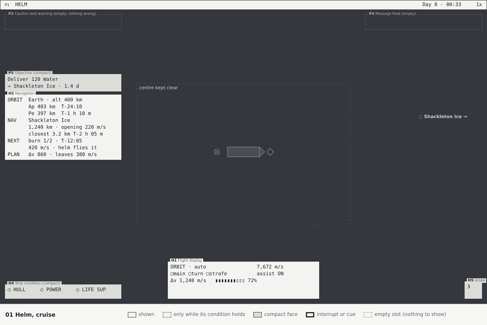

P1 (HELM, clock, warp) · P5 objective (compact) · H2 navigation · H1 flight display · H4 three quiet
lights (the corvette has no shield emitter) · H5 at 5 km, the smallest step that holds Highport, which
the ship has just left, and the Hauler Kestrel, both 3 km off (with nothing inside 50 km it shrinks to
a 48 x 48 button). P2, P3 and
P4 are empty and invisible. About 10 lines of text, against about 40 today.

### 11.2 Helm, warp

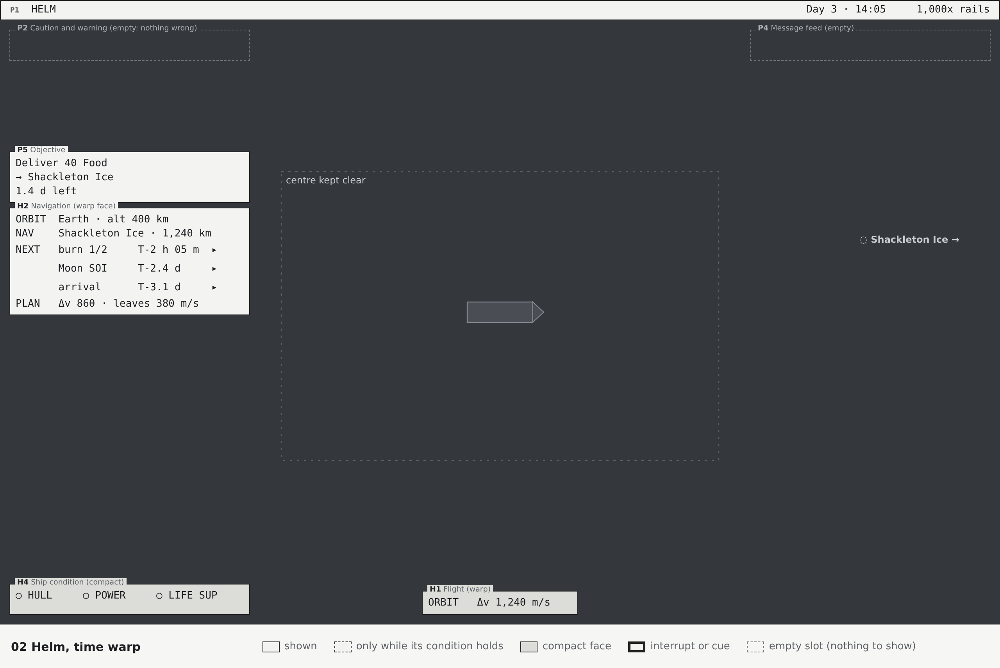

P1 shows the warp rate and any hold reason. H2 expands to the next three events, each with warp-to. H1
is reduced to delta-v and its frame. H5, H6, H7 and W1 labels other than Nav and objective are gone.

### 11.3 Helm, approach

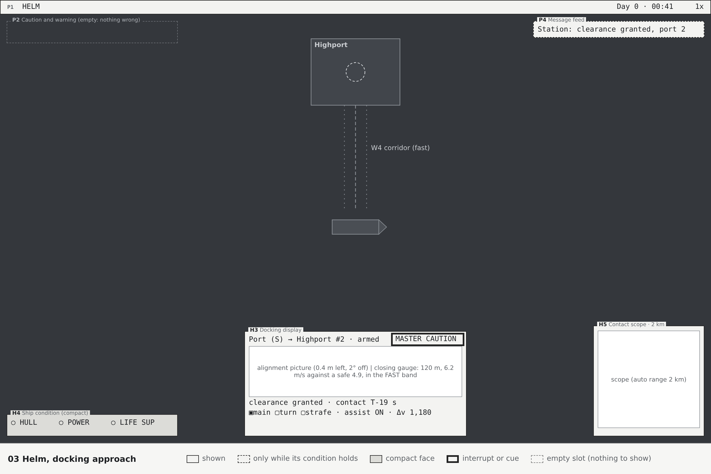

H3 docking display takes bottom centre, with the flight display's thrust, assist and delta-v along
its foot. H5 scope at 2 km. H2 steps aside: H3 names the station and has the distance, and the Nav's
world label drops its range, so the distance is on screen once. W4 corridor in the world. Coming in
too fast shows on H3's closing gauge and the corridor, with the master alert cue; P2 stays dark.

### 11.4 Helm, combat

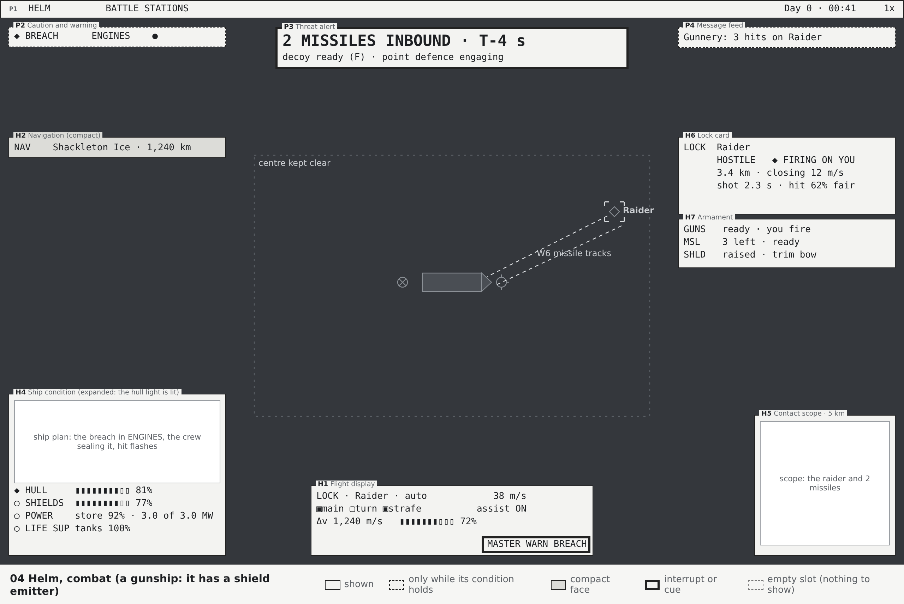

A gunship (it has a shield emitter, which the starter corvette lacks) is under fire: a raider fires
two missiles, and one hit has holed the ENGINES room. P3 shows the missiles and the decoy.
H6 lock card and H7 armament (guns, missiles, shield settings) on the right; H5 scope at the range
that holds the raider and the missiles; H4 has expanded by itself because the breach lit its hull
light, and P2 lists the breach with the crew sealing it; the master alert cue on H1 caught the eye
when the breach came. H1 stays; H2 is down to one line, the Nav and its distance (no event is due
within 30 minutes). P1 shows BATTLE STATIONS. Had the ship been unhurt, H4 would still be four dark
lights.

### 11.5 Fire control, combat

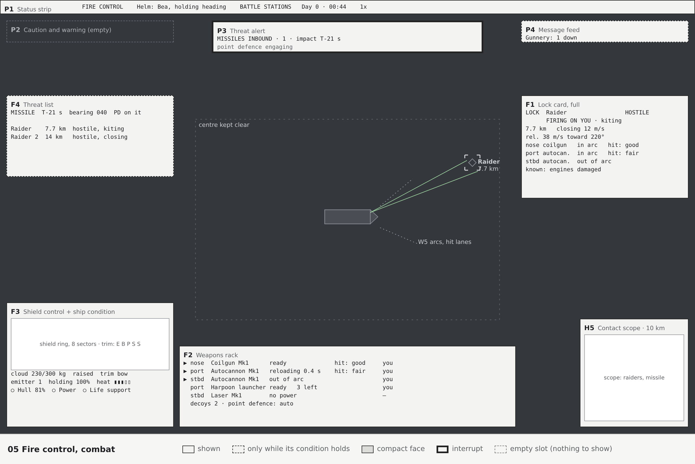

The same gunship, from the weapons console. F2 weapons rack at bottom centre, each mount with its arc
and hit chance; F1 full lock card right; F4 threat list left, with each missile's impact time, so P3
keeps only the count and the decoy; F3 shield control bottom left, with H4's other three lights under
it; H5 scope bottom right; P1 shows FIRE CONTROL and "Helm: Bea · holding heading". On the starter
corvette F3 is absent and H4 has the corner to itself.

### 11.6 Deck

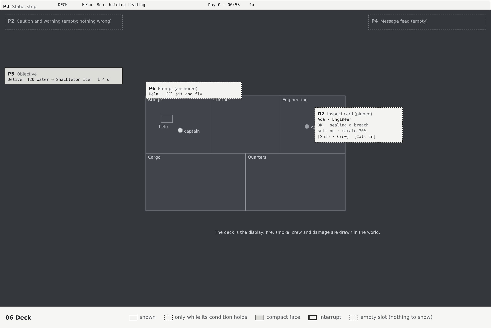

P1 (DECK, helm authority), P5 compact, and nothing else until something calls for it: the P6 prompt
appears at the helm console as the captain walks up; D2 appears over whatever the pointer rests on.

### 11.7 Deck, emergency

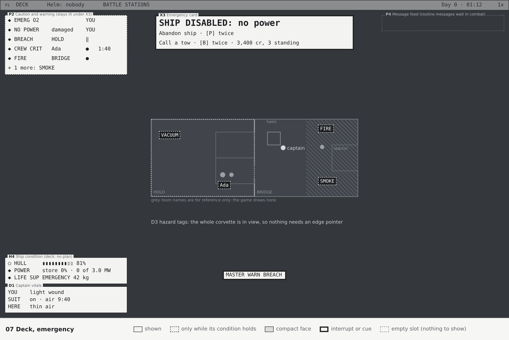

The ship is disabled, its reactor damaged, and its hold has lost its air. X3 offers abandon ship and the tow with their
costs. P2 lists, in its order: EMERG O2 and NO POWER, which need the captain (of the corvette's three
crew, Ada is down, Cole tends Ada and Bea fights the fire alone, so nobody is free for the reactor);
BREACH, which the crew leave unsealed until the fight ends, since Ada was hit in the HOLD (its hover
says the hold is at vacuum, and D3 tags it); CREW CRIT, which
they don't leave, since Ada has under two minutes; FIRE, with Bea on it; and SMOKE under "+1 more". D1 shows the captain's suit and
its air, not yet critical. The whole corvette is in view, so D3 tags the fire, the vacuum and Ada where
they are; on a bigger ship the far ones would be pointers at the edge. The master alert cue
stands alone at the bottom centre.

### 11.8 Docked

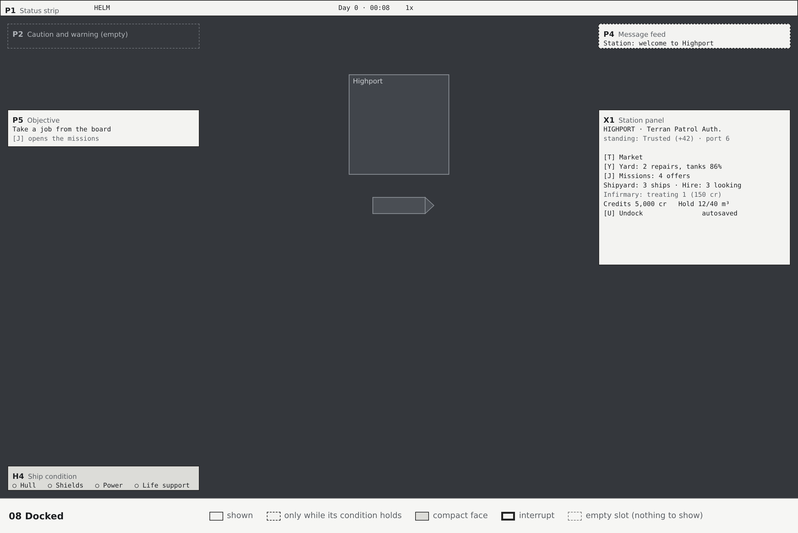

X1 station panel on the right; P5 objective; H4 compact (or expanded if there is damage, which the yard
can fix); P1. The flight instruments retire.

### 11.9 Map

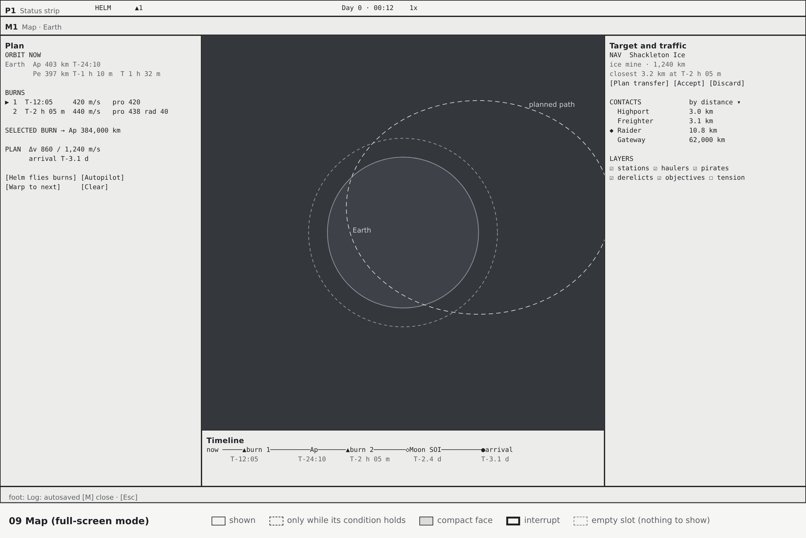

The plan to Shackleton Ice at the moment of 11.1: one burn planned, and the capture at the Moon shown
as an estimate until the crossing plans it. The Moon is drawn where it is now, with the Nav's mark on
it, and as the ghost the path meets, 54° further along its orbit, where it will be at the closest
approach in 4.1 days. The Nav card names the Moon and gives the arrival, as H2 does. The view row sits between the panels, and the timeline
runs to the contract's deadline. The map has no tabs, so the number keys keep the helm orders.

### 11.10 Station

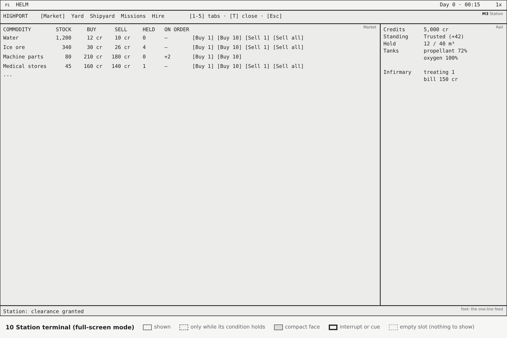

M3 as a panel over the docked view, as tall as its tab. Highport's Market is three rows (water, food
and machinery; each salvaged part aboard would add a sell-only row, but on day 0 nothing has been
salvaged), with the delivery this market can supply under the table: 28 more Food fill the hold. The tabs carry their numbers, and T closes the panel from the Market.

### 11.11 Ship, systems

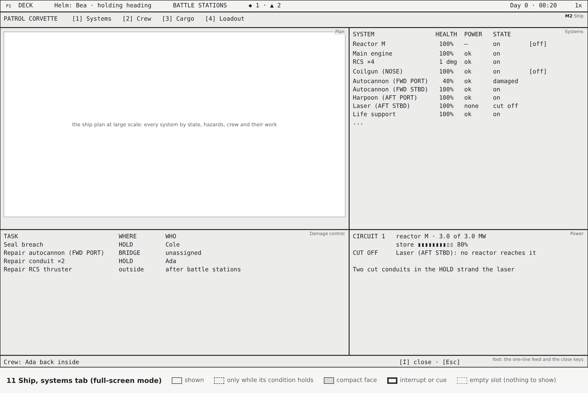

Battle stations, the crew doing what the game's crews would. One hit wrecked the hull tile under the
HOLD's aft port RCS quad: the HOLD is breached, the quad stops (a block works only while its tile
stands, `RcsThruster`), and Cole, the marine, took a light wound there. So the crew keep clear of the
HOLD until the fight ends and the breach waits (a marine never seals one anyway); Cole mans the
weapons console. The quad's repair is outside, so it waits for battle stations to end unless someone
is sent out, and sealing the breach from inside won't start it again: it fires once the repair frames
its tile back up. Ada, the engineer, repairs the FWD PORT autocannon, which damage has taken under the
30% where a system stops working; a gun's repair never waits. Bea, the crewman, has nothing else to
take, so Bea flies. One cut conduit in the BRIDGE strands the FWD STBD autocannon: the crew can only
reset a short, and a cut waits for a yard, so it shows under Power with the yard's price rather than
on the board. Every system row has its switch; the reactor's asks twice. P1's chip counts the breach
and the two guns out of action (SYSTEM DOWN).

### 11.12 Orders menu

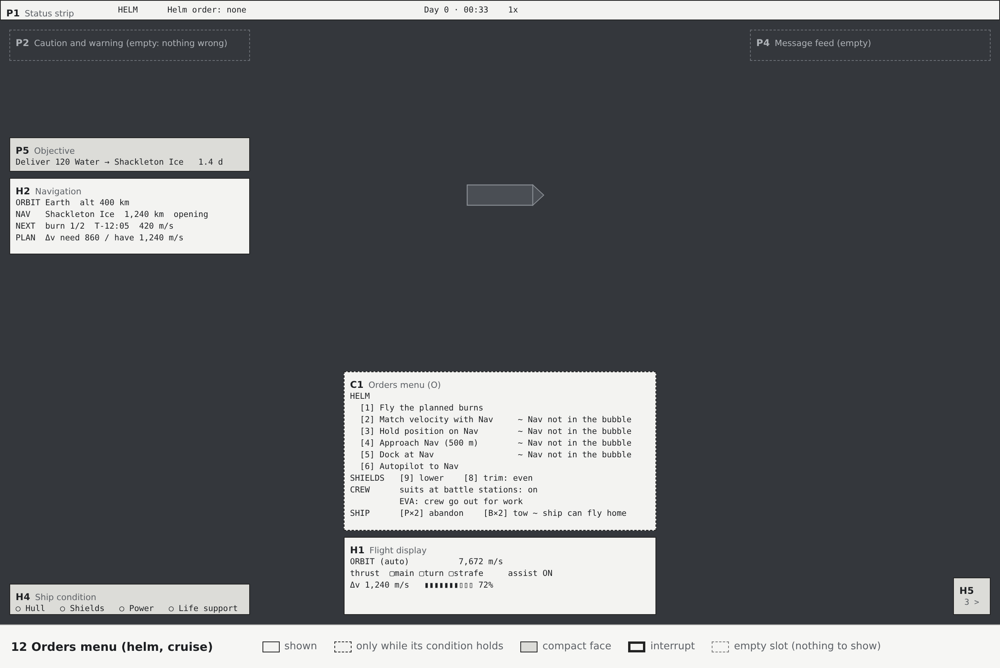

O at the helm in cruise, with no helm order running, so no helm key is down and P1's authority field
is empty. The four orders that need the Nav in the bubble carry a mark, and the menu's foot gives that
reason once with their keys; the tow's refusal is given the same way. Nothing is hidden, so the player
learns what exists.

### 11.13 Boarding, latched

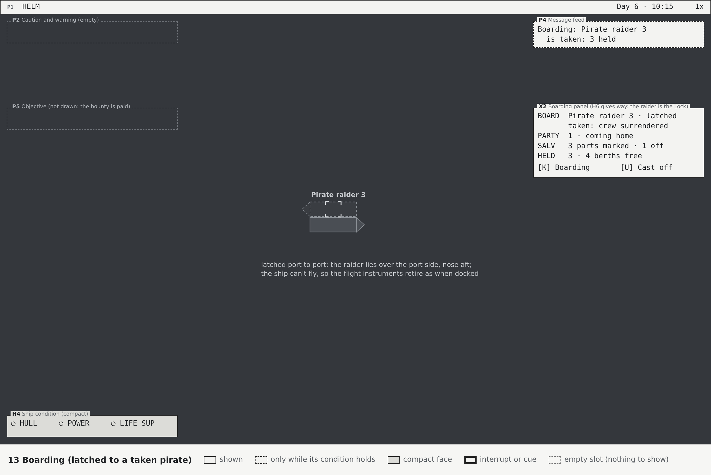

The fight is over and the ship has latched onto the beaten raider; the party has taken it. Latched,
the ship can't fly, so the screen is the docked one: P1, P5 with the bounty's next step, H4's quiet
lights, and X2 where the station panel would be. The raider is still the Lock, but H6 gives way: X2
names it, and its range and closing speed say nothing at 40 m. K opens M4 to mark parts and take the
cargo; U at the helm casts off.

---

## 12. Contract for the art directions

This is what the three art directions must keep, and what is theirs to change. The functional
designs from the other two threads may differ; this section applies to skinning this one.

### 12.1 Fixed

- The data each widget shows, its states, and when it appears (sections 6 to 10).
- Zone membership and stacking order (section 5). A widget may move within its zone.
- The centre clear area.
- Priority order in P2, W1 labels and the zone overflow rules.
- The text budgets (section 5.6) and P2's field widths: a style may draw a field as it likes, but not
  give it fewer characters.
- One home per datum: an art direction may not duplicate a value elsewhere for decoration.
- Every state below must be distinguishable **without colour** (shape, icon, label, fill or pattern
  as well), for colour-blind players.

### 12.2 Theirs to design

- Every visual: shape, framing, typography, colour, texture, line, glow, sound cues for UI.
- How a widget is built: a "two-axis alignment picture" may be a crosshair, a pair of needles, a
  segmented display or a scope trace; a "bar" may be a gauge, a stack of segments or a dial.
- Diegetic dressing: bezels, screws, scanlines, labels on hardware, the seat's console frame around
  the view, as long as the zones stay readable.
- Motion style within section 5.3.
- Exact geometry within ±10% of the stated sizes, and the inner layout of each widget.

### 12.3 Semantic tokens to style

| Group | Tokens |
|---|---|
| Severity | nominal, advisory, caution, warning, warning-urgent (time-critical) |
| Allegiance | own, friendly (sponsor and allies), neutral, hostile, beaten (disabled, surrendered, wreck), unknown or stale |
| Selection | lock, nav, objective, hover, focus (pad), selected |
| Path | actual, planned, predicted (missile), corridor-safe, corridor-fast, corridor-danger |
| Handling | needs you, held, crew on it, clears by itself |
| Control | idle, hover, focus, pressed, disabled, active (toggle on) |
| Data | live, stale (last known), unavailable ("--") |
| Hit chance | good, fair, poor. The art directions choose its colours, and should keep them apart from the severity colours; the colour-free channel is a word or a shape (pips, fill). Today's green, yellow and red clash with severity in every style |

### 12.4 Sizes and legibility

- Labels (legends, units, key names on caps) at least 12 UI units; body text at least 13; values at
  least 15; P3's first line at least 22. (Today: body 15, banners 22.)
- A **value** here is a reading a widget exists to show, drawn on its own: H1's speed and delta-v,
  H3's distance, closing speed and time to contact, the figures beside H4's and F3's bars. A number
  inside a line of text (H2's lines, P2's rows, P3's second line, a price in X1 or X3) takes the
  line's size. The 34-character budget counts lines at 13; a widget that draws values at 15 gives
  them the room.
- Anything that can be clicked is at least 24 units in its smaller dimension.
- Widget sizes in this document are targets at 1280 x 800 units; `UiScale` scales them.

---

## 13. What is cut, and why

| Cut | From | Why | Where it went, if anywhere |
|---|---|---|---|
| "View EXTERIOR [V]" | Flight panel | The seat says it, and the player sees which view it is | P1 seat |
| "Markers orbit / TARGET" line | Flight panel | Separate line for a frame that belongs with the speed | H1 frame tag |
| Heading (deg) | Flight panel | The ship's drawing shows its heading; alignment for docking is in H3 | H1 expanded |
| Orbital speed as the default speed | Flight panel | ~7,670 m/s in low orbit, unchanging, rarely a decision | H1 speeds in the reference frame; ORBIT frame keeps it |
| Period in seconds | Flight panel | Unreadable; times to apsides are what matter | H2 expanded, as a time |
| Second and third copies of the lock | Status column, nav readout | Duplicates | H6 / F1 |
| "Target: none", "No target [Tab]" | Status column, flight panel | Says nothing | – (a learning hint teaches Tab) |
| "Missile: ready" out of combat | Status column | Not a decision until combat | H7 |
| Budget line | Status column | Not a flight decision | M5; payday in the feed |
| Small orbit panel and its caption hints | Bottom right | Duplicates the map and the orbit numbers | M1; H2 |
| "ALL SYSTEMS NOMINAL", four bars at 100% | Ship panel, gauges | Dark cockpit | H4 compact lights |
| "Dock port 1/1: S active, free" | Status column | Debug phrasing; shown even far from any port | H3 port line, approach only |
| "strain 0%" | Status column | Debug value | P2 DOCK STRAIN above 50% |
| Raw approach numbers | Status column | Unflyable as text | H3 |
| Fixed bottom key hint line | Bottom edge | Permanent teaching of known keys | P6 learning hints; M6 |
| "Lighting on/off" (O) | Notices | Graphics option, not play | Settings › Graphics; developer layer; O opens the orders menu |
| Range under every nameplate | World | Clutter | Lock, Nav and hostiles only |
| All later burns' arrows and numbers | World | Clutter | W3 next burn only; M1 |
| "Scenario: ...", "Content loaded with errors" | Notices | Developer information | Developer layer |
| Console power panel on every console | E | A modal window for a single switch | D2 inspect card |

---

## 14. What the simulation must provide

The design needs these from the game, through ui-hud's provider pattern (interfaces in
`com.ringsofiron.uihud.providers`, filled in core):

| Provider | New or changed | Data |
|---|---|---|
| `UiContextProvider` | New | Seat (helm, fire control, gun and which, deck); situation flags with their reasons; helm authority (who, order, autopilot, held reason); battle stations; warp hold reason |
| `ConditionProvider` | New | The P2 catalogue as structured rows: code, severity, detail, location tiles, handling (assigned crew count, or held and why: under fire or outside), timer and its kind (harm or recovery) |
| `MessageProvider` | Change `NoticeLog` | Each notice with a source (P4's list) and a kind split into event or condition; conditions stop posting as notices. The Log also takes P2's conditions from `ConditionProvider` and P3's missiles from `ThreatProvider` as they start and end, and keeps each merged gunnery line's events |
| `HintRegistry` | Change | A gun context apart from the weapons console's, so M6 lists the gun seat's keys under the seat P1 names |
| `HullHitEvent` (combat-sys) | Change | Carries who fired the round (`ImpactResolutionSystem` has the hit's owner), so the Log can say "2 hits from Raider" |
| `ShieldStatusProvider` | New | Whether the ship has an emitter at all; stock, capacity, cloud, scattered, adrift, stowed, raised, lowered for dock, trim, sector thickness (8), emitters (holding, heat, trip) |
| `PowerStatusProvider` | New | Per circuit: reactors, rated and actual output, store and refill; systems switched on but cut off from every reactor; shorts with their reset time (`DamageStates.AUTO_RESET`, 45 s) and stuns with theirs |
| Room names | New, in interior-grid | Each compartment's name by section 5.5's rule, kept with the layout |
| `WeaponStatusProvider` | New | Per mount: name, position, weapon, state, reload, power, stunned, in arc, hit chance on the lock, ammunition, controller; missiles; the decoy's cooldown; point defense active |
| `CaptainStatusProvider` | New | Condition and bleed-out, suit on, suit air, local air, carried item |
| `FlightStatus` | Extend `ShipStatusProvider` or new | Thrust per axis, rotation assist, delta-v left, acceleration, mass, frame velocities |
| `NavigationProvider` | New, over `Navigation` | Structured readout: nav target, distance, closing, closest approach, next events (burns, apsides with times, SOI changes, a leg's capture, impact, arrival), plan Δv. An accepted trip to another body keeps the leg still to come (the capture's estimated time and Δv, and the arrival) with its `TransferLegComponent`: today accepting drops the proposal and keeps only the burns, so after burn 1 the capture has no time and the plan's Δv is gone |
| `DockingProvider` | New, over `PlayerDocking` | Ports, selected, armed, clearance state, the approach (distance, lateral, angle, closing, safe speed), capture state |
| `StationProvider` | New, gathering existing | Station name, faction, standing, services available with counts, infirmary |
| Contact state | Change `HudMarkerComponent` | Allegiance and state as a value (from `HostileLabel`), not only tint and label text |
| Inspect | New | What is under the pointer on deck: crew, system, tile, door, bay, with their fields |
| `BoardingProvider` | Change | The boarding party's size and what it is doing (crossing, fighting or coming home), for X2 |
| `OrbitPathProvider` | Change | A ghost mark carries the time it stands for (`PlayerOrbitPath.ghostTime`), for M1's label beside the ghost; today it has the body's name and sizes only |
| `ThreatProvider` | Change | Time to impact with the missile's closing burn in it: t = (−v + √(v² + 2ad)) / a, with a the missile's `closingBurn` while it has fuel above its reserve. Today's time (`CombatThreats`) is closest approach at the present speed, an upper bound that runs long while the motor burns: a harpoon from 7.7 km reads 37 s five seconds after launch, when it lands in about 17 |

The other existing providers (`TradeProvider`, `YardProvider`, `MissionProvider`, `CrewProvider`,
`ShipyardProvider`, `ManeuverPlannerProvider`, `TrafficMapProvider`, `TargetingProvider`) carry the
full-screen modes as they are.

---

## 15. Input, focus and the Esc stack

- **Keys keep their actions** (section 4.3 maps them to modes). New: a detail key (hold) to expand
  every instrument, a frame key to cycle the reference frame, O for the orders menu (C1), which the
  lighting toggle gives up, and `\` to acknowledge the master alert cue (P2). All rebindable. E
  becomes each object's main action (P6).
- **Esc closes the topmost thing**: the inspect card, then a mode, then (with nothing open) the pause
  menu, as `GameShell.hudWindowOpen` does today.
- **The same key closes the mode it opened**; a mode's tab keys (the tabs' numbers, and in M3 T, Y
  and J) switch tabs inside it (section 10).
- **One mode at a time.** Opening another replaces it.
- **Gamepad.** Every mode and every clickable widget is reachable with `FocusNav`. In the HUD, the pad's
  Back layer opens modes as today. The inspect card follows the focused object.
- **Mouse.** Hover expands an instrument; click on contacts, scope and map selects as today.

---

## 16. Building it

For whoever implements it. In order, each step shippable on its own:

1. **Context and zones.** `UiContextProvider`; the zone layout in `UiHud`; P1 to P4 replacing the
   status column; the cut list; the orders menu (C1), which only gathers orders that already exist.
   The biggest visible change for the least work.
2. **Helm.** H1, H2, H3, H4, H5, H6, H7; the reference frame; W1 decluttering and W3.
3. **Fire control.** F1 to F4 with `WeaponStatusProvider` and `ShieldStatusProvider`.
4. **Deck.** D1 to D3; the inspect card replaces the console power panel.
5. **Modes.** M2 Ship, M3 Station and M5 Captain's record consolidating today's windows; X1 to X3.
6. **Map.** M1's new panels and the timeline.

Each step keeps `UiScaleTest`-style layout tests: no widget overlaps another at 1280 x 800 and at the
largest scale, and the centre stays clear.

---

## 17. Questions for Joe

1. **Reference frame.** The speed and velocity markers would follow the port, then the Nav, then the
   Lock, then the orbit, automatically (section 4.5). Today the markers follow the Lock only. Is the
   wider rule what you want?
2. **Modes from anywhere.** The keys open Ship, Map and Captain's record from any seat; consoles on deck
   open them too, preselected. Or should some (Ship › Systems) need the right console?
3. **Key hints.** Learning mode by default, retiring a hint after it has been used 3 times?
4. **Modes and time.** Full-screen modes don't pause the game. Should any of them (the station
   terminal while docked, say) pause or slow time?
5. **Lock and Nav.** Keep them as two selections with two names, or merge them into one "selected
   contact" with weapons and navigation both following it?
6. **Acknowledging warnings.** Version 3 adds an acknowledge (a click on the master alert cue, or `\`)
   that silences a warning; the warning's row stays while its condition holds. Is that the behaviour
   you want, or should warnings never need a press?
7. **O for orders.** The orders menu takes O from the lighting toggle, which moves to Settings. Is a
   different key better for you?

---

## Revision log

| Version | Round | Changes |
|---|---|---|
| 1 | 0 | First version: inventory, context model, widget catalogue, wireframes |
| 2 | 1 (self-critique) | H4 no longer expands just for combat, only when a light is lit (dark cockpit held in fights). Master alert cue on the primary instrument for new warnings. Objective shows in combat for fight contracts. The reference frame never switches mid-manoeuvre. Message feed summarises during combat. New C1 orders menu on O, gathering every order with why it can't be given. E is each object's main action. Inspect card: pin before acting, confirm risky switches, gamepad subject rule, EVA orders. Hover card for exterior contacts. COLLISION condition. Inset views stay world-anchored, clamped clear of widgets. Station panel no longer misassigns I and Y. Missions tab shows held contracts. Zones given exact bounds; the centre clear area moved to 220..590 so interrupts fit above it. Deck applies aboard any craft. Time format examples fixed. Wireframe 12 added |
| 3 | 1 (art directions' critiques) | One home per datum enforced across every widget: approach distance and closing speed are H3's alone, the lock range the lock card's, the decoy P3's, missile times P3's or F4's, Δv left H1's, plan shortfall H2's, shield settings H7's at the helm and F3's at fire control; P2 details name where, never a value another widget shows. P2 rebuilt as fixed-width rows (severity, 10-character code, detail, handling, timer) with harm and recovery timers; handling shows YOU or a dot per crew member. The captain's suit air leaves P2 for D1, then X3 when critical. Acknowledge for warnings. P3 is two lines. H6 shows the state in one word, FIRING ON YOU as its own flag and the hit chance as a percentage. The starter corvette has no shield emitter, so the shields light, bar, H7 row and F3 appear only on a ship that has one. Room names follow the rule the task design already uses (BRIDGE, HOLD, ...). D3 becomes on-screen tags plus edge pointers. C1 grows to 620 x 250 and gives each reason once. Labels may drop to 12 units. Wireframes redrawn with a check that no text runs past its box; combat and fire control show the gunship |
| 4 | 2 (self-critique) | Latched to another ship is the Boarding situation, not Docked: the screen is the docked one with X2 in X1's place, and H6 gives way when the latched ship is the Lock. X2 gets its size, an example and a cast-off key; wireframe 13 and walkthrough 11.13 added; the provider must give the party's size and activity. X3 fits under P3: Abandoning replaces Disabled, and a second state shows as one line. P2's "+n more" row lists only the codes that fit. In full-screen modes P1's chip is the master alert cue; docked or latched, the cue stands alone at the bottom centre |
| 5 | 2 (VFD critique) | X2 gives the state a row of its own (seven rows, 308 x up to 150), so its worst case fits 34 characters. X3 doesn't offer abandoning or a tow while power is due back by itself; P2's NO POWER row counts it down, and walkthrough 11.7 now has a damaged reactor, which is a real emergency. The master alert cue stays lit under X3. Sample data made true to the game: a delivery to the ice mine is 40 Food (it buys food, and the corvette's hold takes 40), and missile times fit what a harpoon or dart can fly (T-4 s at 7.7 km, not T-37 s) |
| 6 | 2 (NASA-punk critique) | P2 codes use whole words where they fit (HULL DAMAGE, SHIELD DOWN, SHIELD WEAK, SYSTEM DOWN, DOCK STRAIN) and put the noun first (O2 LOW, PRESS LOW): the code field grows to 11 characters and handling shrinks to 3, which still holds YOU, three dots or ●4. The missile impact time must include the missile's closing burn (section 14). Version 5 was wrong to call T-37 s at 7.7 km impossible: it is today's estimate early in a flight that lands in about 22 s; the examples stay, now read by the new estimate. F2 names mounts by the game's facing rule, with FWD and AFT to tell two apart, shows point defense as PD and never in hand, and shows launchers as ready with missiles left (they fire a second apart and only a station restocks them). H5 gains a 5 km step. W3's burn arrow drops its countdown, which is H2's. P4 gains the Shields and Boarding sources. Sample data: the corvette carries three crew, so 11.7's fire has one on it and X2's party is two; the lock sits at 3.4 km, inside the heavy cannon's reach, for its 62%; the latched raider lies over the port side, nose aft |
| 7 | 3 (VFD critique) | "Point defense" spelled as the game spells it (`point_defense`), so the three designs share one string. H7's missile row is the total across launchers, ready while any can fire; F2 splits it by launcher |
| 8 | 2 and 4 (cassette and NASA-punk critiques) | Sample data true to the game: the corvette's S port is cleared to Highport's port 2, coming in at 120 m too fast for the 4.9 m/s safe speed there; Highport sells no ships, so X1 lists hiring on its own line, and M3 shows Shipyard and Hire only where they are offered; F1's kiter moves along the line of sight. F4 names each missile's shooter instead of a bearing with no reference. Section 12.4 says which numbers are values drawn at 15. H4's power line shows the output and adds the rating only when damage holds the output under it. At fire control the master alert cue sits above the rack. H5's 5 km step is justified by fights that reach 5 km. W5 notes that the lead reticle sits inside the lock mark at fight zooms |
| 9 | 3 (VFD critique) | H6's example closes at 12 m/s (pilots close at 80 m/s at most), and wireframe 04's H1 reads the kiter's 12 m/s in the LOCK frame, matching F1 |
| 10 | 3 (cassette critique) | Sample data true to the game's geography and ships: Shackleton Ice orbits the Moon, so from Highport's orbit it is 384,000 km away, and the planner's trip is 3,084 m/s out, about 793 to capture and 4.2 days; the corvette's 2,000 kg of propellant give about 8,750 m/s with an empty hold, so with the delivery's 20 t of food aboard H1 reads 5,606 at 72% (the gunship's 4,000 kg give it 6,831); the delivery's deadline (5.2 d) outlasts the trip; the market at Highport (an agricultural dome) trades water, food, machinery and salvage; Gateway, which the game doesn't have, becomes Anvil Yards; the ship is named by its class. H2 leaves out an apsis past the next burn, and for a Nav around another body names the body and gives the arrival in place of closing and the closest approach. A trip to another body is shown as the game plans it, a leg at a time: one burn before the crossing, then the capture as an estimated event, which H2, M1's burns list and the timeline show and section 14's NavigationProvider keeps. Mode tabs carry their keys (their numbers, which take the helm orders' keys only while a mode with tabs is open) and the foot the close keys. M1 lists all of today's map controls (Delete burn, Next target, Centre, Fit, All traffic). M3 becomes a panel as tall as its tab, and its Market lists the held deliveries it can supply. Wireframe 01's scope shows at 50 km, since the ship has just left Highport, which the map at the same moment lists 3 km off. Wireframe 11: Bea flies and Cole seals the breach, the P1 chip counts the breach and the two guns out of action, and the job held for battle stations is the EVA one |
| 11 | 4 (NASA-punk critique) | Samples the game can't produce, checked against its code. Wireframe 11's crew do what the game's crews would: Cole is a marine, who never seals, and mans the weapons console; Cole's light wound in the HOLD keeps the crew clear of the breach until the fight ends; Ada repairs the gun, whose repair never waits; Bea, with nothing else to take, flies. A cut conduit is yard work, not a crew job, so version 10's "Repair conduit ×2" is gone and the power panel gives the yard's price. The cut that strands a gun is one conduit under the FWD STBD autocannon, since the laser's tile is the only link from the aft systems to the reactor. The damaged autocannon is at 20%, under the 30% where a system stops working. The systems list shows two engines and eight RCS blocks, one stopped. P2 gains a fourth handling state, Held (‖), for the game's rule that crews keep clear of where crew were hit and stay inside at battle stations; the P2 sample and wireframe 07 use it, and Ada's bleed-out in 07 is under the two minutes that send the crew in anyway. The P2 sample says why nobody is free for the vacuum: the gunship's other two crew are marines, who never seal. X2's party is the ship's marines (Cole alone) and goes home once the craft is taken. Wireframe 10 has no salvage on day 0 and nothing on order, so the delivery's 40 Food fit the 40 m³ hold |
| 12 | 4 (NASA-punk critique) | H5's cruise range is the smallest step that holds every contact inside 50 km, in the shape of the combat rule: at a fixed 50 km, the station the ship has just left sat under the own-ship mark, and leaving a station is the commonest cruise. Automatic ranges step out at once and back in only inside 80% of the smaller ring. Wireframes 01 and 12 show the scope at 5 km |
| 13 | 4 (NASA-punk critique) | Wireframe 11's RCS row reads a dash for power, as for health: the game's RCS blocks draw no power (`RcsThruster`, `RcsThrust`: a block fires while its hull tile stands and there is propellant), and the systems list dashes any value the game doesn't have |
| 14 | 4 (VFD critique) | M1 draws a body the plan meets twice, as the game does: where it is now, with the Nav's mark on its station, and as a ghost where it will be at the plan's closest approach, labelled with that time; wireframe 09 shows both, the ghost 54° further along the Moon's orbit. M1's Nav card follows H2's NAV rule, so for a Nav around another body it gives that body and the arrival, not a closest approach. Section 14 lists `OrbitPathProvider`'s ghost time and gives the boarding party's states as X2 has them |
| 15 | 4 (VFD critique) | Wireframe 11's stopped RCS block and the HOLD's breach are one hit on the same hull tile, the aft port quad's, which also wounded Cole: a block stops only while its tile is wrecked, and every one of the corvette's stands on hull next to the interior, so a stopped block always comes with a breach or a sealed one. The systems list gives every system its switch, as the game does, with a group's row switching the group and the reactor's guarded. Wireframe 11's feed line is the game's wound notice |
| 16 | 4 (NASA-punk critique) | The Log keeps a fight's record: P2's conditions and P3's missiles go to it, Log-only, as they start and end, since the feed leaves them out; it keeps the feed's merged gunnery lines, each opening to its events. P4 says which source each notice takes. The Log's filters step with ← and → under `FocusNav` and the list scrolls as today's log does. M6 gives the gun seat its own section, which needs a gun hint context (section 14). P4's example crew line is the game's own ("Ada is back in from EVA") |
| 17 | 4 (NASA-punk critique) | P2 shows a room's air as one row at a time, the first that holds of BREACH, VACUUM (sealed, still airless) and PRESS LOW (refilling), so one hole never takes three rows; wireframe 07 and the P2 sample show the open breach as BREACH, as wireframe 04 does. The Log writes conditions in the catalogue's long form, follows a room's air through those steps, and takes the hits the ship takes from guns as merged lines, which needs `HullHitEvent` to name the shooter. Conditions, missiles and hits taken take a source and a severity in the Log (a missile's lines are warnings). The Log's severity filter is a threshold, and a merged line takes its first event's time |
