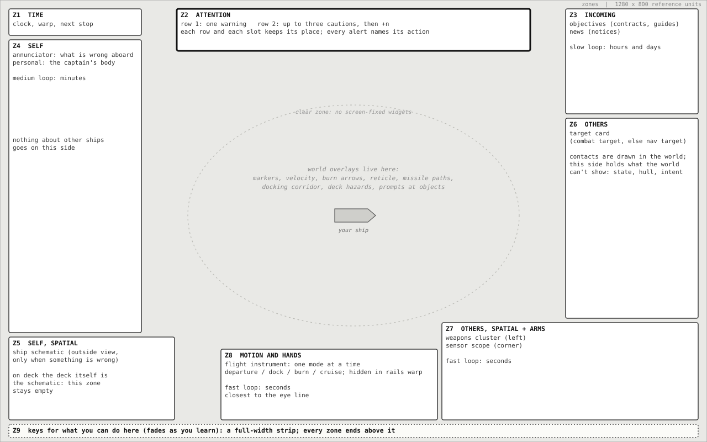
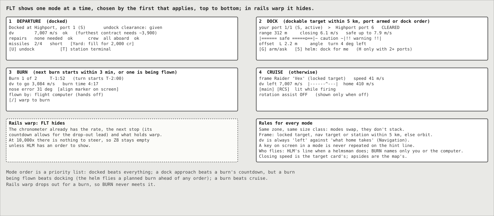
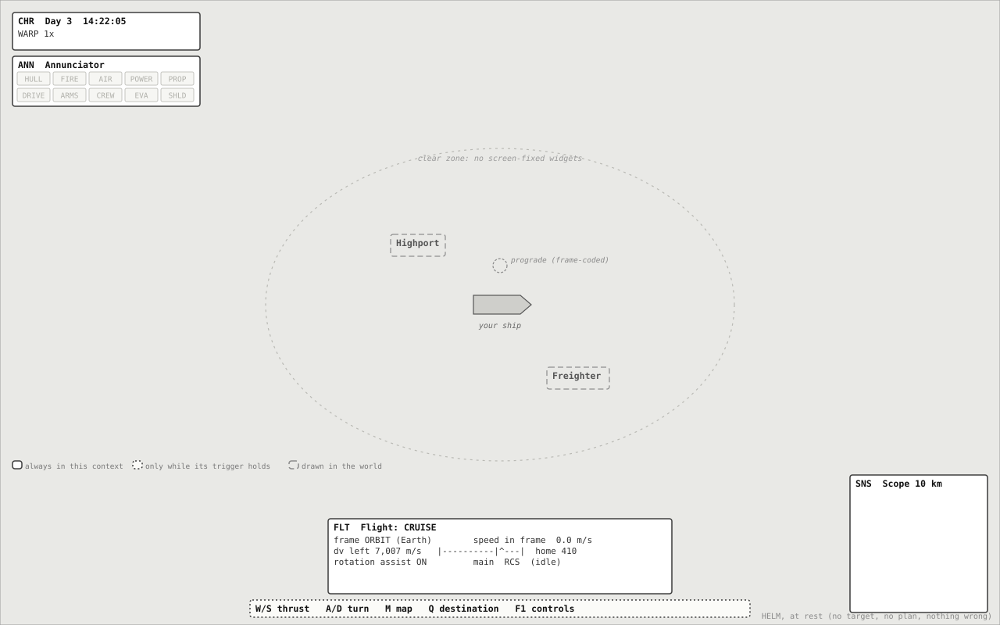
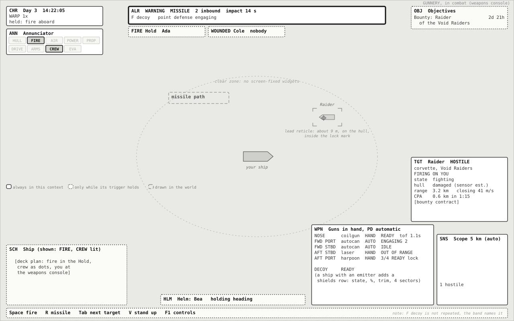
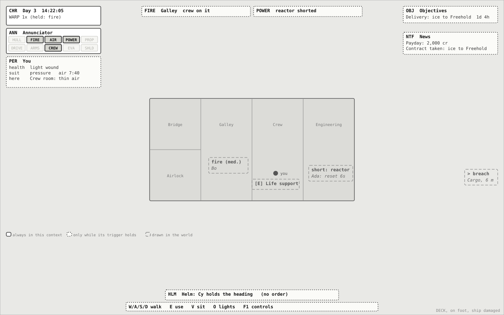
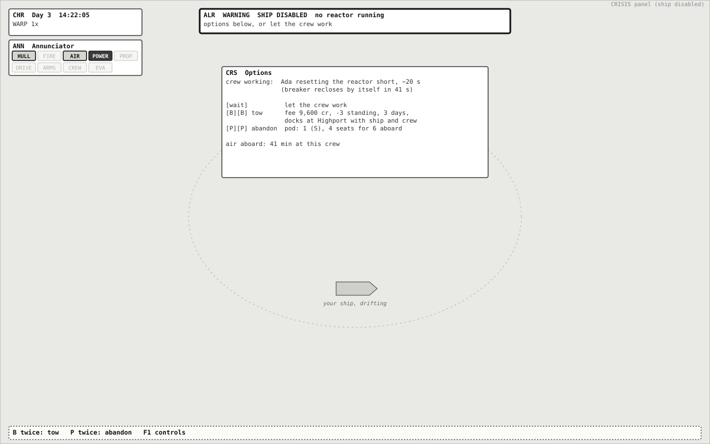
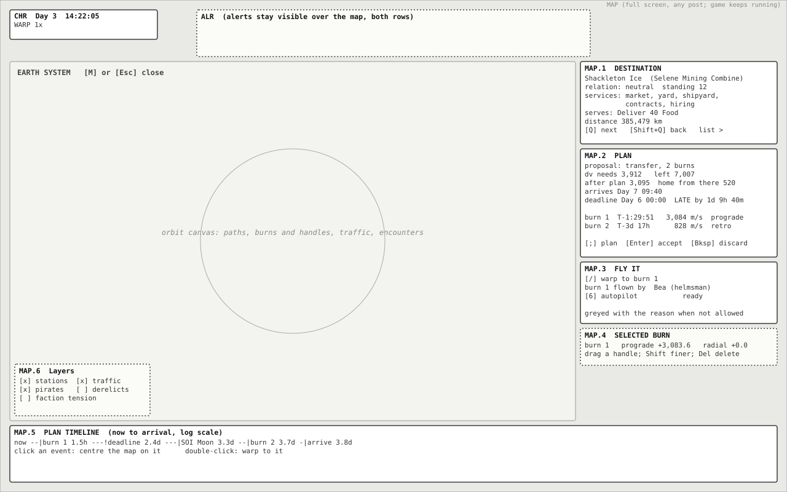
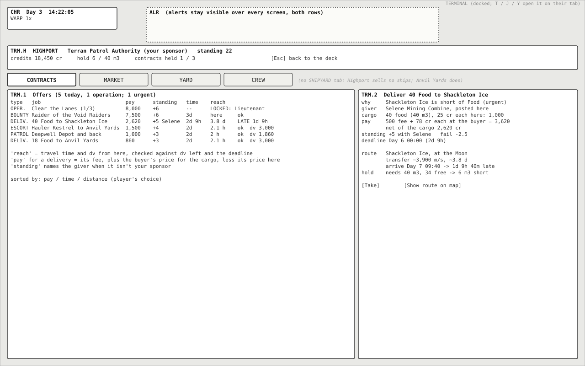
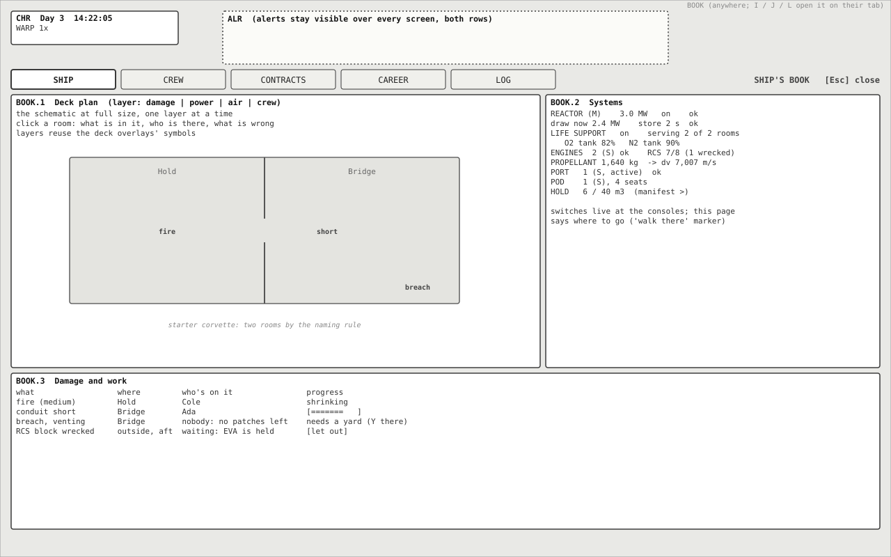
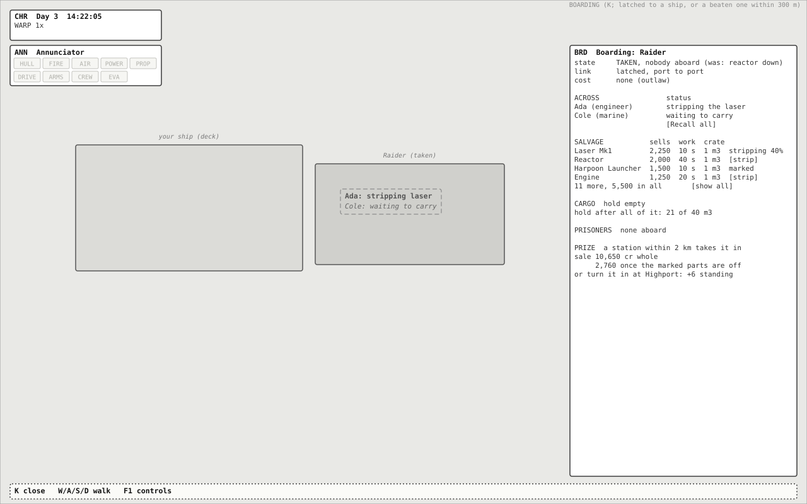

# UI Overhaul: Task-Driven Functional Spec

Functional designer 2 of 3. Round 7.

This spec rebuilds the game's interface from the decisions a player makes, not from the panels the game has today. It says what each widget and screen contains, where it sits, and when it is visible. It says nothing about how anything looks: three artist threads (Nasa-punk, 90s VFD, Cassette-futurism) skin it, and section 12 lists what they are free to change and what they must keep.

**The result in one paragraph.** The screen follows where the captain is. On foot, the HUD is the ship around you and what is wrong with it. Seated at the helm, it is your motion. Seated at the weapons, it is the fight. Every screen-fixed widget has one fixed zone: time and alerts across the top, your own ship on the left, other ships on the right, your motion and your hands at the bottom centre, and the middle of the screen left to the world. Nothing shows while it has nothing to say: at rest in flight the HUD is a clock, a row of dark status lamps, one flight instrument and a scope. Urgent things speak through one alert band, ranked, and each alert names what to do. The windows the game has grown (market, yard, shipyard, missions, crew, boarding, notice log, controls) fold into three screens: the **Map** for getting somewhere, the **Station terminal** for everything a station sells, and the **Ship's book** for your ship, crew, contracts, career and log.

Contents:
1. [Method](#1-method)
2. [Where the player can be](#2-where-the-player-can-be)
3. [The decisions](#3-the-decisions)
4. [What the decisions say about information](#4-what-the-decisions-say-about-information)
5. [Screen zones](#5-screen-zones)
6. [Widgets](#6-widgets)
7. [Screens and panels](#7-screens-and-panels)
8. [Visibility rules](#8-visibility-rules)
9. [Alerts, lamps and news](#9-alerts-lamps-and-news)
10. [Input, focus and closing things](#10-input-focus-and-closing-things)
11. [Audit of the current UI](#11-audit-of-the-current-ui)
12. [Notes for the artist threads](#12-notes-for-the-artist-threads)
13. [What the game needs to expose](#13-what-the-game-needs-to-expose)
14. [Open questions for Joe](#14-open-questions-for-joe)
15. [Revision log](#15-revision-log)

---

## 1. Method

1. Read every design document under `documentation/` and list the contexts a player can be in (section 2).
2. List the decisions a player makes in each context, moment to moment and over a career. For each, write the question the player is really asking and the least information that answers it (section 3).
3. Draw the principles out of that list (section 4), then design widgets from the minimum information (section 6) and screens for the slow decisions (section 7).
4. Place the widgets in zones (section 5) and write when each is visible (section 8) and how urgency is handled (section 9).
5. Only then compare with the current UI, element by element (section 11).

The current UI was deliberately ignored until step 5. Where a widget here resembles one in the game, it is because a decision needs it, not because it exists.

Wireframes are grey boxes in the game's reference units (1280 x 800, the units `UiScale` scales). Solid boxes are always shown in that context, dotted ones only while their trigger holds, dashed ones are drawn in the world. Sample numbers come from the starter career (Highport, the corvette, the raider). `functional-task/wireframes.py` draws them (`python3 wireframes.py <out dir>`), so a revision changes the geometry in one place.

---

## 2. Where the player can be

The game's own rule decides the first cut: the captain must be seated at a console to see outside (GDD section 6). So the captain's body is always somewhere, and that place decides what they can act on. This spec calls it the **post**.

| Post | How the player gets there | What they can act on |
|---|---|---|
| **Deck** | Walking aboard their ship, a docked station or a latched ship | Their body, doors, consoles, suit lockers, furniture; giving orders that don't need a seat (helm orders, crew orders, map plans) |
| **Helm** | V at the helm console | Flying: thrust, turn, strafe, docking ports, undocking; firing the guns on the trigger |
| **Gunnery** | V at the weapons console (every gun and launcher in hand) or at one turret mount (that gun) | Aiming and firing, missiles, decoys, shields; the helmsman flies |

Over any post the player can open a **screen** (full screen, the game keeps running) or a **panel** (beside the view):

| Screen or panel | Opened from | For |
|---|---|---|
| Map | Any post | Getting somewhere: destinations, plans, burns, warp |
| Station terminal | Any post, while docked at a station with its clearance (as the market is today) | Everything a station sells: contracts, market, yard, shipyard, hiring |
| Ship's book | Any post | Your ship in detail, your crew, the contracts you hold, your career, the log |
| Boarding panel | Any post, while latched to a ship or within EVA reach of a beaten one | Boarding, salvage, prisoners, prizes |
| Console panel | Deck, at a system console (E) | That one system: its switch and its numbers |

And five **conditions** change what a post shows:

| Condition | Comes from the game's own state |
|---|---|
| **Docked** | `DockingSystem` has the player's ship latched to a station |
| **Latched** | Latched to another ship |
| **In combat** | The ship is at battle stations (`CrewMedical.atBattleStations`: a hostile captain has it as their target, it fights one, or a shot was fired or taken in the last 60 s) |
| **Warping** | Rails warp. Physics warp (the bubble still simulated, up to 10x) changes only the chronometer: the ship can still be flown and fought |
| **Crisis** | The ship is disabled, being abandoned, or stranded with a tow on offer (`DistressBeacon.refusal() == null`) |

Outside the game sits the **shell**: main menu, new career, load and save, settings, controls, and the end screens.

---

## 3. The decisions

Every row is a decision the game asks of the player. "Minimum information" is what answers the question and nothing more; anything a widget shows must trace back to a cell in this section. Tempo is how fast the decision has to be made: **s** seconds (in the eye line), **min** minutes (glanceable at the edges), **h/d** hours and days (behind a key).

### F. Flying (helm)

| ID | Decision | The question | Minimum information | Acted with | Tempo |
|---|---|---|---|---|---|
| F1 | Point and thrust | Which way am I moving relative to what matters, and how fast? | Velocity in the frame that matters (the locked target, the navigation target or a station within 5 km, else the orbit; FLT gives the order): direction on screen, speed as a number | W/S/A/D, Z/C, X | s |
| F2 | Avoid a collision | Will I hit something, and when? | The object and the time to contact, only when it is close | Steer, brake | s |
| F3 | Dock | Which port, am I cleared, am I lined up and slow enough? | My port and its state, the port I'm given, clearance, range, sideways offset, angle off, closing speed against the safe speed | G, H, steering, or helm order 5 | s |
| F4 | Leave a station | Is the ship ready to go? | Delta-v left, repairs needed, crew aboard, missiles, the contracts held and how far their destinations are | U | min |
| F5 | Fly a planned burn | When do I start, where do I point, when do I stop? | Countdown, pointing error, delta-v still to go, burn time, who is flying it | Turn, thrust, or hands off | s |
| F6 | Skip time | How fast can I warp, and what will stop me? | Warp rate, the next stop and when, what is holding warp back | , . / | min |
| F7 | Hand over the helm | Can someone else fly this while I do something else? | Is there a helmsman, what order stands, is it being flown or waiting and why, which orders are possible here | 1 to 6, 0 | min |
| F8 | Stay in orbit | Am I going to hit the planet or leave this body's sphere? | Periapsis against the surface and the time to impact; the next change of sphere of influence | Burn, plan | min |
| F9 | Burn with crew outside | Is anyone on the hull who a burn could throw off? | Who is out and where, the tether | Hold the burn, call them in | s |

### C. Fighting (helm or gunnery, in combat)

| ID | Decision | The question | Minimum information | Acted with | Tempo |
|---|---|---|---|---|---|
| C1 | See the threats | Who is hostile, who is shooting at me, where are they? | Each contact's relation, range, closing speed; whether it has me locked or is firing | Look, Tab, click | s |
| C2 | Choose a target | Which one matters most? | For the candidates: firing on me, range, closing, state (beaten, struck), a bounty on it | Tab, click | s |
| C3 | Shoot | Will a shot hit now? | Lead point, each gun's readiness, whether the target is in its arc and effective range, time of flight | Space, pointer | s |
| C4 | Launch a missile | Is a launch worth it now? | Launcher ready, missiles left, target in the missile's reach | R | s |
| C5 | Survive missiles | How long till impact, from where, what can I do? | How many, and the time to the first impact; where each comes from, drawn in the world (its path, or an edge arrow) rather than given as a bearing; the decoy ready, or how long until it is (decoys are unlimited, one every 3 s); point defense engaging | F, manoeuvre, shields | s |
| C6 | Shields | Up or down, and which side thick? | Up, down or stowing; strength by side; trim; heat or tripped | 9, 8 | s |
| C7 | Judge the fight | Am I winning? Is it beaten? | Target state and a coarse hull estimate; my own hull, power and guns as states, not numbers | Keep firing, cease, run, board | s |
| C8 | Stop firing on a prize | Has it struck? Will firing again provoke it? | Struck or surrendered, and that firing lifts the surrender after the grace | Cease fire, next target | s |
| C9 | Man the guns | Who is working each gun? | Per gun: in my hand, a named gunner, the weapons console, or nobody | Sit at a gun or the console | min |
| C10 | Break off | Can I get away? | Relative velocity and range, delta-v left, the nearest friendly station's cost | Burn, plan | min |

### S. Keeping the ship alive (any post, mostly the deck)

| ID | Decision | The question | Minimum information | Acted with | Tempo |
|---|---|---|---|---|---|
| S1 | Notice trouble | Is anything wrong aboard, and how bad? | Which category (hull, fire, air, power, propellant, drive, guns, crew, EVA, shield) and how bad (caution or warning) | Look | s |
| S2 | Find it | Where is it? | The room; on deck, its direction from me | Walk, look | s |
| S3 | Step in or not | Is the crew already handling it? | Who is on it and how far along, or that nobody can reach it and why | Walk there, force doors, suit up, or leave it | min |
| S4 | Power | Is there enough power for what is running? | Reactor output against draw, the store, shorts, what is unpowered | Switch systems at their consoles | min |
| S5 | Air | Is the air safe where people are? | Rooms losing air or thin, smoke, tanks left; what is venting | Suit up, shut doors, move people | min |
| S6 | My own body | Am I, the captain, safe? | My health and wounds, my suit and its air, the air in my room | Put on a suit, leave the room | s |
| S7 | The wounded | Who is hurt, and is anyone treating them? | Wounded crew by severity and whether care is under way | Usually none: medics work alone | min |
| S8 | Work outside | Who is on EVA, and should they come in? | Who is out, doing what, where; whether EVA is held | Send out, call in, hold all | min |
| S9 | Abandon or call for help | Is the ship lost? Can I get home? | Why it is disabled, whether repairs are under way, the tow's fee and terms or why it is refused, pod seats against crew | B twice, P twice, P | min |

### N. Getting somewhere (map, any post)

| ID | Decision | The question | Minimum information | Acted with | Tempo |
|---|---|---|---|---|---|
| N1 | Choose a destination | Where do I need to go next? | Contract destinations first, then stations with what they offer, how far and how friendly | Q, click | min |
| N2 | Plan the trip | What will it cost, how long, will I make the deadline? | Delta-v needed against left, what is left after and what home takes from there; arrival against the deadline | ; Enter Backspace | min |
| N3 | Shape a burn | What does this burn do to my path? | The path after it: periapsis, apoapsis, encounters; the burn's delta-v and time | Drag handles, [ ], arrows, Delete | min |
| N4 | Carry it out | Who flies the burns, and when can I warp? | Next burn countdown, helmsman available, autopilot ready or why not | /, 1, 6 | min |
| N5 | Mind the route | Are pirates about? | Known pirates and when last seen; tension if it matters | Plan around, arm up | h/d |

### E. Earning and growing (docked)

| ID | Decision | The question | Minimum information | Acted with | Tempo |
|---|---|---|---|---|---|
| E1 | Take a contract | Which job pays best for its risk and time, and can I do it? | Kind, pay, standing, deadline, destination with travel time and delta-v from here, why it is locked; how many I hold of 3 | Take | h/d |
| E2 | Trade | What do I buy here, and what do I sell? | Stock, buy and sell price, what I carry and what I paid, hold space, credits, what a delivery contract needs | Buy, sell | h/d |
| E3 | Repair and resupply | What does being ready cost? | Damage and its price, tanks and missiles and their price, credits | Repair all, fill | h/d |
| E4 | Refit a gun | Which gun should go on this hardpoint? | The candidates against the fitted gun: damage, rate, effective range, power draw against the reactor, price new, used or salvaged | Fit | h/d |
| E5 | Buy a ship, sell a prize | Can I fly it and afford it, and what do I gain? | Price after the trade-in, rank lock and wait, its numbers against mine; a prize's sale and turn-in terms | Buy, sell, turn in | h/d |
| E6 | Crew the ship | Do I have the hands I need, and can I pay them? | Berths, roles aboard against roles needed, wages against the budget, candidates' skills | Hire, let go | h/d |
| E7 | Steer the career | How close is promotion, how do the factions see me? | Rank, standing against the next rank, time in grade, budget and payday, standing with each faction | Choose jobs | h/d |
| E8 | Fit out the decks | What goes where aboard? | The editor and the placement tool's own information | Their own tools | h/d |

### B. Taking ships (latched, or within EVA reach)

| ID | Decision | The question | Minimum information | Acted with | Tempo |
|---|---|---|---|---|---|
| B1 | Board or not | Is it beaten, what will boarding cost, who goes? | Its state, the standing it costs, who is free to go, how they would cross (dock or EVA) | Send, send on EVA, force a way in | min |
| B2 | Watch the boarding | How is the party doing? | Each boarder's state and room, defenders seen, rooms swept | Recall | s |
| B3 | Strip and carry | What is worth taking, and does it fit? | Each part's sale value, work time and volume; cargo; hold space after | Strip, carry, take all | min |
| B4 | Prisoners and the prize | What do I do with the crew and the hull? | Prisoners against free berths; the prize's terms | Bring aboard, hand over | min |

### G. The game around the game (shell)

| ID | Decision | The question | Minimum information | Acted with |
|---|---|---|---|---|
| G1 | Continue or load | Which save? | Each save's name, when it was saved, game day, ship, credits, where | Load |
| G2 | Start a career | Whom do I serve? | Each sponsor's home, what it offers, a line of who it is | Choose |
| G3 | Set up the game | How should it play and sound? | Settings grouped by what they change | Apply |
| G4 | Learn the controls | What can I do here, and with which key? | Keys for where I am, from my own bindings | Read |
| G5 | Catch up | What happened while I looked away? | The notices, timestamped, filterable | Read |
| G6 | After a loss | Where do I pick up? | The latest autosave and quick save | Load |

---

## 4. What the decisions say about information

Reading section 3 across its rows gives ten rules. Every later section applies them.

1. **The post decides the HUD.** On foot the player can't fly, so nothing about flying is on screen; at the weapons the helmsman flies, so the flight instrument gives way to a line saying who flies and to what order. (F, C and S decisions barely overlap by post.)
2. **Show the answer, not the inputs.** F4, F8, N2 and C10 all ask "is there enough?", never "how many kilograms". Propellant is shown as delta-v left against delta-v needed and delta-v home; docking as closing speed against the safe speed; a plan's arrival against its deadline.
3. **Silence means all is well.** S1 is a question about exceptions. No widget shows an empty or nominal state as text: no "Target: none", no "ALL SYSTEMS NOMINAL", no gauges at 100%.
4. **One fact, one place.** Each number has one home on a given screen. The world may repeat a name (a marker's label) but not a number. A comparison may quote the number it compares against (arrival against the deadline); nothing else repeats.
5. **Where things are goes in the world; how much goes at the edges.** Directions, positions, paths and rooms (F1, F3, C1, C3, C5, S2) are drawn on the view; numbers live in fixed instruments.
6. **Urgency has one voice.** C5, F2, F8, S6 and S9 need the eye now. They all go through one alert band, ranked by time to harm. News (contracts done, paydays, promotions) never shares it.
7. **Tempo sets distance from the eye.** Seconds-scale information sits in the world or at the bottom centre near the ship; minutes-scale at the corners; hours-and-days-scale behind a key.
8. **Every warning names its action.** S9 and C5 are decisions, not facts. An alert without a key or choice is a notice.
9. **Delegation is visible.** F7, C9, S3 and B2 are about the crew acting for the captain. Whenever the crew flies, shoots, repairs or boards for you, the interface says who and how it is going.
10. **Teach, then get out of the way.** G4 matters most in the first hour. Key hints follow the post and drop each key once the player has used it.

---

## 5. Screen zones

| Zone | Holds | Why there |
|---|---|---|
| Z1 Time (top left) | Chronometer | Time is the slowest-changing, always-needed number; top left is where the eye starts |
| Z2 Attention (top centre, 640 x 76) | Alert band: a warning row over a caution row | The one place urgency appears, above the ship, never covering it |
| Z3 Incoming (top right) | Objectives, news | Hours-and-days information and messages from outside |
| Z4 Self (left column) | Annunciator, personal status | Your own ship and body, at a glance |
| Z5 Self, spatial (bottom left, 300 x 150) | Ship schematic, outside view only | The interior when you can't see it; empty on deck, where the deck itself shows it |
| Z6 Others (right column) | Target card | What the world can't show about another ship: its state, hull, intent |
| Z7 Others, spatial (bottom right) | Weapons cluster, sensor scope | Acting on others; the scope in the corner as a wider-than-the-screen view |
| Z8 Motion and hands (bottom centre) | Flight instrument, helm status | Seconds-scale numbers, near the ship and the eye line |
| Z9 Keys (a full-width strip along the bottom edge, 24 units) | Hint line | Read once, then ignored; fades as the player learns |
| Clear zone (centre ellipse, 600 x 400 units) | Nothing screen-fixed | The ship, the target and every world overlay |

Rules for zones:

- A widget lives in one zone and never moves between posts. Zones may be empty; nothing slides in to fill them.
- Changing post swaps the post's widgets at once. Widgets common to both posts (CHR, ALR, OBJ, NTF, ANN, HNT) stay exactly where they were, so the eye has fixed points through the change.
- When two widgets in a zone are both visible, the higher one in the zone's list keeps its size and the other collapses to its compact form.
- Screens (Map, terminal, book) cover zones 3 to 9 but leave Z1 and Z2 visible: time and danger never go away. A screen starts below the band's second row (100 units down in the wireframes, lower when a style's band is taller), so an alert arriving never covers a screen's header.
- Zones anchor to their screen edges and corners. On a wider or taller window the extra space goes to the clear zone; widgets are never stretched.
- Z9 runs the full width of the bottom edge and every other zone ends above it (at 760 units), so the key line never runs under a widget.
- The crisis panel is the only widget that may enter the clear zone (section 6, CRS).
- Sizes in the wireframes are starting points. An artist may change any size by up to a quarter and move a zone's edge, but not swap sides (section 12).

---

## 6. Widgets

Each widget gives what it serves (decision IDs), what it shows, its states, when it is visible, what the player can do with it, and what it replaces today. Field names in `code` are the game's own where they exist.

### CHR: Chronometer (Z1)

Serves F6, N4, E1.

- **Shows:** game day and time (`Day 3  14:22:05`); warp rate and kind (`1x`, `10x physics`, `10,000x rails`); the **next stop**, the event warp will drop out for, with its countdown (the next burn less the 60 s lead, a sphere-of-influence change, the autopilot's arrival, the closest approach); and, when warp is refused or held, **why** in a few words, from the same reason the game gives: `held: fire aboard`, `held: crew on EVA`, `held: hostiles near`, `held: burn coming`.
- **States:** normal; warping (the rate is the loudest part); held (the reason replaces the next stop).
- **One home for each time:** at the helm, within 3 minutes of a burn, FLT's BURN mode owns its countdown and the chronometer shows the stop after it, if any; on the other posts the chronometer keeps it. HLM never shows a countdown. Over the map, the chronometer shows only the clock and warp; the plan's times are the map's.
- **Visible:** always in the game, over every screen.
- **Acts:** comma and period step warp; slash warps to the next burn; clicking the next stop opens the map with the plan timeline on that event.
- **Replaces:** the status column's clock line and the warp refusal notices.

### ALR: Alert band (Z2)

Serves F2, F8, F9, C5, S1, S6, S9. Full rules in section 9.

- **Shows:** at most one **warning** (large: title, the one number that matters, the action) and up to three **cautions** in three slots, then `+n` in a narrow fourth slot at the row's end when there are more. The `+n` slot is reserved, so no caution moves or shrinks when it appears.
- **States:** empty (invisible); warning new (pulsing for 3 s); warning held; caution; acknowledged (cautions leave the band and live on as lamps). Each row keeps its place (section 9.1).
- **Visible:** whenever an alert stands, in every context, over every screen.
- **Acts:** the alert's own key does its action; clicking the band acknowledges it (section 9.3); clicking one alert opens the book on its system. No key is needed: cautions collapse by themselves.
- **Replaces:** the missile warning banner, the deck's large missile line, the red disabled and abandon lines, the EVA status line, the low-propellant warning notice, the dropped helm order notice.

### OBJ: Objective tracker (Z3)

Serves N1, E1, G4.

- **Shows:** up to four rows. First the guide's current objective (First Play or the opening walkthrough), then each contract held: kind, a short title, where, and time left (`Bounty: Raider 'Vex'   2d 21h`); a second line only for the contract that is the navigation target, and only when it has a next step (`return leg: Highport`, `step 2 of 3` for an operation). A contract whose planned arrival falls after its deadline is marked late.
- **States:** a row is normal, the navigation target, late, or done (collect at the giver).
- **Visible:** while a guide runs or a contract is held; on every post. Hidden on screens: the map's destination list puts contracts first, and its plan owns the deadline.
- **Acts:** clicking a row makes its waypoint the navigation target (Q already cycles them first).
- **Replaces:** the gold contract lines, the First Play objective, the walkthrough text and the welcome notice in the status column.

### NTF: News (Z3, under OBJ)

Serves G5.

- **Shows:** the three newest notices of kinds INFO and IMPORTANT (`NoticeLog`): one line each, repeats counted (`x3`), INFO for 5 s and IMPORTANT for 8 s as today.
- **States:** info, important.
- **Visible:** while a notice is fresh; on every post; not over screens. In combat, INFO news waits until combat ends; IMPORTANT shows at once.
- **Not news:** feedback to something the player just did shows on the widget the action changed, not here: a missile launched with no target flashes `no target` on WPN, a decoy away starts WPN's decoy countdown, shields raised change their row.
- **Acts:** none; L opens the book's log.
- **Replaces:** the notice stack in the status column. WARNING notices move to the alert band and are only logged (section 9).

### ANN: Annunciator (Z4)

Serves S1, S2, C7.

Ten lamps in two rows of five, one per thing that can go wrong aboard; a ship without shields has no SHIELD lamp, so the starter corvette shows nine. A lamp has four states: dark when its system is well; **advisory**, lit softly, for something normal but worth knowing (crew outside, morale low), which never enters the alert band; lit for a caution; lit harder for a warning. It blinks only while its alert is new. The lamps are the ship's standing state; the alert band is what calls for attention. An acknowledged caution leaves the band but keeps its lamp lit.

| Lamp | Advisory when | Caution when | Warning when |
|---|---|---|---|
| HULL | A patched breach | Mean hull integrity below 75% (`ShipAlerts.HULL_DAMAGED`) | Below 45% (the `HULL` disable line) |
| FIRE | - | Any tile burning | A large fire, or fire in the captain's room |
| AIR | An airlock cycling (its chamber is left out, as `ShipAlerts.chamber` does) | A room below 70% pressure (`LOW_PRESSURE`) or smoky; venting; an oxygen or nitrogen tank below 25% | A room crew are in below 10% (`VACUUM_PRESSURE`), or the tanks dry with a room short of air |
| POWER | A system switched off by hand | A reactor below full output from damage; a short on a system or conduit; a system cut off from every reactor | No reactor feeding anything: every reactor off, shorted, stunned or broken. A one-reactor ship whose reactor is shorted is here, although the game does not call it disabled |
| PROP | - | Delta-v left below 1.5 times what home takes | Below 1.25 times (the `FlightWarnings` low-propellant rule), or below what the accepted plan needs |
| DRIVE | - | Main engine or any RCS block damaged, stunned or shorted | No working main engine |
| ARMS | - | Any mount not working (damaged, cut off from power, stunned, shorted) | None working while in combat |
| CREW | Morale low; a light wound under care | A wound nobody is treating | Anyone unconscious, dying or bleeding without care |
| EVA | Anyone outside | Anyone adrift, a tether parted, or suit air under 5 minutes outside | Anyone outside with a burn under way or due in 30 s |
| SHIELD | Shields lowered outside combat | Shields down in combat, or the cloud below half | Tripped, or below a quarter in combat |

- **The power store never lights a lamp.** It holds 2 s of output (`PowerRoutingSystem.STORE_SECONDS`) and empties on every laser pulse, so a lamp on it would flicker through every fight. A gun waiting on the store shows `CHARGING` in WPN instead.
- **Visible:** on every post. On screens, no.
- **Acts:** hover (or focus) lists what lit it (`FIRE: Hold (medium), Cole on it`). Clicking opens the book's Ship tab on that system. On deck, selecting a lamp also points the off-screen arrow at the nearest cause.
- **Replaces:** the ship status gauges (propellant, structure, power, oxygen), the ship panel's alert list and its `HULL 100%` and `ALL SYSTEMS NOMINAL`.

### PER: Personal status (Z4, under ANN)

Serves S6.

- **Shows:** the captain's health as a state (`unhurt`, `light wound`, `serious wound`, `critical`, `bleeding`); their suit (none, pressure, EVA) and its air left as time; the room they stand in and its air (`breathable`, `thin`, `vacuum`, `smoke`, `hot`).
- **Visible:** on deck only, while any of: suited, hurt, or the room is not breathable, smoky or burning.
- **Acts:** none; it is read, and its warnings come through the band (air under 60 s, critical wound).
- **Replaces:** nothing; the game shows none of this today.

### SCH: Ship schematic (Z5)

Serves S1, S2, S3, C7.

- **Shows:** the ship's deck plan with what is wrong drawn in its room: fire, smoke, thin air and vacuum, breaches, shorts, damaged and stunned systems; the crew as dots, the captain marked; hull hits flash where they land (`UiHud.flashHullHit`). No text but room names on hover.
- **Visible:** helm and gunnery only (on deck you are looking at the ship itself), and only while any of HULL, FIRE, AIR, POWER, CREW or EVA is lit. The book's Ship tab shows it at any time.
- **Acts:** clicking a room opens the book's Ship tab on that room.
- **Replaces:** the wireframe minimap panel, which is always up today.

### FLT: Flight instrument (Z8)

Serves F1 to F8, C10.

One instrument, four modes, hidden in rails warp. It shows the first mode that applies, in this order:

| Mode | Applies when | Shows | Keys shown in the mode |
|---|---|---|---|
| DEPARTURE | Docked at a station | Where you are berthed; undock clearance; four readiness checks, each `ok` or what is short with a link to the terminal tab that fixes it: delta-v left against the furthest held contract's need, repairs, the whole roster aboard (or who is still ashore, and why), missiles against the launcher. The contracts themselves are OBJ's | U undock, T terminal |
| DOCK | The navigation target can be docked with, it is within 5 km (`PlayerDocking.READOUT_RANGE`), and a port is armed, clearance asked, or the helm ordered to dock | Your port (n of N, size, active or passive, jammed); the port you were given and clearance (given, asked, refused, none); range; closing speed on a bar banded safe (up to the safe speed), caution (to 1.5 times) and warning (beyond), the bands the corridor uses today; sideways offset; angle off | G arm and ask, H next port, 5 helm docks |
| BURN | A planned burn starts within 3 minutes (the helmsman's 120 s turn lead plus a minute), or one is being flown | Burn n of N; countdown to the start of the turn and of the burn; delta-v still to go and burn time; pointing error (and the align marker in the world); who flies it when that is you or the flight computer (hands off), since a helmsman flying it is HLM's line | / warp to burn |
| CRUISE | Otherwise | The frame and the speed in it; delta-v left on a bar marked with what home takes and what the plan needs; rotation assist only when it is off; main engine and RCS as indicators, lit while firing | none: the hint line has them |

- **The frame** is the first of: the locked target, when it has a body in the bubble; the navigation target, within 5 km (`PlayerDocking.READOUT_RANGE`); the nearest station within 5 km; else the orbit about the body you are in. "Near" is always that 5 km. FLT names the frame (`Highport, 3.0 km`, `orbit, Earth`). The prograde and retrograde markers follow the same frame; today they follow the orbit unless a target is locked, so this is a change.
- **Rails warp:** FLT hides. The chronometer already carries the rate, the next stop (its countdown allows for the drop-out lead) and what holds warp back, and at 10,000x there is nothing to steer.
- **Gunnery:** FLT is hidden and HLM takes its place, because the helmsman flies. The gunner's motion numbers (range, closing, closest approach) are the target card's.
- **Speed against closing:** FLT gives the speed in the frame (how fast I move relative to the target: what matching velocity zeroes); the target card gives range and closing (how fast the gap shrinks: what a fight turns on). They are different numbers with one home each.
- **Not shown in any mode:** the ship's heading in degrees (its nose is on screen; BURN gives the pointing error instead), the view mode (the view shows it), orbital speed in CRUISE unless the frame is the orbit, apoapsis and periapsis (map).
- **Replaces:** the FLIGHT panel's speed, heading, markers and view lines; the docking readout lines; the navigation readout's next burn, helm order and delta-v lines; the station banner `Docked at Highport [T] Trade [Y] Yard [J] Missions`.

### HLM: Helm status (Z8, above FLT)

Serves F7, F9.

- **Shows:** who has the helm (`you`, a named helmsman, or `nobody`) and the standing order with its state: `holding heading`, `flying burns`, `matching Raider`, `holding 1,000 m off Highport`, `approaching to 500 m`, `docking: lining up on port 6`, `autopilot to Shackleton Ice, holding: raider near`. A waiting order says why (`waiting: no helmsman`, `waiting: you are at the helm`).
- **Visible:** on deck and gunnery whenever the ship is undocked (someone else is flying it); at the helm only while an order or the autopilot stands, as FLT's first line.
- **Acts:** clicking it opens a short list of the orders with their number keys, each greyed with its reason when it can't be given (`approach: no target`, `dock: beyond 50 km`). The number keys stay the way to give them.
- **Replaces:** the status column's bridge line and helm notices.

### SNS: Sensor scope (Z7, corner)

Serves C1, C2, F2.

- **Shows:** contacts around the ship, north up like the view; shape for what it is (ship, station, missile, derelict, pod), treatment for relation (section 9.4); the locked target and the navigation target marked differently; your heading as a line; contacts beyond range on the rim; the range. Below it, the count of hostiles when there are any (missiles are counted by the alert band).
- **Range:** automatic by default: the smallest step (0.5, 2, 5, 10, 50, 250, 1,000 km; the 5 km step is new, for the corvette's 4 km reach) that holds, with room to spare, every inbound missile and the locked target; with neither, the nearest hostile; else the nearest contact. A raider at 3.2 km and the two harpoons it has just thrown (impact in about 14 s, by 9.2's formula) give 5 km, where both read well clear of the own-ship mark.
- **Visible:** helm and gunnery, undocked, not warping. Docked, only while a hostile is within 50 km.
- **Acts:** clicking a contact locks it (a sensor contact) or makes it the navigation target (a station or other object), as today.
- **Replaces:** the radar panel and its title.

### TGT: Target card (Z6)

Serves C1, C2, C7, C8, N1, F3.

Shows one subject: the combat target (Tab) when one is locked, else the navigation target (Q). With both set, the navigation target gets one line under the combat target's card.

- **A ship:** name and class; owner and relation; state (`fighting`, `running`, `disabled: reactor down`, `struck`, `surrendered`, `wrecked`, `derelict`); `FIRING ON YOU` or `has you locked` when true; hull as a sensor estimate in four bands (`intact`, `damaged`, `heavily damaged`, `crippled`); range and closing; closest approach (distance and time) when it is passing; the contract it belongs to. A struck ship carries `firing on it lifts the surrender`.
- **A station:** name, owner and relation, your standing with the owner, services (market, yard, shipyard, contracts, hiring), clearance when within 50 km, range and closing. While FLT is in DOCK mode the card keeps only the identity lines; the range and speeds are FLT's.
- **Visible:** helm and gunnery while a target or navigation target is set; on the Map as its destination section. Hidden on deck: the deck can't see outside.
- **Replaces:** the FLIGHT panel's TARGET block, the status column's `Target:` line, and the navigation readout's target and closest approach lines.

### WPN: Weapons cluster (Z7)

Serves C3, C4, C5, C6, C9.

Every weapon mount gets one row, launchers and point defense included: point defense is not a separate system but the mounts whose weapon has `point_defense` set (the starter corvette's two autocannons).

- **Compact (helm):** one pip per mount (ready, waiting, not working), the launcher's rounds left and ready, the decoy ready or its countdown, shields up or down. The pip row is enough to know whether pulling the trigger does anything.
- **Expanded (gunnery):** a header saying what is in hand (`guns in hand, point defense automatic` at the weapons console; `this gun` at a turret mount). Then one row per mount:
  - where it is and what it is (`NOSE coilgun`, `FWD PORT autocannon`, `AFT STBD laser`);
  - who works it: `HAND` (in the captain's hand); a gunner's name; `CONSOLE` (a crew member at the weapons console works it at half skill); `TRIGGER` (nobody works it: it aims at the locked target and waits for the captain's trigger); `AUTO` (point defense, which stays automatic at the weapons console and goes in hand only when the captain sits at that mount, as `PlayerGunnery.inHand` has it);
  - its state: `READY`, `RELOAD 0.8 s`, `CHARGING` (the power store can't yet pay its next shot, which takes `power_draw` times its cooldown all at once), `NO POWER`, `STUNNED 12 s`, `SHORTED`, `DAMAGED`, `OUT OF ARC`, `OUT OF RANGE` (past `max_range`, which is a guide for guns and a hard limit for beams), `NO TARGET`, `HOLD` while docked; for point defense `ENGAGING 2` or `IDLE`;
  - for a gun with a target, its time of flight (`tof 1.1 s`);
  - for a launcher, rounds left of its magazine (`3/4`) and the seeker's lock.
- Then the **decoy**: `READY`, or seconds until it is. Decoys are unlimited, one every 3 s (`PlayerGunnery.DECOY_COOLDOWN`), so there is no count.
- Then, on a ship with an emitter, the **shields**: up, down or stowing; the cloud as a share of capacity; trim; four sectors (bow, port, stern, starboard) by thickness; heat, or tripped and for how long.
- **Visible:** compact at the helm while the ship has weapons and is in combat or has a hostile locked; expanded at gunnery always. Hidden docked and while warping.
- **Acts:** the existing keys (Space, R, F, 9, 8). New: clicking rows picks which of the guns in hand the trigger fires (all of them by default), the "selected weapon" the lead reticle follows.
- **Replaces:** the status column's `Missile: ready (4 left)` and `(gun reloading)`.

### HNT: Hint line (Z9)

Serves G4.

- **Shows:** at most four keys for what can be done here and now, from `HintRegistry` contexts, then `F1 controls`: five items in all. A key the player has used three times in that context drops off; setting `Hints: full / learning / off` (default learning). A key already on screen never repeats here: a mode's keys (FLT, CRS, BRD), the action an alert names, and the interaction prompt's keys.
- **Visible:** every post; fades to a dim state after 10 s without a change of context. Not over screens: a screen's parts show their own keys and its header names the close key.
- **Replaces:** the hint line and every key named outside it: `[V]` and `[Tab]` in the FLIGHT panel, `N plans a burn / Q picks a navigation target` in the orbit panel, the station banner's keys.

### INT: Interaction prompt (in the world)

Serves S3, S6, E8.

- **Shows:** beside the object the captain stands at, its name once and then at most two keys, each with a verb: `Reactor console   E open`, `Helm   V sit`, `Suit locker   E put on a pressure suit`, `Door   F force (a hostile act)`.
- **Visible:** on deck within `INTERACT_RADIUS` of something usable.
- **Replaces:** the `Press [E] for the Helm panel  [V] sit and fly` line at the bottom centre.

### OVL: World overlays

Serve F1, F3, F5, C1 to C5, S2, B2. These already exist; the spec sets rules for them.

- **Contact markers.** Shape says what a thing is; treatment says its relation (section 9.4). Labels show only for: stations (few, large, and the landmarks a pilot steers by), the locked target, the navigation target, hostiles within 50 km, contract-related objects, and whatever the pointer is over. Everything else, passing freighters included, is a glyph. Glyphs within 24 px of each other merge into one with a count; ships docked at a station fold into its label (`Highport  2 docked`).
- **Edge arrows** only for hostiles, inbound missiles, the locked target, the navigation target and contract waypoints. Markers and arrows carry names, never numbers: the time to impact is the band's (principle 4).
- **Velocity markers.** Prograde and retrograde in the frame FLT names, the frame told apart by shape, not colour alone.
- **Burn arrows.** The next burn in full with its label; later burns faint and labelled only on hover.
- **Lead reticle** for the guns in hand that need one (not beams, not point defense): one per distinct muzzle speed, at most two. The starter corvette shows one, for its coilgun.
- **Missile paths** and impact marks, incoming and outgoing told apart; the point-defence kill ring.
- **Docking corridor** from the given port, banded by safe speed.
- **Deck overlays:** fire, smoke, thin air, vacuum, breaches and shorts drawn in their tiles; a tag on each hazard with the progress of whoever is working it (the bar crew already show over their work, `showProgress`), or `nobody`; the worker is the figure standing there, and the alert band names them; off-screen arrows at the view's edge for hazards out of sight; crew names and jobs on hover; boarders on a latched ship.
- **EVA:** crew outside and their tethers, in both views.

### Room names

Alerts, the personal status, the schematic and the book all name rooms, and the game's compartments have no names. Every widget uses one rule, in this order:

1. A name given in the chassis data: new, an optional list of names each pinned to a tile, naming whichever room holds that tile.
2. The room holding the helm is the **Bridge**; a small room holding nothing but a docking port or an airlock is the **Airlock** (with the port's number when there are two or more). A port that opens straight into a bigger room doesn't rename it.
3. Otherwise the system that fills the most tiles in it: Reactor room, Life support, Weapons room, Engine room, Shield room, Tank room, Pod bay, Hold (cargo bays), or a gun's position for a turret mount alone (`Fwd port gun`).
4. Otherwise its place in the hull from the ship's middle: Fore, Mid or Aft, with port or starboard when the hull splits there.

Two rooms with one name are numbered fore to aft (`Hold 1`, `Hold 2`). When damage joins two rooms (a wall blown out), the joined room keeps the larger one's name; when a wall splits one, each part is named afresh. On the starter corvette the rule gives two rooms: the **Bridge** forward (helm, weapons console, life support, reactor, the guns' mounts) and the **Hold** aft of the wall (cargo bays, tanks, engines). The samples and wireframes in this spec use that ship.

### CRS: Crisis panel (centre top, below the band)

Serves S9.

- **Disabled:** why (`no reactor running`, `hull broken`, `no conscious crew`); what the crew is doing about it and how long (`Ada resetting the reactor, about 20 s`, and the breaker's own reclose time); then the choices, each with its terms: wait; call a tow (B twice: the fee, the standing, the days, where it takes you, or why it is refused); abandon ship (P twice: pods, seats against crew). Air aboard as time at this crew.
- **Stranded:** not disabled but the tow is offered (`DistressBeacon.refusal()` is null): the same panel with only the tow and the delta-v short.
- **Abandoning:** the countdown to launch, seats filled per pod, and where the captain is against the nearest pod with a free seat (`you are 12 m from the pod`); P launches now.
- **Visible:** whenever one of the three holds, on every post and over screens (it is a crisis).
- **No repeats:** the alert band carries the title and the reason (`SHIP DISABLED  no reactor running`); the panel starts at what the crew is doing and the choices.
- **Size:** disabled is the full panel, and the one widget allowed into the top of the clear zone: a disabled ship can't be flown, so the centre has nothing to steer by. Stranded and abandoning are three lines and stay above the clear zone, since the ship can still move.
- **Replaces:** the red `SHIP DISABLED` and `ABANDON SHIP` lines, and the pause menu's `Call a tow`.

### Wireframes for the posts

---

## 7. Screens and panels

All three screens share one frame: Z1 and Z2 stay visible above it, a header row says where you are, tabs run under the header, and the body is a list on the left with the selected item's detail on the right. The game does not pause behind a screen (open question 1). Esc closes a screen and returns to the post.

### MAP: The map

Serves N1 to N5, F6, F8. Opened with M from any post.

| Part | Shows | Acts |
|---|---|---|
| Orbit canvas | As today: paths after the plan's last burn, patched conics through spheres of influence, apsides, encounters, burns with their handles, the traffic layer | Click the path to plan a burn, drag handles, drag a burn along its orbit, click a contact to make it the destination |
| MAP.1 Destination | The navigation target as the target card shows a station or ship, plus its distance and the contract it serves, by name (the time left is MAP.2's comparison) | Q, Shift+Q; `list` opens every candidate grouped (contracts first with their time left, then stations, known pirates, craft in the bubble, freighters) |
| MAP.2 Plan | The proposal or the planned burns: count; delta-v needed against left; left after the plan and what home takes from the arrival; arrival time against any deadline, `LATE by 22h 40m` when it is; one row per burn | ; plan, Enter accept, Backspace discard |
| MAP.3 Fly it | Warp to the next burn, helm flies the burns, autopilot; each greyed with its reason when it can't be given | /, 1, 6 |
| MAP.4 Selected burn | The selected burn's components and time | Drag, Shift finer, Delete |
| MAP.5 Plan timeline | A strip from now to arrival on a log scale, with every event the plan meets: burns, sphere changes, closest approach, arrival, contract deadlines, payday | Click centres the map on the event; double-click warps to it |
| MAP.6 Layers | Stations, traffic, pirates, derelicts and pods, faction tension, each on or off | Toggle |

The map is the only place for the orbit's numbers (altitude, apoapsis, periapsis, period) and for faction tension. The instruction line along its top today becomes the keys each part shows (MAP.1 to MAP.4), with the close key in the header.

### TRM: Station terminal

Serves E1 to E6. Opened while docked: T on the Market tab, J on Contracts, Y on Yard; or from FLT's DEPARTURE mode. A tab is hidden where the station doesn't offer it.

**Header:** the station, its owner and your relation, your standing with the owner, credits, hold used of total, contracts held of 3.

| Tab | List | Detail | Additions over today |
|---|---|---|---|
| CONTRACTS | The day's offers, operations first: kind, title, pay, standing, deadline, **reach** (travel time and delta-v from here, `ok` or what is short); locked offers with their reason. Sort by pay, time or distance | Full terms: giver, cargo, pay, standing on success and failure, deadline as a date, the route with arrival and spare time, whether the cargo fits; Take; Show route on map (opens the map with the transfer proposed) | Reach and spare time; route preview |
| MARKET | Each commodity: stock, buy, sell, what you carry, what you paid for it, what a held delivery needs | Buy and sell in steps, max affordable, max that fits; the crew's carry jobs across the dock with progress (cargo crosses physically) | What you paid; carry progress |
| YARD | Three groups: Repair (damage, price, time; repair all), Resupply (oxygen, nitrogen, propellant, missiles, each with the price to fill), Refit (each hardpoint, its gun) | A refit candidate against the fitted gun: damage, rate, effective range, muzzle speed, power draw against the reactor's output, mass, price new, used and salvaged. Furnish (buy and place) and Rebuild decks stay as buttons that open their tools | Gun numbers compared; power check |
| SHIPYARD | Ships for sale: class, price after the trade-in, locked by rank or wait | Its numbers against your ship's: hull, berths, hold, delta-v, hardpoints, reactor. A prize in tow: its sale and turn-in terms | Comparison |
| CREW | Who is looking for a berth: role, skills, wage | Your crew by role against your berths and the week's wages against the budget; Hire. (The book's Crew tab links here while docked at a station that hires.) | Gaps by role |

Off a station, Y keeps today's two uses as a terminal with only the tab that applies: the field refit (the yard tab with only the hold's salvaged guns and Mount on EVA), or handing over a prize (the shipyard tab).

### BOOK: Ship's book

Serves S2 to S8, E6, E7, G5. Opened from any post: I on the last tab used (Crew the first time), J on Contracts while undocked, L on Log; a lamp or the schematic opens it on Ship.

| Tab | Shows | Acts |
|---|---|---|
| SHIP | The deck plan full size with one layer at a time (damage, power circuits, air, crew); systems with state, health, power and switch position; reactor output against draw and the store; tanks in kg and propellant as delta-v; shields; ports; the hold's manifest; a damage-and-work table: what, where, who is on it, progress | Click a room or system: what is there and what is wrong. Switches stay at the consoles (open question 2): the book marks the console to walk to |
| CREW | Each person: role, skills, condition, morale, job now and where, suit, wage, history; EVA held or not; suits at battle stations; prisoners with what can be done with them here | Send out, call in, let out; let go (docked); recruit; bring prisoners aboard |
| CONTRACTS | Held contracts with full terms, progress and deadline; the last 20 finished | Give up; set as destination |
| CAREER | Rank and sponsor; standing with the sponsor against the next rank and any time in grade still owed; budget and next payday; standing with every faction; faction tension; net worth; ships beaten and taken | None |
| LOG | The notice log, newest first, stamped with game time, filterable by kind (warnings, important, info) | Scroll, filter |

### BRD: Boarding panel

Serves B1 to B4. Opened with K. A panel down the right side, so the deck (or the outside view) stays in sight while the boarders work.

It follows the boarding through its phases:

1. **Before:** the ship's state; how it is linked (latched by port, or standing off within 300 m and drifting under 2 m/s for an EVA crossing, or why neither); the standing it costs (none for outlaws); who is free to go. Choices: send the party, send them on EVA, force a way in (with its consequence: boards whether beaten or not, every shut door forced).
2. **During:** each boarder's state and room, defenders seen, rooms swept of total. Recall all.
3. **Taken:** salvage (each part's value, work time, volume; strip or marked or under way), cargo (carry, take all), the hold after; prisoners against free berths (bring aboard, with how many won't fit); the prize's terms at a shipyard.

It closes when the ships part. On the latched ship's deck, boarders and their rooms are drawn as world overlays.

### CON: Console panel

Serves S3, S4, S5, C9. Opened with E at a system's console; anchored beside the console in the deck view, not in the middle of the screen; closes when the captain walks away.

- Every console: the system's name, health, power (circuit or none), state (on, off, shorted, stunned) and its one switch.
- Reactor: output, the circuit's draw, the store.
- Life support: the rooms it serves of the ship's rooms, oxygen and nitrogen tanks.
- A gun: `V  take the gun`.
- Helm and weapons consoles open no panel: E and V both sit.

### Shell

- **Main menu:** Continue (with the newest save's summary), New career (then the sponsor choice), First play, Load, Settings, Quit.
- **Load and save:** each save's name, saved date, game day, ship, credits and where (the location is new).
- **Pause:** Resume, Save, Load, Settings, Controls, Quit to menu, Quit game. The tow moves to the crisis panel.
- **Settings:** Audio; Display (window, UI scale); Interface (hints full, learning or off; reduced motion; the colour set for relation and severity, which each artist provides with a colour-blind-safe variant); Controls (bindings, gamepad); Gameplay (the walkthrough).
- **Controls (F1):** every action grouped by post, then screens, with the player's bindings and the pad's buttons.
- **Career over and ship lost:** what happened in one line, then load the latest autosave or the quick save.

The ship editor and the furnishing placement tool keep their own layouts. While placing, every widget but the alert band hides and the hint line carries the tool's keys, as now.

---

## 8. Visibility rules

What each post shows. `on` always; `when` while its trigger (section 6) holds; `small` compact form; `-` never.

| Widget | Deck | Helm | Gunnery | Map | Terminal | Book |
|---|---|---|---|---|---|---|
| CHR chronometer | on | on | on | on | on | on |
| ALR alert band | when | when | when | when | when | when |
| OBJ objectives | when | when | when | - | - | - |
| NTF news | when | when | when | - | - | - |
| ANN annunciator | on | on | on | - | - | - |
| PER personal | when | - | - | - | - | - |
| SCH schematic | - | when | when | - | - | (Ship tab) |
| FLT flight | - | on | - | - | - | - |
| HLM helm status | when | when | when | (MAP.3) | - | - |
| SNS scope | - | when | when | - | - | - |
| TGT target card | - | when | when | (MAP.1) | - | - |
| WPN weapons | - | small, when | on | - | - | - |
| HNT hint line | on | on | on | - | - | - |
| INT prompt | when | - | - | - | - | - |
| OVL overlays | deck set | outside set | outside set | - | - | - |
| CRS crisis | when | when | when | when | when | when |

How the conditions change it:

| Condition | Changes |
|---|---|
| Docked | FLT is in DEPARTURE. WPN hidden (guns hold while docked). SNS hidden unless a hostile is within 50 km. TGT hidden unless a target other than the station is set. The terminal can be opened. |
| Latched | The boarding panel can be opened; the hint line offers K. |
| In combat | WPN appears at the helm. SNS ranges on the threats. NTF holds INFO notices back until combat ends (IMPORTANT still show). The hint line shows fight keys. |
| Warping (rails) | FLT hidden (the chronometer has the warp). SNS, WPN and the overlays other than markers hidden. TGT shows only range and closest approach. |
| Crisis | CRS shown everywhere, carrying the crisis keys; the hint line drops to F1 alone, so nothing competes with the panel. |

The at-rest test: flying near Highport with nothing targeted, nothing planned and nothing wrong, the screen shows CHR (two lines), nine dark lamps, FLT in CRUISE (three lines), the scope, and up to four keys that fade. That is about ten lines of text, against about thirty in six panels today (section 11).

---

## 9. Alerts, lamps and news

### 9.1 Three levels

| Level | For | Where | Sound | Lasts |
|---|---|---|---|---|
| Warning | Harm within about a minute, or the ship or captain lost without action | The band's top row, one at a time | `UI_WARNING`, at most three times (9.3) | Until the condition clears |
| Caution | Something wrong that needs a decision, not a reflex | The band's second row, up to three | `UI_NOTICE` once | Until it clears or is acknowledged; then as a lit lamp |
| Advisory | Normal but worth knowing (crew outside, morale low, a system switched off) | A softly lit lamp only | None | While it holds |
| News | Something happened | NTF and the log | `UI_NOTICE` for important | 5 or 8 s, then the log |

Warnings are ordered by time to harm (a missile in 6 s beats air in 50 s); cautions by severity, then age. A new warning pushes the shown one into the caution row if it is more urgent. Every alert has an id; the same condition never shows twice.

**The rows keep their places.** The warning row is always the top row and the caution row always the second, whether or not a warning stands: with no warning the top row is simply empty, so a warning arriving never shoves the cautions down, and a style may give each row a window of its own.

Two rules keep the band from repeating the rest of the HUD:

- **The action fits the post.** An alert names the action the player can take where they are. On deck, `F decoy` means nothing (F forces doors there), so the missile warning says `point defense engaging; V at a console to fight`; at gunnery it says `F decoy`.
- **No caution for what a visible widget already shows in full.** At gunnery a gun without power is WPN's row, so it lights ARMS but takes no caution slot; at the helm, where WPN is compact, it takes one. Warnings always show.

### 9.2 The alert list

Every alert has a full text, which names its action, and a short form of about 22 characters in two parts joined by a double space: first what, and where or the one number; then who is on it, the key, or the time. A style may break the line at the double space, so each part stays within 19 characters. The warning row always shows the full text. Whether the caution slots are fixed or sized to their text is the style's choice; a caution shows its full text when it fits its slot and the short form when it doesn't. The full text is always on hover or focus, in the book and in the log, so nothing is lost by the short form. A warning pushed down into the caution row takes its short form there.

| Id | Level | When | Full text, with the action | Short form | Lamp |
|---|---|---|---|---|---|
| MISSILE | Warning under 20 s to impact, else caution (the time includes the missile's burn, below) | Missiles inbound (`FlightWarnings.inbound`) | `MISSILE  2 inbound  impact 14 s   F decoy` | `MISSILE 2  38 s` | - |
| COLLISION | Warning | Time to contact under 10 s at more than the safe speed | `COLLISION  Highport in 6 s   brake` | `COLLISION  6 s` | - |
| IMPACT | Warning under 10 min, else caution | Periapsis below the surface | `SURFACE IMPACT in 8:20   raise periapsis (M)` | `IMPACT 1:20:00  M` | - |
| DISABLED | Warning | The ship is disabled | `SHIP DISABLED  no reactor running   options below` (opens CRS) | `DISABLED  no reactor` | as the cause |
| ABANDON | Warning | Abandon ship ordered | `ABANDON SHIP  pods launch in 22 s   P now` | `ABANDON 22 s  P` | CREW |
| CAPTAIN AIR | Warning | Captain's suit air under 60 s, or their room unbreathable without a suit | `YOUR AIR  48 s   E at a locker, or leave the room` | `YOUR AIR  48 s` | - |
| CAPTAIN HURT | Warning | Captain critical or bleeding | `YOU ARE BLEEDING   find a medic` | `BLEEDING  find a medic` | CREW |
| EVA BURN | Warning | Crew outside and a burn under way or due in 30 s | `CREW OUTSIDE  Ada on the hull   hold the burn; I: call them in` | `CREW OUTSIDE  Ada` | EVA |
| FIRE | Caution; warning when large or in the captain's room | Any fire | `FIRE  Hold   Cole on it` (or `nobody on it`) | `FIRE Hold  Cole` | FIRE |
| VENTING | Caution | Air venting to space | `VENTING  Bridge   nobody: no patches left (Y at a yard)` | `VENTING Bridge  nobody` | AIR |
| POWER | Caution; warning when no reactor feeds anything | As the POWER lamp (never the store's level) | `POWER  Bridge conduit short   Ada resetting`; `NO POWER  reactor shorted   Ada resetting; breaker recloses in 41 s` | `POWER Bridge  Ada` | POWER |
| PROPELLANT | Caution | Below 1.25 times home, or short of the plan | `PROPELLANT  500 m/s left, home takes 410` | `PROP 500 m/s  home 410` | PROP |
| BURN MISSED | Caution | A planned burn missed or cut short | `BURN 1 MISSED   replan (M)` | `BURN 1 MISSED  M` | - |
| HELM | Caution | An order waits with no helmsman, or was dropped by a threat | `HELM ORDER DROPPED  shot at   1 to re-give` | `HELM DROPPED  1` | - |
| CONTRACT | Caution | A contract's arrival is after its deadline, or under 6 h left with no plan | `LATE  Delivery to Freehold by 22 h   M` | `LATE Freehold  M` | - |
| SHIELD | Caution | Shields down in combat, tripped, or under a quarter | `SHIELD TRIPPED  back in 8 s` | `SHIELD TRIPPED  8 s` | SHIELD |
| COLLAR | Caution | The selected port's collar jammed | `PORT 1 JAMMED   H next port` | `PORT 1 JAMMED  H` | - |
| WOUNDED | Caution | Crew wounded with nobody treating them | `WOUNDED  Cole, no medic free` | `WOUNDED Cole  no medic` | CREW |

**Time to impact.** Every impact countdown (the band, the 20 s threshold) must include the missile's own acceleration. Today's figure, `CombatThreats.timeToImpact`, is the closest approach at the present relative speed, but a harpoon closes under its burn (`MissileDef.closingBurn`, 30 m/s² unless `weapons.toml` sets it) after a short dark start, so the figure runs long and then falls faster than the clock: from 7.7 km it reads 20 s with 12 s left. While a missile still burns, the time is `t = (−v + √(v² + 2ad)) / a` for closing speed v, range d and burn a; afterwards the closest approach is right. With that, 20 s means 20 s.

The game's WARNING-kind notices that are not on this list (for example `PIRATES intercept you`) become cautions with a sensible action, or news if they need no action; implementation decides case by case and records it here.

### 9.3 Acknowledging

Nothing needs a key. A caution stays in the band for 10 s, then leaves it and lives on as its lit lamp. A warning stays until its condition clears; its sound repeats at most three times. Clicking the band acknowledges at once: cautions leave, warnings stop sounding and pulsing. An action `Acknowledge alerts`, unbound by default, does the same for players who want a key. A caution that worsens (a fire grows to large, a second room vents) comes back.

### 9.4 Relations and states (markers, scope, target card)

Every contact belongs to one relation class and carries one state. Artists choose the treatment; the spec requires that classes differ by more than colour (shape, outline, fill or pattern too).

| Relation | Who |
|---|---|
| Hostile | At war with your sponsor, outlaws, anyone firing on you |
| Neutral | Everyone else with a faction |
| Friendly | Your sponsor and its allies |
| Own | Your ship, your prize, your crew outside |
| Inert | Derelicts, wrecks, pods, debris |

| State | Meaning |
|---|---|
| Active | Flying and able |
| Disabled | `DisabledComponent` with its reason |
| Struck | Surrendered, or silenced and spared (`Struck`) |
| Wrecked | For good |

Contract involvement is a tag over any class, not a class of its own.

---

## 10. Input, focus and closing things

**Where the existing keys go.** No new letter keys are needed; every key keeps its action and gets a single destination.

| Action (default key) | Opens or does |
|---|---|
| Map (M) | The map, any post |
| Station market (T) | The terminal on Market, while docked |
| Station yard (Y) | The terminal on Yard while docked; off a station, the field refit or the prize handover |
| Mission board (J) | The terminal on Contracts while docked; else the book on Contracts |
| Crew roster (I) | The book on its last tab (Crew the first time) |
| Notice log (L) | The book on Log |
| Boarding window (K) | The boarding panel |
| Controls (F1) | The controls reference |
| Use console (E) | A console panel, a suit locker, the interaction under the prompt |
| Helm orders (1 to 6, 0) | As now; clicking HLM lists them with their keys |
| Acknowledge alerts (new, unbound) | Acknowledges the alert band, as clicking it does |
| Esc | Closes the top layer (below) |

**Closing order.** Esc closes, one per press: a confirmation or the placement tool; then a screen (map, terminal, book); then a panel (boarding, console); then the controls reference; then it opens the pause menu.

**One at a time.** One screen at a time; opening another replaces it. Panels close when a screen opens, and reopen when it closes if their condition still holds.

**Gamepad.** Screens and panels use `FocusNav` as now. In a screen, the bumpers change tab and B goes back. The Back-held layer's A, B, X and Y open the terminal's Contracts, the boarding panel, the terminal's Market and Yard, as they open those windows today. Everything a click does on the HUD (acknowledge the band, open the book on a lamp, list the helm orders, set a contract as destination) the pad reaches through **HUD focus**: L3, the one button free in the flying layer, puts focus on the HUD; the d-pad then moves through ALR, ANN, HLM and OBJ, A does what a click would, and B or L3 again leaves.

**Pointer.** Everything in the world can be hovered for its details and clicked to select. Hover never shows a number that is not also somewhere a keyboard player can reach.

**Scale and text.** Layouts are in reference units scaled by `UiScale`. Any number read under time pressure (FLT, WPN, ALR, the target card's range and closing) is at least body size (15 units today); nothing the player must read is under 12 units.

**Motion.** Nothing blinks faster than 3 times a second; with reduced motion on, pulsing becomes a steady mark.

---

## 11. Audit of the current UI

Done last, against the design above. The current HUD in flight near Highport with no target locked and nothing planned ([the flight screenshot](../ui-hud/polish/flight-1280x800.jpg), after) shows, besides the missile banner, about thirty lines of text in six framed panels, a six-key hint line and about ten world labels.

### 11.1 Element by element

| Today | Fate | Where it goes, and why |
|---|---|---|
| FLIGHT panel: speed (orbital, 7,672 m/s) | Rework | FLT CRUISE shows speed in the frame that matters; orbital speed only in the orbit frame or on the map. Near anything, the orbital speed answers no question (F1) |
| FLIGHT panel: heading in degrees | Remove | The ship's nose is on screen; BURN mode gives the pointing error (F5) |
| FLIGHT panel: view `EXTERIOR [V]` | Remove | The view shows it; V is a hint |
| FLIGHT panel: markers frame | Merge | FLT's frame label |
| FLIGHT panel: TARGET block | Move | TGT |
| FLIGHT panel: ORBIT block | Move | The map; IMPACT alert when it matters (F8) |
| SHIP STATUS gauges | Rework | Lamps (ANN) for state; delta-v in FLT; kilograms and percentages in the book (principle 2) |
| RADAR panel | Keep, rework | SNS with automatic range, hidden on deck and docked |
| SHIP panel (minimap, `HULL 100%`, `ALL SYSTEMS NOMINAL`, alert list) | Rework | SCH only outside and only when something is wrong; the alert list becomes lamps and the band (principle 3) |
| ORBIT mini map and its two hints | Remove | The map is one key away; the hints go to the hint line |
| Status column: clock and warp | Move | CHR, with the next stop and what holds warp |
| Status column: `Target:` line, `FIRING ON YOU`, `(gun reloading)` | Move | TGT and WPN |
| Status column: `Missile: ready (4 left)` | Move | WPN |
| Status column: rank and budget line | Move | The book's Career tab; paydays are news |
| Status column: missile warning (and the deck's large line) | Merge | ALR MISSILE |
| Status column: disabled and abandon lines | Move | CRS and ALR |
| Status column: notices | Split | Warnings to ALR, the rest to NTF |
| Status column: docking lines (`Dock port 1/1...`, `To Highport #6: 3,015 m off -2.2 m turn -0 deg in -0.08 m/s`, safe speed, `Docked at Highport strain 0%`) | Rework | FLT DOCK as an instrument, not a sentence; DEPARTURE when docked; strain only as a caution when high |
| Status column: navigation lines (target, closest approach, next burn, helm order, delta-v) | Split | TGT, FLT BURN, HLM, FLT CRUISE |
| Status column: contract lines | Move | OBJ |
| Status column: First Play objective, walkthrough text | Move | OBJ |
| Status column: bridge line | Move | HLM |
| Status column: EVA line | Move | ANN EVA lamp, ALR EVA BURN |
| Missile banner (top centre) | Merge | ALR |
| Station banner `Docked at Highport [T] Trade [Y] Yard [J] Missions` (the market's dock hint) | Remove | FLT DEPARTURE names the berth and offers U and T (a mode's keys are not repeated on the hint line) |
| Hint line | Keep, rework | HNT, four keys, learning |
| `Press [E] for the ... panel` at the bottom | Move | INT beside the object |
| Contact markers, edge arrows | Keep, rework | Label and arrow rules (OVL) |
| Prograde markers, burn arrows, lead reticle, missile paths, PD rings, docking corridor | Keep | OVL, with the label rules |
| Trade, yard, shipyard and mission windows | Merge | TRM tabs, with reach, cost basis and gun numbers added |
| Crew window | Split | Roster to the book's Crew tab; hiring to the terminal's Crew tab |
| Boarding window | Rework | BRD, phased, beside the view |
| Console window | Rework | CON, anchored at the console |
| Notice log (L) | Move | The book's Log tab, filterable |
| Controls panel (F1) | Keep, rework | Grouped by post |
| Map (M) | Keep, rework | Destination, plan, fly-it panels; the plan timeline; layers |
| Tension readout on the map | Move | A map layer and the book's Career tab |
| Pause menu's `Call a tow` | Move | CRS |
| Main menu, settings, load and save | Keep | Load list adds where the save was made; settings gain the interface group |
| Mod trust dialog, developer console, debug menu (F3) | Unchanged | Out of scope; the developer tools stay out of player builds' hints |

### 11.2 Things shown twice or more today

- The target: FLIGHT's TARGET block, the status column's `Target:` line and its world marker.
- The orbit: FLIGHT's ORBIT block, the orbit mini map, and the map.
- Docked: the station banner and the status column's `Docked at Highport`.
- Hull: the structure gauge and the ship panel's `HULL 100%`.
- The missile warning: the banner and (before the last polish) a status column line; on deck a third, large line.
- Keys: the hint line, `[V]` and `[Tab]` in FLIGHT, the orbit panel's two hints, the station banner, and notices such as `J opens its mission board`.

### 11.3 Decisions the current UI leaves unanswered

| Decision | What is missing today |
|---|---|
| F3 Dock | The approach is a sentence of signed numbers; nothing graphic says left or right, or how far over the safe speed |
| F6 Skip time | What stops warp is only learned by being refused |
| F7 Hand over the helm | Which orders can be given here is only in F1; their state is one line among many |
| C3, C9 Shoot, man the guns | One `(gun reloading)` for all guns; nothing says which guns are crewed, powered or in arc |
| C5 Survive missiles | Whether the decoy is ready is never shown (decoys are unlimited, one every 3 s) |
| C6 Shields | No gauge at all (combat-sys: "Not built yet: the HUD gauge and coverage overlay") |
| S3 Step in or not | The alert list says what is wrong, never who is on it |
| S6 My own body | The captain's health, suit and air are shown nowhere |
| N2, E1 Plan, take a contract | No arrival against deadline; the board gives no distance or delta-v |
| E2 Trade | No record of what you paid |
| E4 Refit | Gun names and prices only, no numbers to compare |
| E7 Career | Budget shown always; standing against the next rank never |

---

## 12. Notes for the artist threads

**Fixed by this spec** (change only through a revision of it):

- The posts and conditions (section 2) and the visibility rules (section 8).
- Which widget is in which zone, and the sides: self left, others right, motion bottom centre, time and attention top, the centre clear.
- What each widget shows and its states (section 6), the screens' parts (section 7).
- The alert levels, their order and acknowledgement (section 9).

**Free for each style:**

- Every shape, frame, font, colour, texture, sound and motion.
- How a widget draws its content: a bar, a dial, a segment readout, a printed strip, a physical-looking switch. FLT's DOCK mode could be crosshairs, a moving tape or two needles, as long as it shows the same quantities.
- Sizes within a quarter of the wireframes, and the shape of each zone, so long as the clear zone stays clear and sides don't swap.
- Diegetic framing: whether the HUD reads as a helmet, a bezel, a console, a CRT or a printout. A style can tie a widget's look to the post (the helm looks like the helm console) since posts already change the HUD.
- Whether screens are full-bleed or framed windows.

**Every widget needs these states drawn:** hidden, compact (where it has one), normal, caution, warning, unavailable with its reason, keyboard or pad focus, hover, pressed. Relation classes need five distinct treatments; lamps need four states (dark, advisory, caution, warning) and the band two levels (caution, warning). All of them need a colour-blind-safe variant that differs by more than hue.

**Text room.** Names come from data (ships, stations, crew, mods), so every text field must take a name half again as long as the samples here, and say what it does when one is longer (cut with an ellipsis, never wrap into the next row). Numbers keep their width as they change (fixed-width digits), so a countdown doesn't jitter.

**Suggested reference screens** for comparing the nine combinations: helm at rest; gunnery in combat; deck in damage control; docked at the departure panel with the terminal open; the map with a late plan; the crisis panel. The wireframes in this spec are those screens.

---

## 13. What the game needs to expose

Data the widgets need that no provider gives the UI today. Each line names where the data already lives, where it does.

| Need | For | Source today |
|---|---|---|
| An alert registry: id, level, condition, text, action, lamp | ALR, ANN | New in core; fed by `FlightWarnings`, `ThreatProvider`, `ShipDisablement`, `AbandonShip`, `Spacewalks.statusLine`, `HelmOrders`, `DamageControl` |
| The captain's status: health and wound, suit kind and air, the room's air | PER, CAPTAIN alerts | ai-crew's health and suits, interior-grid's compartments |
| Per-mount weapon status: who works it, readiness (including whether the store can pay the next shot), arc, range, point defense engagements; launcher magazine; the decoy's countdown | WPN | `GunCrews`, `WeaponControlSystem`, `PlayerGunnery` (`inHand`, `DECOY_COOLDOWN`), `SubsystemComponent.tryDrawPower` |
| Time to impact with the missile's burn in it | ALR MISSILE and its 20 s threshold | New: `CombatThreats` taking `MissileDef.closingBurn` while the missile still burns (9.2) |
| Scope range that holds inbound missiles and the target | SNS | New: an automatic range in `RadarScope`, and a 5 km step in `RadarScope.RANGES` |
| Shield status: state, cloud against capacity, four sectors, trim, heat | WPN, SHIELD lamp | `ShieldCloudComponent.line` (96 segments into four), `ShieldModel` |
| Target information: relation, state, hull band, firing on you, contract | TGT, markers | `HudMarkerComponent`, `DisabledComponent`, `HostileComponent`, `Struck`, `ContractBoard` |
| Reach of a destination: delta-v and travel time from here, arrival against deadline | TRM Contracts, MAP.2, OBJ, CONTRACT alert | `RoutePlanner.estimate`, `Navigation.returnDeltaV`, `PlayerTransfer` |
| Warp's next stop and hold reason | CHR | `Navigation.nextDropOutTime`, rails warp guards' refusals, `AutopilotComponent` |
| Who is working each hazard, and progress | Deck overlays, ALR, BOOK Ship | `ShipTaskBoardComponent` claims, the crew's `showProgress` |
| Room names | Every widget that names a room | New: the rule in section 6, and an optional `name` per room in chassis data |
| Departure readiness | FLT DEPARTURE | Aggregate of the above and `YardProvider` |
| What the player paid for cargo | TRM Market | New: a cost basis on the player's `TraderComponent` |
| Time to contact with bubble bodies | COLLISION | New |
| Hints learned per action and context | HNT | New, in settings |
| The save's location | Load list | New field in `SaveSummary` |

The current widgets map onto the new ones as follows, which may help whoever builds it: `FlightReadoutSystem` into FLT and TGT; `ShipGauges` into ANN and the book; `WireframeMinimap` and `WireframeSyncSystem` into SCH and the book; `RadarScope` into SNS; `ThreatOverlay` into OVL and ALR; `TradeWindow`, `YardWindow`, `ShipyardWindow`, `MissionWindow` into TRM; `CrewWindow` into BOOK and TRM; `BoardingWindow` into BRD; `ConsoleWindow` into CON; `GameHudText`'s status column into CHR, ALR, OBJ, NTF, FLT, HLM and CRS; `HintRegistry` into HNT and F1; `NoticeLog` into NTF and BOOK.

---

## 14. Open questions for Joe

Each has the default this spec assumes until he answers.

1. **Pause behind screens.** The game runs on behind the map, terminal and book, as it does behind windows today. Should a screen pause the game when the ship is not in combat? Default: keeps running; a setting `Pause in screens outside combat`, off.
2. **Switching systems from the book.** Systems are switched at their consoles, which keeps walking the ship meaningful. Should the book switch them remotely? Default: no; the book marks the console to walk to.
3. **Rules of engagement.** Crewed guns fire at will on whoever fights the player, and there is no way to tell them to hold. The decisions around prizes and neutral traffic (C8) suggest a hold-fire / return-fire / fire-at-will switch on WPN. Default: not in this spec; flagged.
4. **What the deck knows about outside.** On deck, threats reach the captain only as alerts (no scope, no target card). Default: alerts only, so taking a seat means something.
5. **Price memory.** Trading well needs the prices last seen at other stations. Default: not shown; the market adds what you paid, which needs only a cost basis.
6. **Target hull precision.** Sensors give four bands, not a percentage. Default: bands.

---

## 15. Revision log

| Round | Changes |
|---|---|
| 1 | First version |
| 2 | From the Nasa-punk thread's round 1 notes, checked against the code: WPN has one row per mount, point defense included (it is the mounts with `point_defense`, automatic at the weapons console), with `CHARGING` and `OUT OF RANGE` states, launcher magazines and the decoy as a countdown (decoys are unlimited); the lead reticle is only for guns that need lead. The power store no longer lights POWER (it empties on every laser pulse); POWER's warning is "no reactor feeds anything", which covers a one-reactor ship with its reactor shorted. A rule for naming rooms, which the game doesn't. The flight frame is defined ("near" is 5 km) and the markers follow it. Stations always get labels. Hazard tags show progress, not seconds. Z9 is a full-width strip and every zone ends above it; Z5 is 300 x 150. Colour words left the spec. From this designer's own review: lamps gain an advisory state, so normal things (crew outside) stop looking like trouble; the map hides OBJ and owns the deadline comparison; comparisons may quote what they compare against; the crisis panel doesn't repeat the band; IMPACT and COLLAR light no lamp; the pad reaches the HUD through L3. Every sample now follows the starter corvette as the game builds it: two rooms (Bridge and Hold), a 40 m3 hold, no shield emitter, a launcher magazine of 4, eight RCS blocks. Wireframes redrawn to match. |
| 3 | From the VFD thread's round 1 notes: SCH at gunnery, WPN running under the key strip, the speed at rest in the orbit frame, decoy counts and the corvette's rooms were already answered by round 2. New: the caution row keeps its place when no warning stands (Z2 is 76 units tall), and screens start below both rows (100 units down), so an arriving alert never covers a screen's header. From this designer's own review: the hint line is hidden over screens, whose parts show their own keys; the corvette shows nine lamps, not ten; chassis room names are pinned to tiles and survive damage; F1's frame matches FLT's order; the departure readout folds the contract check into its delta-v line; the station banner's T moves to the DEPARTURE mode; the book's header names its close key. |
| 4 | From the Cassette thread's round 1 notes, checked against the code: FLT has four modes and hides in rails warp, since the chronometer already carries the rate, the next stop and what holds warp. HLM never shows a countdown, and BURN names who flies only when it is you or the flight computer. The BURN and CRUISE samples lost their apoapsis and closing speed (the map's and the target card's). The crisis hint line is F1 alone. No key repeats on the hint line when a mode, an alert or the interaction prompt already shows it. Every alert has a short form of about 22 characters for the caution row, with the full text on hover, in the book and in the log. The departure check is the whole roster aboard, not berths (the corvette berths 8). Samples use the game's starter crew: Ada the engineer, Bea the helmsman, Cole the marine. Markers carry names, never numbers, so a missile's time to impact is the band's alone. From this designer's own review: the chronometer at rest no longer says `nothing planned`, and rotation assist shows only when it is off (principle 3). |
| 5 | From the VFD thread's round 2 notes: every short form is two parts joined by a double space, which a style may break into two lines of up to 19 characters; `+n` gets a reserved narrow slot at the end of the caution row, so no caution moves when it appears; the band is 640 wide to make room for it; a screen starts below the band wherever a style puts it, not at a fixed 100 units; the interaction prompt names its object once, then each key with a verb (`Helm   V sit`). Whether caution slots are fixed or sized to their text is now the style's choice, so the VFD's fixed windows and the Cassette's sized cells both hold. |
| 6 | From the Nasa-punk thread's round 3 notes, checked against the code: every impact countdown includes the missile's burn, since today's constant-speed estimate reads 20 s with 12 s left from 7.7 km, so the 20 s warning now means 20 s; the scope's automatic range holds every inbound missile and the locked target, with a new 5 km step for the corvette's 4 km reach; the lamp is SHIELD, as the alert and the prose are; point defense is spelled as the game spells it. |
| 7 | From the VFD thread's round 3 notes: the gunnery samples now agree with 9.2's time-to-impact formula (harpoons just thrown from 3.2 km land in about 14 s; at 1.4 km they would be 4 s away). The missile alert no longer gives a bearing, which had no stated reference (north-up view, a ship's bow, or the console's counterclockwise convention could each be meant): direction is drawn in the world, by the missile's path or an edge arrow, and on the scope (principle 5), so the band carries the count, the time and the action. |
