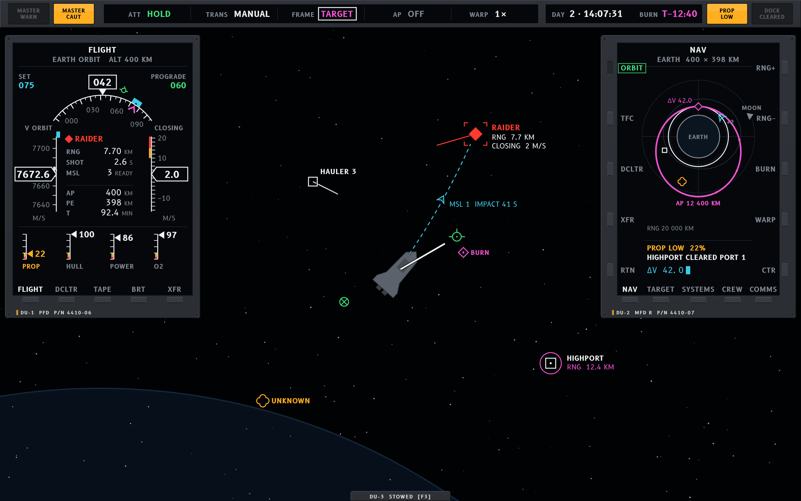
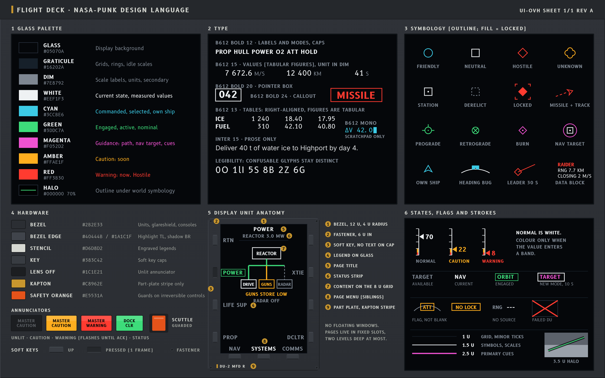

# Style guide: Nasa-punk ("Flight Deck")

Artist 1 of 3 for the UI overhaul. This guide defines a design language, not a layout: the
functional-design specs decide which widgets exist and when they show; this guide decides how
they look, move and sound, and where the style itself changes the structure (display units in
fixed slots instead of windows, soft keys instead of buttons, flags instead of empty fields).



## 1. The idea in one paragraph

The player sits on the flight deck of a working spacecraft built by an agency, not a game studio.
Every screen is a **display unit**: black glass with clean vector symbology, set in a matte grey
**hardware bezel** with stencilled legends, screw heads and soft keys around its edge. The glass
follows real glass-cockpit and mission-control practice: colour has fixed meanings, a quiet
display means all is well, values are drawn as instruments (tapes, scales, trend arrows) before
they are written as numbers, and anything that cannot be trusted is flagged rather than hidden.
The look is the space shuttle's MEDS upgrade, the Orion and Dragon displays, and the Houston
MOCR wall: confident, sparse, legible at a glance, and slightly austere.

### How it differs from the other two artists

| | Nasa-punk (this guide) | 90s VFD / early digital | Cassette-futurism |
|---|---|---|---|
| Light source | Emissive LCD glass, true black | Phosphor glow, segments | CRTs, lamps, backlit plastic |
| Colour | Multicolour with *fixed semantics* (white, cyan, green, amber, red, magenta) | One or two phosphor hues | Warm beige, amber or green CRT, coloured keycaps |
| Shapes | Thin antialiased vector lines, no glow, no bloom | Segmented glyphs, dot matrices | Chunky bevels, rounded plastic, physical switches |
| Content | Instruments, synoptics, maps | Numeric readouts, bar segments | Text terminals, analogue meters |
| Motion | Honest, unanimated: values move at sim rate, pages cut | Segment flicker, scan | Mechanical travel, CRT warm-up |
| Hardware | Machined, minimal; the glass is the star | Moulded fascia around small windows | The hardware is the star |

If an element would look at home in the other two styles, it is wrong for this one.

## 2. Principles

1. **Dark and quiet.** In normal flight the glass is mostly black and white. Colour appears
   because something is engaged, selected, guided, or wrong. A screen with no amber or red on it
   tells the player "nothing needs you" without a single word.
2. **Colour is a word, not paint.** Each colour has one meaning (section 3) and is never used for
   decoration, branding or grouping. Grouping is done with position, rules and labels.
3. **Instruments before numbers.** A value the player watches over time is a tape, scale or
   bar with limits drawn on it, with the number in a box at the pointer. A value read once is a
   number. A value that only matters when abnormal is not shown until it is abnormal.
4. **Everything lives in a display unit.** No floating windows, no drag-around panels. Content
   is a *page* shown on a DU in a fixed slot (section 9). The player changes what a DU shows;
   they never move or resize the DU.
5. **Never lie, never blank.** Missing or invalid data is shown as a flag (a boxed short label in
   amber or red) or as dashes, never as an empty space or a stale number.
6. **Hardware frames, glass informs.** The bezel carries only fixed engraved legends (unit name,
   part number, key labels that never change). Everything that changes is on the glass.

## 3. Palette

Two families that never mix: hardware colours are for bezels, plates and physical keys; glass
colours are for everything drawn on a display.

### Glass (on-screen)

| Token | Hex | Meaning, and only this |
|---|---|---|
| `glass` | `#05070A` | Display background. True black with a hint of blue. Opaque. |
| `graticule` | `#16202A` | Grid lines, range rings, inactive scale bodies. |
| `dim` | `#7E8792` | Scale labels, units, secondary text, unselected page names. |
| `white` | `#EEF1F3` | Current state and measured values. The default ink. |
| `cyan` | `#3CCBE6` | What the player commanded or selected: bugs, set-points, cursor, selected item, editable fields, own ship. |
| `green` | `#3DDC7A` | Engaged or active: an active mode, a running system, a good lock, "GO". |
| `magenta` | `#F052D2` | Guidance: the planned path, the navigation target, flight director cues, the target-relative frame. |
| `amber` | `#FFAE1F` | Caution: needs attention soon. Steady, never flashing. |
| `red` | `#FF3B30` | Warning: needs action now. Flashes until acknowledged. Also hostile contacts. |
| `halo` | `#000000` at 70% | 1 u outline behind every symbol drawn over the world view. |

Proportions on any screen in normal flight: roughly 85% `glass`, 12% `white` and `dim`, 3% or
less colour. Amber and red together should never exceed a few small elements; if they do, the
functional design is alarming too much and the alert philosophy (section 8) applies.

Backgrounds are never tinted to group things: no blue panels, no gradients, no translucent
glass. The world view itself is the only thing seen "through" the deck, and only the HUD layer
(section 9) draws on it.

### Hardware (bezels and plates)

| Token | Hex | Use |
|---|---|---|
| `bezel` | `#2B2E33` | Display unit frames, glareshield, console bodies. Flat, very slight top-down shade (2% lighter at the top). |
| `bezel-edge` | `#40444B` | 1 u highlight on the top and left of a bezel; `#1A1C1F` on the bottom and right. |
| `stencil` | `#D6D8D2` | Engraved legends on hardware. Slightly warm white, never pure. |
| `key` | `#383C42` | Soft key caps. Pressed: `#24272B` with the highlight edge swapped. |
| `lens-off` | `#1C1E21` | Unlit annunciator lenses; legend still readable in `#5A5E63`. |
| `kapton` | `#C8962E` | Thermal-blanket gold. Used only as a 2 u stripe on a unit's part plate or on a guarded switch cover. Never on glass. |
| `safety-orange` | `#E5531A` | Guards on irreversible controls (eject, scuttle, jettison) and the master-arm cover. Never on glass. |

## 4. Typography

**B612** (SIL Open Font License), designed by Airbus for cockpit displays, is the face on glass.
It is built for legibility at small sizes on emissive screens, separates confusable glyphs (0/O,
1/l/I, 5/S), and its figures are tabular, so right-aligned columns of numbers line up without a
monospaced face. **B612 Mono** is used only where text is entered a character at a time (the
scratchpad). Inter stays only for long prose: mission briefs, codex pages, the tutorial. Fetch the
TTFs from the Google Fonts repository into `assets/fonts` next to Inter, with their OFL.

| Role | Face | Size (UI units) | Case | Ink |
|---|---|---|---|---|
| Scale labels, units | B612 | 11 | Caps | `dim` |
| Labels, page names, mode names | B612 Bold | 12 | Caps, +6% tracking | `white` / `dim` |
| Values, table cells | B612 | 15 (13 in tables) | n/a | `white` (or its state colour) |
| Primary value in a pointer box | B612 Bold | 20 | n/a | `white` |
| Scratchpad entry | B612 Mono | 13 | Caps | `cyan` |
| Callouts and banners (MISSILE) | B612 Bold | 24 | Caps | state colour, boxed |
| Bezel legends | B612 Bold | 10 | Caps, +12% tracking | `stencil` on `bezel` |
| Prose | Inter | 15 | Sentence | `white` at 90% |

Rules:

- **Caps for labels and modes, sentence case only for prose.** "PROP", "RCS ATT HOLD", "DOCK
  PORT 1"; but "Deliver 40 t of ice to Highport" in a brief.
- **Values are right-aligned on the decimal** (B612's tabular figures keep columns straight).
  Units follow in `dim`, one size smaller: `7 672.6` `M/S`. Thousands are separated by a thin
  space, never a comma.
- **Words come from one table** ([`abbrev.md`](abbrev.md)). One name for each thing: a page,
  station, system or datum is written the same way on every screen, on its key, tab and head
  alike. Whole words unless a fixed field can't hold one; then the table's one short form (PROP,
  ΔV, RNG, BRG, MSL, PD, FWD, STBD, LIFE SUP, EMERG, CRIT, SYS), and never another. A phrase
  keeps its words whole (`RNG 3.4 KM`, but `OUT OF RANGE`).
- **Time is the game's clock.** `DAY 2 · 14:07:31` (days since the campaign began) on the
  glareshield. Countdowns are `T−12:40` with a true minus, `T−1:10:00` over an hour, and M:SS
  without the T− where a label already says what they count to (`IMPACT 0:03`); counts up are
  `T+01:15`. Durations are seconds: `SHOT 1.3 S`.

## 5. Lines, grid and shape

- **Grid:** 8 u. Every DU, margin and slot is a multiple of 8 u; text baselines sit on a 4 u grid.
- **Stroke weights** (UI units, scaled by `UiScale`):
  - 1 u: graticule, minor ticks, table rules.
  - 1.5 u: symbology, scale bodies, outlines, major ticks.
  - 2.5 u: primary cues: the velocity vector, the magenta path, the pointer on a tape.
  - 3.5 u: the halo under any symbol drawn over the world view (drawn first, in `halo`).
- **Corners:** square on glass (0 radius). 4 u radius on bezels, 2 u on keys. No other rounding.
- **No glow, bloom, scanlines, noise, gradients or drop shadows on glass.** These belong to the
  other two artists. Lines are antialiased and crisp; the glass looks like a modern LCD.
- **Fill means locked or pressed.** Symbols are drawn as outlines. A symbol fills only when the
  thing it stands for is locked, armed or held (a locked target, a pressed soft key, an engaged
  mode button).

## 6. Display units and framing

### The display unit (DU)



A DU is the only container. It is drawn in two layers:

1. **Bezel** (hardware): 12 u of `bezel` around the glass, 4 u corner radius, `bezel-edge`
   highlight top-left and shadow bottom-right. A 2 u fastener head (circle with a slot) sits
   6 u in from each corner. Bottom-left of the bezel carries the unit's engraved name and a part
   plate (`DU-2  MFD R  P/N 4410-07`) with a 2 u `kapton` stripe; it never changes.
2. **Glass:** `glass` fill, square corners, 1 u inner line of `#0E141A` to read as an inset.

**Soft keys (OSBs)** sit in the bezel along one or more edges: 5 per long edge, 3 per short
edge, as small rectangular caps in `key`. A key has no text on it. Its **legend is on the
glass** directly next to it, so the same key can mean different things on different pages. A
legend in `dim` is available; `white` is the current page or state; boxed `green` is an engaged
mode; a legend in `dim` with no box and a hollow key means not available here. Keys answer to
the mouse (click the cap or the legend) and to the keyboard: each slot has a fixed key, shown on
the cap in the key-hint overlay. Where a functional spec wants bindings in view all the time (a
hint line, an alert that names its key), the slot's fixed key may be printed on its cap in
`stencil`, as on a keyboard; the legend stays on the glass.

**Page layout inside the glass:** page title top centre in `white` caps; page menu (sibling
pages) along the bottom keys; actions along the side keys; a 1-line **status strip** under the
title for the page's one most important state; content in between on the 8 u grid.

### Other containers, all built from the DU

- **Glareshield:** a 40 u hardware strip along the top edge of the screen, holding the
  annunciators (section 8), the flight mode annunciator (FMA) and the clock. In the default
  layout it is the only element that is always visible; a spec that puts the clock and the lamps
  in a corner block gets them in the same hardware there.
- **Annunciator lens:** a 48 x 24 u push-button lens set in the glareshield or a console. Unlit:
  `lens-off` with a dim legend. Lit: the lens fills with its colour at 85% and the legend turns
  black. MASTER CAUTION (amber) and MASTER WARNING (red) are larger (64 x 32 u).
- **Console:** an interior station (helm, weapons, engineering) is a **console face**: 2 to 4
  DUs laid side by side in one bezel body, with a stencilled console name across the top
  ("ENGINEERING  STA 3"). This replaces today's console windows. It is full screen by default;
  where a functional spec keeps the deck or the world live beside it, the face stands as a side
  panel of the same hardware (the Ship Stations variation's reactor console).
- **Ops wall (docked services):** trade, yard, missions, shipyard and boarding are not windows
  but pages of a station **ops wall**, a row of 3 DUs styled like a mission-control row: each DU
  topped by a stencilled position name (TRADE / YARD / FLIGHT DIR / CREW). The variations under
  `documentation/ui-overhaul/variations/` show it applied to each functional spec.
- **Prompt:** an interaction prompt near a console is the only element drawn outside a DU or
  the HUD layer: a small `bezel` plate with one soft key cap and its legend (`[E] HELM`).

## 7. Symbology and icons

Vector only, outline by default, 1.5 u strokes, 16 u nominal size, drawn on the 8 u grid.

### Own ship and flight cues

| Symbol | Drawing | Colour |
|---|---|---|
| Own ship (on maps) | Arrowhead chevron, 16 u | `cyan` |
| Prograde | Circle with three ticks (top, left, right) | `green`; `magenta` in the target frame |
| Retrograde | Circle with a diagonal cross | same as prograde |
| Velocity trend | Line from the ship, length = 10 s of drift, 2.5 u | `white` |
| Heading bug | Notched cyan pentagon on the heading arc | `cyan` |
| Planned burn | Hollow diamond on the path, ΔV written beside it | `magenta` |
| Flight director cue | Magenta caret on the heading arc: "turn to here" | `magenta` |

### Contacts (after MIL-STD-2525, simplified)

Affiliation is carried by **shape first**, so it reads in grey and to colour-blind players.

| Affiliation | Shape | Colour |
|---|---|---|
| Friendly / own faction | Circle | `cyan` |
| Neutral (haulers, civilians) | Square | `white` |
| Hostile | Diamond | `red` |
| Unknown | Quatrefoil | `amber` |
| Station, structure | Square with a centre dot | `white` |
| Derelict | Dashed outline of its affiliation shape | `dim` |
| Missile, projectile | 8 u chevron along its track, dashed predicted track | by side |

Every moving contact carries a **leader line** along its velocity, 30 s long at the current
scale, so relative motion reads without numbers. The locked target's symbol fills and gets a
4-corner bracket; the navigation target gets a magenta ring. A data block beside a contact has at
most three lines: name, `RNG`, `CLOSING`. Never more on the world view; the rest is on a page.

### Interface icons

There are almost none. A soft key is labelled with a word, not a pictogram. The only pictograms
are the symbology above, the system glyphs on synoptic pages (pump, valve, tank, bus, breaker,
drawn as schematic symbols), and the red X of a failed display (section 8).

## 8. States, alerts and the quiet cockpit

**State colours on any element:** `white` normal, `cyan` commanded, `green` engaged, `amber`
caution, `red` warning, `dim` off or unavailable. An element in its normal range shows no colour
at all: a propellant gauge at 70% is white, at 25% amber, at 10% red.

**Alert levels:**

| Level | Example | What happens |
|---|---|---|
| Advisory | Docking clearance granted | One `white` line in the message area of the MFD. No sound. |
| Caution | Propellant low, compartment smoke | `amber` text in the alert list; MASTER CAUTION lens lights steady; single chime. |
| Warning | Fire, breach, missile inbound, collision | `red` boxed text flashing 2 Hz (0.3 s on, 0.2 s off) until acknowledged, then steady; MASTER WARNING lens flashes; repeating chime and a voice callout. |

Acknowledging (click the lens or press its key) stops the flashing and the sound; the alert
stays listed while the condition lasts. The first warning also pages the MFD to its **electronic
checklist** for that alert: the steps to take, each one ticking green as the game sees it done
(`ISOLATE POWER, AFT STBD GUN .... DONE`). The checklist is a feature of the style and should be offered
to every functional spec.

**Mode changes** are announced by a `white` box drawn around the new mode on the FMA for 10 s,
then the box goes and the mode stays. No sound, no animation.

**Invalid data** shows a flag: a short boxed label in the colour of the severity (`ATT` in amber
over a frozen heading arc; `NO LOCK` in amber on the target box; `---` for a value with no
source). **A failed display** (a damaged DU) shows a single red X corner to corner across its
glass and nothing else; its pages can be moved to another DU with the bezel's `XFR` key.

## 9. Layout grammar

The style's default layout is a set of fixed **slots**, below. A functional spec that defines its
own zones keeps them: the style then maps its containers onto those zones (a band of DUs along
the bottom, side columns, a clock block and a lens panel top left) and keeps what makes it
Nasa-punk: everything screen-fixed is a DU, a lens panel or a slip in a bezel; the HUD layer is
unboxed symbology; the master lenses sit at the top. The variations under
`documentation/ui-overhaul/variations/` show the mapping for each spec. In either case the style
guarantees each slot's size, position and behaviour at every UI scale.

```
+----------------------------------------------------------------------+
| GLARESHIELD: [MASTER WARN][MASTER CAUT] FMA: ATT|TRANS|AP|WARP  DAY |
+--------+                                                   +---------+
|        |                                                   |         |
| DU-1   |                 OUT-THE-WINDOW                    | DU-2    |
| PFD    |            (world, HUD layer only)                | MFD     |
|        |                                                   |         |
+--------+                                                   +---------+
|                      [prompt plate, if any]                         |
+----------------------------------------------------------------------+
```

- **Glareshield** (top, full width, 40 u): always on.
- **DU-1, primary flight display** (left, 304 x 400 u at 1280 x 800): what the pilot needs every
  second. Fixed content per view mode; it has page keys only for declutter.
- **DU-2, multifunction display** (right, same size): pages chosen by the player (NAV, TARGET,
  SYSTEMS, CREW, COMMS, CHECKLIST). The functional specs decide the page list.
- **DU-3** (optional, bottom-centre, 400 x 160 u, folded down out of sight by default): a
  secondary MFD the player can raise with a key for a second page.
- **HUD layer:** the only thing drawn over the world. Symbology from section 7 with halos,
  nothing boxed, no panels, no text longer than a data block. The deck view is the exception: it
  is a picture of the ship rather than a flight display, so a hazard there carries a glass slip on
  a leader (what it is, who is working it, the job's progress), like the comm-loop slips, and a
  console's prompt is a bezel plate.
- **Console face / ops wall:** full-screen, replaces the flight deck while a console or docked
  services are open. The glareshield stays above them.

Interaction rules that follow from the style:

- **Two levels deep at most.** A DU shows a page; a page may show one sub-page. The bottom-left
  key is always `RTN`.
- **Declutter** (`DCLTR` on every DU and on the HUD layer) cycles three levels: full, essential,
  minimum. Every page must define what survives each level.
- **Cursor on the glass.** On map-like pages the mouse becomes a cyan cross cursor inside the
  DU; clicking selects, and the selection's soft-key actions appear on the side keys.
- **Scratchpad entry.** Typed values (a burn's ΔV, a quantity to buy) go to a scratchpad line at
  the foot of the page in `cyan`, then a line-select key beside the field puts the value there.
  Mouse dragging still works where the functional spec has it (burn handles); the scratchpad is
  for exact values.
- **Keyboard first.** Every soft key has a fixed key; a held key-hint overlay draws the keys on
  the caps.

## 10. Data visualisation

- **Tapes** for values that change continuously and have a target: speed, range rate, altitude.
  A vertical scale scrolls behind a fixed pointer box holding the number; a `cyan` bug marks the
  commanded value; a `white` trend arrow from the pointer shows where the value will be in 10 s.
  Caution and warning ranges are drawn on the scale itself as amber and red bands.
- **Arc scales** for direction: heading on a 120-degree arc above the PFD with the bug, the
  prograde and retrograde ticks and the magenta director caret.
- **Strip gauges** for quantities: a thin vertical scale with ticks at 25%, a `white` pointer
  and its number, amber and red bands on the scale. Not filled bars.
- **Synoptics** for systems: a schematic of the ship's real layout (from the interior grid) with
  flow lines. A powered bus is a solid `green` line, available but idle `white`, degraded `amber`,
  failed `red` with a gap, no flow `dim` dashed. Breakers and valves are schematic symbols that
  can be clicked to toggle.
- **Plan view** for orbits and traffic: current orbit `white` 1.5 u, planned path `magenta`
  2.5 u, other bodies' orbits `graticule`, time ticks every 10 minutes along the path with
  `T+` labels at the apsides.
- **Telemetry tables** for markets, contracts and crew: B612, right-aligned fixed columns, 1 u rules
  every 4 rows, no zebra stripes, changed values boxed in `white` for 3 s. Stale data carries a
  dim `S` in its own column.
- **Timelines** for anything scheduled: a horizontal T- / T+ strip with event ticks (next burn,
  contract deadline, arrival, a missile's impact), now as a fixed `white` line, the future to the right.

## 11. Motion

Motion is instrumental, never decorative.

- Tapes, pointers and symbols move with the simulation, every frame, with no easing or lag.
- Pages **cut**: no slide, fade or zoom. A page change blanks the glass for one frame.
- A DU powering on (game start, a repaired unit) runs a 0.6 s self-test: the glass fills with
  the test pattern (graticule plus every state colour as a bar), then cuts to its page. The
  glareshield runs a 1 s lamp test on load: every lens lights, then goes out.
- Flashing is reserved for unacknowledged warnings (2 Hz). Nothing else blinks.
- The cursor and the soft-key press are the only things that respond to the pointer; there are
  no hover glows. A pressed key swaps its bezel edge for one frame (looks pushed).

## 12. Sound

Sounds come from the deck's hardware and the agency's procedures, short and dry.

| Event | Sound |
|---|---|
| Soft key | Dry plastic click, 25 ms, slight pitch variation per key |
| Page change | None (the click is enough) |
| Caution | Single chime, about 1 kHz, 0.4 s decay |
| Warning | Triple chime, repeating every 2 s until acknowledged, plus a calm voice callout ("Warning. Fire, engineering.") |
| Missile inbound | Voice "Missile, missile" and a fast repeating tone pitched by the time to impact |
| Radio, comms | Quindar tones: 2 525 Hz, 250 ms before a transmission and 2 475 Hz after it |
| Mode change | None |
| Range callouts on approach | Voice "One kilometre", "Five hundred", "One hundred" (optional per setting) |
| DU self-test | Faint relay click and a 50 ms fan spin-up |

## 13. Do and don't

Do: black glass, thin vectors, words on soft keys, white for normal, colour for meaning, flags for
missing data, fixed slots, honest instruments, checklists for emergencies.

Don't: glow, scanlines, segment digits, bevels, beige, wood, rounded plastic, translucent panels,
floating windows, colour-coded panels, filled progress bars, icons on buttons, animated
transitions, any element that blinks for a reason other than an unacknowledged warning.

## 14. Implementation notes (libGDX)

- **One palette class.** `NasaPunkPalette` holds the tokens above; nothing else in the HUD names
  a colour. `HudSkin` gets a `nasapunk` variant built from it.
- **Drawables.** `DuBezel` (the bezel with fasteners, part plate and key caps, from the skin's
  white region like today's `HudFrame`), `DuGlass`, `AnnunciatorLens`. A `DisplayUnit` Scene2D
  group owns a bezel, a glass and a current `DuPage`; pages are plain tables plus custom
  `Widget`s (tape, arc, strip gauge, synoptic, plan view).
- **Halos.** Each HUD-layer symbol is drawn twice: 3.5 u in `halo`, then 1.5 u or 2.5 u in its
  colour. The existing `HudDraw.ring` and `disc` take a width already.
- **Fonts.** `HudFonts` loads B612 and B612 Mono through FreeType at the sizes in section 4;
  Inter stays for prose.
- **Scale.** All sizes here are UI units at 1280 x 800, so `UiScale` keeps working unchanged.
  Slots are laid out from the screen edges in units, so wider screens give the world view the
  extra room, not the DUs.
- **No shaders needed.** The style is flat vector; everything is shapes and fonts.

## Mockups

All mockups are 1280 x 800 UI units, drawn at 2x. Data in them is illustrative; the functional
specs will decide the real pages.

- `mockups/flight-deck.png`: exterior flight with the glareshield, PFD, a NAV page on the MFD and
  the HUD layer over the world.
- `mockups/sheet.png`: palette, type, stroke weights, contact symbols, state colours, DU anatomy
  and annunciator states.

Sources are the HTML files beside them (`mockups/*.html`, inline SVG drawn by `mockups/lib.js`);
render with `node documentation/ui-overhaul/nasapunk/mockups/render.js` (Playwright, B612 loaded
from `mockups/fonts/`, SIL OFL 1.1). Each functional spec skinned in this style lives under
`documentation/ui-overhaul/variations/`.
