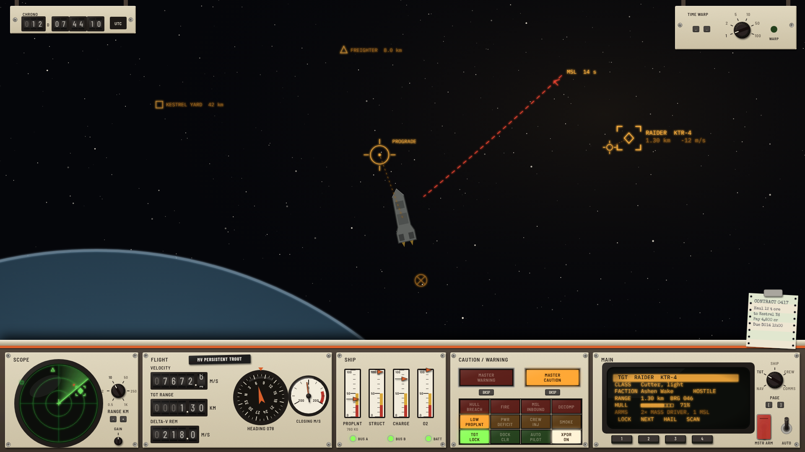
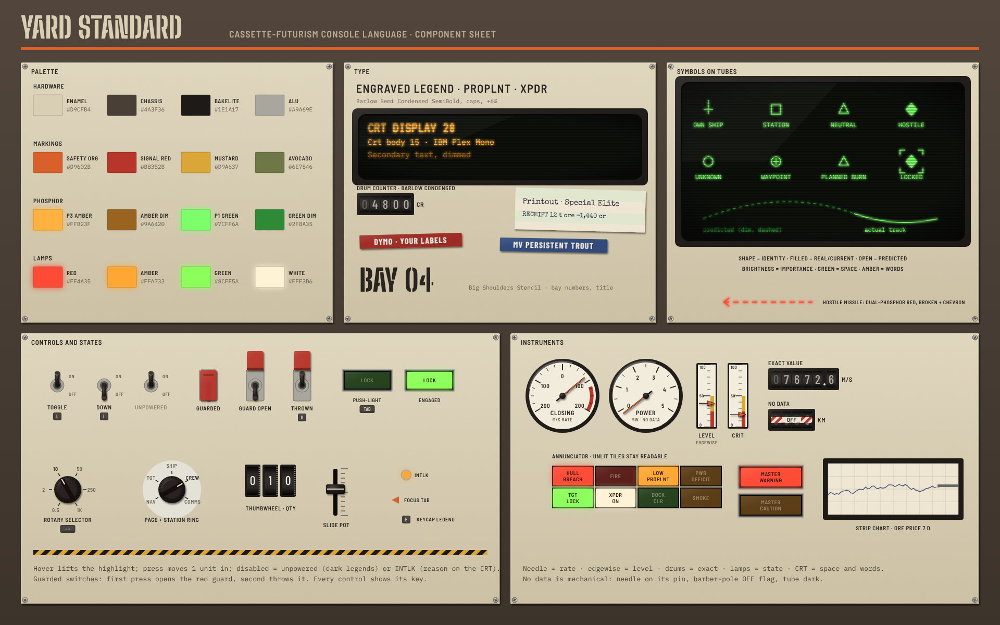

# Cassette-Futurism: Style Guide and Design Language

**Working name: "Yard Standard"** — the console hardware a working shipyard bolts into a hull.

Artist 3 of 3 in the UI overhaul. This document sets the visual and interaction language. It does not
decide *what* information exists or *when* it is visible; the three functional specs in
`documentation/ui-overhaul/` do that. Section 13 says how a functional spec is translated into this
language, and that is where this style is more than a skin.





---

## 1. The premise

The ship's UI is not a screen painted over the game. It is **equipment**: a console deck with cathode
ray tubes, needles, lamps, counters and switches, built cheaply and to last, by people who expected it
to be kicked, rewired and repaired. The view of space is what you see past the console, through the
gunsight glass.

Five principles follow from that, and every later rule comes from one of them.

1. **Every element is a physical object with a place.** A gauge does not pop up; it is mounted, and it is
   always there (lit or dark). Information moves *between* fixed instruments, it does not spawn windows.
   This gives the player muscle memory: power is always the third needle from the left.
2. **Each kind of data has one kind of instrument.** Rates and trends are needles; exact quantities are
   drum counters; on/off states are lamps; space and lists are CRTs. The instrument's shape tells you
   what sort of number you are reading before you read it (section 8).
3. **Controls have travel and state.** A switch is up or down and *stays* there, so the console itself
   shows what you have set. Dangerous actions sit under guards. Nothing important is a flat text button.
4. **The console runs on the ship.** The instruments are powered by the ship's circuits (interior-grid's
   `PowerRoutingSystem`). A browned-out bus dims its CRTs and drops its needles; a fire in the bridge
   makes the console flicker. The player reads the ship's health from the console's behaviour, not only
   from a number (section 11).
5. **Warm, worn, legible.** Beige enamel, brown and black, amber and green phosphor. Wear is visible but
   never in the way of a reading. When the style and readability disagree, readability wins.

### What this style is not

The other two artists take neighbouring ground. To keep the three clearly different:

| | Nasa-punk (artist 1) | 90s VFD (artist 2) | **Cassette-futurism (this)** |
|---|---|---|---|
| Surface | Black glass, white and grey vector | Dark smoked glass, segment cells | **Painted metal and plastic, beige and brown, screws and seams** |
| Light | Crisp emissive lines, no glow | Cyan-teal VFD glow, dot matrix and 7-segment | **Amber and green CRT phosphor with afterglow; incandescent lamp lenses** |
| Numbers | Clean sans, tabular | Segmented digits | **Rolling drum counters, needles on printed dials** |
| Controls | Touch, soft keys around an MFD | Membrane keys, beeps | **Toggles, rockers, rotary selectors with detents, guarded switches** |
| Motion | Smooth, precise, quick | Instant, stepwise flicker | **Mechanical: spring, inertia, roll, warm-up** |
| Feel | Clean mission control | Consumer electronics | **Heavy industry, a 1979 freight hauler** |

Hard rules that keep us out of their space: **no cyan or teal anywhere**, no seven-segment digits, no
dot-matrix text, no thin-line glass cockpit framing, no flat touch buttons.

---

## 2. The screen, as hardware

The screen is divided into the **viewport** (space, seen through glass) and the **deck** (the console).

```
┌───────────────────────────────────────────────────────────────────────────┐
│ ▣ CHRONO 0012:07:44:10            viewport                  WARP ◉ 1×   │  ← header strip: 2 small
│                                                                           │    bracket instruments
│                     space, the ship, markers, the gunsight                │
│                     (projected in amber phosphor on the glass)            │
│                                                                           │
├──┬────────────┬──────────────────┬──────────────┬──────────────────────┬──┤
│  │  SCOPE     │  FLIGHT          │ ANNUNCIATOR  │  MAIN CRT  (pages)   │  │  ← the deck: 22–26% of
│  │  (round    │  counters,       │ lamp grid +  │  amber raster        │  │    height at 16:9,
│  │   PPI CRT) │  needles, compass│ master C/W   │  ◉ page selector     │  │    with a 1-unit lip
│  │            │                  │              │                      │  │
│  └ range ◉   └ switch row ──────┴──────────────┴ soft keys ───────────┘  │
└───────────────────────────────────────────────────────────────────────────┘
```

* **The deck sits along the bottom** like the dashboard of a vehicle. It is the only place persistent
  UI lives. It has a hard top edge (a rolled metal lip with a highlight) so the eye reads it as solid.
* **The viewport is kept clear.** Only things that belong *in space* are drawn there: contact brackets,
  the gunsight, missile tracks, the dock approach. They are drawn as a **reflector-sight projection**:
  amber phosphor on glass, slightly glowing, no backgrounds, no panels. Nothing rectangular floats over
  space.
* **Two header brackets** at the top corners carry the chronometer (mechanical counter) and the warp
  selector (a rotary knob with detents). They are the only hardware above the deck, small, and mounted
  on visible brackets so they read as objects, not overlays.
* **Bays.** The deck is built of bays, each a separate faceplate with its own screws and seam. A
  functional spec's "widget" becomes an instrument in a bay. Bays are a fixed width in grid units
  (section 6), so the deck is laid out like a rack, not a free canvas.
* **Large tasks take the main CRT, not a window.** Trade, yard, missions, boarding and the orbit map
  are *pages* of a CRT. Small ones run in the deck's main CRT; big ones (the maneuver map, the
  shipyard editor) **raise the big screen**: the deck slides down and a full-height CRT rolls up from it
  (section 9). There are no draggable windows.

### Interior view

When the player walks the deck, the console is not in front of them, so the deck is replaced by a
**wrist unit** (bottom left: a chunky beige forearm terminal with a small amber CRT, two needles and
four push buttons) and **wall consoles** in the world that the avatar uses. A console the avatar walks
up to opens as its *own* faceplate rising from the bottom edge, in that console's livery.

### Station equipment has its own livery

When docked, station services (market, yard, mission board) are **the station's terminal**, patched into
the deck by a visible cable and plug. The station's terminal uses its faction's hardware livery
(section 4.4): a corporate station is clean off-white plastic with a logo plate; a frontier mine is
olive drab with stencils. The player reads *whose equipment this is* at a glance, and the ship's own
deck is never re-skinned by a station.

---

## 3. Palette

All colours are sRGB hex. Hardware colours are **materials**, lit by a soft top-left key light; phosphor
and lamp colours are **emissive** and the only colours that may glow.

### 3.1 Hardware (non-emissive)

| Token | Hex | Use |
|---|---|---|
| `enamel` | `#D9CFB4` | Main faceplates, the deck. Warm putty beige. |
| `enamel-shade` | `#B8AD92` | Lower bevels, recesses, panel seams' lower lip. |
| `enamel-light` | `#ECE4CE` | Top bevel highlights, rolled edges. |
| `chassis` | `#4A3F36` | Bay surrounds, the frame between bays, knob skirts. Chocolate brown. |
| `chassis-deep` | `#2B241F` | Gaps, screen surrounds, shadows behind hardware. |
| `bakelite` | `#1E1A17` | Knobs, toggle bats, switch boots, CRT bezels. |
| `alu` | `#A9A69E` | Brushed aluminium trim strips, screw heads, guard frames. |
| `rubber` | `#3A3734` | Keycaps' sides, grommets, cable. |

### 3.2 Markings and accents (non-emissive paint)

| Token | Hex | Use |
|---|---|---|
| `ink` | `#2A2420` | Engraved legends and scales on `enamel`. |
| `ink-light` | `#EFE8D6` | Legends on `chassis` and `bakelite`. |
| `safety-orange` | `#D9602B` | The deck's identity stripe; "this changes the ship" controls. |
| `signal-red` | `#B8352B` | Guards over irreversible controls; red-line zones on dials. |
| `mustard` | `#D9A637` | Hazard stripes (with `bakelite`), caution zones on dials. |
| `avocado` | `#6E7846` | Secondary panel colour, crew/life-support bays. |
| `tape-red`, `tape-black`, `tape-blue` | `#9E2A23`, `#1C1B1A`, `#2F4A7A` | Dymo label tape backgrounds. |

The deck has a **safety-orange stripe** under its top lip. It is the one decorative element that
identifies the style at a glance, the way a livery stripe identifies a vehicle.

### 3.3 Phosphor (emissive, on CRTs and the gunsight)

| Token | Hex | Use |
|---|---|---|
| `p3-amber` | `#FFB23F` | Raster CRT text and the gunsight. The *voice* of the ship. |
| `p3-amber-dim` | `#9A6420` | Secondary text, gridlines, unselected list rows. |
| `p3-amber-ghost` | `#4A300F` | Afterglow trails, burn-in. |
| `p1-green` | `#7CFF6A` | Vector CRTs: the scope, the orbit map, trajectories. |
| `p1-green-dim` | `#2F8A35` | Range rings, grids, predicted (not yet real) paths. |
| `crt-black` | `#0E100C` | The tube face when lit but empty (never pure black; a lit tube is grey-green). |
| `crt-off` | `#22251F` | The tube face unpowered (glass reflection, no image). |

**Amber is for words and the ship's own state; green is for space and geometry.** A player learns that
anything green is a place or a path and anything amber is a statement.

Contacts on the green scope and on the gunsight use **shape first and brightness second**, not hue
(section 7.2), because a monochrome tube can only do that, and it is better for colour-blind players.
The one exception is hostile threat: a hostile missile track on the gunsight is drawn in `lamp-red`
phosphor (a period "dual-phosphor" tube), always with its own shape (a broken line with chevrons).

### 3.4 Lamps (emissive, behind coloured lenses)

| Token | Lit | Unlit lens | Meaning |
|---|---|---|---|
| `lamp-red` | `#FF4A35` | `#5A1E18` | Warning: act now. |
| `lamp-amber` | `#FFA733` | `#5A3B16` | Caution: act soon. |
| `lamp-green` | `#8CFF5A` | `#24401C` | Engaged, safe, go. |
| `lamp-white` | `#FFF3D6` | `#4A4740` | Advisory, information, "on". |

An unlit lamp is *visible* (a dark coloured lens), so the player sees every lamp that *could* light. A
lamp that is lit glows past its lens edge (bloom radius 1.5 units).

### 3.5 Colour rules

* Hue never carries meaning alone. Every lamp has an engraved legend; every warning has a sound and a
  position.
* Red means danger only. No red decoration, no red for "hostile faction" when nothing is threatening.
* Never put phosphor colours on hardware or hardware colours on a tube.
* Contrast: legends on `enamel` are `ink` (contrast 10.9:1); phosphor text on `crt-black` is ≥ 9:1
  at full brightness and ≥ 4.5:1 for `-dim` tones.

---

## 4. Materials

Materials are what makes this style tactile. Each is a 9-patch or a shader, never a flat fill.

### 4.1 The palette of surfaces

* **Painted enamel faceplates.** Slight noise (2% luminance grain), a 1-unit top-left highlight and a
  1-unit bottom-right shade on every edge. Corners are radius 3 units: folded sheet metal, not
  rounded plastic.
* **Brown chassis** between bays, recessed 2 units, with **Phillips screw heads** at each faceplate's
  corners (aluminium, randomly rotated per screw, seeded by bay so they do not change between frames).
* **Bakelite knobs and bezels.** Near-black with a soft specular band. Knobs have a printed index line
  and a knurled skirt.
* **Smoked glass over CRTs.** A CRT sits in a deep bezel, its face very slightly curved (barrel
  0.02), with a faint reflection gradient top-left. Behind the glass: scanlines, phosphor bloom, and
  persistence (section 10.4).
* **Engraved legends** on faceplates (ink fill with a 0.5-unit light lower edge, like a filled engraving).
* **Dymo tape labels** for anything the crew might have *added*: custom names, a ship's name on the
  console, the player's own bookmarks. Raised white letters on red, black or blue tape, slightly
  skewed (≤ 1.5°). Dymo is the style's handwriting: it is how the game says "this is yours".
* **Paper** for printouts: contracts, trade receipts, the mission board. Off-white `#EEE6D2`
  tractor-feed paper with sprocket holes and faint green bar banding, typed in a typewriter face.

### 4.2 Wear

Wear is a texture layer, never on a reading. Allowed: paint rubbed through to grey metal at the edges of
the most-used switches; a scuff under a handle; a faded legend that is still legible; a strip of
tape holding a cable. Forbidden: dirt over a needle, a crack across a counter, grime that reduces
contrast below the section 3.5 minimums.

### 4.3 Wear follows the ship

Each hull class gets a wear level from its age (0 to 3). A new corvette from a corporate yard is
clean, crisp enamel; a forty-year-old hauler has worn switches and a Dymo label over a broken legend.
This is cosmetic, chosen at ship creation, and is the cheapest way to make two ships feel different.

### 4.4 Liveries

Panels can be re-coloured per owner. A livery changes only `enamel`, `enamel-shade`, `enamel-light`,
the identity stripe and the logo plate; instruments, phosphor and lamps never change.

| Livery | Enamel | Stripe | Notes |
|---|---|---|---|
| Yard Standard (the player's default) | `#D9CFB4` beige | `#D9602B` safety orange | |
| Corporate | `#E6E3DA` off-white | `#2F4A7A` blue | Smooth plastic, logo plate |
| Frontier / mining | `#6E7846` avocado | `#D9A637` mustard | Stencilled, heavy wear |
| Military | `#5E6152` grey-green | `#B8352B` red | Matte, rivets instead of screws |

---

## 5. Typography

All typefaces are SIL Open Font License, so they ship in `assets/fonts` next to the Inter files that
are there now. Four roles, each tied to a material:

| Role | Typeface | Where | Notes |
|---|---|---|---|
| **Engraved legend** | **Barlow Semi Condensed**, SemiBold, all caps, tracking +6% | Faceplate labels, scales on dials, switch positions | Industrial, condensed, like a panel engraver's alphabet |
| **CRT text** | **IBM Plex Mono**, Regular and Medium | Everything on a raster CRT | Monospace so CRT pages align to a character grid (section 9.2) |
| **CRT display** | **VT323** | Big CRT headings (≥ 24 units) only | Raster-terminal shape; never below 24 units |
| **Counter drums** | **Barlow Condensed**, Medium | Digits on drum counters | White on black drums, tabular figures |
| **Dymo / paper** | **Special Elite** (paper), **Barlow Condensed** Bold embossed (Dymo) | Printouts and labels | Typewriter for paper; emboss shader for Dymo |
| **Stencil** | **Big Shoulders Stencil Display** | Bay numbers, bulkhead markings, the title screen | Large sizes only |

### Scale (UI units, the same units as `HudFonts`)

| Token | Size | Use |
|---|---|---|
| `legend-s` | 10 | Dial scale numbers, keycap legends |
| `legend` | 12 | Switch and lamp legends, bay titles |
| `crt-body` | 15 | CRT text (the current `BODY` size, kept so layouts carry over) |
| `crt-large` | 20 | CRT emphasis (the target's name) |
| `counter` | 22 | Drum counter digits (drum is 30 units tall) |
| `crt-display` | 28 | VT323 headings on a CRT page |
| `stencil` | 44+ | Title, bay numbers |

Rules: legends are always ALL CAPS and short (≤ 12 characters; abbreviate like a panel engraver would:
`PROPLNT`, `XPDR`, `RCS`). CRT text is mixed case. Never use the CRT face on hardware or the legend face
on a CRT.

---

## 6. Grid, framing and layout

* **Base unit: 4 UI units.** Bays are multiples of 24 units wide (6 grid units) and the deck's height is
  a multiple of 24. Everything snaps; nothing is placed by eye.
* **Bay anatomy:** 2-unit chassis gap · 3-unit faceplate bevel · 8-unit margin to the first instrument ·
  instruments on a 4-unit grid · bay title engraved top-left at `legend` size, 6 units from the edge ·
  screws in the corners, 6 units in.
* **Deck heights:** at 16:9 the deck is 216 units tall at UI scale 1 on a 1080-unit-tall screen (20%).
  The deck has three densities the player can choose (and `F` style hotkey to cycle):
  * **Full deck** – everything above.
  * **Low profile** – the deck folds to a 96-unit strip: counters, master caution and warning, the
    switch row and the scope shrunk to a 88-unit tube. Needles become edgewise meters.
  * **Clear view** – only the gunsight, the master caution/warning lamps (bottom corners) and the
    chronometer. For screenshots and for players who fly by feel.
* **Aspect ratios.** The deck's bays are centred in a fixed-width rack (1,824 units at 16:9). Extra width
  (ultrawide) fills with **blank panels** (enamel, screws, maybe a Dymo label), never by stretching
  instruments. Narrower screens drop bays in a defined order (set per functional spec).
* **Depth layers**, back to front: space → gunsight projection → deck shadow (a soft 24-unit shadow
  cast up onto space, so the deck sits in front of the glass) → deck → raised big screen → paper.

---

## 7. Iconography and symbology

### 7.1 Pictograms on hardware

Pictograms are **engraved**: 2-unit strokes in `ink`, on a 16-unit grid, built from straight lines
and circular arcs only, in the manner of industrial control symbols (ISO 7000 style): a lightning bolt
for power, a droplet for propellant, a bell for alarm silence, an arrow-into-box for dock. Each sits
*beside* its legend, never instead of it.

### 7.2 Symbols on tubes

On CRTs and the gunsight, symbols are vector strokes. **Shape carries identity**, brightness carries
importance:

| Thing | Symbol |
|---|---|
| Own ship | Small cross with a heading tick |
| Station | Square |
| Neutral ship | Triangle |
| Hostile ship | Diamond |
| Unknown contact | Open circle |
| Locked target | The symbol in a four-corner bracket that blinks once on lock |
| Missile | Short dash, with a chevron tail pointing back along its track |
| Waypoint | Upright cross in a circle |
| Planned burn | Hollow triangle on the path, apex in the burn direction |

Filled symbols are *real and current*; open/dashed are *predicted or old*. Brightness: the selected
thing is full intensity, its neighbours at 60%, distant or stale contacts at 30%.

---

## 8. Instruments: which shape for which data

This is the core of the language. A functional spec says "show X"; this table says *how*.

| The data is... | Instrument | Why |
|---|---|---|
| A rate or trend you glance at (closing speed, power draw, thrust) | **Round needle gauge**, 270° sweep | A needle's angle and its movement read faster than digits |
| A level that drains (propellant, O₂, charge) | **Edgewise meter** (vertical moving pointer on a printed scale with caution and red-line zones) | Compact, sits in a row, shows the zone at a glance |
| An exact number you read carefully (speed, range, credits, Δv, time) | **Drum counter**, white on black, rolling | Precision; the roll shows *direction and rate of change* for free |
| A direction (heading, prograde, target bearing) | **Compass card** behind a fixed lubber line, rotating | The one familiar dial for orientation |
| An on/off or a fault state | **Lamp** in the annunciator, or a lamp on its own control | A grid of lamps lets a player see "all dark = all good" |
| Space, paths, positions | **Vector CRT** (green) | Lines, afterglow and persistence suit orbits and sweeps |
| Words, lists, tables, choices | **Raster CRT** page (amber) | A character grid, cursor keys and soft keys |
| A value over time (market price, power history) | **Strip chart**: a pen trace on a scrolling paper strip in a window | Physical history; it keeps scrolling while you watch |
| A one-off record (contract, receipt, log) | **Printout** on tractor paper | The player can keep it; it is obviously a document |

Instrument rules:

* **Every needle has a printed scale** with numbers at the major ticks and zones painted on it (mustard
  caution arc, red-line arc). The zones are where the functional spec's thresholds are (today's
  `ShipGauges`: amber below 50%, red below 25%).
* **Every counter has a fixed number of drums** sized for the largest value it will show, with units
  engraved to its right (`M/S`, `KM`, `CR`). Leading zeros are shown dimmed, like real drums.
  Values that overflow show a red flag drum (`OVR`) instead of breaking the layout.
* **"No data" is mechanical:** a needle parks below zero against its pin; a counter shows a striped
  `OFF` flag in a window over the drums (the classic barber-pole flag); a CRT goes to `crt-off`.
  Today's `--` readings become these flags.
* **Units are engraved, not typed.** If a counter can change units (m/s to km/s), it has a small lamp
  beside each unit legend, and the lit one is the unit in use.

### 8.1 The annunciator

All discrete ship states live in one **annunciator panel**: a grid of lens tiles, each with a two-line
engraved legend (`HULL BREACH`, `FIRE BRIDGE`, `LOW PROPLNT`, `DOCK CLR`, `MSL LOCK`). Unlit, every
tile is readable; lit, it glows in its colour. This replaces the alert lists and status text lines.

Beside it, two big push-lights: **MASTER CAUTION** (amber) and **MASTER WARNING** (red). Any new
caution or warning lights its master and the tile; pressing the master (or its key) acknowledges it,
which silences the tone and stops the flash but leaves the tile lit until the condition clears. This is
the standard aircraft pattern and it maps cleanly onto the game's alert sources (`ShipAlerts`,
`ThreatProvider`, docking clearance, mission events).

### 8.2 The scope

A round **PPI** (plan position indicator) CRT in green: range rings, a sweep line rotating at 1 turn per
2 s that brightens contacts as it passes them, contacts fading with persistence between sweeps. Range is
a **rotary selector** under the tube with detents engraved `0.5 · 2 · 10 · 50 · 250 · 1000 KM`, the
steps `RadarScope` already has. The sweep is cosmetic: contact *positions* update every frame so the
scope is never less accurate than today's.

---

## 9. CRT pages: how lists, windows and menus work

### 9.1 Pages, not windows

Every former window is a **page** on a CRT. A CRT has a **page selector** (a rotary knob with engraved
positions, e.g. `NAV · TGT · SHIP · CREW · COMMS`) and a row of **soft keys** under the tube whose
labels are drawn on the bottom line of the page. Keyboard: the selector is bound to a key pair, and the
soft keys to `1`–`6` while the page has focus.

When docked, station pages (`MARKET · YARD · BOARD`) appear on the selector *because the station's
terminal is plugged in*: an extra ring of positions with the station's livery on the knob's
escutcheon. Undocking unplugs it, with a cable animation.

### 9.2 The character grid

Raster pages are laid out on a **character grid** (IBM Plex Mono at `crt-body`: 64 columns by
20 rows in the deck's main CRT, 120 by 44 on the big screen). Tables align by column, never by pixel.
This is a real constraint that keeps pages honest: if it does not fit in 64 columns, it is too much for
that context and belongs on the big screen or a printout.

Page anatomy: row 0 is the page title in reverse video (`crt-black` on `p3-amber`) and the clock; rows
1–17 content; row 18 a rule; row 19 the soft-key labels in boxes. The cursor is a solid block that
blinks at 1.5 Hz. The selected row is reverse video.

### 9.3 The big screen

Tasks that need room (the maneuver map, the ship editor, the full market, crew management) **raise the
big screen**: the deck drops 60% of its height (still showing master caution/warning, counters and the
switch row), and a large CRT in a heavy bezel rolls up into the viewport from behind it. The big screen
has its own page selector and soft keys on its bezel. Closing it reverses the motion. Space is still
visible on the sides and the sim keeps running, so the player never loses the feeling of being in the
cockpit.

The orbit/maneuver map is a **green vector** big-screen page, with persistence: the predicted path is
drawn dim, the actual track behind the ship glows and fades. Burn handles are drawn as hollow
triangles; dragging one shows a drum counter for Δv in a corner of the bezel.

### 9.4 Paper

Contracts, receipts and logs **print**. Accepting a contract feeds a sheet out of a slot on the deck's
right edge (with the printer sound); the sheet can be torn off and pinned to a clipboard on the side of
the deck (the contracts held). Clicking a pinned sheet enlarges it over the viewport. Paper is the only
thing allowed to overlap space other than the big screen, and it is always dismissed by one click or
`Esc`.

### 9.5 Menus and settings

The pause menu and settings are a **maintenance panel**: the deck's faceplate swings open on hinges
and behind it is a technician's panel of DIP switches, trim pots and fuse rows (settings as toggles,
sliders as slide pots with engraved ranges, key bindings as a patch panel of labelled keycaps). The main
menu is a ship's console in a dark hangar with a single big CRT that warms up when the game starts.

---

## 10. Controls and motion

### 10.1 The control catalogue

| Control | Use for | States | Key binding display |
|---|---|---|---|
| **Toggle switch** (bakelite bat) | Two-state settings: lights, autopilot, transponder | Up / down; unpowered (dark legend) | Keycap legend beside it |
| **Guarded toggle** (red flip cover) | Irreversible or dangerous: master arm, undock, jettison, self-destruct | Guard closed / guard open / switch on | First press opens the guard, second throws it |
| **Rocker** | Mode with two directions: warp − / +, zoom | Center / up / down | Two keycaps |
| **Push-light** (lit square button) | Actions that have a state: lock target, dock request, ack master caution | Unlit / lit / flashing | Keycap engraved on the cap |
| **Momentary push button** (round, travel) | One-shot actions: fire, decoy | Up / pressed | Keycap legend |
| **Rotary selector** (detents) | Choices of 3–12: page, radar range, view mode | Each detent | Two keys step it |
| **Thumbwheel** | Numeric entry: quantities to buy, Δv, a heading | Each digit | Arrow keys on the focused wheel |
| **Slide pot** | Continuous: throttle limit, volumes, brightness | Position | Shown only in maintenance panel |

Each control has a **keycap legend**: a tiny keycap shape (8 units, `rubber` with `ink-light` letter)
next to it, showing its binding. The keyboard is the primary input; the console tells the player which
key does what without a help line at the bottom of the screen. (The help bar that exists today is
removed.)

### 10.2 Interaction states

* **Hover** is a slight brightening and a 0.5-unit *lift* of the control's top highlight (the hand
  reaching for it), never an outline.
* **Pressed** moves the control 1 unit down/in and shifts its shadow.
* **Engaged/latched** is shown by the control's physical position and, if it has one, its lamp.
* **Disabled** = **unpowered**: legend lamps dark, the control physically still there. If the reason is
  not power (e.g., "need dock clearance"), an amber `INTLK` (interlock) lamp beside it lights on hover
  and the CRT prints why.
* **Focus** (keyboard navigation through `FocusNav`) is a small amber **pointer tab** (a triangle on the
  faceplate) beside the focused control, the way a technician's pen points at it.

### 10.3 Motion

Motion is physics, not easing. Values:

| Thing | Motion |
|---|---|
| Needles | Second-order spring: ω = 14 rad/s, ζ = 0.55 (a small overshoot, settles in ~0.35 s). Needles stick slightly when the console's circuit is damaged |
| Drum counters | Each drum rolls to its digit; lower drums spin, higher drums carry at the end like an odometer. Max spin 20 digits/s, then the low drums blur |
| Toggles and rockers | Snap in 50 ms with 1 frame of overshoot |
| Rotary selectors | Step 70 ms per detent with a 1-unit bounce |
| Lamps | Filament: on in 40 ms, off in 120 ms (warm fade). Flashing at 2 Hz, 50% duty |
| CRT power-on | 250 ms: a dot, a horizontal line, the raster opens vertically, brightness settles |
| CRT page change | 120 ms: the old page drops to the ghost colour, a vertical roll of 1 frame, the new page draws in top to bottom at 60 rows/s |
| Big screen | 450 ms mechanical rise with a 2-unit bump at the top; the deck drops in the same motion |
| Printout | Paper feeds at 30 rows/s with a line-feed jitter |

The **player's input is acknowledged in the first frame** (the switch moves, the click plays) even
when the *displayed value* follows with inertia. Mechanical lag is allowed on readouts, never on
controls.

### 10.4 CRT rendering

* **Scanlines** at the tube's native line count (240 lines for the deck CRTs, 480 for the big screen),
  25% darkening between lines.
* **Bloom**: a 2-pass blur of the phosphor layer at 35% strength.
* **Persistence**: the phosphor layer renders into a frame buffer that decays toward `crt-black` with
  a half-life of 120 ms (amber) or 300 ms (green). This makes the radar sweep, orbits and missile
  tracks glow and fade without extra code in those widgets.
* **Curvature**: barrel 0.02, vignette 15% at the corners.
* **Flicker and noise**: off by default; only when the circuit is damaged (section 11).
* All CRT effects can be turned down or off in settings (section 12).

### 10.5 Reduced motion

A setting replaces needle springs with critically damped motion, rolls drums instantly, removes CRT
roll and wobble, and keeps everything else. State is still shown by position and lamps.

---

## 11. Diegetic state: the console belongs to the ship

This is the largest departure from a skin. The deck is wired to the ship's systems, which exist
already in interior-grid:

* **Power.** Each bay is on a circuit (`PowerCircuit`). A circuit losing power **browns out** its bay:
  CRTs shrink and dim, needles sag toward their pins, lamps go dark. A bay with no power is dark
  except its legends. The annunciator and master caution/warning are on the **battery bus** and are the
  last to die, so the player is always told *why* the console is going dark.
* **Damage.** A fire or breach in the room the console is in causes CRT flicker and needle jitter in
  proportion, capped so readings stay readable. A destroyed bridge console swaps to a backup set of
  instruments on a smaller **emergency panel** (fewer bays, worse visuals) until repaired.
* **Crew.** Stations the crew operates (weapons, engineering) have a small `MANNED` lamp; an unmanned
  station's instruments still read, but its controls show `INTLK` until someone is at it, matching
  how the game already gates consoles.
* **Docking.** The station terminal is literally plugged in (section 2), so a station's services are
  visibly a cable away and visibly gone on undock.

Accessibility override: an option, **"Console always readable"**, stops brownouts and damage from
affecting any *reading* (effects only on decoration), for players who find it frustrating.

---

## 12. Accessibility and readability

* Minimum text sizes: legends 10 units, CRT text 15 units at UI scale 1; the existing `UiScale` scales
  the whole deck, hardware included.
* Every CRT effect (scanlines, bloom, persistence, curvature, noise) has a slider; a **"Clean tubes"**
  preset turns them all off and keeps the colours.
* Colour is never the only signal (sections 3.5, 7.2). A **high-contrast lamps** option adds a white
  outline and a letter (`W`, `C`, `A`) to lit annunciator tiles.
* A **phosphor colour** option allows amber, green, or white for each CRT class, for players who
  find one hard to read.
* Every control is reachable by keyboard; every hardware control also accepts a mouse click.
* Sounds (section 13) all have subtitles on the CRT's bottom line when the sound is meaningful
  (warnings, comms).

---

## 13. Sound

The console sounds like objects. All cues go through audio-spatial so they come from where the control
is on screen (pan by x position).

| Event | Sound |
|---|---|
| Toggle, rocker | Short heavy snap, with a pitch variance of ±4% |
| Guard flip | Spring-loaded clack, metallic |
| Rotary detent | Small click per detent; a heavier one at the end stop |
| Push-light | Plastic thunk; a relay click 30 ms later when it engages something |
| Drum counter roll | Soft ratchet tick, rate-limited to 25/s |
| CRT power-on | Thump and a low hum swelling; a 15 kHz whine is **off by default** (ear fatigue) |
| CRT page change | Faint static tick |
| Printer | Dot-matrix chatter per line, paper tear |
| Master caution | Two-tone chime, repeating every 4 s until acknowledged |
| Master warning | Klaxon pulse, repeating every 1.5 s until acknowledged |
| Missile incoming (< 5 s) | Rising tone stepping in pitch with time to impact |
| Brownout | Relays dropping in sequence, hum falling in pitch |

Ambient: the deck has a low electrical hum and occasional relay ticks. Volume follows a **Console**
slider separate from game effects.

---

## 14. Applying this to a functional spec

The three functional-design threads will define which widgets exist, where, and when. For each element
in a spec, the translation is:

1. **Classify the data** with section 8 and pick the instrument. If the spec shows a value as text,
   decide whether it is a rate (needle), a level (edgewise), an exact value (counter), a state (lamp) or
   a list (CRT page).
2. **Assign it a bay.** Persistent elements go into a deck bay; context elements become a CRT page or a
   page *position* that appears in context (the station ring on the selector, the boarding page while
   latched). "Pop-up" elements become either an annunciator tile (if it is a state) or a printout (if it
   is a record).
3. **Size it on the grid** and check the deck still fits at 16:9 at UI scale 1; if not, the spec's
   priority decides which bay moves to a page.
4. **Give every action a control** from section 10.1, dangerous ones guarded, and a key binding legend.
5. **Wire it to a circuit** and decide its brownout behaviour.
6. **Check context visibility** in the spec: things that a spec hides become *dark* (powered down) rather
   than absent if they are part of the deck, and absent if they are pages. A dark instrument is
   information too: it tells the player the system is off.

When a spec asks for something this language does poorly (free-floating tooltips, dense
spreadsheets, drag-and-drop), the answer is a page, a printout or the big screen, and I will note
the adaptation in the skinned spec rather than bend the style.

---

## 15. Implementation notes (libGDX)

Written so this can be built on the existing `ui-hud` module without a rewrite of its providers.

* **Skin.** A `CassetteSkin` next to `HudSkin`, built from a texture atlas (`assets/ui/cassette.atlas`)
  of 9-patch faceplates, bezels, keycaps, switch frames and lens tiles at 1x, 2x and 3x, chosen by
  `UiScale`. `HudFrame` can draw the faceplates procedurally until the atlas exists.
* **Fonts.** Add Barlow Semi Condensed, Barlow Condensed, IBM Plex Mono, VT323, Special Elite and Big
  Shoulders Stencil Display (all OFL) to `assets/fonts` with their licences; extend `HudFonts` with
  the roles in section 5.
* **New widgets** (Scene2D `Widget`s that take a provider, as the current ones do):
  * `NeedleGauge` (scale, zones, spring), `EdgewiseMeter`, `DrumCounter` (drums, units, `OFF` flag),
    `CompassCard`;
  * `Annunciator` + `MasterCautionWarning` (tile registry fed by `ShipAlerts`, `ThreatProvider`, ...);
  * `CrtScreen` (an off-screen `FrameBuffer` with the persistence decay, then a scanline/bloom/
    curvature `ShaderProgram` on composite), with `RasterPage` (character grid) and `VectorPage`
    (line drawing) contents;
  * `RotarySelector`, `ToggleSwitch`, `GuardedToggle`, `PushLight`, `Thumbwheel`, `KeycapLegend`;
  * `Deck` (the rack of bays, densities, the big-screen raise) and `Printout`.
* **Existing widgets map onto these:** `ShipGauges` → edgewise meters and the power needle;
  `FlightReadoutSystem` text → counters and compass; `RadarScope` → a `CrtScreen` with a PPI
  `VectorPage`; `AlertList` and `WireframeMinimap`'s alert list → annunciator tiles; `TradeWindow`,
  `YardWindow`, `MissionWindow`, `BoardingWindow`, `CrewWindow` → `RasterPage`s; `ManeuverMap` and
  `OrbitMap` → big-screen `VectorPage`; `ThreatOverlay` and `NavMarkers` → the gunsight projection
  layer.
* **Persistence cost:** one extra frame buffer per CRT (at most four on screen); deck CRTs render at
  their native line count (e.g. 320×240) and are upscaled, which is both cheaper and more authentic.
* **Power wiring:** a `ConsolePowerProvider` maps bay ids to `PowerCircuit` state; every instrument
  takes a `supply` (0–1) and degrades by it.

---

## 16. Mockups

Mockups are HTML/SVG renders in `cassette/` (source: `cassette/mockups.html`, rendered with the
pre-installed Playwright: `node cassette/render.js`). They show the style, not a final layout; the
layout will come from the functional specs.

* `mockup-flight.png` – the flight console at 16:9: a raider locked at 1.3 km, a caution lit for
  low propellant, the main CRT on the target page.
* `mockup-components.png` – palette, type, the control catalogue in its states, and the instruments.
