# FILAMENT: the 90s VFD design language

Artist 2 of 3 for the UI overhaul. This guide defines how the game's interface looks, moves and sounds in the style of 90s vacuum fluorescent displays and early digital readouts, and how the limits of that hardware change layout and interaction. The functional specs decide what is shown, where and when; this guide decides what it is built from.

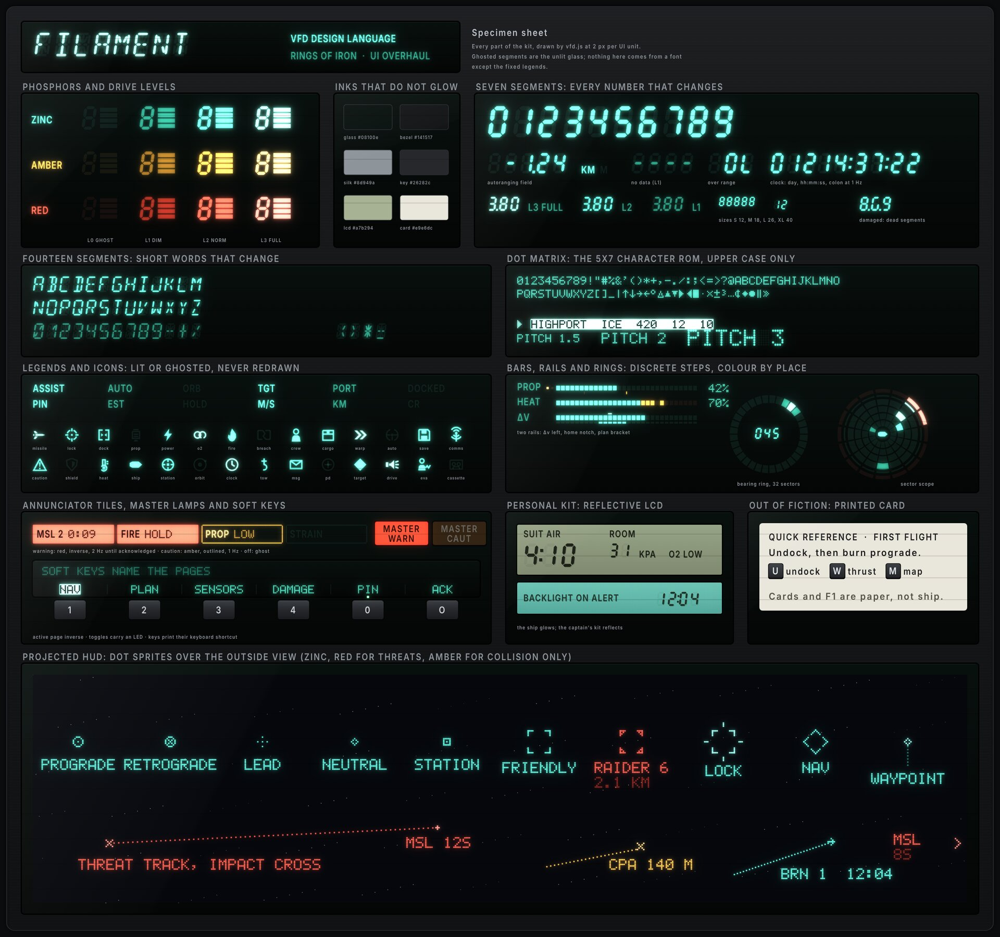

Contents

1. [The idea](#1-the-idea)
2. [What this style is not](#2-what-this-style-is-not)
3. [The hardware kit](#3-the-hardware-kit)
4. [Palette and drive levels](#4-palette-and-drive-levels)
5. [Lettering](#5-lettering)
6. [Icons](#6-icons)
7. [Building widgets](#7-building-widgets)
8. [The projected HUD](#8-the-projected-hud)
9. [Motion](#9-motion)
10. [Sound](#10-sound)
11. [Data visualisation](#11-data-visualisation)
12. [What the hardware changes in layout and interaction](#12-what-the-hardware-changes-in-layout-and-interaction)
13. [Semantic roles](#13-semantic-roles)
14. [Lexicon](#14-lexicon)
15. [Accessibility and settings](#15-accessibility-and-settings)
16. [Building it in the game](#16-building-it-in-the-game)
17. [Skinning a functional spec](#17-skinning-a-functional-spec)
18. [Screens beyond the flight HUD](#18-screens-beyond-the-flight-hud)

---

## 1. The idea

The ship's electronics come out of the same catalogue as a 1994 car stereo, a fax machine and a cash register. Every display is a sealed glass tube made for one job. Its digits, words and icons were laid down in phosphor at the factory; the only thing the ship can do at run time is choose which of them glow, and how brightly.

Everything in this language follows from that:

- **A readout can only show what its glass was built to show.** Every fact has a fixed home and a fixed shape.
- **Unlit segments are still there.** Behind the smoked glass the player sees every segment that could light, faintly. They learn a panel by where things are, not by reading it.
- **Light is the only ink.** Nothing normal needs to glow. A healthy ship is a dark console; trouble is what lights up.
- **Glyphs are made of segments and dots.** Numbers sit in fixed-width fields, words are short, and nothing is set in a typeface.
- **Things switch; they never glide.** A state change is instant, with a brief afterglow.

Touchstones for mood, not to copy: 90s car stereos and digital dashboards, the VFD head-up display in some 1989 cars, hi-fi decks and VCR fronts, calculators, pole displays, fax and copier panels, cockpit annunciator panels of the period, digital watches with an electroluminescent backlight, pagers and the first PDAs.

**Pillars**, ranked. When two collide, the higher one wins.

1. **Built for one job.** Each module has a fixed purpose and a fixed vocabulary.
2. **Position is meaning.** Nothing moves or reflows. A fixed place lights or stays dark.
3. **Light is information.** Nominal is dark or dim; abnormal is bright.
4. **Discrete, never smooth.** Values step, bars step, motion steps.
5. **Terse.** Character cells are expensive. Write like a telex.

---

## 2. What this style is not

The three artist styles must stay far apart. This is where FILAMENT stands against the other two:

| | **FILAMENT (VFD)** | Nasa-punk | Cassette-futurism |
|---|---|---|---|
| Display technology | Sealed vacuum fluorescent glass: segments, dot matrix and fixed legends. LCD for personal devices | Glass cockpit: free raster and vector graphics | CRT monitors, mechanical counters, incandescent lamps |
| Emissive lettering | Generated from segments and dots; never a font | Clean proportional sans | Terminal monospace on a raster |
| Colour | One phosphor (zinc blue-green) plus amber and red filters in fixed places | A broad semantic palette | Monochrome CRT phosphor and painted plastic |
| Lines | None. Dot chains and segments | Thin anti-aliased vectors | Scanlines and raster |
| Motion | Instant switching, afterglow, character-step scrolling | Smooth tweens | Mechanical travel, rolling, warm-up |
| Material | Smoked glass in satin-black moulded bezels, rubber keys, LEDs | Flat glass, minimal bezel | Beige and grey plastics, toggles, knobs, screws |
| Sound | Piezo beeps and relay clicks | Soft synthetic tones | Clunks, tape and motor noise |

**Never in FILAMENT:** anti-aliased lines or curves on an emissive layer; a typeface for emissive text (the fixed legends are shapes, see 5.4); gradients or transparency inside an emissive element; scanlines, screen curvature, chromatic aberration or rolling bars (those are CRT); eased or tweened movement; arbitrary colour; drop shadows; translucent panels floating over the world.

---

## 3. The hardware kit

Every widget in a functional spec is built from these parts and nothing else. If a widget can't be built from them, the widget changes, not the kit.

### 3.1 Housings

| Part | What it is | Rules |
|---|---|---|
| **Module** | A window of smoked glass with its own segments, cells and legends | Corner radius 3 units; 1.5-unit black gasket; a faint glare across the top-left third; 2 to 4 filament wires visible across it. Contents keep a 6-unit margin from the glass edge |
| **Rack** | A satin-black bezel plate along a screen edge that holds modules, printed legends and keys | Opaque. Heights on an 8-unit grid. Never transparent, never floating |
| **Slab** | A free-standing module with a thin bezel of its own, for things that appear and go (overlay, side panels) | Powers up when it has something to show and powers down when it has nothing (section 9). Never semi-transparent |
| **Pod** | A round housing for a ring or scope | May stand up to 24 units proud of its rack's top edge |

### 3.2 Emissive parts

| Part | Shows | Sizes (cap height, units) | Use for |
|---|---|---|---|
| **Seven-segment digits** | 0 to 9, minus, a few letters (`E r o L P H t`) | S 12, M 18, L 26, XL 40 | Every number that changes: speeds, ranges, times, counts |
| **Fourteen-segment characters** | A to Z, 0 to 9, `- + / * < > =` | 12, 16, 22 | Short words that change: mode names, page titles, a contact's name up to 8 characters |
| **Dot-matrix cells** | 5x7 glyphs from the character ROM (5.3) | Pitch 1.5, 2, 3 (cap 10.5, 14, 21) | Free text: names, lists, callouts, table cells |
| **Graphic dot panel** | A full grid of dots | Pitch 2 to 3 | Plots: the orbit plot, the ship plan, the shield ring |
| **Annunciator legends** | Fixed words laid down in phosphor | Size 10 to 14 | A fixed vocabulary: units, frames, states, page names, alert tags |
| **Icons** | Fixed segmented pictograms | 12, 16, 24 | States and alerts (section 6) |
| **Bars** | A row of discrete segments | 10, 20 or 30 segments | Quantities with thresholds |
| **Rings** | Annular sectors | 16, 32 or 96 sectors | Bearings, coverage, rotation |
| **LEDs** | Round 3-unit lamps in the bezel: red, amber, green | | The state of a key: on, armed, pending |
| **Lamp keys** | Translucent key caps lit from behind | | The master warning and master caution lamps, which are also the acknowledge buttons |
| **LCD** | Reflective liquid crystal, dark on grey-green, with an electroluminescent backlight | | The captain's personal kit and the instruments' NO POWER face (7.11) |

### 3.3 Grid

- Everything snaps to a 2-unit grid. Racks and modules snap to 8.
- A character cell is 6 x 9 dots: the 5x7 glyph, one column of space, two rows of leading. At pitch 2 a cell is 12 x 18 units; at pitch 1.5 it is 9 x 13.5.
- **Fields are counted in cells, not measured.** A spec's "name, up to 16 characters" is 16 cells, and the module is sized from the cell counts of its fields.

### 3.4 Resolution

Segment glyphs, bars, rings and icons are geometry and stay sharp at any scale. Dots need at least 2 pixels each:

- Dot pitch is snapped to whole pixels, at least 2.
- From 3 pixels a dot gets its gap (80% fill) and rounded corners; at 2 pixels it is a plain square and dot text reads as a crisp pixel font.
- So that pitch 1.5 never drops below 2 pixels, FILAMENT asks for the automatic UI scale to follow `window height / 800` (1.35 on a 1080-line window, where the 1280 x 800 layout still fits) rather than `window height / 1080`. A fixed scale below 1.35 still works; dot text then grows by whole cells and modules widen with it.

---

## 4. Palette and drive levels

### 4.1 Phosphors

| Token | Hex | Hot core | Role |
|---|---|---|---|
| `zinc` | `#46F6CC` | `#DEFFF6` | The bare phosphor, zinc oxide's blue-green. Everything by default |
| `amber` | `#FFAC34` | `#FFEECC` | A filter printed on the glass: caution regions |
| `red` | `#FF402E` | `#FFD8CC` | A filter printed on the glass: warning and hostile regions |

At full drive the centre of a segment whitens toward its hot core while the glow around it keeps the hue.

**Filters are places, not paint.** An amber or red filter covers a fixed region of a module's glass, so that region is always that colour, and nothing outside it can be. A warning cannot turn a zinc readout red; it lights a red element that was built for it. Every module that can raise a caution or a warning therefore has its amber or red element designed in at a fixed place: a pair of severity pips leading a row, a bar's notches, an annunciator cell, a tile's frame. This is the single biggest layout consequence of the style (section 12).

### 4.2 Drive levels

Brightness is the grid's duty cycle. Four levels, no others:

| Level | Name | Look | Use |
|---|---|---|---|
| L0 | **Ghost** | Unlit; 7.5% tint seen through the glass, no glow | Every segment, dot, legend and icon that is off |
| L1 | **Dim** | 40%, a little glow | Labels, secondary values, nominal values |
| L2 | **Normal** | 80%, full colour and glow | Primary values, active states |
| L3 | **Full** | 100%, white-hot core, wide bloom | The one thing that matters now: warnings, the focused row, the locked target |

Budgets: at most one L3 element per module outside an alarm. A status reading that is nominal (hull, shields, power, air) stays at L1, so the row in trouble is the bright one; the values the seat works with (speed, range, time to go) are L2.

### 4.3 The dimmer

The brightness the player sees is `setting x bus x module`:

- **Setting**: the player's brightness, 25% to 100%.
- **Bus**: the ship's power. A brownout dims every tube, with a 1 to 3% jitter; the floor is 35% so the UI stays readable.
- **Module**: a console without power goes dark (all ghost, then not even that); a damaged console flickers and loses segments (9.5).
- **Spotlight**: when a spec dims everything but a few widgets (an emergency card), FILAMENT does it with the bus: the other modules drop to 45%. The caution and warning list never dims, because it is the evidence the player decides on.

### 4.4 Inks that do not glow

| Token | Hex | Use |
|---|---|---|
| `glass` | `#040605` to `#08100E` | Module windows, top to bottom |
| `bezel` | `#141517`, edge `#26282B`, shadow `#08090A` | Racks and slab rims |
| `silk` | `#8D949A`, dim `#5B6167` | Printed legends on the bezel |
| `key` | `#26282C` | Rubber keys |
| `led` | red `#FF3C32`, amber `#FFAA28`, green `#5AFF78` | LEDs |
| `lcd` | `#97A386` to `#7F8A70`, ink `#1A2016`, backlight `#68B3A4` to `#4F978A` | Personal devices, NO POWER face |
| `card` | `#E9E6DC`, ink `#1C1C1C` | Out-of-fiction help (7.12) |

---

## 5. Lettering

Four lettering systems, each with one job.

### 5.1 Seven segments: numbers

- Slant 8 degrees, aspect 0.54, segment thickness 13% of the height, a visible gap at every joint.
- **Fixed-width fields**, right aligned, leading blanks (never leading zeros, except in clock fields). The minus sign takes its own cell. The layout never moves when a value changes.
- **No bare signs.** A value whose direction matters (closing speed, a rate of climb) never tells it by its sign alone: a word or a lit legend beside it says which way (`CLOSING`, `OPENING`).
- **Autoranging**, like a multimeter: the field keeps its width and the unit legend beside it steps (`M` to `KM`, `M/S` to `KM/S`) with the decimal point. A 4-digit field reads ` 312 M`, `1.24 KM`, `12.4 KM`, ` 124 KM`.
- **No data** is `----` (segment g only) at L1. **Over range** is `OL`. **Estimated** values are L1 with an `EST` legend lit.
- **Thousands** take a comma, lit at the foot of the digit before it as a decimal point is, never a cell of its own: `5,000` fills four cells, so a field keeps its width when a value passes 999.
- **Colons** take their own narrow cell (a fifth of a digit), so `14:22:05` doesn't crowd. **Long times** carry their unit as a segment letter inside the field: `1h10`, `2d21h`, `1.4d`.
- **Refresh rate** is fixed per readout: 5 Hz for fast values (speed, range), 2 Hz for slow ones, 1 Hz for clocks. Never per frame: the last digit must be readable.

### 5.2 Fourteen segments: short words

- Same slant. At most 8 cells per field.
- For words that change: page titles (`SENSORS`), modes (`APPROACH`), the locked contact's name (`RAIDER 6`). A longer name moves to dot matrix.

### 5.3 Dot matrix: free text

- **5x7 glyphs from the character ROM** in `vfd/src/vfd.js`: `A` to `Z`, digits, punctuation and a page of custom glyphs: `↑ ↓ ← → ° Δ ▲ ▼ ▶ ◀ █ · × ± ³ … ¢ ♦ ‖ »`.
- **Upper case only.** Writers write in sentence case; the display folds it. Long text reads like a telex, which is deliberate.
- **Pitch**: 1.5 for column text, table cells and slab rows (the minimum: its 10.5-unit cap height matches a 13-unit typeface, the specs' body size); 2 for running text (a ticker, a callout) and for every label in the world; 3 for headlines.
- Monospaced cells; no kerning; word space is one cell.
- **Line length is the module's cell count.** Wrap at spaces only, never hyphenate; a word longer than its field is cut with `…`. Only the focused row of a list may scroll its overflow (9.3).

### 5.4 Legends: printed words

- Only for a **fixed vocabulary** (section 14): units, frames, states, page and station names, alert tags.
- Face: Inter SemiBold (already in `assets/fonts`), condensed horizontally to 80%, tracking +6%, all capitals, size 13 to 18. Size 12 only for silk, key caps and the words on lamps and tell-tales.
- **If it can change state, it is phosphor; if it never changes, it is silk.** A phosphor legend is lit or ghosted (`ASSIST`, `DOCKED`, `PIN`); a silk legend is printed on the bezel in grey and never glows (a module's title, a key's name).

---

## 6. Icons

- **Segmented.** Each icon is built from separate strokes and fills with visible breaks where the glass separates them, on a 16-unit grid, strokes 1.5 units, no detail under 2 units.
- Every icon has its ghost (always visible on its home module) and its lit state, in one colour. An icon never changes shape.
- The first set, drawn in the specimen sheet: missile, lock, dock, propellant, power, oxygen, fire, breach, crew, cargo, warp, autopilot, save (a floppy disk), comms, caution, shield, heat, ship, station, orbit, clock, tow, message, point defense, target, drive, EVA, cassette.
- Icons stand beside a word, not instead of one, wherever space allows. On the projected HUD they are dot sprites instead (section 8).

---

## 7. Building widgets

### 7.1 Readouts

A label (phosphor legend at L1, or silk), a seven-segment value (L2) and a unit legend chosen from a fixed set beside it. The value's field width is part of the design: `VEL` is 6 digits, `RNG` 4 with autoranging, a clock `DDD HH:MM:SS`.

### 7.2 Bars

- 10, 20 or 30 segments, 1.2 units apart.
- **A depleting resource** (propellant, hull, air, shield mass) fills in zinc: a full tank is not news. Its thresholds are **notches**, short ticks under the bar behind amber and red filters, ghosted until the value falls past them, and the alarm is the row's **severity pips** (7.6), which lead the row. *Round 1 drew these bars with red and amber feet; every healthy bar then showed red, which broke the dark cockpit.*
- **A rising hazard** (heat, strain, closing speed) keeps **fixed filter zones** at the top: the top 20% of segments red, the 20% before them amber. They only light when the hazard is high, so a quiet bar stays zinc.
- **Markers ride on the bar, not over it.** A limit or a target (the Δv needed to get home) is one segment lit at L2 beyond the fill, plus a silk notch. A range on the bar (the Δv a plan will spend) lights a thin second rail of segments under the bar: a two-rail bar.
- Ballistics: a bar rises at once and falls at 30 segments a second; a peak segment holds for 1.5 s where a peak matters.

### 7.3 Rings

16, 32 or 96 annular sectors. A bearing lights a sector; a coverage ring lights sectors in up to three concentric rails (thin, medium, thick) to show strength in steps instead of a smooth thickness.

### 7.4 Scopes

- **Sector scope** (the default radar): 16 bearings by 4 range rings of fixed cells, plus a red-filtered rim of 16 threat segments. A contact lights the cell it is in; a hostile also lights the rim at its bearing. Precise positions are the world view's job; the scope answers "what is around me, how far, and from where is the threat". The range ring legends are lit to show the scale.
- **Plotting scope**: a round graphic dot panel, for pages that need positions (a contact list beside it carries the numbers).

### 7.5 Plots on graphic panels

- Lines are dot chains on the panel's grid. No anti-aliasing, no stroke widths.
- Fills are ordered dither: 25%, 50%, 75%. A planet is a 50% disc with a solid limb; drawn large (past 60 units), it is the ground under the orbits, a 25% dither with its limb at L1.
- Labels are 5x7 text on the same grid. The selected item is shown by inverse text and a 1 Hz blink.
- The map's line rules, labels and timeline are in 18.3.

### 7.6 Lists and tables

- Columns are counted in cells. Headers are legends (L1 phosphor or silk); rows are dot matrix at L2; numbers right aligned. Seven segments are for single values, not table cells.
- **Severity pips.** A list of conditions (cautions and warnings, mounts, ship systems) leads each row with two 3-unit pips in fixed columns, amber then red. The row's words stay zinc: the pips carry the severity, by colour and by column, so it reads without colour too.
- **Focus is inverse video**: the focused row's cells invert, and a `▶` sits in column 0. There is no hover state: the pointer moves the cursor.
- **Paging, not scrolling.** A list shows a fixed number of rows; `PG 1/3` and lit `▲ ▼` legends say there is more. The cursor steps by row; Page Up and Page Down step by page.

### 7.7 Soft keys

- A module may have a row of up to six rubber keys under it. The module's bottom row of cells draws each key's label above it, and each key cap prints its keyboard shortcut in silk.
- **An MFD's rail** has three page keys and one split key. A page key carries its page's full name, never a short form (`SENSORS`, not `SNS`), so each is wide enough for nine cells, the longest name (`CONTRACTS`). The split key's halves pin and fold the display, each half a 24-unit target with its glyph in the glass over it (a pin, a chevron down to a bar); the pin glyph lights while the display is pinned. A station with two pages leaves its third key unlabelled.
- The active page or mode's label is inverse. A key that toggles something has an LED above it: green when on. A key waiting for a second press (abandon ship, call a tow) has its LED blinking amber.
- Keys are at least 24 units square, the smallest thing a pointer is asked to hit. A folded module's rail idles at L1; only the active page's label is L2, so a quiet console's brightest words are never its menu.
- **Keys are keys.** Wherever the UI names a key, it draws a small key cap with the key's legend, never `[E]` in brackets. Inside a dot-matrix field the cap is one inverse cell, the display's own key cap, so the line stays on its cell grid and a key costs one cell: the stations status strip's longest emergency text (`DISABLED`, P twice, `ABANDON`, B twice, `TOW`, 34 characters as the spec writes it) takes 28 of its 39 cells.

### 7.8 Annunciator cells

Four forms:

- **Fixed panel**: one cell per condition, ghosted when inactive. For small, fixed sets: a station's own conditions on its module. Each cell is **dual-filtered**: its frame sits behind amber and its block behind red, so the same cell lights as an amber outline for a caution or a red inverse block for a warning.
- **Tell-tales**: a fixed panel whose cells carry an icon over the word, like a dashboard's warning lamps. For a ship-wide set of ten or so conditions the player learns by position and shape. A tell-tale has four states, so its cell is printed in register: the frame behind amber, the block behind red, the icon and word on clear glass. **Dark**: all ghost. **Advisory** (normal but worth knowing): the icon and word at L1 zinc. **Caution**: the amber frame at L3 and the icon and word at L2. **Warning**: the red block at L2 with the icon and word cut out of it. A ship without the system (no shield emitter) has blank glass in that place, not a ghost cell.
- **Tile row**: for a list ordered by severity, where conditions come and go. A tile is a cell holding a legend tag and a dot-matrix value. A **caution** tile sits behind an amber filter and is drawn as an outlined cell; a **warning** tile sits behind a red filter and is drawn **inverse** (a solid lit block with dark letters). Every tile is dual-filtered like a fixed panel's cell (its frame and dots behind amber, its block behind red), so the row has no fixed split: warnings fill inward from the `MASTER WARN` lamp at one end, cautions inward from `MASTER CAUT` at the other, and when more stand than there are tiles, the tile where they meet counts the rest (`+2` over `MORE`) in the role of the worst it hides. Severity is told apart by colour, form, end and blink rate together.
- **Message centre**: a dot-matrix window behind red glass that holds the one standing warning in words, over a row of cells behind amber glass for up to three cautions. A warning can only be red because there is nowhere else for it to light. The red window keeps its place unlit when no warning stands, so the cautions never move. A caution cell is two lines of 19 cells: what and where, then who is on it or the key; each line takes its part of the alert's full text when that fits and its part of the short form when it doesn't. A narrow fourth cell counts the rest: `+2` over `MORE`.

Where a list of conditions runs out of tiles or rows, its last place says how many more stand and the most severe of them (`+1 MORE: SMOKE`); it never scrolls.

Inverse text (a warning tile, an active mode, the seat in use) is cut out of a lit block. Bloom would fill the cut letters with glow, so every cut is also kept on a mask and darkened again after the bloom: the eye sees a dark letter in front of a lit block. Inverse text therefore has the same minimum sizes as lit text (section 15).

### 7.9 Master lamps

Two lamp keys, `MASTER WARN` (red) and `MASTER CAUT` (amber). Lit and flashing while an unacknowledged alert of that severity exists: warning at 2 Hz, caution at 1 Hz. Pressing one (a click, or the acknowledge key) is the acknowledgement: the flashing and the alarm stop, the lamp stays lit while the condition holds.

### 7.10 Prompts and responses

A prompt is a small slab over its console: the console's name in legend type, then each verb with its key cap. A response (the answer to a key pressed where it can't work) replaces the prompt's text for 4 s, with the refused-input buzz.

### 7.11 LCD: the captain's kit and the NO POWER face

The ship glows; the captain's own kit reflects.

- **Personal devices** (the slate, the suit readout) are reflective LCD: dark segments and dots on grey-green, each with a faint shadow cast on the reflector behind, no glow. The electroluminescent backlight (blue-green) comes on for 3 s on an alert or a key press.
- **The NO POWER face.** Behind each instrument's smoked glass sits a small LCD that can't be seen while the ship has power. When the instrument loses power its tubes go dark, every ghost still showing what it would hold, and the LCD's backlight comes on from the emergency bus: `NO POWER`, dark on dim teal, in the middle of the glass. A dead page reads the same wherever it is viewed.
- **The emergency bus.** In a blackout, with no reactor running, the seat goes dark: its clusters, MFDs and station board on their NO POWER face, and the projected HUD over the outside view with them (a hostile still near shows in the world, without its bracket). The player sees at once that the ship can neither fly nor fight. What the crew need to get out stays lit on the emergency bus: the overlay (status strip, annunciator, ticker, prompt line), Engineering's consoles with their switches, and the slate, which is LCD anyway. On deck the tags and marks stay, since there the projector is the suit's own; the consoles go dark and the deck goes to its emergency lighting, door lights and alarm beacons still lit.
- The backlight is a dim teal, not white: in a dark cockpit a bright backlit panel outshines every alarm.

### 7.12 Out-of-fiction help

Tutorial guide cards and the controls reference (F1) are **printed quick-reference cards**: off-white laminated card with black ink and key caps, the only light surface in the UI. They are plainly not part of the ship. Menus (main, pause, settings) are the ship's computer in setup mode and use the full kit.

---

## 8. The projected HUD

The symbology over the outside view is written by a dot-matrix projector, the descendant of those early car head-up displays. It follows its own rules:

- **Dots only.** Every marker is a dot sprite on a 2-unit grid (dots 1.6 units). Lines are dot chains with dots every 4 to 6 units. There are no solid strokes and no curves.
- **Two channels.** Zinc for everything; red for threats (hostiles, incoming missiles, the impact cross) and for warning tags on the deck. Amber appears only for the collision cue, an unsafe docking corridor and caution tags on the deck.
- No ghosting and no mesh (it is projected), the same bloom.
- **Under the hardware.** The projection lands on the world, so racks, pods and slabs cover it. It never draws over a module.
- **Tags on the deck.** Over the lit interior a tag is hard to read, so the deck view darkens a soft pill under each tag. The world is dimmed; the projector still draws no black. A hazard tag is its severity glyph (`♦` warning, red; `▲` caution, amber) and its name in 5x7 at pitch 2, set over the hazard; under it, a bar of dots for the progress of whoever works it, or `NOBODY`.
- **Shape before colour**, so every role reads without colour:

| Role | Sprite |
|---|---|
| Prograde | Circle of dots with three ticks; a square of dots when the frame is a station or a target, so the frame reads by shape |
| Retrograde | Circle of dots with a cross |
| Frame tag | When a spec names the frame beside the markers, a 5x7 tag at L1 on the side away from your own ship, never across the hull |
| Friendly | Square corner brackets |
| Neutral | A small open diamond; icon only unless near or hovered |
| Hostile | Red triangular corners, with the class in 5x7 |
| Beaten (struck, disabled, taken) | Its corners drop to L1 zinc: no longer a threat, still a ship |
| Station | An open square with a centre dot |
| Locked target | Full corner brackets at L3 with four ticks; blinks three times on lock |
| Navigation target | Diamond brackets (corners turned 45 degrees) |
| Contract waypoint | A hollow diamond with a dotted tail |
| Burn arrow | A dot chain with an arrowhead sprite and the 5x7 label the spec gives it, if any: the burn's number, its countdown only where the spec puts the time on the arrow |
| Threat track | A red dot chain, dots every 6 units, ending in an impact cross |
| Point-defense kill | A ring of eight dots that steps out three times (16 ms each) and fades |
| Lead reticle | A ring of dots broken on the diagonals, with a centre pip. At fight ranges the lead is tens of metres, so the reticle sits on the target, inside its lock mark: the world view dims a soft disc under it (as the deck view does under a tag), so its dots don't read as the hull's own lights, and it is the smallest mark there, well inside the lock's corner brackets |
| Fire arc | Dot chains along the arc's edges, sparse dots along its rim |
| Docking corridor | Two dotted rails: zinc while safe, amber when closing too fast |
| Collision cue | An amber cross of dots at the closest approach, with a dot chain to it |
| Edge marker | A dot chevron at the edge of the view with a 5x7 label; a missile's seconds to impact only where the spec puts them on the marker |
| Picture-in-picture ring | A circle of dots every 4 units with a 5x7 caption |
| Speaking mark (deck) | Three dots over a crew member's head that light in turn, 250 ms each, for the 3 s after they speak. No words: the ticker has them |

- Labels are 5x7 at pitch 2, at most 12 cells a line: the name at L2, and under it at L1 a number where the spec allows markers one (the task spec gives markers names only).
- Sprites snap to the 2-unit grid as they move, so they step rather than slide.

---

## 9. Motion

### 9.1 Switching

- **On**: rises within one frame.
- **Off**: afterglow, decaying over 120 ms. A digit that changes leaves a faint trace of its old segments.
- **Power-up** (a module or slab appearing, a console coming to life): 240 ms self-test. Every segment lights at L2 for 120 ms, the module goes blank for 60 ms, then its content draws top to bottom one text line every 16 ms, as if over a slow bus.
- **Power-down**: content blanks at once and decays; a slab's glass then goes.
- **Changing page or mode**: the module blanks and redraws. No slides, no fades, no tweens.

### 9.2 Blinking

- One global blink clock; every blinking thing on screen is in phase.
- Caution 1 Hz (500 ms on, 500 off). Warning 2 Hz (250 on, 250 off). Nothing blinks faster.
- Only the master lamps, unacknowledged tiles, a newly locked target (three blinks) and a text-entry cursor blink.

### 9.3 Scrolling

- Text that overflows its field marquees one cell at a time, 8 cells a second, with a 1 s hold at each end. Only in the focused row or a ticker line. Writers keep a ticker's callouts within its width (54 cells on the stations ticker, whose spec caps a callout at 50 characters), so the marquee is the exception.
- Lists move by whole rows and pages.

### 9.4 Attention without motion

- **Level kick**: when a value crosses a threshold it jumps from its level to L3 for 2 s and settles back. This replaces flashing for anything that is not a caution or a warning.
- **Busy**: a "racetrack" around one digit's outer segments at 12 Hz, or three dots chasing.

### 9.5 Power and damage

- **Brownout**: every tube dims with the bus, with a slight jitter.
- **Power lost**: tubes go dark over 300 ms and the NO POWER face comes up behind the glass; in a blackout, what is on the emergency bus stays lit (7.11).
- **Damaged console**: its modules flicker (a 1 to 3% drop at 10 to 30 Hz) and lose a fixed scatter of segments, the same ones every time for that module, so the player can learn to read around them.
- **Destroyed console**: its modules are dark, the glass cracked (a non-emissive overlay).

---

## 10. Sound

A piezo beeper and a relay. Square waves, short, never a melody. Every alarm is tied to the master lamps and stops on acknowledge.

| Event | Sound | Today's hook |
|---|---|---|
| Key or click | 2.4 kHz tick, 6 ms | new `UI_KEY` |
| Soft key confirmed | Two tones, 1.8 then 2.4 kHz, 40 ms each | new `UI_CONFIRM` |
| Refused input | 440 Hz buzz, 120 ms | new `UI_REFUSE` |
| Advisory | One 1.2 kHz bip, 50 ms | `UI_NOTICE` |
| Caution | Three 1 kHz beeps (80 ms on, 80 off), repeated once after 4 s if not acknowledged | new `UI_CAUTION` |
| Warning | 2.8 kHz pips at 4 a second, in phase with the blink clock, until acknowledged | `UI_WARNING` |
| Module power-up | A 200 ms filament whine and a relay click | new `UI_POWERUP` |
| View change, dock latch, mode switch | Relay clack | new `UI_RELAY` |
| Autosave | Floppy-drive seek chatter, 400 ms | new `UI_SAVE` |
| Brownout | The tubes' whine drops in pitch | new `UI_BROWNOUT` (looped) |

---

## 11. Data visualisation

| Data | Built as |
|---|---|
| A value that changes | Seven segments in a fixed field, unit legend, autoranging |
| A quantity with thresholds | A depleting resource: a zinc bar with notches, its alarm on the row's pips. A rising hazard: a bar with filter zones at the top. Limits and targets ride on it (7.2) |
| A quantity against a budget (Δv against the trip home, demand against generation) | Two rails on one scale, sharing a limit segment |
| A bearing or coverage | A ring of sectors |
| Positions | A graphic dot panel, or a sector scope when the world view already holds the precision |
| A trend over time | Spectrum columns: 16 columns of 8 segments, the newest on the right, stepping left once a second |
| Several similar things (stations, mounts, launchers) | A row of identical cells: small multiples, the same layout in each |
| A state | A legend lit or ghosted; never the words ON and OFF |

---

## 12. What the hardware changes in layout and interaction

These are the ways FILAMENT changes more than the look. They are what the functional designs adopt when skinned in this style; where one clashes with a spec, it is raised with that spec's designer as a critique, not quietly changed.

1. **Racks, not floating panels.** Persistent instruments live in opaque racks along the screen edges. The outside view is the window between them, and the camera centres the ship in that window, not on the screen.
2. **Fixed homes.** A module never moves or resizes. In a rack, a field with nothing to show goes dark (ghosted) instead of collapsing, so every other field stays where the player learned it. In the overlay, a slab with nothing to show powers down and is gone. "Hidden when empty" means dark in a rack and gone in the overlay. A rack module that a post doesn't need **folds**: its glass sinks into the rack and only its soft-key rail stays, so it can be called back where it was. Instruments a context retires (the flight display while docked or latched) sink the same way; whatever must stay in reach, such as the master lamps, keeps a shelf of its own proud of the rack.
3. **Character budgets.** Every text field has a cell count, and every module is sized from those counts. Specs give maximum lengths; this guide's lexicon (section 14) shortens the rest.
4. **Soft keys instead of buttons.** Every action in a module is a soft key with a key cap. Mouse clicks land on soft keys and rows; nothing changes under a hovering pointer.
5. **States are lit words, not text.** `ASSIST ON/OFF` becomes the legend `ASSIST`, lit or ghosted. Booleans never take text.
6. **Modes instead of windows.** A module changes what it shows (its lit mode legend says which) rather than opening a window over another module. Only slabs overlap the world, and they never overlap each other.
7. **Paging instead of scrolling.**
8. **Colour by place.** Amber and red exist only where the glass was filtered, so every alerting element has a reserved home in its module.
9. **Personal kit is LCD.** The slate and the suit readout reflect light instead of emitting it, which tells the player at a glance whether they are looking at the ship or at their own kit.
10. **The UI runs on the ship's power.** A brownout dims it, a dead instrument is dark behind its NO POWER face, and in a blackout the emergency bus keeps lit what the crew need to get out.

---

## 13. Semantic roles

How the semantic roles the functional specs name are told apart. Each is distinct without colour.

| Role | Channel | Level | Form | Motion |
|---|---|---|---|---|
| Nominal | zinc | L1, or dark | plain | none |
| Advisory | zinc | L2 | plain | level kick on arrival |
| Caution | amber filter | L2 | outlined cell, `▲` | 1 Hz until acknowledged |
| Warning | red filter | L3 | inverse cell, `◆`-like `♦` | 2 Hz until acknowledged |
| Own ship | zinc | L2 | hollow sprites | none |
| Friendly | zinc | L2 | square brackets | none |
| Neutral | zinc | L1 | small diamond, icon only | none |
| Hostile | red | L2 | triangular corners | none |
| Navigation | zinc | L2 | diamond brackets, dotted lines | none |
| Locked target | zinc | L3 | full brackets with ticks | three blinks on lock |
| Selected or focused | as its element | inverse | inverse cells and `▶` | text cursor at 1 Hz |
| Unavailable | none | ghost only | `----`; a dead instrument's `NO POWER` face | none |
| Player / crewed / automated | zinc | L3 / L2 / L1 | `YOU` inverse / initials / `AUTO` legend | none |
| Out of fiction | printed card | n/a | off-white card, black ink | none |

---

## 14. Lexicon

The legend vocabulary and the abbreviations dot-matrix fields use when a word doesn't fit. Text in callouts and tables is written in full where its field allows.

| Abbreviation | Meaning | Abbreviation | Meaning |
|---|---|---|---|
| `VEL` | velocity | `ROT` | rotation rate |
| `ALT` | altitude | `AP`, `PE` | apoapsis, periapsis |
| `PER` | period | `SOI` | sphere of influence |
| `RNG` | range | `CLS` | closing speed |
| `CPA` | closest approach | `TTI` | time to impact |
| `TOF` | time of flight | `BRG` | bearing |
| `ΔV` | delta-v | `HOME` | Δv the trip home needs |
| `PROP` | propellant | `HULL` | hull integrity |
| `PWR` | power | `GEN`, `DMD` | generation, demand |
| `STOR` | power store | `O2` | oxygen |
| `PRES` | pressure | `ATMOS` | atmosphere |
| `SHLD` | shields | `PD` | point defense |
| `MSL` | missile | `DCY` | decoy |
| `TGT` | target | `NAV` | navigation |
| `ORB` | orbit frame | `PORT` | docking port frame |
| `BRN` | burn | `WARP` | time warp |
| `AUTO` | autopilot or automated | `ASSIST` | rotation assist |
| `DCK` | docked | `CLR` | clearance |
| `STRN` | collar strain | `CR` | credits |
| `QTY` | quantity | `STK` | stock |
| `RDY` | ready | `RLD` | reloading |
| `HLD` | held (guns) | `FREE` | firing at will |
| `ENG` | engineering | `TAC` | tactical |
| `CMD` | command | `MED` | medical |
| `ACK` | acknowledge | `PIN` | pinned |
| `PG` | page | `EST` | estimated |
| `OL` | over range | | |

---

## 15. Accessibility and settings

- **Never colour alone.** Severity is also told by the form of the cell (outlined or inverse), the blink rate and the legend word; contacts by their sprite shape.
- **Flashing** is at most 2 Hz and limited to the elements in 9.2. *Reduce flashing* turns every blink into a steady L3 with inverse.
- **Legibility mode** turns off the mesh, filaments, ghosts and bloom, fills dots to squares and raises L1 to 60%.
- **Glow** strength (bloom) and **afterglow** each have a slider.
- **Brightness** (the dimmer's setting) from 25% to 100%.
- **Minimum sizes** (UI units at 1280 x 800), for lit and cut text alike:
  - legends 13; 12 only for silk, key caps and the words on lamps and tell-tales;
  - seven and fourteen segments 12 tall;
  - dot matrix pitch 1.5 for column text (cap 10.5, the same cap height as a 13-unit typeface); pitch 2 for running text, tickers, callouts and labels in the world;
  - LCD text 12;
  - anything clickable 24 by 24.

  The functional specs size type by its typeface (body 13, values 15). FILAMENT matches cap heights: dot matrix at pitch 1.5 has a 13-unit typeface's cap (10.5), and a seven-segment digit 12 tall stands taller than a 15-unit typeface's cap (about 11). So a spec's value, a reading a widget exists to show, is drawn in seven segments, never in dot matrix at pitch 1.5; a number inside a line of text takes the line's dot matrix.

  When a module no longer fits at these sizes, its content is cut by priority (the spec's order) and never shrunk. The mockup renderer reports anything drawn below them, and an overflow check reports a row that runs past its module.

---

## 16. Building it in the game

The mockups are drawn by `vfd/src/vfd.js`, which doubles as the reference for the glyph tables and drawing rules. In the game:

| Piece | Role |
|---|---|
| `VfdGlyphs` | The seven-segment and fourteen-segment masks and the 5x7 ROM, ported from `vfd.js` |
| `VfdDraw` | Segments, dots, bars, rings and icons as batched quads from the skin's white region, the way `HudFrame` and `HudDraw` draw now |
| `VfdLayer` | Two frame buffers at UI resolution: base (glass, ghosts, bezels) and emissive (lit parts). Bloom is the emissive buffer at half resolution through a 9-tap Gaussian twice, added over the base. A third, the cut mask, holds every inverse letter and is darkened over the result after the bloom |
| `VfdClock` | The global blink phase, and afterglow: each part keeps its last mask and the time each segment went off |
| `VfdDimmer` | Setting x bus x module, fed from `ShipStatusProvider` |
| `VfdModule`, `Rack`, `Slab` | Scene2D widgets laid out in cells |

Only the legends and silk use a font (Inter SemiBold, drawn with a horizontal scale); everything else is geometry, so every segment can be ghosted, dimmed, blinked or burned out on its own.

---

## 17. Skinning a functional spec

How each functional design becomes a FILAMENT variation:

1. List every widget and its data; pick its parts from section 3.
2. Give every field a cell count; shorten with section 14.
3. Give every widget a rack, module or slab and a fixed home.
4. Map every semantic role with section 13.
5. Reserve the amber and red filtered places for every caution and warning element.
6. Define each module's power-up, power-down and alert behaviour, and its sounds.
7. Mock up the spec's walkthroughs, critique them, send functional critiques to the spec's designer, and repeat.

The variations live in [`variations/`](variations/), with the round log in [`variations/vfd-rounds.md`](variations/vfd-rounds.md).

---

## 18. Screens beyond the flight HUD

The windows, the map, the menus and the cards: everything the flight HUD hands over to when the player stops flying and starts deciding. Each spec gives them its own shape (a console panel, a full-screen mode, a terminal that serves several windows); FILAMENT builds every shape from the same four housings, so a market, a map and a crew roster read as one machine. The parts are drawn by [`vfd/src/screens.js`](vfd/src/screens.js), and each variation's own screens are in its page under [`variations/`](variations/).

### 18.1 Four housings

| Housing | What it is | Where it serves |
|---|---|---|
| **Terminal** | A slab of smoked dot-matrix glass in its own bezel: page keys along one edge, soft keys along another | A console's or a station's screen: the market, the yard, the mission board, boarding, the map's panels, a full-screen mode |
| **Plot** | A graphic dot panel at pitch 3, every dot ghosting through the glass | The map's orbit canvas |
| **Slate** | Reflective LCD in a dark rubber housing (7.11) | The captain's own: career, crew, contracts, the log |
| **Card** | Printed paper, out of fiction (7.12) | The controls (F1); ship lost or career over |

The menus around the game are the ship's computer in **setup mode** (18.5), built from the terminal's parts.

### 18.2 The terminal

- **Page keys** run along the top edge, each with its page's full name in the glass beside it, the page up in inverse. A narrow panel puts them down its left edge instead, each name in the glass's first column, so a 480-unit side panel still takes six pages by their full names (`INFIRMARY` is nine cells). A page this place doesn't offer is a blank key over blank glass: the other keys keep their homes.
- **Soft keys** run along the bottom edge: the cap prints the keyboard key, the glass row over it the action. An action that can't be taken now stays in its place as a dim label; nothing on a terminal appears or vanishes as the state changes.
- **The title row** carries the place in fourteen segments (`HIGHPORT`), its owner dim beside it, and the figures that matter on every page (credits, hold) in seven segments at the right.
- **Rows and focus.** Tables are cell grids (7.6); the focused row inverts across the whole grid and its `▶` sits in column 0. The soft keys act on the focused row, so a table has no buttons in its rows: `BUY 1`, `BUY 10`, `SELL 1`, `SELL ALL` act on the row under the cursor.
- **Pages, not scrolling.** A list longer than its glass pages (`PG 1/2`, its arrows lit where there is more). Only the focused row may scroll its overflow (9.3).
- **The response line** over the soft keys says what the last press did (`SOLD 2 WATER FOR 26 CR`) until the next.
- **The mode frame.** A full-screen mode (the context spec's map, ship, station and boarding modes) is a terminal across the screen: a title strip (the mode's title in fourteen segments, a dim subtitle, its tabs as keys in the bezel above the strip, each tab's name in the strip under its key, the one showing inverse); the content in panes; a foot strip with the one-line feed at the left and the closing keys right-aligned (`M  OR  ESC  CLOSE`). A pane is a module of glass with its name as a dim legend in its first row; a section in a pane is a dim legend and a ghost rule to the pane's edge.

| | |
|---|---|
| 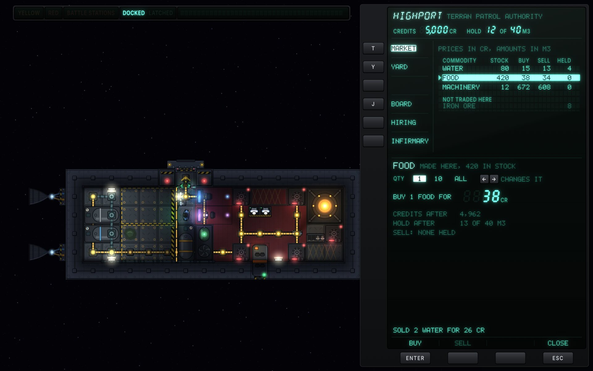 | 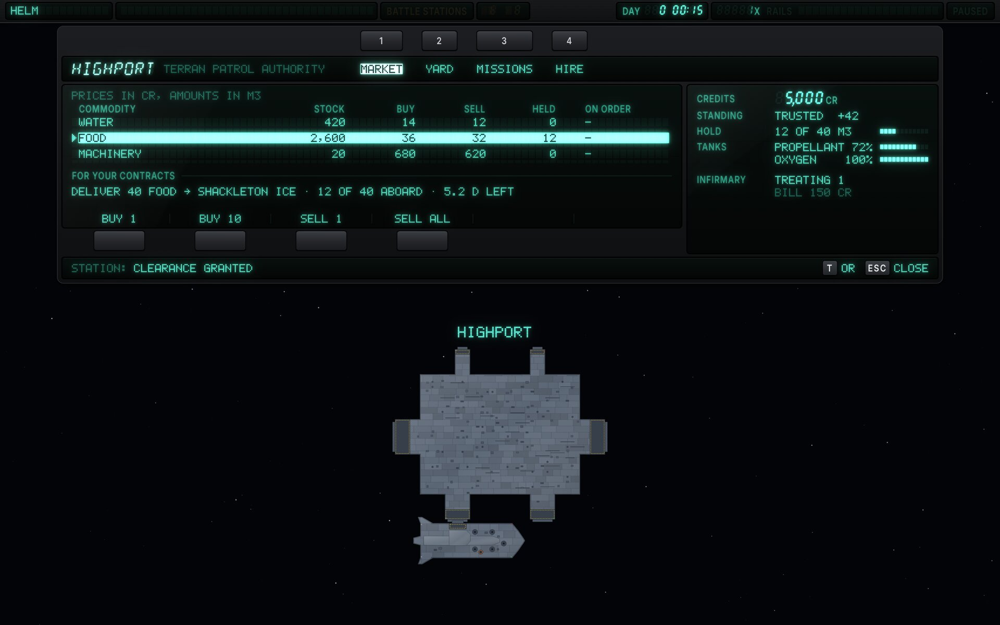 |

### 18.3 The plot

The orbit canvas keeps the game's geometry; FILAMENT draws each piece on the dot grid (7.5).

| Line | Drive | Dots lit |
|---|---|---|
| The orbit now | L2 | every second |
| A planned leg | L3 | every one (solid) |
| A proposed transfer, not yet accepted | L3 | every third |
| The orbit the plan ends in | L1 | every one |
| A moon's orbit; a sphere of influence | L1 | every third; every second |
| A moon where the path will meet it (the game's ghost): its outline and its sphere | L1 | every third |
| A leader from a label to its mark | L1 | every second |

- **Marks** are sprites on the panel's own dots: the ship, stations and contacts by kind, burn nodes (the selected one solid with its four handles, prograde at L2 and the rest at L1), apsides, the waypoint where a leg crosses into another sphere, impacts. The Nav target carries four corner brackets at L3.
- **Labels keep their ground.** A label is 5x7 text at pitch 1.5 and the dots under it go dark, their ghosts still showing, so no line ever crosses text. It sits clear of its mark on a leader that leaves from its first line, or from under its last line when the mark is below it, never across its own text; a label left of its mark is set right-aligned, so it ends where its leader starts.
- **Clusters.** Traffic too close together to draw apart at the scale is one label (`4 CONTACTS`) on a leader to the ship; the contact list beside the plot names them.
- **Estimates.** An event the plan only estimates (a capture before the crossing plans it) is a hollow cell on the timeline with its label at L1, and the plan's list gives its figures as `ABOUT`.
- **The timeline** under the plot is a strip of 64 cells from now to the last event on a log scale: each event lit in its cell, an estimate hollow, a deadline lighting the amber rail under the strip up to its cell. Each label is right-aligned to its cell and drops to a second row rather than touch the one before; `»` after a future event's time is its warp-to.
- Bodies follow 7.5; a ruler with its figure sits in the panel's corner.

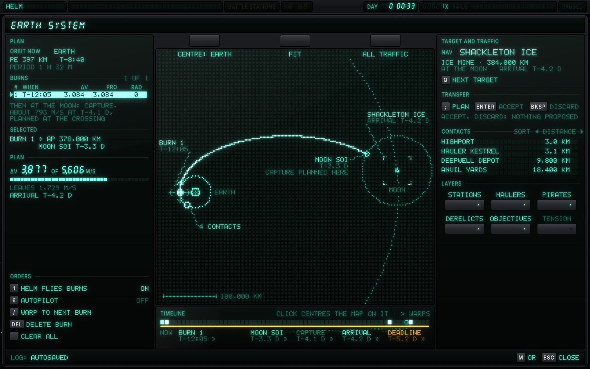

### 18.4 The slate

- The captain's own kit is LCD (7.11): dark dots on grey-green with their shadow on the reflector, the backlight on for 3 s after a key press and while it warns.
- **No colour on the LCD.** A caution is an outlined square, a warning a solid one; focus is a dark block with the dots left clear.
- Its tab keys run down the housing's left edge with their names beside them in the glass; its action keys sit under the glass with their actions printed on the housing over them, so they never light.
- A slate is a side panel: seated, it stops above the band and the camera moves to keep the ship in what is left of the world, a world label it would cover going to its edge marker.

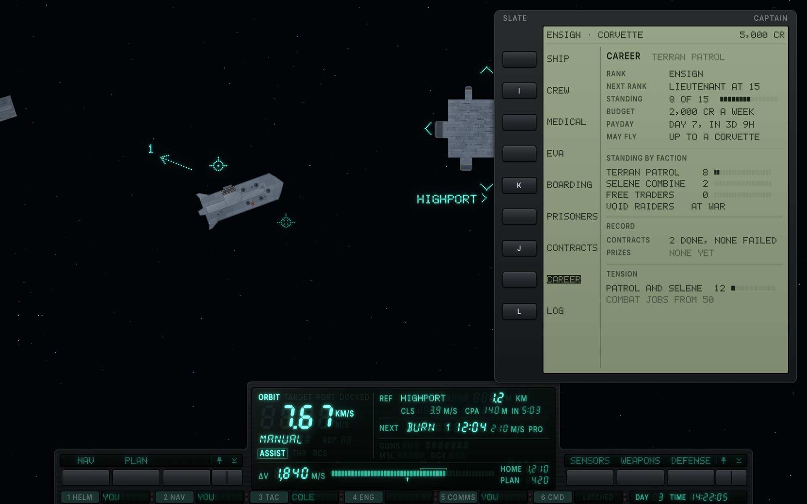

### 18.5 Setup mode: the menus

Before a game starts, nothing aboard is live but the computer. The top rack shows `SETUP` in fourteen segments, its annunciators and clock all ghosts; the window between the racks shows the stars and the lit limb of the planet below; the bottom rack's window carries the legend of keys.

- **Each menu keeps the classic one's rows, buttons and order.** A button is a field of cells at pitch 2 with a cursor column; focus inverts the field and lights the cursor; a disabled button is dim and the focus steps over it.
- **Controls.** A choice is its value between `◀` and `▶`, stepped with Left and Right; a check box a lit block or a ghost frame; a text field fixed cells with their ghosts and a block cursor; a level a bar (7.2) with its figure. A long list (the key bindings) shows its place as a column of segments beside it, the lit run the part in view.
- **Over the paused game** (pause, load, save), every tube of the game goes on the dimmer bus and the world under a dark scrim: the menu is the only thing at full drive, and the legend of keys is a slab of its own under it.
- **The mod scripts dialog** floats over the game as it starts. Its title sits in a red-filtered strip: scripts run with the player's full access, the one warning the shell gives.
- Settings name each combination of design and style: `90S VFD: TASK`.

| | |
|---|---|
| 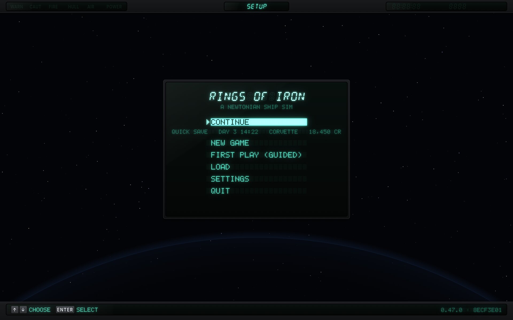 | 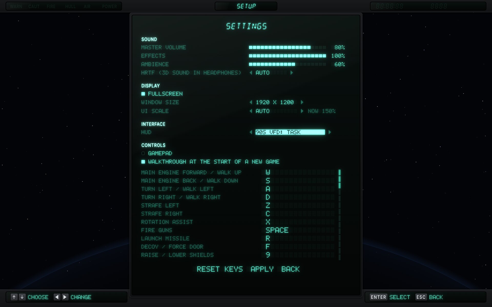 |
| 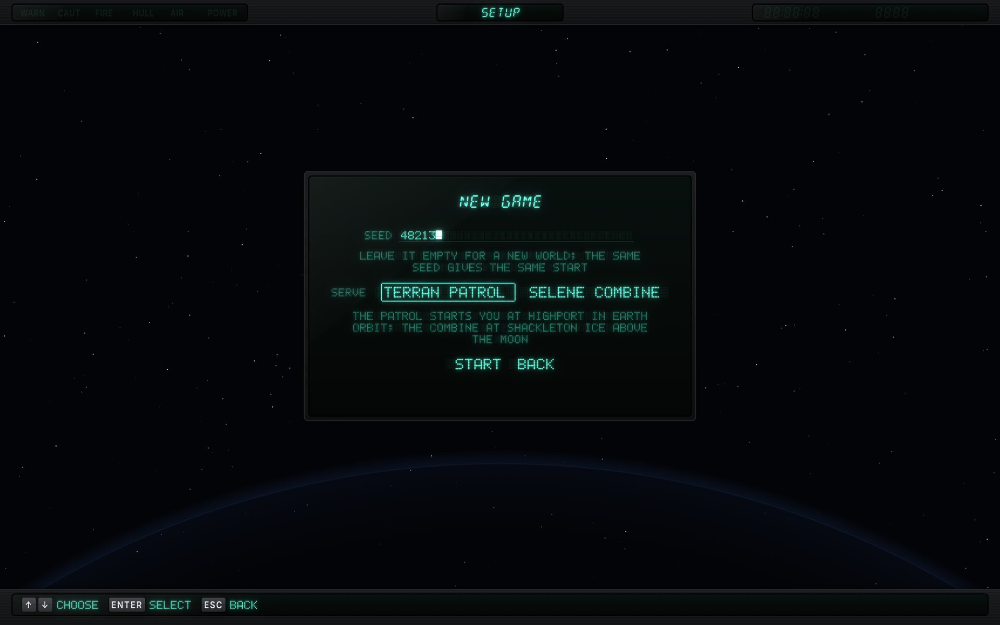 | 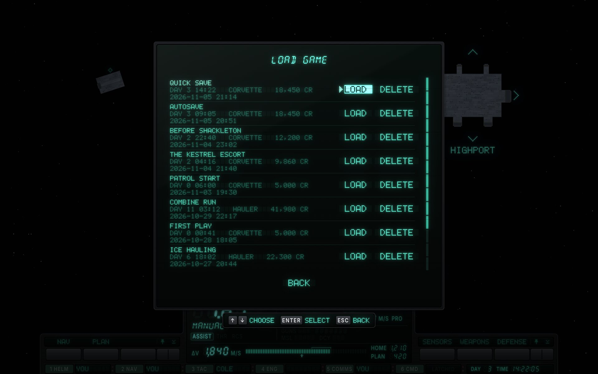 |

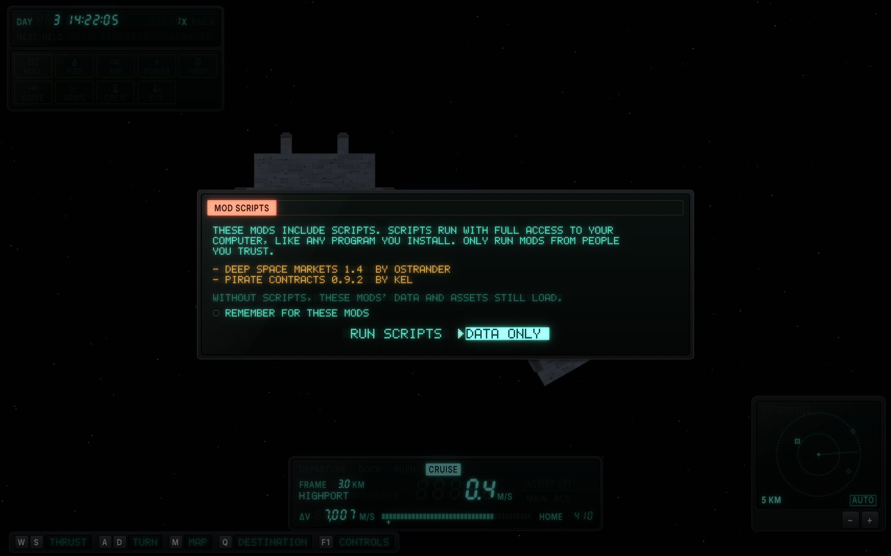

### 18.6 Cards

- The controls (F1) and the end of a career are printed quick-reference cards laid over the game (7.12): Inter in sentence case, black on the card, key caps printed as outlined keys.
- The controls card puts the section the player is in first, tagged `HERE`, and says which key closes it.
- **Ship lost.** The tubes go dark, every ghost still showing, and the card says what happened and the ways on, each with its key. The game keeps those keys; the card only names them.

| | |
|---|---|
| 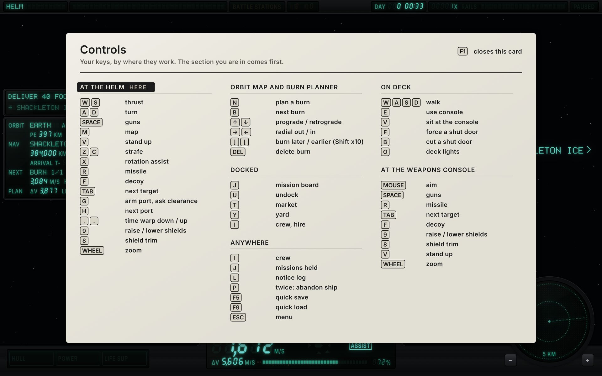 | 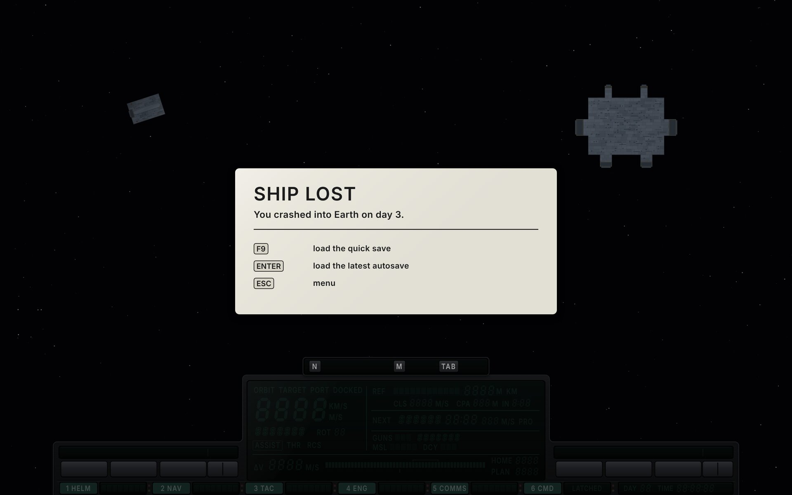 |

### 18.7 In the game

The variant framework's hooks ([`Variants.md`](../ui-hud/Variants.md)) decide what a FILAMENT build can reach:

- **Screens in place of the windows.** A variant shows its own screen for each classic window (`ClassicWindow`), in whatever housing its spec gives it. The game keeps when each can open and its keys, so a terminal closes itself when the ship undocks.
- **The map's look.** The orbit canvas stays the game's (zoom, panning, the burn handles, what a click picks); a FILAMENT `MapPainter` draws each piece where the map puts it, snapped to the panel's dots, with the line rules above. The panels around it are the variant's own.
- **The menus' look.** A `ShellLook` gives the menus FILAMENT's skin, the setup-mode backdrop and the pause backdrop, and dresses each menu once it is built; the menus keep their rows and keys.
- **The focus tint.** The game's keyboard and pad focus (`FocusNav`) tints the focused button and its text a warm yellow. In FILAMENT that would read as a caution, so a FILAMENT look needs the tint left off and draws focus as the inverse field and the lit cursor; the hook doesn't offer that yet, so the menus' build adds it.
- **The ship editor** draws itself, outside Scene2D, and has no hook yet: it keeps its classic look under every style.
