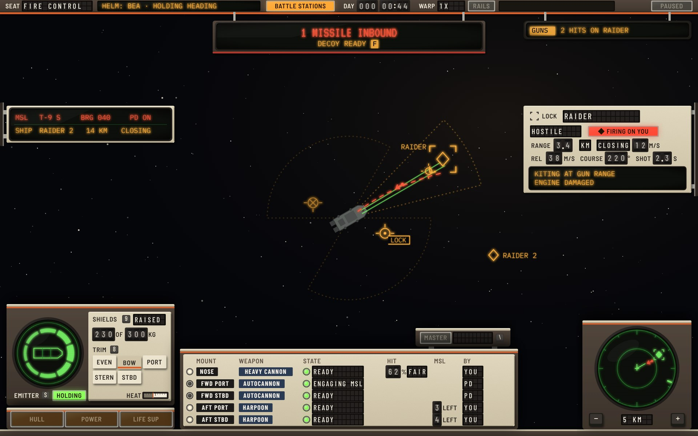
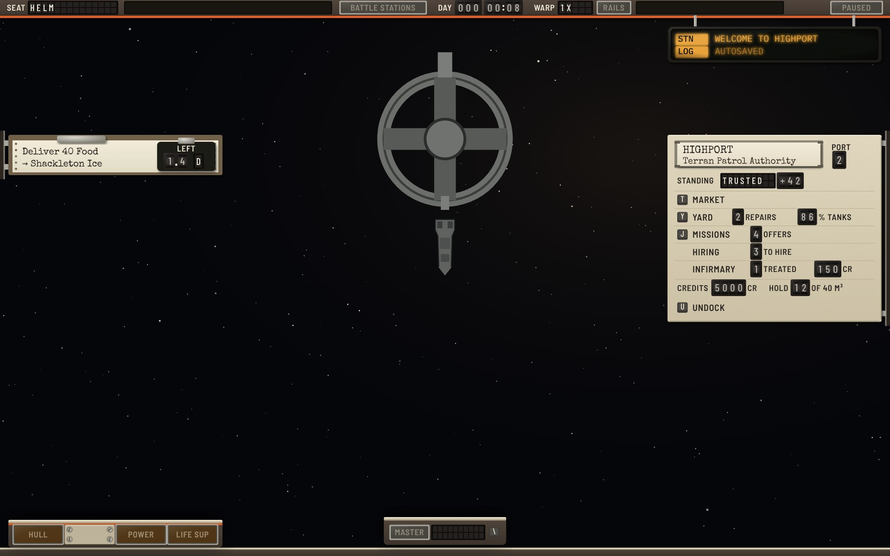
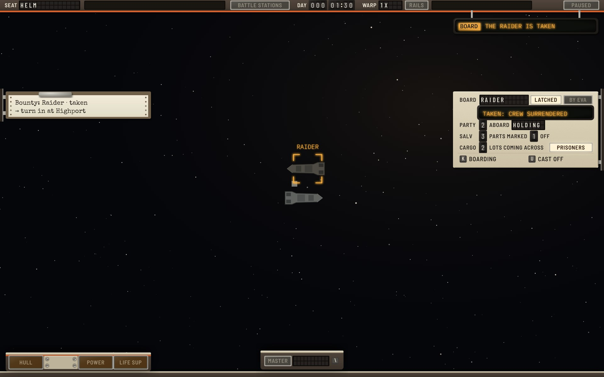

# Context-driven × Cassette-futurism

The **Context-driven** functional design ([functional-context.md](../../functional-context.md), version 7, branch `claude/project-thread-ukjzrp`) built in the **Yard Standard** design language ([style-cassette.md](../../style-cassette.md)).

**Status: round 2.** This round's critique and what changes next are at the end. The round log for all three Cassette variations is [cassette-round-log.md](../cassette-round-log.md).

The spec decides what is shown, where and when. This variation decides what each element is made of. Where the hardware needs something the spec doesn't say, or the spec asks for something hardware does badly, it is listed under [Adaptations](#adaptations) and was sent to the context designer.

## The idea: a canopy, not a console

The stations design puts a console band across the bottom of the screen. The context design has no band: widgets come and go by seat and situation, and the centre stays clear. So in Cassette the hardware is a **frame around the view**, and each widget is a unit mounted on that frame by its zone:

- The **header rail** across the top edge is P1. It is the only thing always on screen, as the spec says.
- **Top units hang from the rail on rods**: the caution board (P2), the threat unit (P3), the emergency placard (X3) and the intercom (P4). With nothing to show they are drawn up into the rail.
- **Side units ride slide rails** on the screen's left and right edges: the contract clipboard (P5), the navigation tube (H2), the lock card (H6), the armament strip (H7), the threat list (F4), the station panel (X1) and the boarding panel (X2). They slide off the edge when their context ends.
- **Bottom units stand on the coaming**, the top edge of the seat's console: the ship-condition light strip (H4), the flight pod (H1), the docking pod (H3) or the weapons rack (F2), and the scope (H5). On deck there is no seat, so there is no coaming.

The view stays as empty as the spec wants it. Nothing floats, because every unit hangs, slides or stands on something.

## The screens

Eight screens, one for each of the spec's wireframes 01, 03, 04, 05, 07, 08, 12 and 13.

### 01 Helm, cruise

The dark canopy. The rail shows the seat on split flaps and the clock and warp rate on drums. Its two message windows are set flush and plain while they have nothing to say: helm authority lights only when someone other than the captain flies, and the warp-hold window only when warp is held. The tracked contract is its printout on a clipboard, with the time left on a timer clipped to it. The navigation tube carries its own row names (ORBIT, NAV, NEXT, PLAN) in dim phosphor. The next burn is a double chevron in the world, with no number, since NEXT has the countdown. The corvette has no shield emitter, so the condition strip has a blanking plate where SHIELDS would be, and all three lights are dark.

### 03 Helm, docking approach

The docking pod takes the flight pod's place. The **alignment dial** shows the ship 2.2 m left of the corridor and turned 4°. The **closing gauge** has two bugs on its bezel that move as the ship closes: avocado at the safe speed for the distance and red at twice it. The needle is at 6.2 m/s against a safe 4.9, so a **FAST** flag has dropped into the face. The distance to the port is a counter in the face, 120 m, the way an airspeed indicator carries an odometer. Because H3 is on screen, P2 leaves the FAST APPR caution out, as the spec says, and the gauge lights the **master caution** on the pod instead. The foot strip carries the flight pod's thruster group (back thrust firing), assist and Δv.

### 04 Helm, combat

The gunship, with a raider firing two missiles and a hit that holed the engine room. The **threat unit** drops from the rail at once: the count and impact time on a red line at 26 units, then "decoy ready F · point defense engaging". The **caution board** has one row: BREACH, ENGINES and one crew dot. The **master warning** on the flight pod reads BREACH. The HULL light is lit, so the condition unit has risen above its light strip with the ship's plan (the breach, the crew sealing it, the captain on the bridge) and the four rows: each a level bar and its reading on drums. The **lock card** shows HOSTILE on flaps and FIRING ON YOU as its own red lens. The hit chance is a number and three printed windows with FAIR lit. The **armament strip** reads guns ready, you fire; 7 missiles left across both launchers, ready; shields raised, trim bow on a five-jewel rose.

### 05 Fire control, combat

The same gunship from the weapons console, while Bea holds the heading (the rail's authority window says so). The **weapons rack** has a row per mount. Mount and weapon names are Dymo tape, because a refit changes them. A white lamp marks the mounts in the gunner's hand. The point-defense autocannons read PD and are never in hand. The rack's rows fill it, so the **master cue stands on a glareshield bracket** above the rack's right end, in the gunner's eyeline. **Shield control** pairs a green ring of eight sectors (drawn thicker where the cloud is thicker, here at the bow) with the mass on drums, interlocked trim keys and the emitter's HOLDING lens and heat. The **threat list** is a red and amber tube. The **target card** adds speed, course and a two-line tube for what the target is doing and its known damage. The condition strip shows HULL, POWER and LIFE SUP only, since shields are on shield control.

### 07 Deck, emergency

The reactor is wrecked, the hold is open to vacuum, Ada is down in it and the bridge is on fire. The deck is lit only by battery lamps. The **emergency placard** hangs from the rail in hazard stripes, with the two ways out as **guarded switches**: lifting the guard is the first press of P or B, and throwing the switch is the second. The tow's price is on drums. Under the placard everything dims except the placard, the caution board, the threat unit, the condition unit, the suit unit, the deck's tags and the master cue. The **caution board** is full: five rows, warnings that need you first (YOU printed on yellow flaps), then those crew are on (a dot each), then "+1 more: SMOKE". The **condition unit** shows on deck only while a light is lit. It has no plan, because the deck is the plan. The **master warning** stands alone at the bottom centre. The **suit unit** shows a light wound, suit on with 9:40 of air, and thin air here.

### 08 Docked

The **station panel** is a typed card in a holder (name and owner), the port on a drum and the standing on flaps and a drum. Below it is one row per service the station offers. Highport has no shipyard, so the rows close up without it. Market, yard and missions have keys; hiring and the infirmary are tabs in the terminal, so they have none. Credits, hold and UNDOCK sit at the foot. The intercom keeps the station's welcome bright and the autosave dim, since it is older.

### 12 Orders menu, helm in cruise

The orders menu is a **panel that swings up** from the flight pod when O is pressed:

- **Helm orders are interlocked latching keys**, like the preset buttons on an old radio. One stays down while its order flies, and 0 releases it. A key that can't be pressed now has a barber-pole tab beside it, and its legend is greyed.
- **Approach Nav has a thumbwheel** for its distance, 500 m.
- **The autopilot** has its own latching button, with a HELD lens.
- **Shields:** a latching button for raised, and five interlocked trim keys. All are barred on the corvette, which has no emitter.
- **Crew:** latching buttons for suits at battle stations and holding everyone in from EVA.
- **Ship:** guarded buttons for abandoning ship and calling a tow, with the tow's price on drums.
- **The reasons tube** at the foot gives each reason once, with the keys it bars in reverse cells.

### 13 Boarding, latched

The raider lies latched over the port side, nose aft, in the lock bracket. The **boarding panel** takes the lock card's place. It shows the other ship on flaps, with LATCHED lit and BY EVA dark, and its state as a sentence on a tube. Below are the party (2 aboard, holding), salvage (3 parts marked, 1 off), cargo (2 lots coming across) and a lit PRISONERS lens. The K BOARDING and U CAST OFF keys sit at the foot. The bounty's clipboard has no timer, because the contract has none.

## The element kit

How each element of the spec is built.

| Spec element | Yard Standard object |
|---|---|
| P1 status strip | The header rail. Seat and warp on split flaps; day and time on drums; helm authority and warp hold in windows let flush into the rail, plain while dark, phosphor when they speak; BATTLE STATIONS, RAILS and PAUSED as lenses |
| P2 caution and warning | The caution board: split-flap rows like a departure board, hung from the rail. Each row: a severity lens (◆ red, ▲ amber), code flaps (11), detail flaps (10), handling (3), a timer drum. The sixth row is a key and "+n more" on flaps |
| Handling | Three flaps: YOU printed on yellow faces; a dot per crew member on it, or ●4; BCK when it clears by itself, with the recovery timer beside it |
| Master alert cue | One MASTER lens with a red and an amber lamp behind it, the newest warning's code or CAUTION on ten flaps, and the `\` key. It sits on the seat's primary instrument: in H1's top row, in H3's right column, on a glareshield bracket above F2. On deck, docked or latched it stands alone at the bottom centre |
| P3 threat alert | The threat unit: a red line at 26 units (count and impact), and an amber line with the decoy key in a reversed cell |
| P4 message feed | The intercom repeater: an amber tube, the source in reverse video, older lines dim |
| P5 objective | The contract's printout on a clipboard, typed. The time left is a bakelite timer clipped to it, because paper doesn't change and the clock does |
| C1 orders menu | A panel that swings up from the flight pod: interlocked latching keys, latching push buttons, guarded push buttons, barber tabs for barred orders, a reasons tube |
| H1 flight display | The flight pod: frame and name on flaps, the PIN latch, the master cue, speed on drums, the thruster group (notched darts round a ship drawn nose right), ASSIST OFF push-light, Δv on drums over the propellant bar |
| H2 navigation | A tube with the row names on it in dim phosphor, so the compact face (one line, NAV or NEXT) carries its own name |
| H3 docking display | The docking pod: port line on flaps and drums, ARMED lens, clearance on flaps; the alignment dial; the closing gauge with moving bugs, a FAST or DANGER flag and a distance counter in the face; contact time on drums; three capture lamps; HELM DOCKING lens and phase flaps; a foot strip with thrusters, assist and Δv |
| H4 ship condition | Compact: a strip of lights, dark when nominal; the light's film shows ◆ lit red and ▲ lit amber; a blanking plate where SHIELDS would be on a hull without an emitter. Expanded: a unit rises above the strip with the plan tube and four rows, each a level bar and its reading on drums. On deck: the same rows without the plan |
| H5 contact scope | A round green tube in a square pod, range on flaps between − and + keys. Missiles are a dot with a leader and a chevron; contacts beyond the range are ticks on the rim. Collapsed: a SCOPE key with the count |
| H6 lock card | A plate on the right rail: LOCK and the name on flaps, the state on flaps, FIRING ON YOU as a red lens, range, rate and shot time on drums, the hit chance as a number and three printed windows |
| H7 armament | A plate under the lock card: the guns' lamp, state and who fires them; missiles left across every launcher; shields with the trim on a five-jewel rose. A blanking plate for shields on a hull without an emitter |
| F1 target card | The lock card with speed, course and a two-line tube for what the target is doing and its damage |
| F2 weapons rack | A row per mount: in-hand lamp, mount and weapon on Dymo tape, state lamp and flaps, seconds, hit chance, missiles left, who fires it |
| F3 shield control | A green ring of eight sectors around the ship, beside a plate with SHIELDS, the mass, the trim keys, the emitter and its heat |
| F4 threat list | A tube on the left rail: missiles in red, ships in amber |
| X1 station panel | A typed card in a holder, the port and standing, a row per service offered, credits, hold and UNDOCK |
| X2 boarding panel | Board flaps, LATCHED and BY EVA lenses, the state on a tube, party, salvage and cargo on drums, PRISONERS lens, the two keys |
| X3 emergency card | The emergency placard: hazard-striped frame, red tube headline, the ways out on guarded switches, the tow's price on drums |
| D1 captain vitals | The forearm suit unit: condition on flaps, bleed-out on a drum or a closed shutter, SUIT ON lens, air on drums, the air here as three printed windows, what is carried on flaps |
| D3 hazard tags | Projected tags on the deck in red (amber for smoke), one per room and code |
| W1 to W6 | Amber reflector-sight projection at a lighter weight than tube text, threats in red. Frame tags sit in a notch on the prograde marker; neutrals are notched darts; burns are double chevrons; the corridor's states differ by line as well as colour |

## Adaptations

Places where the hardware changes the spec's geometry or behaviour.

1. **The coaming and side rails use the margins.** The coaming fills the 12 units below the zones (y 788 to 800), and the slide rails fill 7 of the 12 units at each side edge. No zone loses space.
2. **Units arrive from their edge.** Units brought by a warning (P2, P3, X3) drop at once, with the flap clatter. Others ease in for 300 ms on their rods or rails.
3. **Every number is on a drum at 15 units**, as 12.4 asks for values. That made H4's rows into instruments (a bar, then drums) instead of a line of text, because "store 92% · 3.0 of 3.0 MW" at 15 units doesn't fit beside a bar. POWER shows the store as the bar and its percentage, then GEN 3.0 MW, without the "of 3.0" capacity.
4. **Drums carry no thousands separator** (5000 CR). Text keeps the formats in 5.4.
5. **H3 is 196 tall from y 592** (the spec's 190, plus 3%), so its foot strip can carry the thruster group.
6. **F2's master cue stands on a bracket above the rack**, at y 602 to 636, inside the bottom-centre zone. The rack's five rows fill its 150 units.
7. **C1 is 620 × 262** (the spec's 250, plus 5%), so the ship buttons and the three-line reasons tube fit at their sizes.
8. **H4 on deck keeps its light strip** under the rows. The wireframe draws each row with its light. The strip is the same hardware as at the helm, so the lights don't move between screens.

## Round 1 critique, resolved

All five style points from round 1 are fixed:

- The rail's windows are flush and plain while dark.
- The bars have a hairline index and no head.
- Frame tags sit in a notch on the prograde marker.
- World labels are lighter than tube text.
- Thruster lamps are 14 units.

Round 2 also draws fire control, docked and boarding. The designer answered all 13 functional notes in versions 3 to 6.

## Round 2 critique

What this round got wrong or left weak, in the style and in the combination.

**Style (for round 3)**

- **H3's thruster group is scaled down.** In the foot strip it is drawn at 0.68, so its darts are about 10 units against the 14 set for H1. It reads at 1.5x, but is marginal at UI scale 1. Round 3: give the strip the full-size group, either by dropping the THRUST legend, since the group explains itself, or by moving ASSIST OFF into the right column.
- **The weapons rack reads as a sparse table.** HIT and MSL are empty in most rows, because a gun has no missiles and a launcher has no hit chance. Round 3: draw each row as a module of its own kind. A gun module has a hit window, a launcher module has a LEFT counter, and a point-defense module has neither. Each gap gets a blanking plate, as the hardware rule asks.
- **The gunship's plan is small.** In the expanded condition unit it is drawn at 9 units a tile, so the room names nearly touch the walls. It is enough to place a breach, but a crew dot and the captain's ring are close to the floor of legibility.
- **Not drawn yet:** warp (H2's warp keys), hover cards (W1, D2), P6 prompts, the inset views, a gun seat (F2 with one gun), and the full-screen modes, where P1's chip is the master cue. Round 3 draws warp, a P6 prompt on deck and the full-screen frame.

**Fixed during the round (found on render)**

- **The closing gauge.** Its numerals ran into the FAST flag. The scale now spans the top half only (0 at nine o'clock, 12 at three), so the needle never sweeps the lower face, where the flag and the distance counter sit.
- **The foot strip's thrusters** were six darts in a row that didn't read as directions. They are now the flight pod's thruster group, with a grey hull on the dark strip so that only the lamps read as lit.
- **The alignment dial** drew the ship right of the corridor for "2.2 m left".
- **F2's master cue** covered the HIT and MSL column heads. It is now on the glareshield bracket.
- **The rack's ENGAGING MSL lamp** was dark. Lamp states are now matched by their first word.
- **The deck condition unit** had a row hidden behind its light strip. It is now sized from its rows.
- **YOU on yellow flaps** read as struck through, because the flaps' dark seam crossed the ink. The seam is pale on a printed face.
- **The emitter's legend** on shield control was dark on the dark pod. It is now light, with S as a key.
- **The orders panel.** Its ship buttons overlapped, its reasons tube cut the third line, and its trim keys squeezed STERN.
- **The station panel's UNDOCK row** fell outside the plate. Absent services now close up, as the spec says, instead of keeping a blanking plate.
- **The boarding panel's keys** crowded its cargo row. Its rows are now 24 apart.
- **The target card.** Its "what it is doing" and "condition" lines overprinted. The hit percentage touched its windows.
- **Number sizes.** About twenty drums were drawn at 12.5 to 14 units. They are now at the 15 that 12.4 asks for values.

**Combination (sent to the designer)**

1. **Wireframe 03's sample can't happen.** The corvette's docking port is size S, and Highport's port 6 is M, so clearance would give port 1 or 2. At 820 m the safe speed is 12.8 m/s (`safeSpeed`), so 6.2 m/s isn't fast there. Cassette draws port 2 at 120 m, 6.2 against a safe 4.9, contact T-19 s. P4's "port 6" and X1's "port 6" change with it.
2. **X1's "Shipyard 3 ships · 3 to hire" at Highport.** Highport has no shipyard (Anvil Yards has one), so the line would be left out, taking hiring with it. Hiring works at any non-hostile station, so it needs its own line.
3. **F4's "brg 040" has no stated reference** (the ship's nose, or the plot's north). The task design dropped its missile bearing in its round 7 for this reason. The direction is drawn in the world and on the scope.
4. **12.4's "values at least 15" isn't drawn by the wireframes**, which set every value at 13. Does it apply to numbers inside sentences too (H2's "1,240 km · opening 220 m/s", P3's second line, X3's price)? If it does, H2 and X3 are over budget. Cassette reads it as every standalone readout. Sentences keep their numbers at the sentence's size.
5. **H4's POWER line doesn't fit at 15 units.** "store 92% · 3.0 of 3.0 MW" is too long beside a bar. The capacity never changes for a ship, so "of 3.0" could move to the hover.
6. **F2 has no room for the master cue.** P2's section puts the cue on the seat's primary instrument (H1, H3 or F2), and the rack's rows fill its 620 × 150. The zone's 40 units above the rack would hold it. Cassette's bracket stands there.

## Files

- `mockups.html`: the eight screens, drawn with the shared kit in `../../cassette/kit.js`.
- Render: `NODE_PATH=$(npm root -g) node ../../cassette/render.js mockups.html 1.5 jpeg`.
