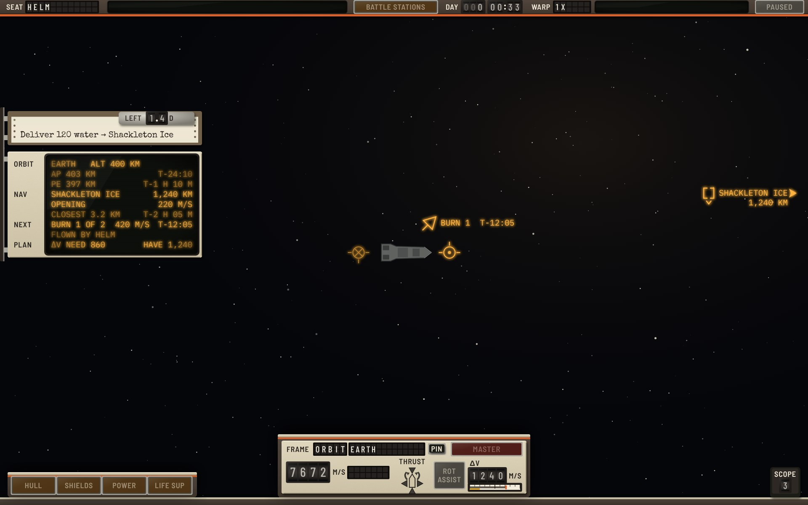
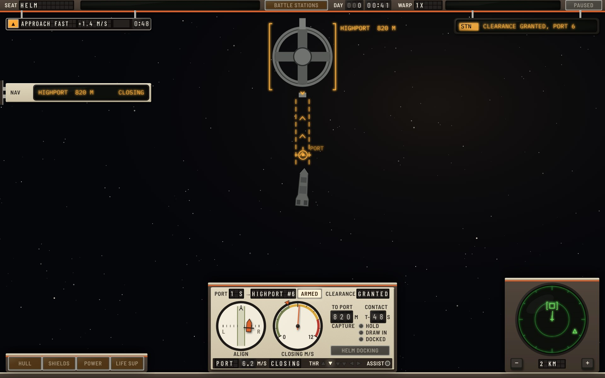
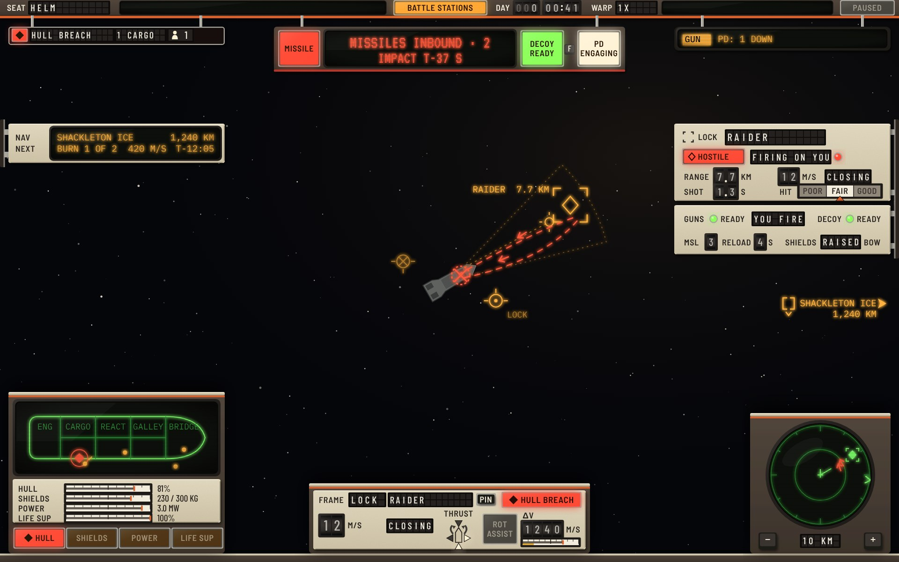
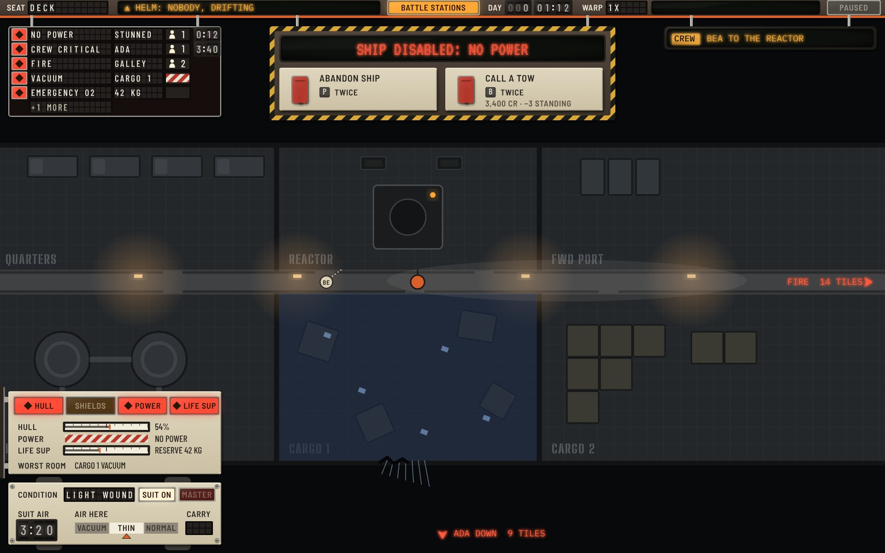
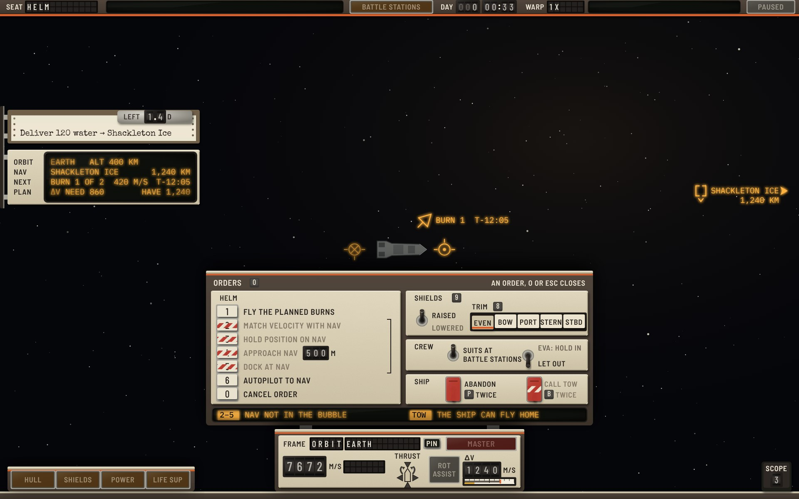

# Context-driven × Cassette-futurism

The **Context-driven** functional design ([functional-context.md](../../functional-context.md), version 2, branch `claude/project-thread-ukjzrp`) built in the **Yard Standard** design language ([style-cassette.md](../../style-cassette.md)).

**Status: round 1.** This round's critique and what changes next are at the end. The round log for all three Cassette variations is [cassette-round-log.md](../cassette-round-log.md).

The spec decides what is shown, where and when. This variation decides what each element is made of. Where the hardware needs something the spec doesn't say, or the spec asks for something hardware does badly, it is listed under [Adaptations](#adaptations) and was sent to the context designer.

## The idea: a canopy, not a console

The stations design puts a console band across the bottom of the screen. The context design has no band: widgets come and go by seat and situation, and the centre stays clear. So in Cassette the hardware is a **frame around the view**, and each widget is a unit mounted on that frame by its zone:

- The **header rail** across the top edge is P1. It is the only thing always on screen, as the spec says.
- **Top units hang from the rail on rods**: the caution board (P2), the threat unit (P3), the emergency placard (X3) and the intercom (P4). With nothing to show they are drawn up into the rail.
- **Side units ride slide rails** on the screen's left and right edges: the contract clipboard (P5), the navigation tube (H2), the lock card (H6) and the armament strip (H7). They slide off the edge when their context ends.
- **Bottom units stand on the coaming**, the top edge of the seat's console: the lamp bar (H4), the flight pod (H1) or docking pod (H3), and the scope (H5). On deck there is no seat, so there is no coaming.

The view stays as empty as the spec wants it. Nothing floats, because every unit hangs, slides or stands on something.

## The screens

### 01 Helm, cruise

The dark canopy. The rail shows the seat on split flaps, the clock and the warp rate on drums, and two dark tubes for helm authority and a warp hold, which light only when someone else flies or warp is held. The tracked contract is its printout on a clipboard, with the time left on a drum counter fixed to the clip. The four ship-condition lamps are dark, and the scope has sunk into the coaming, leaving a key that counts the contacts beyond 50 km. About ten readings on screen, as the spec intends.

### 03 Helm, docking approach

The docking pod takes the flight pod's place and grows to 190 units. The **alignment dial** shows the ship as an orange symbol between the corridor's rails, moved by the lateral offset and turned by the angle error, so the job is "fly the symbol to the centre". The **closing gauge** has the safe band marked and an orange bug at the safe speed for this distance, which moves as the ship gets closer. The needle in the amber band means "fast", and so do the dashed rails of the world corridor and the P2 board. The capture sequence is three lamps, HOLD, DRAW IN and DOCKED, which light in turn on capture.

### 04 Helm, combat

A raider fires two missiles and one hit holes cargo 1. The **threat unit** drops from the rail at once, with its MISSILE light flashing (allowed, since inbound missiles are time-critical), the count and impact time on a red tube, and the DECOY key and PD lamp beside it. The **caution board** drops with one row: the HULL BREACH flap, where, and one crew member's figure in the handling window. The **master alert cue** on the flight pod lit red with the code when the breach came. The lamp bar rose into the **expanded face**: the ship's plan on a green tube, with the breach and the crew sealing it, and four level meters. The lock card's **hit chance** is a three-zone scale, POOR, FAIR and GOOD, with a pointer, so it reads without colour.

### 07 Deck, emergency

No power: the deck is lit only by battery lamps, consoles are dark, and the stunned reactor's lamp blinks on its own battery. The **emergency placard** hangs from the rail in hazard stripes, with the two ways out as **guarded switches**: lifting the guard is the first press of P or B, throwing the switch is the second, so the spec's pending confirmation is a guard standing open. The **caution board** is full, five rows and "+1 more", each with who is handling it: figures and a count, or a barber-pole flag for nobody (VACUUM). The captain's state is the **forearm suit unit** from the stations variation, with the air where they stand as a three-zone scale.

### 12 Orders menu, helm in cruise

The context designer asked where a widget needs a real control surface. This is the clearest case. The orders menu is a **panel that swings up** from the flight pod's lip when O is pressed:

- **Helm orders are interlocked latching keys**, like the preset buttons on an old radio. One stays down while its order flies, and 0 releases it. A key that can't be pressed now has a barber-pole flag on its face.
- **Approach Nav has a thumbwheel** for its distance, 500 m.
- **Shields:** a toggle for raised or lowered, and five interlocked keys for the trim.
- **Crew:** two toggles, one for suits at battle stations and one for EVA.
- **Ship:** two guarded switches, the same as on the emergency placard. The tow's guard is locked with a flag.
- **The message line** at the panel's foot says why the locked orders can't be given, once for each reason, not once for each order.

## The element kit

How each element of the spec is built.

| Spec element | Yard Standard object |
|---|---|
| P1 status strip | The header rail, chassis with an orange stripe. Seat and warp on split flaps; clock on drums; helm authority and warp hold on strip tubes, dark when empty; BATTLE STATIONS and PAUSED as lenses |
| P2 caution and warning | The caution board: split-flap rows like a departure board, hung from the rail. Each row: a severity lens (◆ red, ▲ amber), code flaps (15), detail flaps (9), a handling window, a drum timer. New rows clatter in. "+n more" is the last row's flaps |
| Handling | A small window: a lit figure and the number of crew on it, or a barber-pole flag when nobody is. Blank when the code has no handling |
| Master alert cue | A lens on the primary instrument reading MASTER when dark; lit red with the code for a warning, amber with no code for a caution. On deck, the same lens on the suit unit |
| P3 threat alert | The threat unit: a MISSILE push-light, a red-phosphor tube (count and impact, 23 to 25 units), the DECOY key with its READY light (F), a PD ENGAGING lamp |
| P4 message feed | The intercom repeater, as in the stations variation: an amber strip tube, source tag in reverse video |
| P5 objective | The contract's printout on a clipboard, typed. The time left is on drums fixed to the clip, because paper doesn't change and the clock does |
| P6 prompt | The engraved nameplate with key caps, as in the stations variation *(round 2 mockup)* |
| C1 orders menu | A panel that swings up from the flight pod: interlocked keys, toggles, guarded switches, one message line for the reasons |
| H1 flight display | The flight pod: FRAME on flaps (tag and name), a PIN latch (down and orange when pinned), the master cue lens, speed on drums with CLOSING or OPENING on flaps, a thrust diagram of six lamps around a ship outline, ROT ASSIST push-light (an OFF flag when off), Δv on drums over a propellant level |
| H2 navigation | A tube with the row names (ORBIT, NAV, NEXT, PLAN) engraved on the plate beside it, so the names never move. Under warp the rows gain keys for warp-to *(round 2 mockup)* |
| H3 docking display | The docking pod: port line on flaps, ARMED push-light, clearance on flaps; alignment dial; closing gauge with a safe-speed bug; distance and contact time on drums; three capture lamps; a HELM DOCKING lens; H1's speed and thrust as a strip at its foot |
| H4 ship condition | Compact: four lenses on a pod, dark when nominal, lit with ◆ or ▲. Expanded: the plan tube rises behind the lamp bar, with four level meters between |
| H5 contact scope | A round green tube in a square pod, range on flaps between − and + keys (24 units). Collapsed: a SCOPE key with the count on a drum |
| H6 lock card | A plate on the right rail: the lock bracket engraved beside LOCK, name on flaps, allegiance on a lens with its glyph, state on flaps with a red lamp for FIRING ON YOU, range and closing on drums, shot time on drums, hit chance on the three-zone scale |
| H7 armament | A plate under the lock card: guns' READY lamp and who fires on flaps, decoy READY lamp, missiles and reload on drums, shields on flaps with the trim |
| X3 emergency card | The emergency placard: hazard-striped frame, red tube headline, the ways out on guarded switches with their keys and costs |
| D1 captain vitals | The forearm suit unit: condition on flaps, SUIT ON lens, air on drums, air here on a three-zone scale, what is carried on flaps |
| D3 off-screen pointers | Red edge chevrons with the subject and distance in tiles |
| W1 to W6 | Amber reflector-sight projection, threats in red, as in style guide 7.2. Lock is corner brackets, Nav is side brackets with a chevron. The corridor's safe, fast and danger states differ by line (solid, dashed, dotted) as well as colour |
| Full-screen modes | The station terminal, the ship's book and the map are terminals and printouts, as in style guide 9 *(round 2 mockup)* |

## Adaptations

Places where the hardware changes the spec's geometry or behaviour. These went to the context designer as round 1 notes.

1. **The coaming and side rails use the margins.** The coaming fills the 12 units below the zones (y 788 to 800), and the slide rails fill 7 of the 12 units at each side edge. No zone loses space. Section 12.2 allows "the seat's console frame around the view".
2. **Units arrive from their edge.** Units brought by a warning (P2, P3, X3) drop at once, spring-loaded, with the flap clatter. Units brought by anything else ease in for 300 ms on their rods or rails, as 5.3 allows.
3. **P2's fields have fixed widths:** code 15 characters, detail 9, handling a count, timer a drum. Details need a short form: CARGO 1, +1.4 M/S, 42 KG.
4. **H2's long lines are split.** At 13 units, ORBIT and NAV take three rows each, and the time values are right-aligned in their own column.
5. **H4's shield meter shows only the cloud's mass.** H7 owns raised and trim at the helm, so the same values aren't shown twice.
6. **H7's decoys show ready or seconds to ready.** The game's decoys never run out: `PlayerGunnery` gives them a 3 s cooldown and no count.
7. **C1 is 620 × 248** (the bottom-centre zone's width). The wireframe draws it 400 wide, which doesn't fit four groups of controls at 13 units.
8. **Drums carry no thousands separator** (1240). Text keeps the formats in 5.4.

## Round 1 critique

What this round got wrong or left weak, in the style and in the combination.

**Style**

- **The rail's two dark tubes read as dead equipment.** In quiet flight they are about 600 units of black glass across the top of the screen. Round 2: set them flush with the rail, with no glass highlight while dark, and shorten the authority tube to the longest real phrase.
- **The level meters in H4 look like sliders.** Four stacked edgewise scales with orange pointers read as controls. Round 2: a hairline pointer with no head, and a filled bar behind it.
- **The world's frame tags (LOCK, PORT) float.** They are small dim words beside the prograde marker. Round 2: set them into a notch on the marker's ring.
- **World labels and tube text still look the same.** This was carried over from the stations round 1 critique. Round 2 fixes it for both: projection text gets a lighter weight.
- **The thrust diagram's lamps are too small at UI scale 1.** At 10 units they work at 1.5x but not at 1x. Round 2: 14 units.
- **Not drawn yet:** fire control (F1 to F4, the design's biggest new instrument), docked with X1, warp, hover cards (W1, D2), P6 prompts, the inset views and the full-screen modes' frame. Round 2 draws fire control and docked.

**Fixed during the round**

- Dim phosphor text was 3.8:1 against the tube. It is now 5.4:1, and the guide's token changed with it.
- The tube scanlines were coarse enough to strike through 13-unit text at 1x. They are finer now.

**Combination (sent to the designer)**

- **The spec's examples don't fit its columns at its own text floor.** The wireframes draw rows at 10.5 units. At 13, a 308 column holds about 34 characters, but H2's ORBIT line as written is 57, P2's PROPELLANT LOW example is 46, and P1's autopilot example is 47. Each text field needs a maximum length and a short form.
- **P2 ranks recovery timers first.** "Rows with a timer by time left" puts NO POWER (stunned, the reactor recovers by itself in 0:12) above CREW CRITICAL (Ada bleeds out in 3:40). Some timers count toward harm (bleed-out, impact, suit air) and some toward recovery (stun, emitter trip). Only harm timers should rank. Recovery timers could read "back in 0:12". Wireframe 07 doesn't follow the stated order either: it lists FIRE first.
- **Wireframe 07 contradicts the catalogue.** H4 shows life support on EMERGENCY 42 kg with a caution light. EMERGENCY O2 is a warning, and it isn't in P2's list. Cassette drew it as a warning row, which pushes SMOKE into "+1 more".
- **"+n more" is clickable but 22 units tall.** Six rows in 132 units leaves 22 each, under 12.4's 24.
- **An approach shows several values two or three times.** Time to contact is in P2's APPROACH FAST row and in H3. Closing speed is on H3's gauge and in H3's foot strip, because during an approach the frame is PORT, so H1's speed is the closing speed. The distance is in the Nav's world label, H2's NAV line and H3.
- **Shields show twice at the helm in combat.** H4's expanded bar and H7 both carry raised and trim.
- **Decoys don't run out.** H7 says "Decoys: left" and wireframe 04 shows DECOY 2. In the game they have a 3 s cooldown and no count.
- **Power has no demand figure.** H4's power bar is "output against demand", but `PowerCircuit` has output, the store's charge and what was drawn. There is no demand.
- **P1 at the helm by hand:** the table says the authority field is empty, but wireframe 12 shows "Helm order: none".
- **P3 and P4 both report an intercept:** P3's "1 down" and P4's "PD: 1 down".
- **H2's compact face:** section 7 says NAV and NEXT, but 11.4 and wireframe 04 show NEXT only.
- **The deck's master cue sits "beside D1's slot"**, but D1 is hidden on a healthy captain, so the cue needs its own place.
- **Labels have no size.** 12.4 sets body text at 13 and values at 15. Cassette uses 12 for engraved legends, units and key names, as the stations spec allows.

## Files

- `mockups.html`: the five screens, drawn with the shared kit in `../../cassette/kit.js`.
- Render: `NODE_PATH=$(npm root -g) node ../../cassette/render.js mockups.html 1.5 jpeg`.
