# Nasa-punk × Context-driven

The context-driven functional spec (`functional-context.md`, version 17 when drawn and version 18 now,
on branch `claude/project-thread-ukjzrp`) skinned in the Nasa-punk style
(`../../nasapunk/style-nasapunk.md`), with its words from
[`../../nasapunk/abbrev.md`](../../nasapunk/abbrev.md). Mockups are 1280 x 800 UI units drawn at 2x; sources are
the HTML files here, using `context.js` and the shared kit in `../../nasapunk/mockups/`. From
`documentation/ui-overhaul`, render with `node nasapunk/mockups/render.js variations/nasapunk-context`
and check with `node nasapunk/mockups/check.js variations/nasapunk-context` (text overlaps, text
touching a frame, text cut by its glass, and the 12-unit floor).

Round history is in [`../nasapunk-round-log.md`](../nasapunk-round-log.md).

## How the style maps the spec

| Spec element | Nasa-punk container |
|---|---|
| P1 status strip | One long glass across the top. Each field has a fixed place and its reserved width, so a field that empties leaves dark glass and nothing moves. BATTLE STATIONS is an amber lens set into it. In a full-screen mode P2 folds into the caution and warning chip: a push lens 24 tall, standing proud of the glass since a click on it closes the mode, with each count in its severity's colour (◆ 1 · ▲ 2), and lit red while a new warning waits to be acknowledged. |
| P2 caution and warning | An EICAS list of rows 24 tall: severity shape (◆ warning, ▲ caution), code, detail, handling, timer. Handling is a cyan YOU flag (needs the captain), a white pause mark of two bars (held: the crew leave it for now), a white dot per crew member on it, or BACK with the recovery time. The three marks the crew make are shapes, not colours, so amber and red stay the code's. Harm timers are white, recovery timers dim. The sixth row is "+n MORE" with a chevron, since a click opens Ship › Systems. |
| Master alert cue | MASTER WARN and MASTER CAUT lenses, 24 tall since a click acknowledges them, on a hood across the top of the seat's primary instrument. On deck, docked or latched the two lenses stand alone at the bottom centre, but only while one is lit. A lit lens shows the newest code. |
| P3 threat alert | A red-framed glass with a lit lamp carrying the missile glyph, the count at 22, the decoy with its key cap and point defense on the second line. At fire control F4 has each missile's time, its shooter and point defense, so P3 keeps the count and the decoy. |
| P4 message feed | Comm-loop slips: a source tag, then the message in sentence case (speech and events are prose; instruments are caps). |
| P5 objective | A two-line slip with a kapton tab. |
| H1 flight display | A DU under the hood. The frame is an FMA box, green while picked automatically and white when pinned. The speed is in that frame, beside the assist box. Below them are the thruster pictogram, delta-v, and the propellant tape. |
| H2 navigation | Label, value and time columns: ORBIT, NAV in magenta with its ring, NEXT with its diamond, PLAN. Its numbers sit inside lines, so they take the line's 13 (version 8's rule for values), with units dim at 12. |
| H4 ship condition | Lenses in a bezel, dark when well: three on a ship with no shield emitter. Expanded on deck, each lens heads a row with its reading, its figure at 15 and a tape. POWER gives the store, then the output, with the rating beside it only while damage holds the output under it. |
| H5 scope | A 200 x 200 DU with − and + at 24, the range in the corner, and off-scale contacts as rim ticks at their bearing. In cruise it takes the smallest step that holds every contact inside 50 km, and with none inside 50 km it folds to a 48 x 48 key with the count. |
| C1 orders menu | A mode control panel, as on a flight deck, its groups in the spec's order read across and down: HELM, then AUTOPILOT and CREW, then SHIELDS and SHIP. The helm orders are interlocked lit keys under their number caps. Autopilot and crew orders are lit keys whose lower line is their state. The trim is a five-way selector: the hull in miniature with a mark on each side it can lean to and a dot for even, the chosen one lit. Abandon and the tow sit under hinged guards with striped rims, last and furthest from the helm keys. A barber-pole strip marks an order that can't be given now, and the panel's foot gives each reason once with the keys it blocks. |
| F1 lock card | The name in the allegiance colour with the lock brackets. HOSTILE is a box, and FIRING ON YOU a lit red flag. Then RNG, REL, what it is doing and what is known. |
| W5 lead reticle | A cyan ring with four ticks where the gun's solution puts the shot. In this game's fights it sits a few units off the target, so it rings the target inside its lock brackets. |
| F2 weapons rack | One row per mount: mount, weapon, state, hit chance as cyan pips with the number and word, rounds left, who fires it (YOU in cyan, PD). Point defense engaging reads green, like an engaged autoflight mode. |
| F3 shield control | A ring of eight sectors around the ship's outline, each as wide as the cloud there. The trim is a cyan arc outside the side leaned to, and the ring itself is the control. Beside it: cloud mass, RAISED, TRIM, the emitter and its heat against the trip. |
| F4 threat list | Rows 24 tall (a click locks): the missile's impact time, the ship that fired it in red and PD ON, then the other hostiles. |
| M1 to M4, the full-screen modes | A console body under P1: a title row of glass with the mode's name and its tabs on their number caps, the mode's DUs, and a foot row of glass with the one-line feed and the close keys as caps. M3, the station, is a panel over the docked view, as tall as its tab. |
| X2 boarding panel | A DU of seven rows: the other ship and how it is held, its state on a row of its own, the party, salvage, cargo and prisoners, then K BOARDING and U CAST OFF as buttons 26 tall. |
| X3 emergency card | A hazard-striped card: the cause at 22, then the ways out as the same guarded switches as C1, with the tow's costs. Armed, a switch's guard stands open, the switch lights amber, and the card's foot says what the second press does while a bar runs out its 3 s. |
| D1 captain vitals | The suit's own chest display (the DCM): suit-grey bezel, orange tab. |
| D3 hazard markers | Tags on the deck by P2's code or the casualty's name, with a leader to the spot. |
| The ships | The game's own hull outlines (`HULL_ART`), plate grey for your ship, red-brown for hostiles, dark for a beaten one. |

## Screens

Each screen is its walkthrough's moment, at its wireframe's clock with the seconds added. They are
separate moments, as the spec's walkthroughs are, not one voyage, except for one story: First
Play's fight with the raider and the way home, which C8, C6, C4, C10 and C9 follow in that order
(C9's log has the others' events at their times).

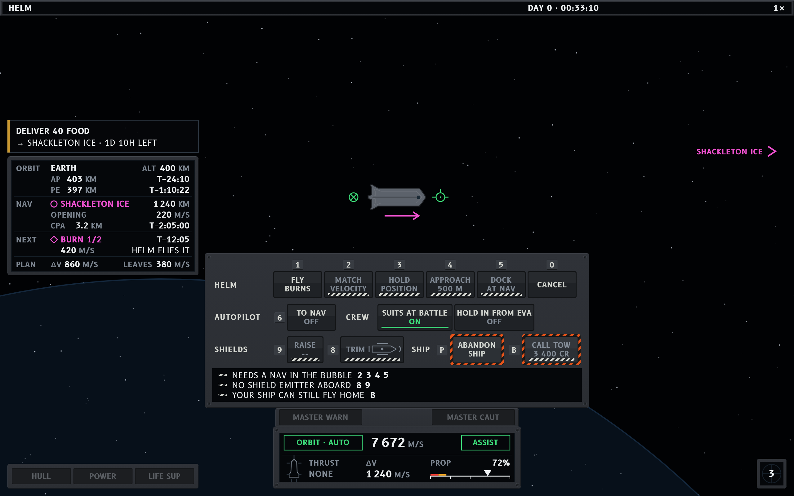

**C1, helm, cruising in Earth orbit with the orders menu open (11.1 and 11.12).** The ship is
just out of Highport with nothing wrong, so P2, P3 and P4 draw nothing and H4 is three dark lenses.
H5 is on the 5 km step, the smallest that holds everything inside 50 km, with Highport and the
Hauler Kestrel 3 km astern; the hauler is berthed there, so their glyphs all but touch. No helm
order is running, so P1's helm field is empty and no helm key is down. Four helm orders need a Nav
in the bubble, the shield orders need an emitter, and the tow is refused while the ship can fly
home. Each carries the strip, and the foot says why once. P5 has the delivery: 40 food to
Shackleton Ice, with 5 days 4 hours left. H2 plans the trip a leg at a time, as the game does: the
one burn that leaves Earth, 3 084 m/s in 12:05, and the arrival at the Moon in 4 days 4 hours. With
the capture's estimate the plan needs 3 877 m/s, which leaves 1 729 of H1's 5 606. The orbit line
gives only the periapsis, since the apoapsis would come after the burn has changed the orbit. The
burn arrow carries no countdown, which is H2's NEXT line.

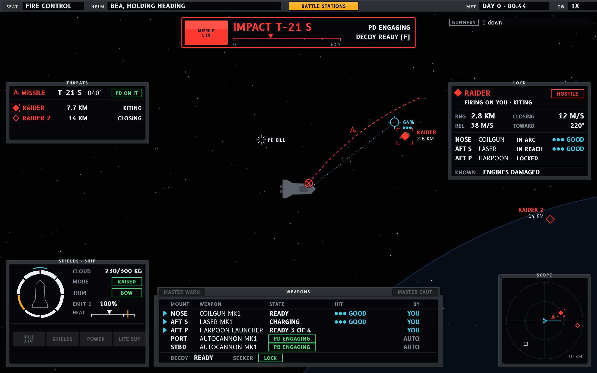

**C2, the weapons console of a gunship (11.5).** Bea holds the helm. One harpoon is inbound with
point defense on it, T−0:03 in F4 with its burn counted and the Raider named as its shooter, so P3
keeps only the count and the decoy.
The Raider is kiting at gun range, 3.4 km off and easing in at 12 m/s; a kiter doesn't circle, so
its motion relative to the ship runs along the line of sight, and the heavy cannon's 2.2 s shot
leads it by 27 m: the lead reticle rings it. The shield ring leans to the bow. In F2 the nose
cannon has the hit chance on the Lock, the autocannons are point defense (one engaging the
missile, one ready), and the harpoon launchers are ready with 3 and 4 left. The scope is at 5 km,
version 6's new step, with Raider 2, 14 km off, as a rim tick, and the world gives it an edge
marker at the same bearing.

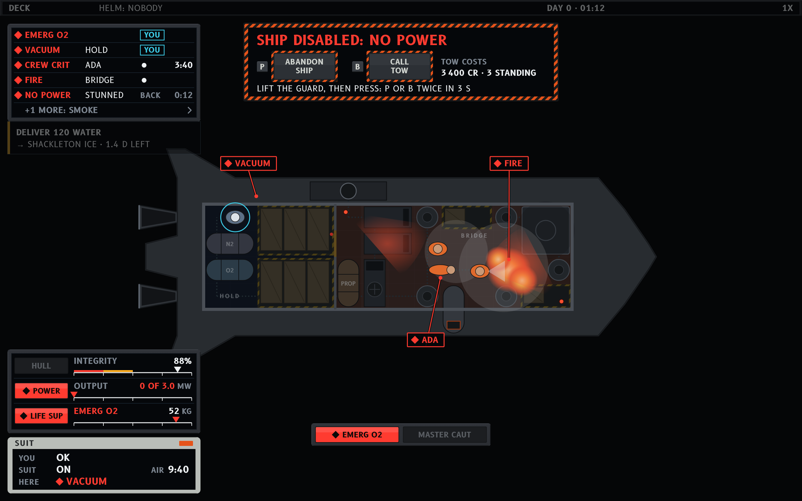

**C3, on deck, the corvette disabled at battle stations (11.7).** The reactor is damaged, so no
power is due back by itself and X3 offers the ways out; the hold has lost its air. Ada was hit in
the hold and lies there with Cole tending; Bea fights the fire in the bridge alone. P2 ranks EMERG
O2 and NO POWER as needing the captain, since nobody is free for them. BREACH comes next, held (the
white bars): the crew keep clear of where Ada was hit until the fight ends. A room's air is one row
at a time (version 17), its cause while the crew can act on it, so the hold reads BREACH, and its
hover says the hold is at vacuum. CREW CRIT and FIRE
follow with their one worker each, and Ada's 1:40 is under the two minutes that send the crew in
anyway. SMOKE folds into "+1 MORE". The captain, by the helm with a light wound and suited in the
bridge's thin air, has pressed B once: the tow is armed, its guard up and its bar running out. P1
dims under X3. P5 isn't drawn, since in combat it shows only a fight's contract. The master cue
stays lit at the bottom centre with the newest warning, BREACH. D3 tags the fire, the smoke, the
vacuum where people would walk into it, and Ada. Bottom left is H4's deck face over the DCM: the hull at 81%, the store empty and
the reactor giving 0 of its 3.0 MW, and 42 kg left of the 60 kg emergency oxygen.

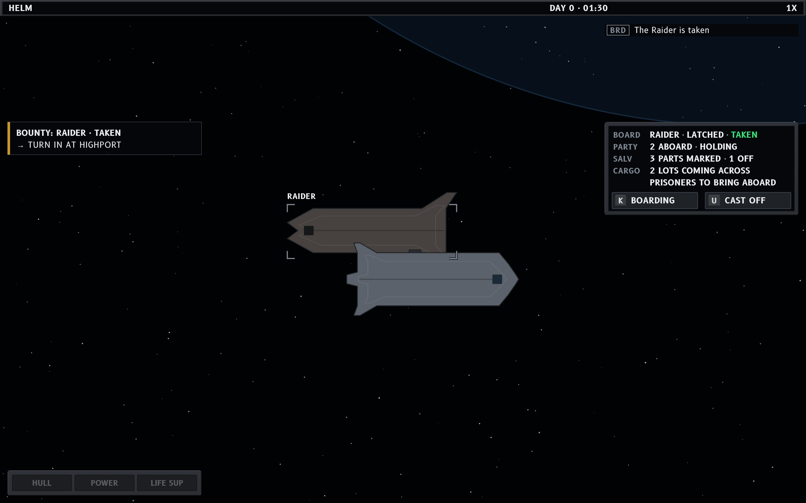

**C4, latched to a taken raider (11.13), two minutes after C6.** Latched, the screen is the docked
one. P5 has the bounty's next step, X2 sits where the station panel would be, with the raider's
state on its own row, and H4 has its quiet lights. The party is Cole alone, the ship's one marine,
coming home now that the raider is taken. The raider lies the way the game docks two ships: half a turn
apart, port to port. That puts it over the corvette's port side, upside down and nose aft. Its lock
brackets and name stay, but there is no lock card and no range.

### The windows the overhaul skipped

The shell's pages are in [nasapunk-shell](../nasapunk-shell/README.md); these are the spec's own
full-screen modes, drawn after the first rounds.

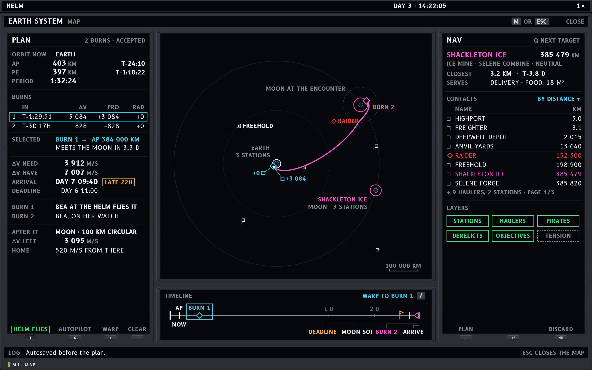

**C5, M1, the map as a full-screen mode (10.1), at C1's moment.** P1 stays above; below it come
the mode's frame and title row, the Plan panel on the left and the Nav with the traffic on the
right, the view row and the map between them, the timeline under the map, and the foot row with the
one-line feed and the close keys. The map has no tabs, so the number keys keep the helm orders, and
the panels' feet carry them as soft keys. The plan to Shackleton Ice is the game's, a leg at a time:
burn 1, selected in cyan with its handles and its result, an apoapsis at the Moon's distance, then
the capture at the Moon as an estimate (the dashed diamond) until the crossing into the Moon's
sphere plans it. The path stops at that crossing, marked with a bar. The Moon is drawn twice, as
the game draws it: where it is now, with the Nav's ring on Shackleton Ice, and dashed, as a ghost
with its sphere, where it will be at the plan's closest approach, labelled with that time (version
14). The timeline runs to the contract's deadline, past the arrival,
with its cursor on burn 1 and the warp-to. The Nav panel names the body the station orbits and
gives the arrival in place of a closest approach.

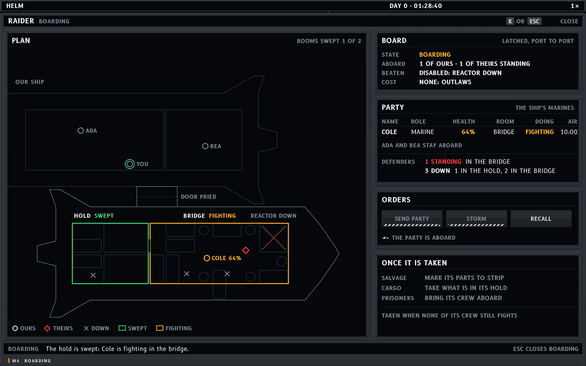

**C6, M4, the boarding mode (10.4), two minutes before C4.** The raider's reactor is down, the
dock's door was pried (the raider has no power to cut against), and the party has swept the hold
and is fighting in the bridge. The party is the game's: the ship's marines, so Cole alone, at 64%
and in a pressure suit whose air stays full while the bridge holds pressure. The plan of both
ships shows who is where, with the rooms swept and fighting. The state line is the game's own
("Boarding: 1 of ours aboard, 1 of theirs standing"). SEND PARTY and STORM are barred while the
party is aboard, with the reason once on the strip under them, and RECALL is live. Salvage, cargo
and prisoners wait, each saying what it will offer once the ship is taken. The close keys, K or
Esc, are the foot's.

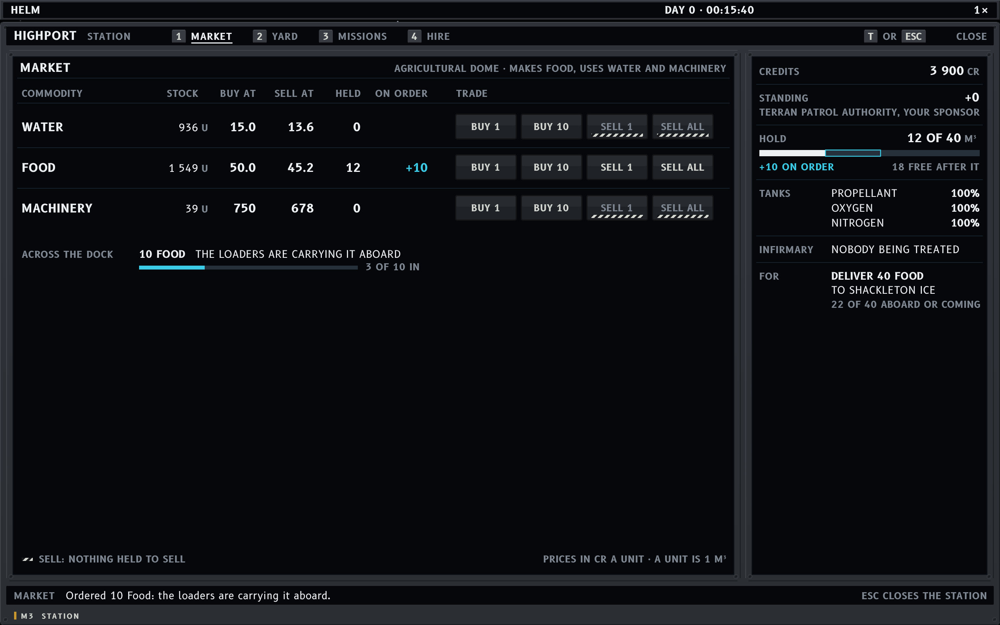

**C7, M3 on its Market tab (10.3), docked at Highport on day 0, loading food for the delivery.**
M3 is a panel over the docked view, as tall as its tab. P1 stays above, then the panel's title row
with the tabs the station offers on their keys (Highport sells no ships, so there is no Shipyard
tab), the tab's panel, the rail every tab shares, and the foot row with the feed and the close
keys, T or Esc. Highport is an agricultural dome, so it makes food and uses water and machinery, at
today's prices. On day 0 nothing has been salvaged, so there is no salvage row. Bought cargo
crosses the dock in the loaders' arms, so a buy is an order until it is in the hold: HELD and ON
ORDER read the game's "12 (+10)". The order is under way with its progress, and the foot row
carries the game's own line for it. Each row has today's four trade buttons as lit push buttons;
SELL is barred where nothing is held, with the reason once at the foot. Under the table is the
delivery this market can supply: 12 of 40 aboard, 10 coming, and 18 more fill the hold. The rail
has credits (the starting 5 000, less 22 food at 50), standing, the hold with what is coming,
tanks and the infirmary.

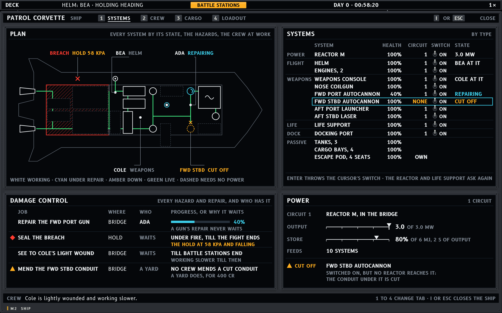

**C8, M2 on its Systems tab (10.2 and 11.11), on deck in the corvette's fight.** P1 stays above
with BATTLE STATIONS lit and P2 folded into its chip, ◆ 1 · ▲ 2: the breach, and the two guns out of
action. Then come the title row with the four tabs on their keys, the plan, the systems list, the
damage control board, the power circuit, and the foot row with the feed and the close keys. One
hit wrecked the hull tile under the hold's aft port RCS block (version 15): the hold is breached,
the block is stopped, since a block works only while its tile stands, and Cole took a light wound
there. Another cut the conduit under the forward starboard autocannon, and another left the forward
port autocannon at 20%, under the 30% where a system stops working. The plan is the corvette's
real layout and network: every system by its state, the hold hatched for its breach, the cut marked
where it broke, the eight RCS blocks on the hull with the stopped one amber beside the breach, one
label for the one hit, and the crew where they work. The list groups the systems by type, each with
its health, circuit, switch and anything not normal, and a dash where the game has no such value:
RCS blocks draw no power and have no health of their own, and tanks and bays draw none. Every
system has its switch, as the game lets the crew switch any system off; a group's row switches the
group, the RCS blocks are no system and have none, and the reactor's sits under a striped guard,
pressed twice. The board is the game's crew rules at work. Ada has the gun, since a gun's repair
never waits out a fight. The breach is where Cole was hit, so the crew leave it till the fight ends
(and Cole, a marine, never seals one). The RCS block is outside, and EVA work waits for battle
stations to end; sealing the breach from inside won't start it again. That is why Bea can hold the helm: crew man a console only when nothing on the
board suits them. No crew mends a cut conduit, so it is no job on the board: Power has it under the
gun it strands, with the yard's 400 cr. The feed has the game's own notice for a light wound.

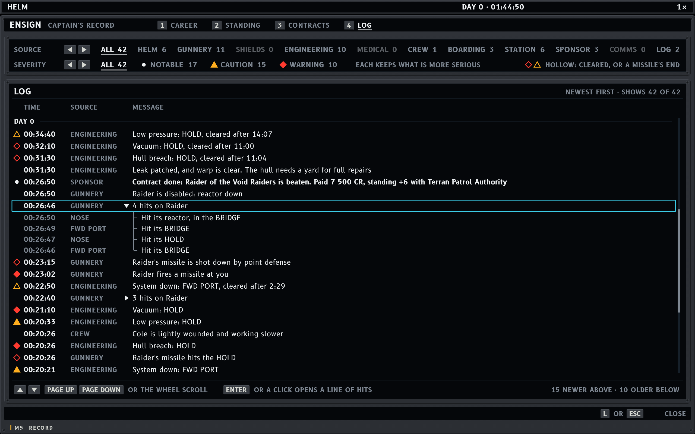

**C9, M5 on its Log tab (10.5), docked at Highport after the yard's order.** This is First Play's
NOTICES step, whose own words are "L opens the notice log: the fight, the bounty and the yard's
work are all there", and L opens M5 on this tab. The frame is C8's: P1 above with nothing wrong, the
title row with the rank and the four tabs, the filters, the list, and the foot row, whose feed is
empty since the yard's line has had its 5 s. The captain has scrolled to the fight and opened the
line of the raider's hits on the corvette. The Log keeps a fight's record (versions 16 and 17): with
every message come each condition as it is raised and as it clears, each missile fired at the ship
and how it ended, and the hits the ship takes from guns, merged as the feed merges its own. So the
whole fight is on one page, and it says what caused the damage. Point defense shot down two of the
raider's three missiles, and the second hit the hold, since the captain was on deck in C8 with no
decoy to throw. Two hits from the raider's guns cut the conduit under the forward starboard gun and
left the forward port one at 20%, and Ada's repair brought that one back in two and a half
minutes. The hold's air follows P2's one row: the breach, the vacuum once the crew patched it after
the fight, the low pressure as it refilled, and the clearing timed from the first. The texts are the
game's own notices with P4's tags; a condition takes the catalogue's long form with its room and
the source of what it is about. Each merged line opens to its events with their times: for the
ship's own hits, the gun that fired and the raider's room it hit; for hits taken, the room each
landed in and what it did. Severity is a mark, P2's diamond and triangle and a white dot for a
notable message, hollow when it clears or a missile's flight ends, so a fight's record doesn't
fill the glass with red. The two filters are controls at the top, a row of positions each with its
count, stepped with ← and → once focused or by a click; the set one is white and underlined, as a
tab is, an empty one is dark, and severity is a threshold. The list scrolls with ↑ and ↓, Page Up
and Page Down and the wheel, and the focus, in the cursor's cyan, is on the opened line.

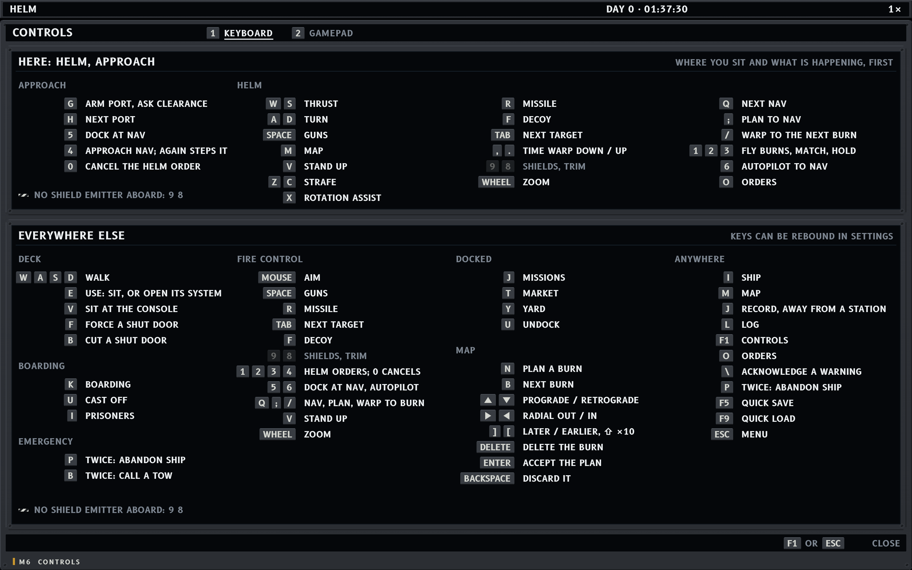

**C10, M6 on its Keyboard tab (10.6), on the way home, approaching Highport.** The spec's own
example, "Here: Helm, approach": the situation's keys come first, then the seat's in the game's
order, and everything else below, each section a hint context of the game's under the design's
name for it (FIRE CONTROL, as P1 calls the seat; BOARDING for latched to a ship; EMERGENCY for the
ship disabled). Every key and verb is the game's, with the design's changes: E at a console sits or
opens its system, O opens the orders menu, \ acknowledges, and I, J and L open the ship and the
record. The corvette has no shield emitter, so its shield keys are listed and dim, with the reason
once at each section's foot, as the orders menu gives reasons. The caps sit against their verbs, so
a single key is beside what it does and a row of them still lines up. The sections are the seats
and situations P1 names (version 16), so the gun seat has its own under fire control's: the pointer
aims that gun alone, Fire or a click fires it, the wheel zooms and V stands up, and its heading says
the rest are fire control's. The missile and the decoy share a row, as the strafe keys do, so each
seat fits its columns.

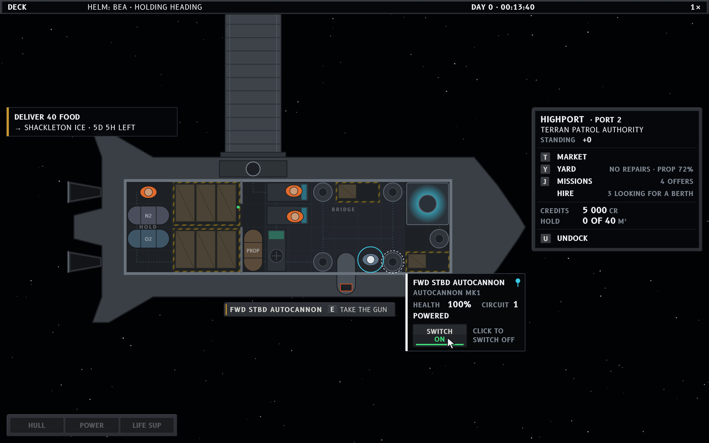

**C11, on deck, docked at Highport, with the starboard autocannon inspected (11.6 and 11.8).**
This is the moment the other two variations draw as a gun panel (S9, T10), on day 0 just after
docking. The spec gives a gun no panel. E at a gun takes it, as V does (4.3), so the system itself,
with its numbers and its switch, belongs to D2, the inspect card over whatever the pointer rests on.
The pointer went to the mount and a click pinned the card, so its switch acts. A dotted ring marks
the subject, a dotted leader runs from it to the card, and the pin sits in the card's corner. The
card holds the spec's fields in the game's numbers: the mount's name as H7 gives it, the weapon
(Autocannon Mk1), health, circuit and powered, with stunned shown only while it is. The switch is
a lit push button, as C1's orders are: ON is lit green while the gun is on, and the hint beside it
says what a click does. P6 stands beside the hull under the mount, with the name once and E's verb
in the game's words ("take the gun"). Inside the deck that spot is the systems', and the card holds
the other side. Docked, X1 takes the right column with the spec's lines in the game's numbers:
Highport is the Patrol's, at port 2. Standing is a number, since the game names no levels. The
yard has nothing to repair and the propellant is at C1's 72%. The board posts five jobs a day and
the delivery is taken, so four are left. Three are looking for a berth, and Hire, a tab in the
terminal, has its name and count but no key. The infirmary has treated nobody, so it has no line.
Nothing is bought yet (C7 is two minutes on), so the credits are the starting 5 000 and the hold is
empty. P5 is compact with the delivery, H4 is compact and dark, and P1's helm field is the game's
bridge line, which keeps a helmsman at the helm holding the heading while docked.

## Round 9 critique (version 18)

Version 18 gave the modes their missing data sources and a group's switch its rule when the members
disagree (all on, then all off). No drawn screen changes. C11, new this round, draws D2, P6 and X1
for the first time, and five questions went to the designer:

- **X1's standing names a level ("Trusted (+42)"), but the game names none.** Standing is a number
  for each faction, so C11 writes STANDING +0.
- **X1's infirmary line when nobody was treated.** C11 leaves it out, as it does a service the
  station doesn't offer. It could instead read that nobody needed treating.
- **D2's Type for a gun.** The game's system type is TURRET_MOUNT, and its console is "Gun". C11
  gives the weapon on the mount (Autocannon Mk1), which is what H7 lists.
- **P1's helm field while docked.** The game's bridge line has no docked case: a helmsman at the
  helm "holds the heading". C11 draws it so. It could instead be empty, or read docked.
- **H7 says a point-defense mount is never in hand,** but at a gun seat the game puts that gun in
  hand, point defense too (`PlayerGunnery.inHand`), and a gun aimed by hand hunts no missile. P6
  at a point-defense gun could say what taking it costs, as the other two specs now do.

The task designer's round 14 also found that First Play's Raider flies with nobody aboard:
`GameScenario` spawns it with no crew, while `HostileSpawns` crews the rails' pirates. A disabled
ship with nobody to fight for it is taken when the first strip order goes in
(`Boarding.takeUndefended`), with no party, no prisoners and no cargo. X2's sample, 11.13 and so
C4 and C6, with a defender in the bridge and four held, assume a crewed Raider, and 11.13's P5
keeps a bounty step, though the game pays a bounty the moment its ship is beaten
(`ContractBoard`). Both went to the designer with the rest. C4 and C6 stay as drawn until the spec
answers.

## Round 8 critique (versions 16 and 17)

Version 16 took the four questions C9 and C10 raised. The Log keeps the conditions and missiles
that the feed leaves to P2 and P3, as they start and end, and the merged gunnery lines, each opening
to its events. P4 now says which source each notice takes. The Log's filters step under `FocusNav`,
and its list scrolls as today's log does. M6 gives the gun seat its own section, which needs a gun
hint context, and P4's crew line is the game's own. C9 and C10 are redrawn to it. Drawing C9's
record found four more questions, sent to the designer:

- **P4 gives no source for a condition or a missile.** C9 puts the hull, the air and a system down
  under Engineering, as its repairs are, and a missile under Gunnery, as point defense is.
- **P2 says the long form is the Log's wording**, but P4's example uses the short code ("VACUUM
  HOLD cleared, 2:10"). C9 uses the long form with the room, and "cleared after" the time it held.
- **A room that goes from low pressure to vacuum and back.** P2's own example has no PRESS LOW row
  beside a VACUUM one, so C9 takes the vacuum to stand in for the low pressure while it holds, and
  logs four entries.
- **The hits the ship takes from guns aren't in the record.** The Log has the hits it lands and
  where each missile ended, but the raider's gun hits on the corvette show only as the SYSTEM DOWN
  they raise, with nothing to say what did it. A merged line for hits taken, opening to where each
  landed, would close the gap.

Version 17 took all four. A condition takes the source of what it is about, as C9 had them, and
missiles go under Gunnery as warnings. The long form with the room and "cleared after" is the
format, and P4's example now uses it. P2 shows a room's air as one row, the first of BREACH,
VACUUM and PRESS LOW that holds, so one hole never takes three rows, and the Log follows that
course; C3's row and master cue read BREACH now. The Log takes the hits from guns as notable merged
lines, which needs the game's hit event to name the shooter. The severity threshold and a merged
line's first-event time, my choices, are in too. C9 and C3 are redrawn to it.

**Converged** at version 17: nothing meaningful is left in the windows the overhaul skipped, and
the HUD screens stay converged from round 7.

## Round 7 critique (versions 10 to 15)

Version 10 came from the cassette direction's round 3. It made the samples true to the game's
geography (Shackleton Ice orbits the Moon, so the trip is planned a leg at a time and the deadline
outlasts it), set the full-screen modes' frame (tabs on their number keys, the close keys at the
foot), and made M3 a panel over the docked view. I checked it against the game's code and sent four
notes; version 11 took all four and added P2's Held state. Drawing C1 to it found one more, which
version 12 took, and drawing C8 one more, which version 13 took. Every screen here is redrawn to
version 13. Version 14 came from the VFD direction's check: the map's ghost of the Moon carries the
time it stands for, and the Nav card follows H2's rule. C5 already drew both Moons and that card,
so only the ghost's label changed, to `MOON AT CPA · T−4D 2H`. Version 15 came from the VFD direction's check of
C8's tab: the stopped RCS block and the breach are one hit on one tile, and every system has its
switch. C8 is redrawn to it, and C9 and C10 are drawn to it.

Problems in the spec, sent and taken:

- **Wireframe 11's crew did what the game's crews can't.** Cole, a marine, sealed the breach, but a
  marine never seals (`CrewRole` gives that job 0). Bea, a crewman, couldn't stay at the helm while
  a job that suits a crewman was open, since crew leave a console for any open task. And no crew
  mends a cut conduit: only a yard does. Version 11 has Ada repair the gun, Cole man the weapons
  console, the breach wait out the fight, and Bea fly with nothing else to take.
- **Wireframe 11's power.** The laser can't be stranded alone, since its tile is the aft run's only
  link to the reactor; one cut under the FWD STBD autocannon strands it alone. The damaged gun at
  40% still fired, over the 30% where a system stops. Version 11 has the one cut and the gun at
  20%, and lists the two engines and eight RCS blocks, one stopped.
- **X2's party, "2 aboard · holding",** can't happen on the corvette: the party is the ship's
  marines, Cole alone, and a party that takes a ship stands down. Version 11 has "1 · coming home".
- **Wireframe 10's hold** could not take the delivery's 40 food with salvage and an order aboard,
  and on day 0 nothing has been salvaged. Version 11 has neither.
- **H5's fixed 50 km in cruise** put Highport and the hauler, 3 km off, 5 units from the centre,
  under the own-ship mark, so the commonest cruise there is, leaving a station, drew one blob.
  Version 12 takes the smallest step that holds every contact inside 50 km, and steps back in only
  once everything is inside 80% of the smaller ring, so a contact on a ring doesn't flip the scope.
- **Wireframe 11's systems list gave the RCS blocks' power as "ok"**, but the game's blocks draw
  none (`RcsThruster`: a block works while the hull tile it is bolted to stands, and `RcsThrust`
  checks only that and the propellant). Version 13 dashes it, and the list dashes any value the
  game doesn't have.

Found in my own screens and fixed this round:

- **C3 lacked BATTLE STATIONS**, which wireframe 07 has had since version 5, and so drew P5, which
  in combat shows only for a fight's contract. P1 has the lens now, and P5 is gone.
- **The full-screen modes had their close keys in the title row**, and C8's foot repeated them with
  "1 TO 4 CHANGE TAB", which the tabs' caps already say. The close keys are the foot's now, as caps.
- **C7's HELD and ON ORDER headings stood 6 units apart.** The columns are spread so each stands at
  least 13 clear of the one before it.
- **Comments in C3's source gave Ada a gendered pronoun.** The crew are named, never gendered.

What works:

- Held reads at a glance beside YOU and the dots: three marks, three shapes, and no colour taken
  from the alerts.
- The chip puts P2's state where the eye already goes in a full-screen mode, and as a push lens it
  is plainly the thing to press.
- The map and H2 tell the same trip in the same words: one burn, the crossing, the capture as an
  estimate, the arrival, the deadline.

**Converged** at version 13, and still at version 14, which changed only C5's label, and at
version 15, which changed C8's hit and switches: nothing meaningful is left in the HUD screens, and
the designer counts it converged too. C9 and C10 were new this round; version 16 took their
questions, and round 8 has the next ones.

## Round 5 critique (version 9)

Version 8 took both round 4 notes: F1's kiter now moves along the line of sight (closing 12, REL 12,
course 235°, shot 2.2 s, as drawn), and H5's 5 km step says fights reach 5 km. W5 adds that the
lead reticle sits inside the lock mark at fight zooms, which is how it is drawn. From the other
critiques it names each missile's shooter in F4, says which numbers are values drawn at 15 (12.4),
moves the master cue above the rack at fire control, and gives H4's power line the output with the
rating only under damage. All are drawn.

What works:

- The 12-unit floor reshaped the variation for the better. With no room for bezel titles, each
  widget is known by its zone and its face, and the labels that remain are ones a reader uses.
- C1 reads in the spec's order, and the most dangerous orders sit in the far corner under guards,
  which is where a flight deck puts them.
- The armed state completes the guarded order: C3 shows the guard up, the amber switch and the
  window running out, and C1's switches are the same hardware.
- P2's handling column reads at a glance: cyan for you, white dots for crew, dim BACK for a
  condition clearing itself. The whole-word codes fit their 11 characters.
- At fire control each datum has one home: the missile's time, shooter and point defense are F4's,
  the split of the launchers F2's, the Lock's motion F1's, and F1's numbers agree with the reticle.
- Numbers differ in size for a reason: a value drawn on its own (the figures beside H4's bars,
  F3's heat) reads at 15, a DU's one lead figure (H1's speed, F3's cloud) is larger, and a number
  inside one of H2's lines takes the line's 13.

Problems in the spec: none found this round. Versions 8 and 9 draw as written.

Found in my own screens and fixed this round:

- **H4's life support row read EMERGENCY**, the spec's word, though the word list gives an
  instrument EMERG and P2's code and the master cue on the same screen say EMERG O2 for the same
  reserve. The row's reading is now EMERG O2, 42 KG: one name for one datum.

Two notes stay open, neither a fault in what is drawn:

- C1's trim selector is only live on a ship with an emitter, and C1 is the corvette, so the
  selector is drawn struck through. F3 shows the trim live at fire control; a gunship's orders
  menu would be a fifth screen, for coverage.
- C3's deck is dark enough that the bridge's consoles read only by their outlines. An emergency
  floor-path strip, as aircraft have, would help, but it is world art.

**Converged.** No meaningful criticism remains for Context-driven × Nasa-punk: version 9 and these
four screens agree.

## Deviations from the spec

- **Thousands take a thin space** ("1 240 KM", "7 672 M/S"), the style guide's rule, where the
  spec writes a comma.
- **Countdowns are M:SS** (`T−0:03`, P2's `1:40`), where the spec writes seconds in places
  ("T-3 s"). A time left over a day is days and hours (`5D 4H LEFT`), as the task spec writes it,
  where this spec writes "5.2 d", and a countdown over a day takes the same form after its minus
  (`T−4D 4H`).
- **The clock carries its seconds** (`DAY 0 · 01:12:40`), as the game's clock does.
- **Instruments are in caps**, as the guide has it; P4's messages are prose and stay in sentence
  case.
- **C7 has an order under way**, where wireframe 10 has none, so that the ON ORDER column and the
  loaders crossing the dock have something to show. The hold still fits the delivery.
- **H4's reserve reads EMERG O2**, where the spec writes EMERGENCY: the word list's instrument form,
  and the name P2 and the master cue give the same reserve.
- **No bezel titles.** The floor applies to legends, and titles at 12 would crowd the bezels. The
  zone says what a widget is.
- **The master cue is hidden on deck, docked or latched while it is unlit.** Dark there, it would
  be hardware with nothing to say over the deck.
- **No hand mark in F2 at the console.** Every mount is in hand there, so the mark carries nothing.
  It belongs to the gun seat's single row.
- **No fire arcs at fire control.** The nose cannon's arc is 270° and would cover the view. The
  hit lane and the lead reticle show where the shot goes. `LeadReticle`'s line back to the target
  is 2 units long at C2's lead, so it doesn't show.
