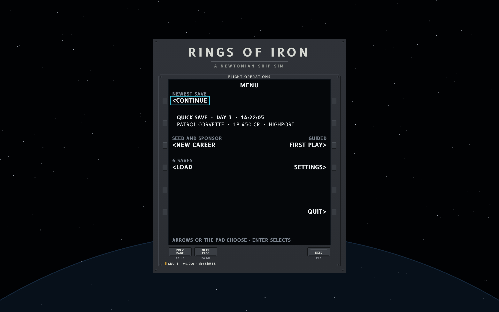
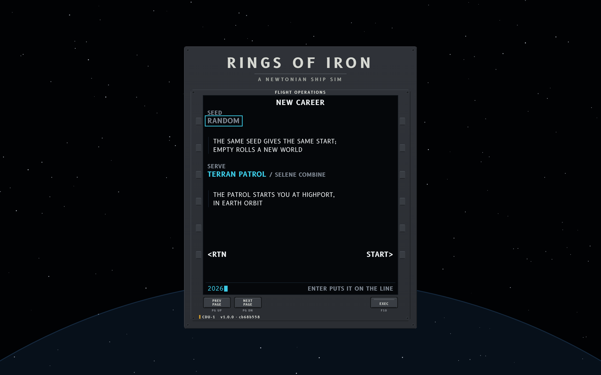
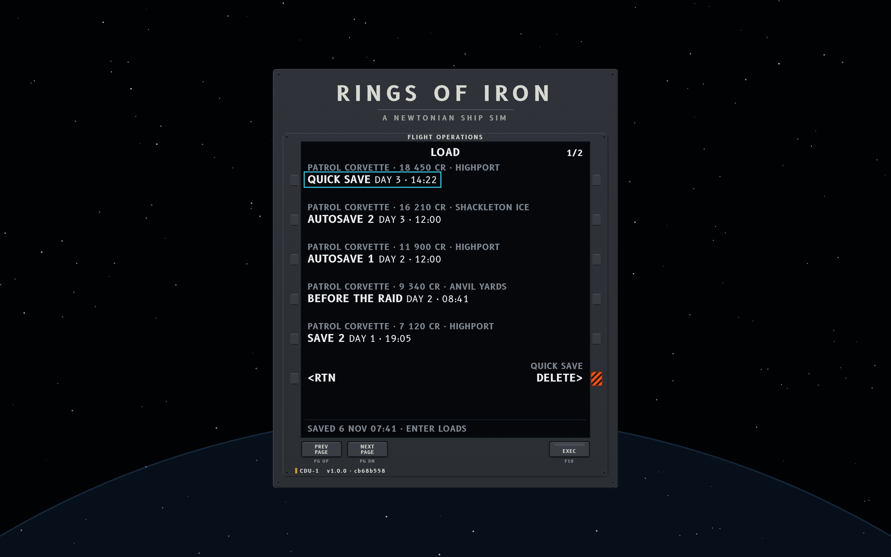
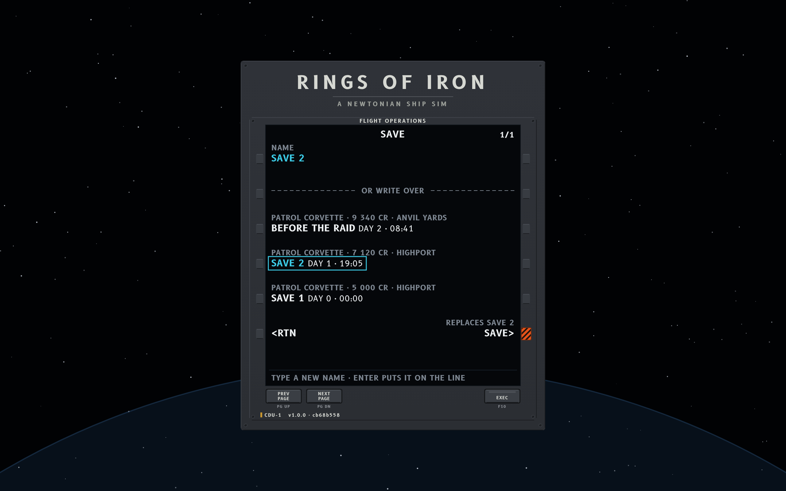
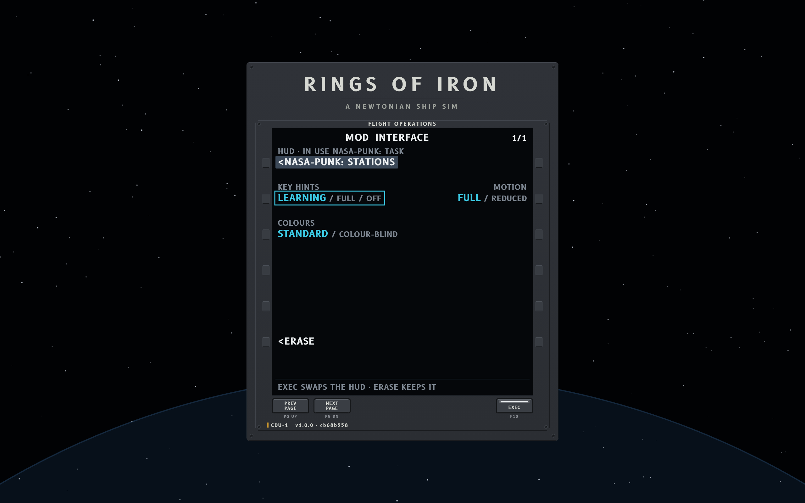
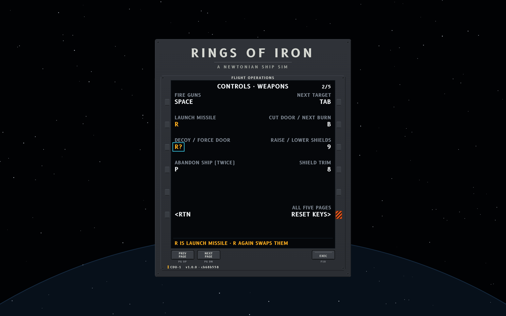
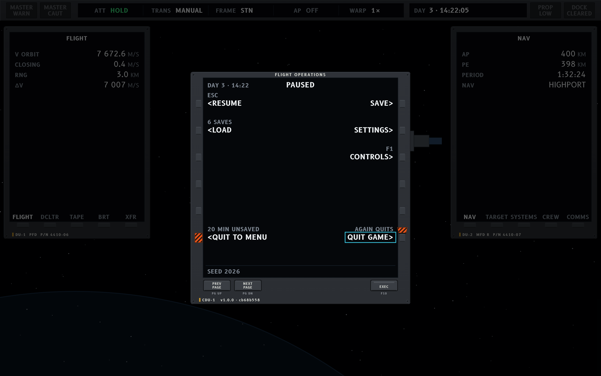
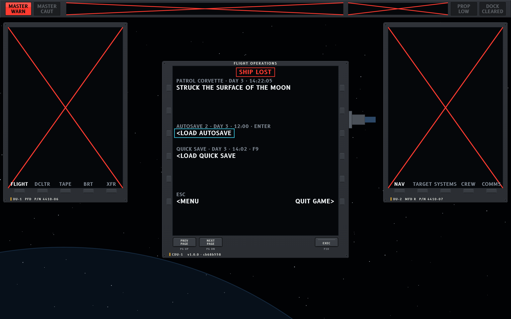

# Nasa-punk shell

The menus before and around a game, in the Nasa-punk style (`../../nasapunk/style-nasapunk.md`,
section 15): the main menu, a new career, load and save, settings, pause, and the ship lost. The
three Nasa-punk variations share this shell. The task-driven spec (`functional-task.md`, section 7,
"Shell") gives it the most detail and is followed here; the context spec (section 10.7) keeps
today's shell and adds an interface page to settings; the stations spec leaves it as it is today.
Where a spec differs, the notes under the screens say so.

Mockups are 1280 x 800 UI units drawn at 2x; sources are the HTML files here, using `shell.js`
and the kit in `../../nasapunk/mockups/` (`screens.js` holds the flight computer). From
`documentation/ui-overhaul`, render with `node nasapunk/mockups/render.js variations/nasapunk-shell`
and check with `node nasapunk/mockups/check.js --floor 12 variations/nasapunk-shell`.

## The flight computer

Every menu is a page of one control display unit, CDU-1, as a spacecraft's crew talk to its
computer. Its rules hold on every page:

- **Line-select keys.** Six keys a side, each level with a row. A row has a label line (12, dim)
  over a data line (15, bold). A field's key acts on it. A `<` or `>` caret marks a prompt (the key
  does something or goes somewhere); a field with no caret is a value; a dim field is not offered.
- **The cursor.** A cyan box on the field the keyboard or the pad has reached. The arrows or the
  pad move it; Enter presses that field's key.
- **The way back** is RTN on L6, or Esc. The pause page's way back is RESUME.
- **Option selects.** The live option large in cyan, the others small and dim, slashes between;
  the key steps to the next and acts at once.
- **The scratchpad** is the glass's foot line. Typing goes there (cyan, mono, a block caret);
  the field's key, or Enter with the cursor on it, puts it on the line. With nothing typed, the
  line carries a dim hint, or a message in its colour (a clash of keys is amber).
- **Pages.** The count sits top right (`2/5`). PREV PAGE and NEXT PAGE are hardware keys under the
  glass (Page Up, Page Down). Lists are paged, not scrolled.
- **MOD and EXEC.** Most settings act as soon as they are set. A change that rebuilds the screen
  waits: the title reads `MOD`, the new value is shaded (the computer's reverse video), EXEC's light
  bar is lit, and L6 offers ERASE in place of RTN. EXEC (F10) carries it out; ERASE, or leaving the
  page, drops it. The map uses the same pair for a planned transfer.
- **Guards.** Anything that can't be undone (delete a save, write over one, reset every key, quit
  with play unsaved) has a striped safety-orange cover over its key. The first press lifts the
  cover, which then stands above the key, and the label says what the second press does.
- **Labels name keys.** Where an action has a key of its own, its label says so (ESC, F1, F9,
  ENTER).

Out of a game the unit is set in a console that carries the game's name, over the game's own
backdrop of stars and the Earth's limb; the build is the unit's part number on its plate. In a game
it stands alone in front of the deck.

## Screens

**SH1, main menu.** The task spec's main menu: CONTINUE first, with the newest save's summary under
it (name, game day and time, ship, credits and where), the cursor on it. NEW CAREER (seed and
sponsor), GUIDED FIRST PLAY, LOAD with the count of saves, SETTINGS, and QUIT on R6.

**SH2, new career, mid-entry.** The player has typed a seed; it waits in the scratchpad, and the
SEED line still reads RANDOM until its key puts it there. The sponsor is an option select with a
line under it on where each one starts you. START on R6, RTN on L6.

**SH3, load.** Five saves a page, each on its key: name and game time on the data line, ship,
credits and where on the label line (new in the task spec). DELETE on R6 acts on the cursor's save
and carries a guard. The scratchpad line gives the cursor's save's real date and the key that
loads it.

**SH4, save.** NAME takes a typed name; under the divider, the saves it could write over. The
player has picked SAVE 2, so its name is on the NAME line in cyan and SAVE carries a guard with what
it replaces. Typing a new name takes the guard away.

**SH5, settings, the interface page, with a change waiting.** The player has picked another HUD,
which rebuilds the screen, so it waits for EXEC: MOD in the title, the new HUD shaded with the one
in use named in its label, EXEC lit, ERASE on L6. Key hints, motion and colours are option selects
that act at once (the task spec's interface settings). The settings index (not drawn) has AUDIO,
DISPLAY, INTERFACE, CONTROLS and GAMEPLAY on its keys; DISPLAY's window mode and size wait for EXEC too.

The context variation's interface page lists its own settings in the same way: UI SCALE, KEY HINTS
(LEARNING / ALWAYS / OFF), FRAME (AUTO / ORBIT), READOUTS (COMPACT / EXPANDED), FEED HOLD and
FLASHING.

**SH6, settings, controls, page 2 of 5** (flight, weapons, map and burns, helm, station and
windows). Each binding is a field: the action in the label, its key as the data. The player is
binding DECOY and pressed R, which LAUNCH MISSILE has: both show amber, the field reads `R?`, and
the scratchpad says what R does now. R again swaps the two keys; Esc keeps F. RESET KEYS, for all
five pages, carries a guard.

**SH7, pause.** CDU-1 alone in front of the deck, which keeps 40 per cent of its light. RESUME
(Esc), SAVE, LOAD, SETTINGS and CONTROLS (F1, new in the task spec). With play unsaved, both quits
carry guards; the player has pressed QUIT GAME once, so its guard stands open and its label says
the next press quits. The seed is on the scratchpad line.

The task spec moves the tow to the crisis panel. The context and stations variations keep it here:
`<CALL A TOW` on L3 while the ship can call one, with what it costs in the label.

**SH8, ship lost.** Every display on the deck shows its red X, the style's mark for a failed
display, and MASTER WARN is lit. CDU-1 carries SHIP LOST, the one line that says what happened
(the task spec's career over: one line), then the ways on: the latest autosave (Enter, where the
cursor starts), the quick save (F9) and the menu (Esc).

## Keys

| Key | Does |
|---|---|
| Arrows, the pad | Move the cursor between fields |
| Enter | Press the key of the field under the cursor |
| Typing, Backspace | Fill and clear the scratchpad |
| Esc | RTN; resume on the pause page |
| Page Up, Page Down | PREV PAGE, NEXT PAGE |
| F10 | EXEC |

The mouse presses any key, and a click on a field presses its key.

## In the game

The shell is drawn by the variant through the shared window and menu hook (the VFD thread's, one
PR on top of #266), in place of `ShellMenus`' panels and `GameShell.drawBackdrop`; the pages keep
today's actions and add only what the task spec adds (the newest save's summary, the save rows'
ship, credits and where, CONTROLS on the pause page, the interface settings).
