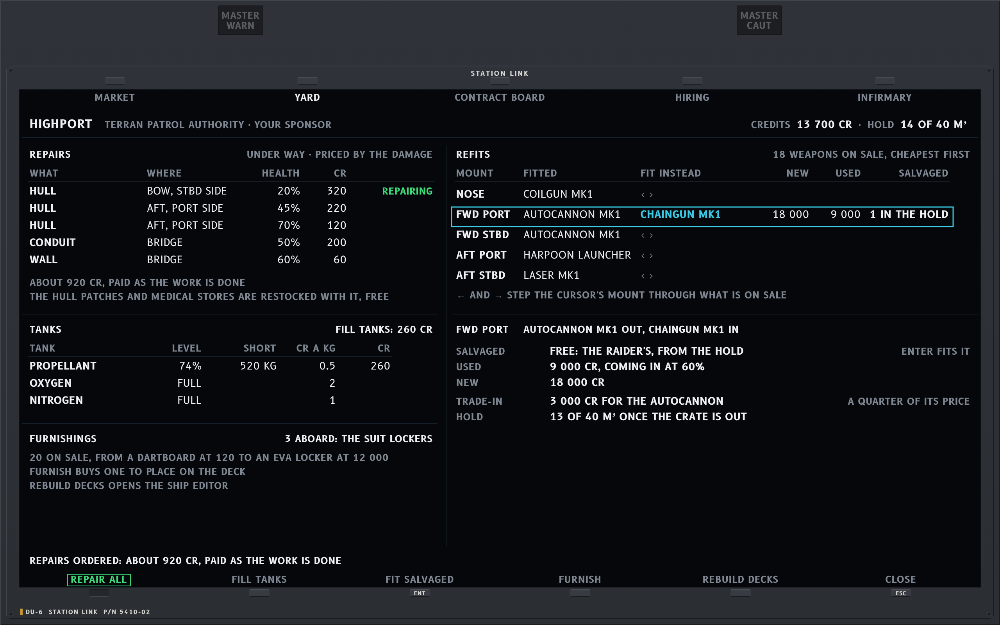
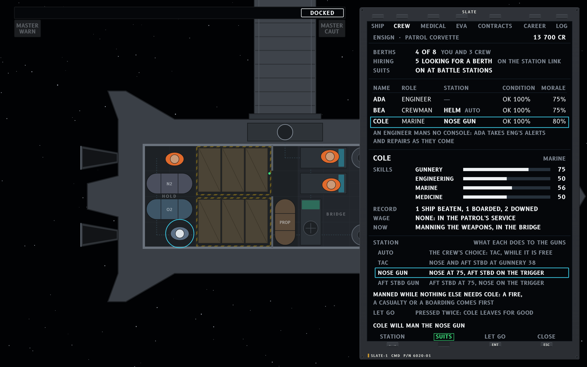
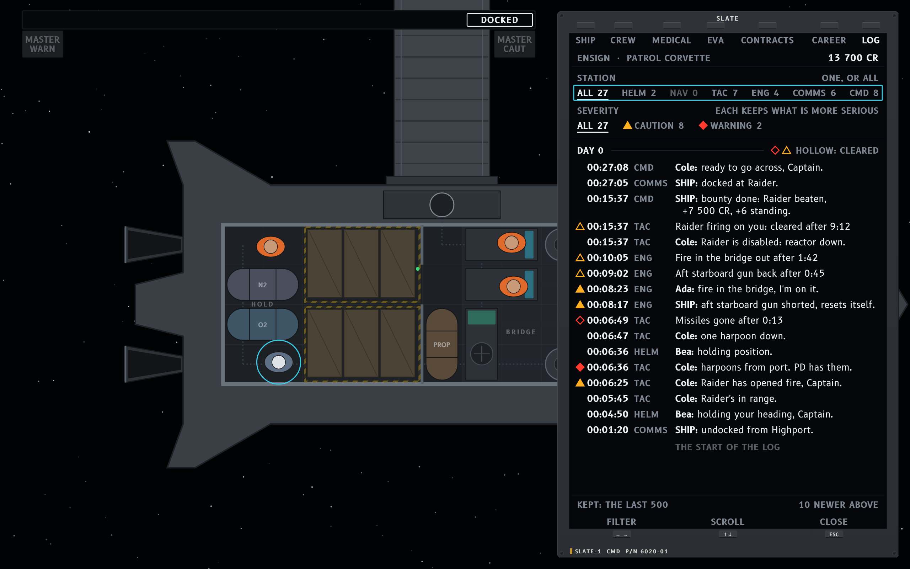
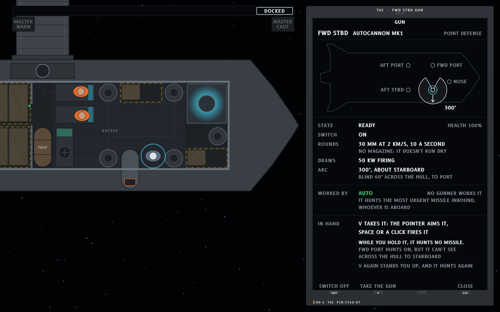

# Nasa-punk × Ship Stations

The Ship Stations functional spec (`functional-stations.md`, round 14 when drawn, S7 at round 15, S9 at round 16 and S8 at round 17) skinned in the
Nasa-punk style (`../../nasapunk/style-nasapunk.md`), with its words from
[`../../nasapunk/abbrev.md`](../../nasapunk/abbrev.md). Mockups are 1280 x 800 UI units drawn at
2x; sources are the HTML files here, using `stations.js` and the shared kit in
`../../nasapunk/mockups/`. From `documentation/ui-overhaul`, render with
`node nasapunk/mockups/render.js variations/nasapunk-stations` and check with
`node nasapunk/mockups/check.js variations/nasapunk-stations` (text overlaps, crowding, text
against or across a frame, text cut by its glass, and the 12-unit floor).

Round history is in [`../nasapunk-round-log.md`](../nasapunk-round-log.md).

## How the style maps the spec

| Spec element | Nasa-punk container |
|---|---|
| Bottom band: left MFD, station cluster, right MFD | Three DUs in one bezel row along the bottom (y 616). An MFD with nothing to say folds down to its rail of soft keys. |
| MFD page keys | Soft keys under the glass. Page names keep their whole spelling, the same as on the console tabs. PIN and FOLD are short function keys and take a little over half a page key's room each. |
| Station cluster (five fixed slots) | The centre DU. Each slot is an instrument row (pointer box, tape, chip), not a line of text. A slot with nothing to say yet shows its lenses unlit, so it reads as reserved; a slot for a system the hull lacks is blank, with no legend, as hardware not fitted. |
| Annunciator (top centre) | Two-line lens tiles. When any tile is lit, the row comes up with MASTER WARN and MASTER CAUT at its ends, each lit only while an alert of its kind is live. |
| Status strip | One glass across the top, with the condition (GREEN, YELLOW, RED) as a lit block at its left. |
| Ticker | Comm-loop slips under the annunciator: the station tag, the speaker, and a line of at most 50 characters. |
| Station board (bottom strip) | A hardware strip of six station tiles (HELM, NAV, TAC, ENG, COMMS, CMD), then the day and the time. |
| Prompt line | Key caps with their verbs, quiet, above the band. |
| Console page (Engineering) | A console face standing as a side panel (480 wide, full height): tabs on soft keys, the reactor and store as pointer scales, a synoptic of the power network, the systems not working in the order they come back, each with its state and what clears it (a row that comes back by itself runs its wait as a bar), and the footer's soft keys. |
| Suit readout | The suit's own chest display (DCM): suit-grey bezel, small glass. |
| Station assignment (new) | A selector on the slate: its positions in a row, the one set boxed in the cursor's colour, stepped with ← and →. |
| SENSORS range | The step at the page header's right with a − and a + cap either side of it, as the game's scope has its buttons today. |
| World labels and cues | HUD-layer symbology with halos: contact shapes, velocity markers, burn arrows carrying only their number, missile tracks, impact marks, the lead reticle, and a camera inset (OPT) on the target. On deck a crew member who speaks shows a speaking mark; the words are in the ticker. |

## Screens

**S1, helm, cruising, condition Green.** Nothing is wrong, so the overlay is empty and both MFDs
fold to their rails. The cluster's slots are velocity (the ORBIT frame, 7.67 km/s, MANUAL and
ASSIST, the MAIN and RCS lenses dark), reference (Highport with range, closing and its closest
approach, 140 m in 5:03), the next event (burn 1, T−12:04, which the world's burn arrow marks with
its number alone), the trigger slot with its GUNS, MSL and DECOY lenses unlit, and ΔV (the pointer,
the plan's bracket and the notch for home). The CMD tile names nobody: Command is the captain's
slate. The nav target has a camera inset.

**S2, the weapons console in walkthrough E, condition Red.** Two harpoons inbound from port, 2.4
and 2.5 km out on their predicted paths, landing in 8 and 9 s with their burn counted: the MISSILE
tile with its count and the first impact (`2  0:08`), both master lenses lit, HOSTILE FIRING. The
cluster lists the guns in hand by position, each with its own hit chance (NOSE with Cole at it,
charging; AFT STBD burning at 60%), the point-defense autocannons on one PD chip, the launcher with
its four harpoons and the salvo warning, and the blank Shields slot. SENSORS is open on the left
MFD at 5 km, the smallest step that holds the Raider and both harpoons, with its − and + caps;
DAMAGE is on the right. The coilgun's lead reticle rings the Raider: at 2.8 km its round takes
0.92 s, and the Raider moves 39 m in that time.

**S3, walkthrough F: on deck at the reactor console, condition Yellow.** A short has cut off the
aft starboard gun, and its sparks lit a fire in the bridge, which Ada has called and is fighting;
Ada's speaking mark is overhead, and the call, the newer, is at the ticker's foot. The SHIP line
carries no countdown, since a spoken number goes stale while it holds. Only cautions are live, so
MASTER CAUT is lit and MASTER WARN sits dark in its place. The Engineering face stands beside the
live deck (the world shifted 240 left): the reactor at 2.6 of 3.0 MW and damaged, the store full,
the synoptic with every conduit live and the two faults at the guns, and only the systems not
working, in the order they come back. The shorted gun is on top, back in 0:37, with its breaker's
45 s wait as a bar 8 s along; the nose gun under it is disabled at 24% health and needs a repair.
The top row is the next to come back, so the page needs no NEXT line.

### The windows the overhaul skipped

The shell's pages are in [nasapunk-shell](../nasapunk-shell/README.md); these are the spec's own
panels (10.2 to 10.4), drawn after the first rounds.

**S4, the Plot (10.2), full screen, opened with M at the helm.** Its console hosts Navigation, so
it is owned and its keys work; elsewhere it opens read-only, keys greyed. It hides the band and
brings its own annunciator and ticker, and it has the grammar of every panel: a title bar with the
station and console, tabs (MAP with traffic, PLAN, TARGETS), the body, and a footer of soft keys
with their key caps that shows the last key's response. The transfer is the other two variations',
accepted: the path solid magenta with the burns on it. The cursor is on the path two days out
and reads what is there. Nothing is wrong aboard, so the annunciator is dark and the ticker
carries the helmsman's word on the burn to be flown. The MAP tab carries no plan numbers: their
home is the PLAN tab.

**S5, the slate's Boarding tab (10.4), seated at the helm, just latched onto the disabled
raider.** K opened it as a side panel that stops above the band. The top column recentres left of
it, and the camera's centre moves left by half its width, so the pair stays in the middle of the
world still in view. The raider is the corvette refitted by pirates, so it is drawn on the
corvette's hull in its own colours, half a turn round along the port side with the collar between.
Latched, the strip and the CMD tile read LATCHED, the cluster's Velocity slot reads DOCKED with
the Reference and Next event slots dark, and the rails offer DOCK and CARGO. The tab is the
decision to board: the raider's state and what boarding it costs; the party, which is the ship's
marines, so Cole alone, and what Cole's going leaves (TAC empty, in amber); the two orders on the
footer's keys, each with what it does; and what waits for the ship to be taken. Storming forces
every shut door, pried here since the raider's power is down, as the game's "Force a way in" does.

**S6, the station link's Yard tab, full screen (10.1 and 10.3), at Highport after the raider
fight.** It hides the band and brings its own annunciator; the live part of the title bar (the
station, its owner, credits and the hold) is on the glass. REPAIR ALL has been pressed, so it is
lit and the footer shows the game's answer. The repairs are what the crew can't make whole: they
mend a damaged system in seconds, so S3's nose gun is long mended, and a field repair frames a
wrecked hull tile back up only to 20%, so the bow's starboard tile comes first. Each is priced as
the game prices it (400 a hull tile, 150 a wall, 3 000 a system and 400 a conduit
for each whole point lost), with the hull patches and medical stores restocked free. The tanks
need 520 kg of propellant at 0.5 a kilogram. The refits are a row per mount, named by position as
S2 names them: the cursor's mount steps through the 18 weapons on sale, and the raider's chaingun
from S5 is in the hold, so it fits for nothing. The cursor's refit is set out in full, new, used
(at half the price, coming in at 60%) or salvaged, with the quarter of its price the yard gives
for the autocannon.

**S7, the slate's Crew tab (10.4), on deck, docked at Highport on S6's visit (round 15).** On deck
the slate runs the full height, and the camera's centre moves left by half its width, so the
captain stands in the middle of the world still in view, in the hold, where Ada is idle.
Highport's docking arm meets the port collar, and the strip reads DOCKED. Boarding went with the
latch, and the raider's crew were handed over on docking, so there is no Prisoners tab. The roster
gives each person's name, role, station, condition and morale, and the cursor's person, Cole, has
skills, record, wage and what Cole is doing now. The station column is the new order, a station
assignment: the console a person mans whenever nothing else needs them. AUTO keeps the crew's own
choice, so Bea's helm reads AUTO, and an engineer mans no console, so Ada has no selector. Cole's
selector offers only what a marine mans, the weapons console and the two guns a gunner works (the
point-defense autocannons keep to themselves and the launcher waits for the captain), and beside
each choice it says what it does by the game's rules: a gunner works a mount at their own gunnery,
75, and the weapons console works every gun at half of it, 38, and a gun nobody works waits for
the trigger. I have stepped Cole from AUTO through TAC to the NOSE GUN, which leaves AFT STBD on
the trigger. A fire, a casualty or a boarding still comes first, as manning a console does today.
Letting go is docked only and can't be undone, so it takes Enter twice, and the page says it is
for good.

**S8, the slate's Log tab (10.4), on deck, docked at Highport on S7's visit (round 17).** The tab
is what happened aboard, newest first, the last 500 lines. L opened it, and the captain has
scrolled down to the First Play fight, ten lines below the newest. Each line is what the ticker
carried, with its station tag and its speaker. An alert someone called is one line, the callout,
with the alert's mark, and its clearing is its record from 13.7 at the same severity, hollow
("Missiles gone after 0:13", "Raider firing on you: cleared after 9:12"). Advisories and crew
lines answering an order carry no mark, and responses, the player's own answers, are not logged.
Today's notices come in under the station 13.4 gives them, COMMS for docking and salvage, TAC for
the Raider's disablement and CMD for the bounty, boarding progress and the prisoners, in the
game's own words where they fit 50 characters ("Raider is taken: 3 held") and shorter ones where
they don't (the bounty's "bounty done: Raider beaten, +7 500 CR, +6 standing"). A station speaks
in its own name ("Highport: clearance granted, port 2."); the ship's own events are SHIP's. Read
from the bottom, the fight goes in order on First Play's day 0: the Raider in the guns' range and
opening fire, its harpoons, both shot down 13 s later, the short on the aft starboard gun and the
fire it lit, then the Raider disabled, which pays the bounty, and the latch. First Play's raider is
a ship placed beside Highport, not a pirate on the rails, so it never intercepts or breaks off.
Above the page are the boarding, the way home and the three prisoners handed over, 400 CR each,
and the credits are the game's sum: 5 000 to start, the bounty's 7 500 and the handovers' 1 200.
The filters are two rows at the top, each position with its count: station takes one or all, and
severity is a threshold, each position keeping what is more serious. ← and → step the focused row,
under `FocusNav`, and ↑ ↓ scroll. NAV has nothing in it, so it is dark.

**S9, the gun panel (10.2), on deck at the forward starboard autocannon, docked at Highport
(round 16).** E at a gun opens that mount in detail as the side panel, in place of today's "Gun"
console window and its "Take the gun" button. The title names the mount by where it sits
(13.2), and a synoptic puts it on the hull among the other four with its arc: 300° about
starboard, so its one blind 60° is across the hull, to port. Its state, health and switch, on
Enter, are the console window's. Its rounds are 30 mm at 2 km/s, ten a second, with no magazine,
and it draws 50 kW firing. Its mode is in the WEAPONS page's words: PD AUTO, in the tactical
cluster's green, since it hunts the most urgent missile inbound whoever is aboard and no gunner
works it, and YOURS, in the commanded cyan, once in hand. Taking it in hand is V, or the footer's
TAKE THE GUN, and the panel says what that costs before the captain sits: a gun aimed by hand
hunts no missile, and the other autocannon hunts on but can't see across the hull to starboard,
the side this one covers. V again stands the captain up, and the gun goes back to PD AUTO.

## Round 5 critique

Round 14 of the spec took all four round 4 notes: POWER lists what is not working in the order it
comes back, so the NEXT line has gone; a shorted system reads SHORTED on the page as on its gun
chip; C's closest approach is 5:03; and F's ticker has Ada's call, the newer, at the foot.

What works:

- One bottom band carries the fast loop, and the board gives the crew picture in one strip.
- The synoptic answers "why is the aft starboard gun dead" in one look: every conduit is live and
  the fault ring sits on the gun itself, so the part has failed, not the network.
- POWER now reads top down as a queue: what comes back first, how long it has left, then what
  needs hands. A bar runs only on a row that clears by itself, so a moving bar means "wait" and a
  still row means "work".
- One name per page holds across the band and the console: SENSORS, WEAPONS, DEFENSE, DAMAGE,
  POWER and ATMOS are the same words on S2's keys, S1's rails and S3's tabs. SHORTED is now one
  word on the chip and the page.
- The dark cockpit holds: S1 has no lit lens and no list, and its unlit trigger lenses say the
  slot is there without saying anything is wrong.
- At 5 km, E's fight fills the SENSORS scope's outer half instead of its middle fifth.

Problems in the spec: none found this round. Round 14 draws as written.

Found in my own screens and fixed this round:

- **S3's MASTER WARN lens vanished** when only cautions were live, leaving a gap at the row's left
  end where S2 has it lit. The master lenses are the row's fixed hardware, so MASTER WARN now sits
  unlit in its place, as the style's lenses do (style section 6).
- **S1's camera carried a TV tag**, a short form the word list doesn't have, for a mode the game's
  cameras don't offer. Its corners now hold only the camera, what it shows and the zoom, as S2's do.

Resolved without a change:

- S2's first impact stays at the tile's size. The tile grid is fixed hardware, and with the
  double space kept, `2  0:08` reads at a glance; a larger number would break the row.

**Converged.** No meaningful criticism remains for Stations × Nasa-punk: the spec and these three
screens agree, and a fresh pass over S1 to S3 found only the two fixes above, both mine.

## Deviations from the spec

- **The annunciator puts the master lenses at the ends of the tile row** rather than on a strip of
  their own, so the eye finds them where the tiles are.
- **Console tabs are soft keys** with their legends on the glass, per the style.
- **Countdowns are M:SS throughout** (`0:08`, `BACK IN 0:37`), as the word list has it, where
  the spec writes seconds ("37 s"). Prose keeps the spec's form.
- **A row that comes back by itself carries a bar** for its wait (the breaker's 45 s), on the line
  where a row that needs work gives what the work is against. The spec gives the countdown only;
  the bar is the style's way of showing that the row moves on its own.
