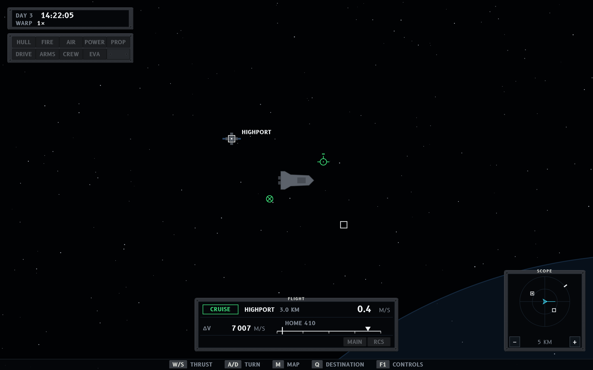
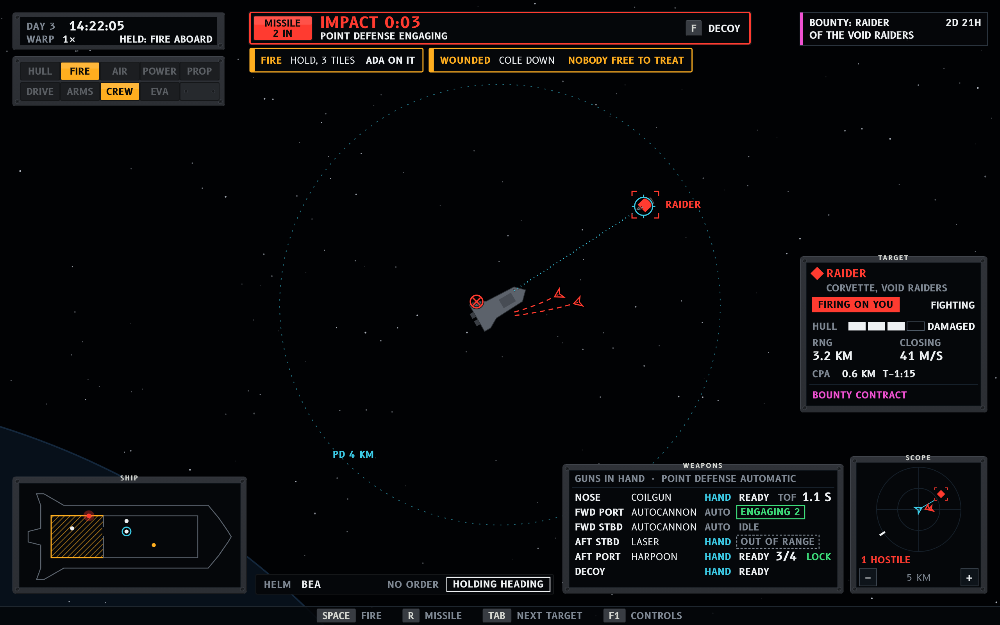
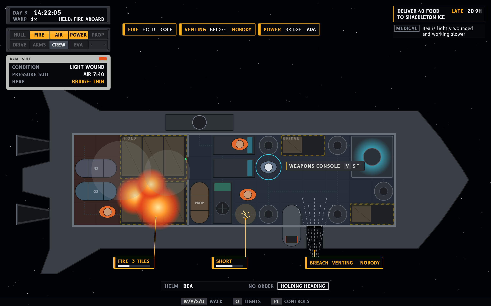
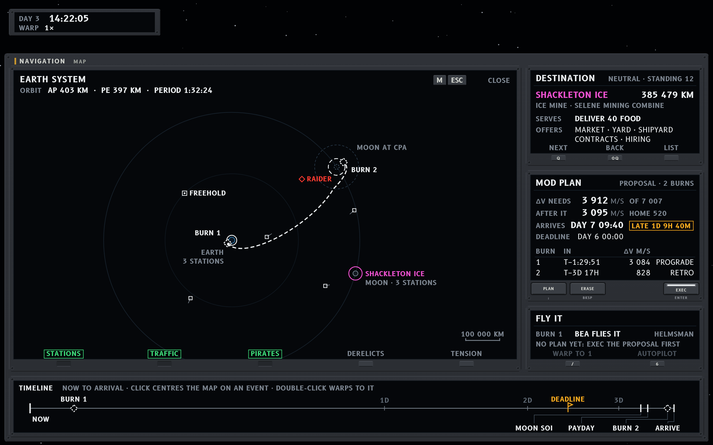
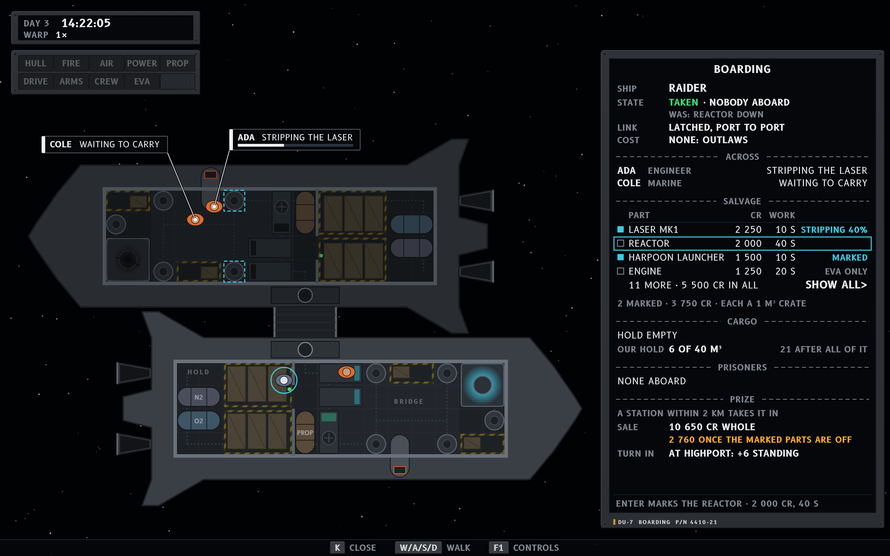
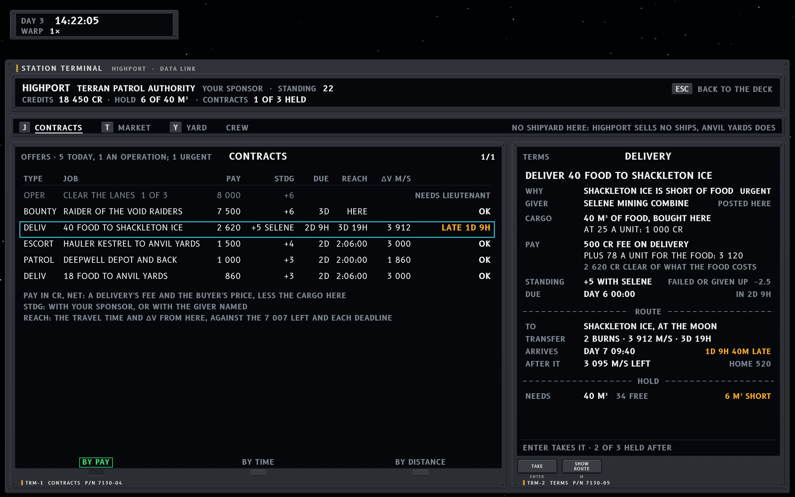
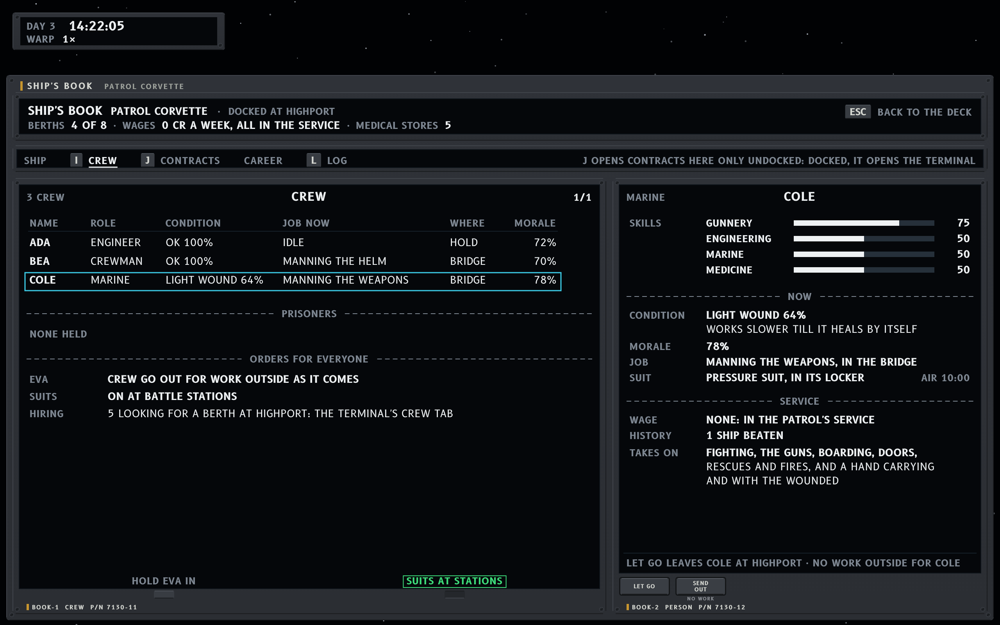
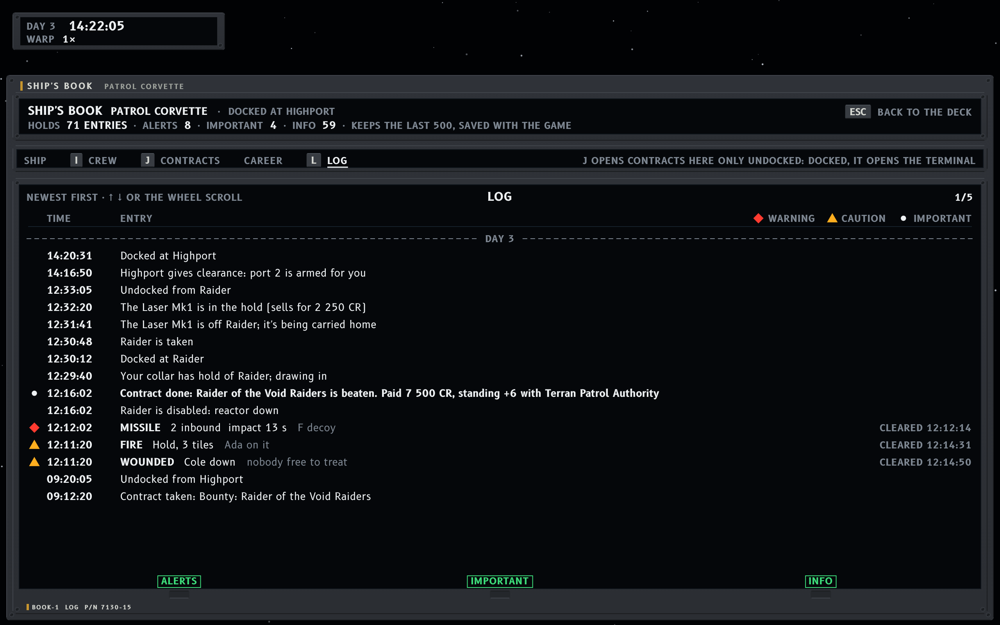
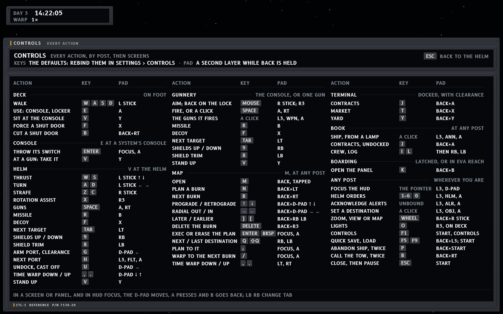
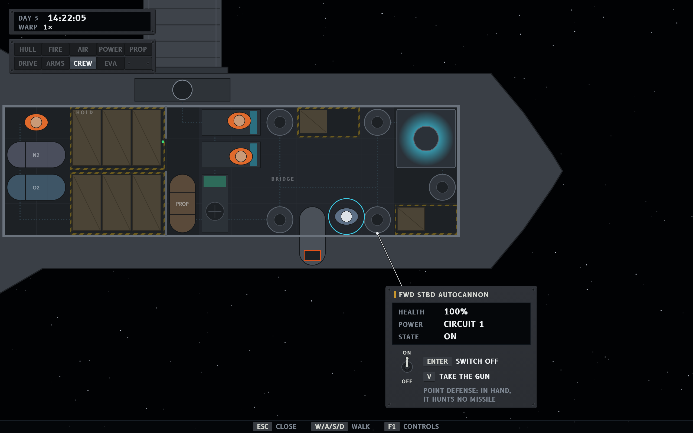

# Nasa-punk × Task-driven

The task-driven functional spec (`functional-task.md`, round 9 when drawn and round 17 now, on
branch `claude/project-thread-nfiuf0`) skinned in the Nasa-punk style
(`../../nasapunk/style-nasapunk.md`), with its words from
[`../../nasapunk/abbrev.md`](../../nasapunk/abbrev.md). Mockups are 1280 x 800 UI units drawn at
2x; sources are the HTML files here, using `task.js` and the shared kit in
`../../nasapunk/mockups/`. From `documentation/ui-overhaul`, render with
`node nasapunk/mockups/render.js variations/nasapunk-task` and check with
`node nasapunk/mockups/check.js variations/nasapunk-task`.

Round history is in [`../nasapunk-round-log.md`](../nasapunk-round-log.md).

## How the style maps the spec

The spec fixes nine zones (section 5); the style keeps them and fills each with its hardware. Z2 is
the spec's 640 (320 to 960). The left column is 272, widened inside the spec's allowance of a
quarter so the lamps' 12-unit legends fit their lenses.

| Spec widget (zone) | Nasa-punk container |
|---|---|
| CHR chronometer (Z1) | A small clock block: the day and the time large; WARP and the rate; when warp is held, why, at the right. |
| ANN annunciator (Z4) | A ten-lens caution and warning panel in two rows of five, dark when well. A lamp lit for a warning also gets a red ring, so the level reads without colour. A ship without shields has a blanking plate where the SHIELD lamp would be. |
| PER personal (Z4) | The suit's chest display (DCM): condition, suit and its air, the air where you stand. |
| ALR alert band (Z2) | One warning as a red-framed glass: a red lens, the number that matters large, the action on a key cap; no bearing, since the world and the scope show where a threat comes from. Under it the caution row: amber cells sized to their text, filling from the left, each naming who handles it, and the last 44 units reserved for `+n`, so no caution moves when it lights. |
| OBJ objectives, NTF news (Z3) | Slips with a kapton tab (magenta for the navigation target's row); news on comm-loop slips. |
| SCH ship schematic (Z5) | A synoptic plan DU: hazards hatched in their room by severity, crew as dots (amber when hurt), the captain ringed. No text, as the spec asks. |
| TGT target card (Z6) | A DU: name and class, FIRING ON YOU lit, the hull estimate as four cells and a word, RNG and CLOSING at body size, CPA, the contract in magenta. |
| FLT flight instrument (Z8) | A DU led by an FMA-style mode box (CRUISE); the frame's reference and the speed; ΔV on a bar with the home notch; MAIN and RCS lamps. |
| HLM helm status (Z8) | A mode strip: who has the helm, and the order in an FMA box (green while it flies, white while it holds or waits). At gunnery it spans the gap between SHIP and WEAPONS, so an order with a whole contact name fits. |
| WPN weapons (Z7) | A DU: one row per mount (where, what, who works it, state, time of flight), with the decoy as the last row, worked by hand like the launcher. |
| SNS scope (Z7 corner) | A scope DU. The range is automatic, with − and + caps either side of its figure to override it, as the game's scope has them; the count of hostiles on its own row under the scope, so nothing moves when one appears. |
| Interaction prompt | A bezel plate: the object's name once, then each key with its verb (`WEAPONS CONSOLE  V SIT`). |
| CON console panel | The prompt's plate grown: the system's name engraved beside the kapton strip, a glass with health, power and state, and the keys as caps with their verbs, the switch's under a toggle that shows where it stands. |
| HNT hints (Z9) | Key caps with their verbs. |

## Screens

**T1, helm at rest near Highport.** The spec's at-rest test: the clock, nine dark lamps and a
blanking plate, FLT in CRUISE in Highport's frame, the scope, and four keys and F1 on the hint
line. The scope's automatic range is 5 km, the step that holds the nearest contact (a freighter at
2.5 km) with room to spare; the third contact, 9 km off, is a tick on the rim. Contacts are glyphs
only, since nothing is targeted, and Highport carries its name.

**T2, the weapons console in a fight with the Raider.** The pirate corvette the game places near
Highport, by its own name (round 13), is 3.2 km off, closing at 41 m/s
to pass 0.6 km off in 1:15, and Bea holds the heading with no order: the launch dropped any order
but hold position and match velocity. Warp is held by the fire aboard. Two harpoons
inbound a second apart, the first 1.1 km out and 0:03 from impact with its burn counted, the second
1.4 km out (the one warning, with F for a decoy), each drawn on its predicted path to the hull; a
fire in the hold, three tiles burning as the game counts them (round 16), with Ada on it, and Cole
seriously wounded and down with nobody free to treat, since anyone aboard can and all are busy (two
cautions, in their full texts, since both fit the row). FIRE stays a caution: Ada took it on at
once, and the captain is in the bridge. The objective is the bounty by the title the game gives it, which names the target's
faction, so it takes a second line, broken before the faction; the target card gives the name
whole, the class and the faction. WPN as the
starting corvette really carries its guns: the coilgun and the laser in hand (the laser out of
range at its 3 km), the two autocannons on point defense, the harpoon launcher at 3 of 4, then the
decoy. One lead reticle, the coilgun's, ringing the Raider: its round takes 1.05 s, and the
Raider moves 44 m in that time. The point-defense ring at 4 km. The scope's automatic range is 5 km,
which holds the Raider
and both harpoons; a freighter 7 km off is a tick on the rim. SCH shows, because FIRE and CREW
are lit.

**T3, on foot in the bridge after a hit.** The fire is in the hold, its tag sized as the game
counts it, three tiles burning (round 16), with Cole on it, so FIRE stays a caution; the bridge
vents with nobody free to patch it; a short has cut power to the bridge and Ada resets it, the
progress on its tag. No warning, three cautions in their short forms, in the spec's order of
severity. On deck the deck is the schematic, so Z5 is empty and FLT, WPN and SNS are hidden; the
console prompt names the weapons console once, then V SIT, since the weapons console opens no
panel and E sits there too, so the hint line doesn't repeat it. The hit left two light wounds, the captain's and Bea's, so CREW is lit softly as an
advisory and the suit's display reads LIGHT WOUND; Bea's is the news slip, the game's own words,
the captain's having had its five seconds. The objective is spec round 11's urgent food delivery to
Shackleton Ice, by the game's title, LATE in amber before its 2D 9H, since the plan arrives after
the deadline; the title breaks before where the job goes, the time staying on the first line.

### The windows the overhaul skipped

The shell's pages are in [nasapunk-shell](../nasapunk-shell/README.md); these are the spec's own
panels, drawn after the first rounds.

**T4, MAP from any post (M), near Highport on day 3.** The player has asked for a transfer to
Shackleton Ice, where the held food delivery goes, and the computer has proposed one: two burns,
3 912 m/s of the 7 007 left. Not yet accepted, it is a modification, so the path and its burns are
dashed white, PLAN's title reads MOD and EXEC's bar is lit: Enter (EXEC) makes it the planned path,
solid magenta, and Backspace (ERASE) drops it. The delivery is the urgent one Shackleton Ice's food
shortage posts, for the Selene Mining Combine, due on Day 6 at 00:00: the transfer arrives
1 d 9 h 40 m after that, so ARRIVES carries an amber LATE flag and the timeline puts the deadline
before the arrival. The timeline carries the first payday too, on Day 7, a week into the career,
among the last day's events on their leaders. The orbit's numbers live here and nowhere else, under the plot's title. The numbers are
the game's: Shackleton Ice orbits the Moon 100 km up, and the Moon, 384 400 km out, moves 50
degrees in the 3.8 days the transfer takes.

**T5, BRD in its third phase: taken (section 7).** The Raider flies with nobody aboard and carries
no cargo, so no party went: the first part marked took it (round 14), and the salvage is under way.
The panel runs down the right side so the deck stays in sight, and the raider lies the way the game
docks two ships, half a turn round over the corvette's port side. On its deck the workers carry
their work tags (Ada stripping the laser, Cole beside the mount waiting to carry it home), and the
parts marked to strip carry cyan outlines. The state reads TAKEN with nobody aboard, and what had
beaten it. The salvage list is the game's, most valuable first, in its names and statuses, each
part priced at a twentieth of its price new with a tile's 10 s of work. The four dearest show, and
the last row opens the other eleven. A mark box sits on each part, filled cyan once it is marked;
Enter marks the cursor's row, or calls off a marked part's work, and the scratchpad says what that
will do. A part the link can't reach says so before it is marked (round 15): latched on, nobody can
get to the engines from inside, so they read EVA ONLY. Once taken there is no recall, so ACROSS
says only what each person does. The cargo is the Raider's
empty hold, with ours after all of it, and the prisoners section says nobody was aboard. The prize
is what a station within 2 km pays: 10 650 CR whole, or 2 760 once the marked parts are off, in
amber, since each gun taken off takes its price with it. At Highport it can be turned in for the
bounty's +6 instead. OBJ is hidden: a bounty is paid the moment its ship is beaten, so nothing is
held.

**T6, TRM on its CONTRACTS tab, docked at Highport.** The task spec's frame: CHR and ALR stay
above, the header row says where you are (the station, its owner, your standing, credits, the
hold and contracts held), the tabs run under it on their keys (J, T and Y, the game's), and the
body is the list on the left with the selected offer's terms on the right. CREW has no key: I opens
the ship's book, whose Crew tab links here while docked. Highport sells no ships,
so there is no SHIPYARD tab, and the row says why. The offers are the game's, sorted by pay with
operations first: a bounty pays 7 500 and +6 over 3 days, an escort 1 500 and +4, a patrol 1 000
and +3, and a delivery its fee, 15% of the cargo's value and at least 500, on top of the price the
giver pays for the cargo. Pay is net of what the cargo costs here, and the standing names a giver
who isn't the sponsor (spec round 11). Clear the Lanes waits for the rank of lieutenant. REACH,
the spec's addition, is the travel time and delta-v from here. The cursor is on round 11's urgent
delivery, the one Shackleton Ice's food shortage posts at Highport: 40 food to fill the hold,
bought here at 25 and paid for there at 78, half again the buyer's price, with the 500 fee, for +5
with the Selene Mining Combine and due on Day 6, 3 days after the day's roll. Its one transfer
arrives 1 d 9 h 40 m late, which REACH says in amber, and the terms say why it was posted, who
gives it, the cargo and its price here, the pay as fee and cargo and what that clears, the standing
and what failing costs, the deadline as a date, the route with its arrival, and the hold, 6 m³
short. TAKE (Enter) and SHOW ROUTE (M) are keys under the glass.

**T7, BOOK on its CREW tab, docked at Highport after T5.** The terminal's frame again, with the
ship, its berths, the week's wages and the medical stores in the header. The crew are the
service's, so they draw no wage. Each row has the role, the condition as the game words it, the
job now and where, in the game's words, and morale. An engineer never mans a console, and with
nothing to mend Ada is idle; the rest man them, a crewman the helm and a marine the weapons. The
four aboard take 4 of the corvette's 8 berths. The Raider flew with nobody aboard (round 14), so no
prisoners are held, and their section says so. The orders for everyone sit under them: EVA, suits
at battle stations, and where to hire. Cole's page has the four skills as bars; the light wound,
which slows the work and heals by itself; the job, and the suit in its locker with its 10:00 of
air; the history as the game counts it, one ship beaten and no boarding; and what a marine takes
on. LET GO and SEND OUT are its keys. SEND OUT is dark, since the only
work outside in a marine's trade is fetching someone adrift, and there is none.

**T8, BOOK on its LOG tab (L), docked at Highport after T5.** T7's frame, with the list the whole
width, since an entry needs no page of its own. It is the spec's log (round 11): every notice and
every alert, newest first under a divider for each day, each stamped with its game time and
filtered on the soft keys under the glass, ALERTS, IMPORTANT and INFO, each lit while it shows. It
keeps the last 500 entries and is saved with the game, and the header counts what it holds by
filter. The notices are the game's own words, with ships named in full: the bounty taken at 09:12
and done the moment the Raider was beaten, by the game's title, which names the target's faction, paid at
once (7 500 CR and +6 with the Patrol); the disablement, the collar, the taking, which the first
strip order made since nobody was aboard, the laser stripped and stowed within two minutes, and
Highport's clearance for port 2. An alert is logged once, as it was raised, in its full text: its code, what and where,
then the action it named, dim, since that was the advice of the moment, with the band's level as
its mark, ◆ a warning and ▲ a caution. When it cleared, its entry gained the time at the right,
rather than a second entry. The game's warning notices are their alerts: Cole's serious wound is
WOUNDED, which cleared once Ada, the fire out, began to treat Cole. The fire is sized in tiles
burning, and its entry was revised in place as it grew to T2's three, as a worsening alert's is
(round 16). There is no INTERCEPT, since
the Raider waits near Highport and the rails' traffic doesn't fly it. An important notice has a white dot, and news has no mark.

**T9, the controls reference (F1), at the helm.** The book's frame again, with every action on one
page in three columns of action, key and pad button: the posts first (deck, with its console
panels, helm, gunnery), then the screens and panels (map, terminal, book, boarding), then what
works at any post, where
zoom and the lights sit, since the wheel and O work everywhere. Every key is the game's default
with the spec's destinations: I opens the book on Crew, L on Log, J the terminal's Contracts docked
and the book's undocked, K the boarding panel, and Esc the top layer and then the pause menu; the
reference opens over everything, so Esc closes it first. The pad buttons are the game's where it
has them, and section 10's where it didn't (spec round 11): the right stick aims the guns in hand,
R3 putting the aim back on the lock; the bumpers work the shields; Back held with the right stick
zooms; R3 on deck works the lights; L3 puts the focus on the HUD, where the d-pad moves through its
items and A does what a click would, which reaches the next port, the guns the trigger fires, the
helm orders and a destination; the map's keys are its buttons, the bumpers stepping the
destination and the triggers warp; the book's bumpers step its tabs; and the pause menu holds
Controls and Load. B, which cuts a door on deck, calls the tow when stranded and selects the next
burn on the map, is Back with RT (round 13), so every action has a pad button.

**T10, CON at a gun, docked at Highport as in T7.** The captain has walked forward to the
starboard autocannon and pressed E. The panel is anchored beside the console, below the mount
where the hull meets space, on a leader from the mount, so the deck stays in sight and the middle
of the screen stays the world's; walking away closes it, and so does Esc. It is the prompt's plate
grown: the mount's name as WPN gives it, engraved beside the kapton strip; health, power (circuit
1, the ship's one) and state on the glass; and the keys as caps with their verbs, Enter to switch
it off under a toggle that shows where the switch stands, and V to take the gun. It is a
point-defense gun, so a dim line under V says what taking it costs (round 14): in hand, it hunts no
missile. While the panel is
open it carries those keys, so the prompt stands down rather than repeat them, and the hint line
keeps Esc, walking and F1. The rest of the HUD is what the spec shows docked with nothing wrong:
the clock, and the lamps with CREW lit softly for Cole's light wound; Ada, with nothing to mend,
stands idle in the hold. OBJ, NTF, HLM and PER have nothing to say, so they are hidden.

## Round 6 critique

Round 8 of the spec took all three round 4 notes: the scope's − and + are back, the 5 km step's
reason says fights reach 5 km, and there is one lead reticle, for the selected gun that needs the
most lead (all guns in hand are selected by default, and clicking WPN's rows picks fewer). Round 9
took my round 5 note, so a ship is named in full wherever it is named, and corrected two samples
from the designer's own review against the code. A shot at the ship or a missile launched at it
drops every helm order but hold position and match velocity (`HelmOrders.threat`), so T2's helm
holds the heading. No warp guard holds for hostiles, so T2's warp is held by the fire aboard, the
game's own reason. Both are drawn.

What works:

- The at-rest screen is quiet, and the ten-lens panel is the most Nasa-punk element of the three
  variations: dark when well, and it says which system at a glance.
- The band has room at the spec's 640: three short-form cautions and the reserved `+n` slot fit
  without a caution ever moving, and the warning carries only the count, the time and the key.
- At 5 km the scope holds T2's fight in its outer half, with the harpoons clear of the own-ship
  mark, and its caps let the captain step out to see the freighter on the rim.
- The deck tags answer "is anyone on it?" where the hazard is.
- T2's numbers agree with each other and with the game: range, closing, the closest approach, the
  reticle's lead, the helm under fire and the warp hold all describe one moment.

Problems in the spec: none found this round. Round 9 draws as written, with the one deviation
below on the scope's range.

Found in my own screens and fixed this round: T2's helm and its warp hold, to round 9 (above).
The helm strip keeps its width across the gap between SHIP and WEAPONS, 12 clear of each, so an
order with a whole contact name still fits when one stands.

Resolved without a change:

- **The caution cells stay sized to their text.** The ten-lens panel is the fixed hardware that
  says which system; the band is a message list, like an EICAS, where each line is as long as its
  words. Fixed thirds would waste the 640 on short cautions and cut long ones.

**Converged.** No meaningful criticism remains for Task-driven × Nasa-punk.

## Deviations from the spec

- **The interaction prompt stands down while a console panel is open.** The panel shows the same
  keys (CON's switch and `V  take the gun`), and the spec has no key repeat on screen (HNT).
- **Warp reads `1×`** with the multiplication sign, where the spec writes `1x`.
- **BRD is 408 wide**, where the wireframe's is 360, so the game's longest salvage status
  (`stripping 40%`) fits beside the work and the price. Its bezel takes 24 of that.
- **Countdowns are M:SS** (`IMPACT 0:03`, `CPA 0.6 KM  T−1:15`), where the spec writes seconds.
- **The log's clearing time has seconds** (`CLEARED 12:14:31`), where the spec writes `cleared
  14:31`: the log's own stamps carry seconds, and a missile's warning clears within its minute.
- **Thousands take a thin space**, the style guide's rule, where the spec writes a comma.
- **The scope's range has no AUTO word** (`5 KM`, where the spec writes `5 km (auto)`). Automatic
  is the normal state, and a dark cockpit names only what isn't normal. A range the captain has set
  with − or + reads in cyan, the style's colour for a commanded value, until the post changes.
