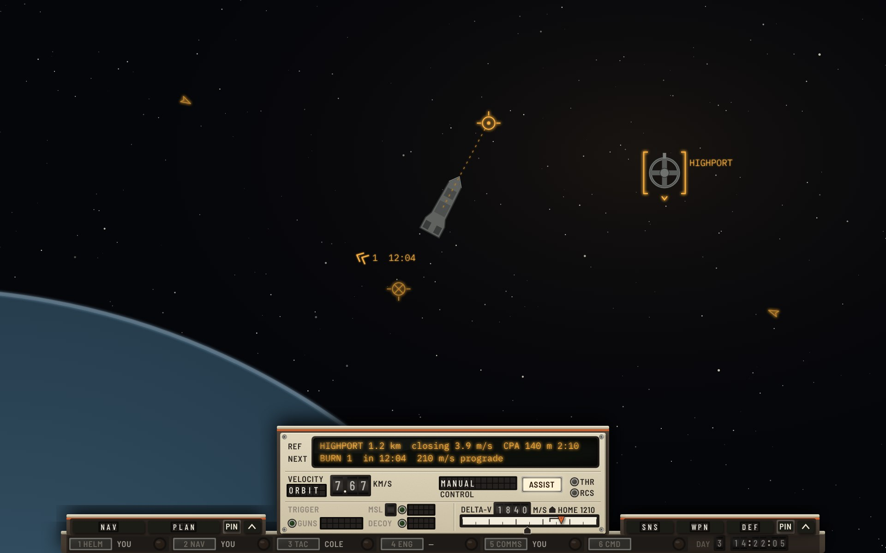
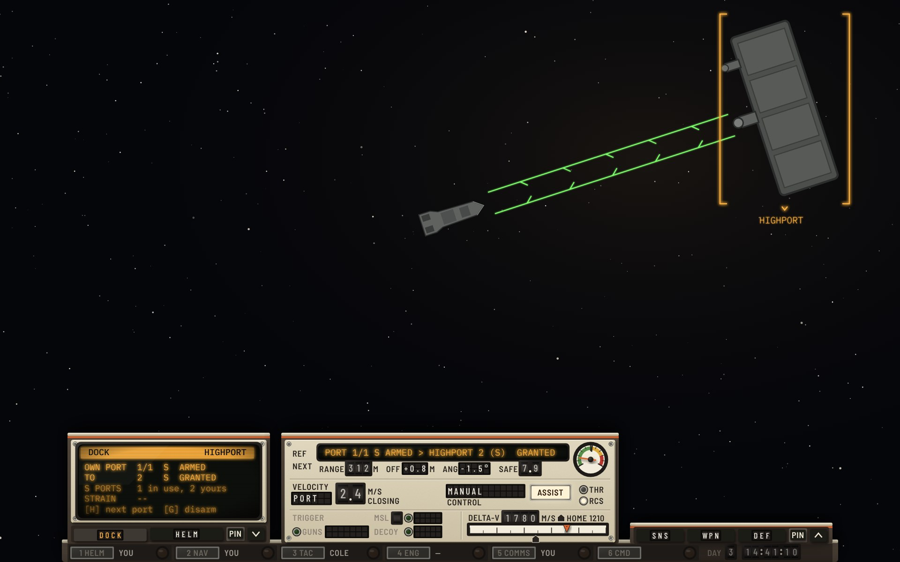
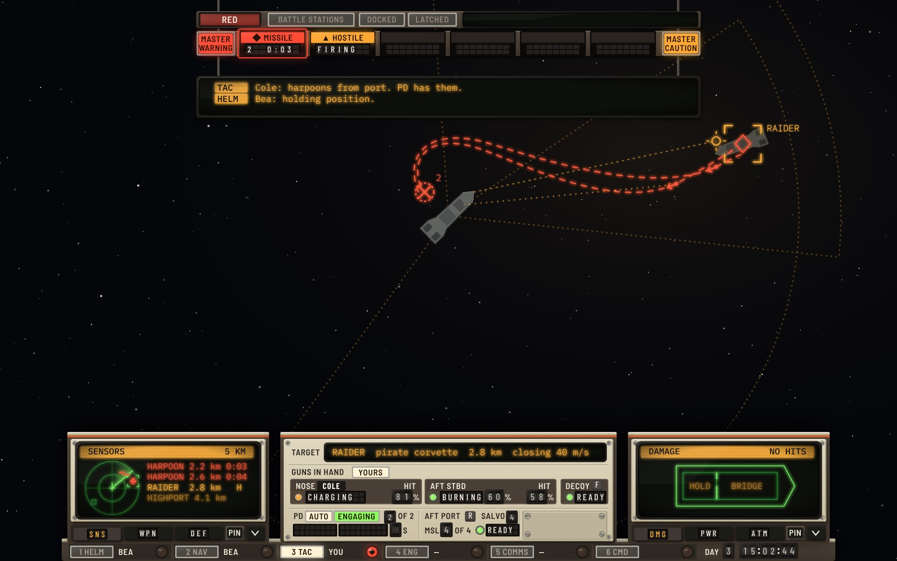
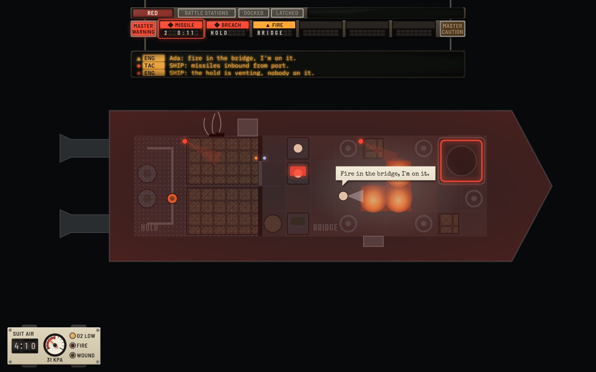
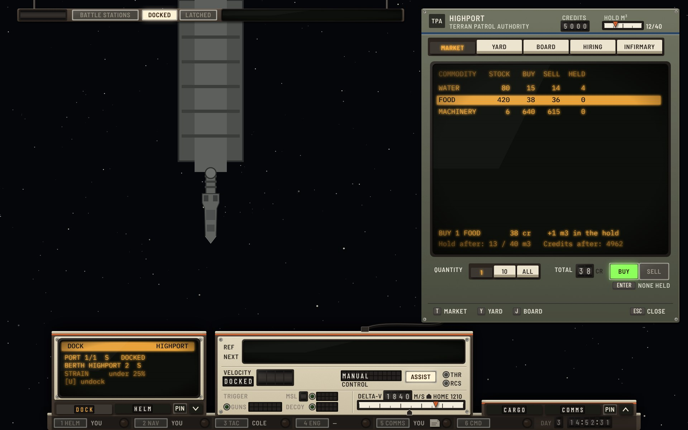
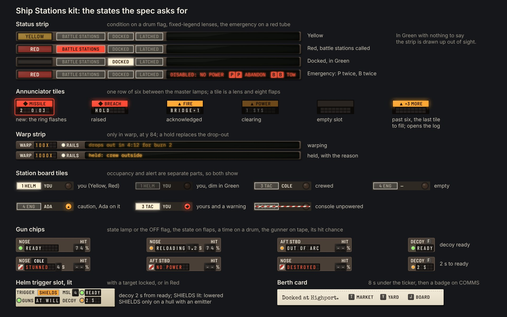
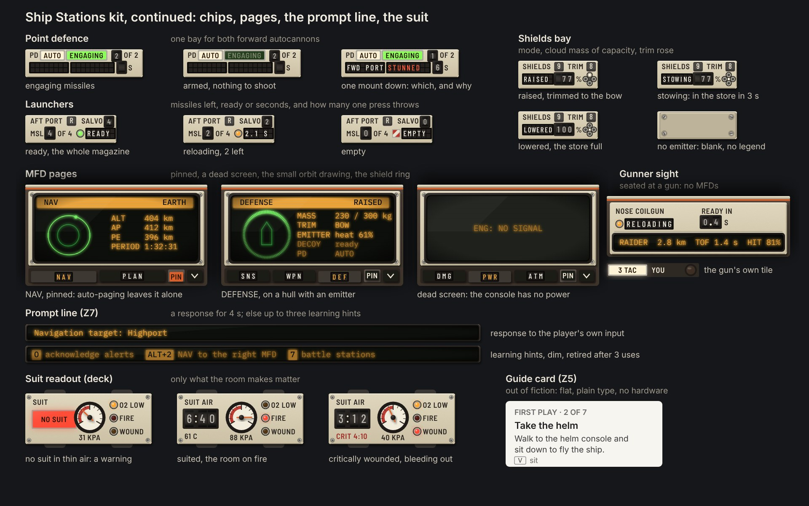
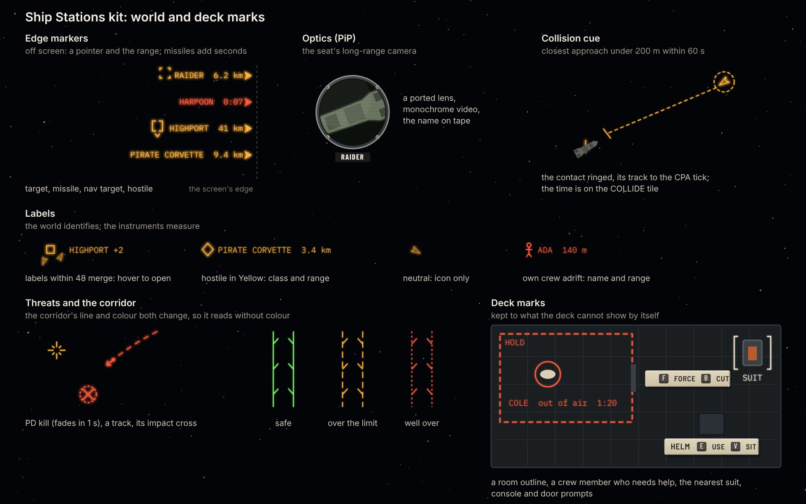

# Ship Stations × Cassette-futurism

The **Ship Stations** functional design ([functional-stations.md](../../functional-stations.md), round 9, PR #260) built in the **Yard Standard** design language ([style-cassette.md](../../style-cassette.md)).

**Status: round 2.** The critique of this round is at the end. The round log for all three Cassette variations is [cassette-round-log.md](../cassette-round-log.md).

The spec decides what is shown, where and when. This variation decides what each element is made of. Where the hardware needs something the spec doesn't say, or the spec asks for something hardware does badly, it is listed under [Adaptations](#adaptations) and was sent to the stations designer.

Round 1 drew four screens against the spec's round 2. This round redraws them against round 9 and adds the docking approach and three kit sheets. Every element in the spec's kit (17.5) is now drawn at least once, except the full-screen panel frame.

## The screens

### C. Seated at the helm, cruising (Green)

The dark ship. Both MFDs have sunk into the deck, leaving their soft-key rails, and nothing hangs from the top edge: in Green with nothing to say, the status strip, annunciator and ticker are drawn up out of sight. The cluster carries the reference (Highport, range, closing, closest approach) and the next event (burn 1 in 12:04) on one two-line tube. Velocity is on drums with its frame on flaps. CONTROL and ASSIST are the helm order and the flight assist. The TRIGGER slot is dark until a target is locked or the condition is Red. Delta-v is on drums over an edgewise meter with the house-shaped HOME bug and the planned burn bracketed.

In the world: Highport in its nav bracket with its name only, prograde and retrograde marks, burn 1 as a double chevron along the burn, and two neutral ships as notched darts along their headings. The station board is dim: in Green even the player's own stations are unlit.

### D. Seated at the helm, on the docking approach

The approach takes over the cluster's REF and NEXT slots (spec 8.2). The tube reads the ports: own port 1 of 1, small, armed, to Highport port 2, small, granted. Under it sit range (drum), lateral offset and angle (flaps) and the safe closing speed for that range (drum). The closing speed itself is a rate, so it goes on a needle: the dial's green arc runs to the safe speed, mustard to 1.5 times it and red past that, with an ink red-line at the safe speed. Velocity reads in the port's frame (PORT, 2.4 m/s closing).

The left MFD shows the DOCK page as the fuller table: the ports of that size, which one is yours, strain, and the keys for the next port and disarm. In the world, the approach corridor runs from the ship to the port on two green rails with chevrons. No callout plays: clearance has its home on screen in the cluster, so it is logged and not spoken (13.5).

### E. Seated at the weapons console, in a fight (Red)

The First Play fight. The annunciator hangs under the status strip with both master lamps lit: MISSILE (2 inbound, 0:03, its ring flashing because it is new) and HOSTILE FIRING. The ticker under it carries two lines from the crew, each under 50 characters: "Cole: harpoons from port. PD has them." and "Bea: holding position."

The tactical cluster says once that the guns are yours (the YOURS lens) and point defence is AUTO. Each gun in hand is a chip: NOSE has Cole on its Dymo tape and is charging, AFT STBD's laser is burning at 60% of its draw, and each has its own hit chance on a drum. The decoy chip rides beside them, since the player fires it too (F). Along the foot of the cluster runs the defence rail of three fixed bays: point defence (AUTO, ENGAGING lit green, 2 of 2 mounts working), the launcher (AFT PORT, 4 of 4, salvo 4, ready), and the shields bay, which on the corvette is a blanking plate with no legend, since the hull has no emitter.

The left MFD is on SENSORS (the two harpoons with their range and countdown, the Raider, Highport). The right MFD starts on DAMAGE, not DEFENSE, because there are no shields to show. In the world: the Raider bracketed with its name and the lead point; the two harpoon tracks hooking round the bow to the port side; point defence's tracer on the nearer one; one impact mark with its count; the guns' fire arcs dotted.

### B. On deck: fire (Ada on it), breach (nobody on it), missiles inbound

On deck there is no console in front of the captain, so the only hardware on screen is what hangs from the top edge and the suit unit on the captain's forearm. The ship is the starting corvette's real plan, the hold aft and the bridge forward, lit red inside for the Red condition while space outside stays black. The hold vents through a breach in its port hull, its air streaming out, and the captain is in there, suited. Ada fights the fire in the bridge and says so, in a bubble for its first 3 s. Bea and Cole are seated at the helm and the weapons console. Consoles glow in their station's alert role (Engineering at the reactor, Tactical at the weapons console), door lights show what is on the far side, and beacons turn in both rooms.

### G. Docked at Highport, Station link open, seated

The Station link is the station's equipment, not the ship's: a terminal in the Terran Patrol Authority's grey-green with a navy stripe, plugged into the cluster by a rubber cable. Only the tabs Highport offers are on its piano keys: Market, Yard, Board, Hiring and Infirmary (Highport's yard repairs and refits; the Patrol's shipyard is at Anvil Yards). The market lists water, food and machinery in the game's catalog order. Quantity is three interlocked keys (1, 10, ALL), the total is on a drum, and BUY is the one lit push-light, with SELL dark and NONE HELD under it.

The status strip shows DOCKED beside a blank condition flag (Green). The DOCK page reads the berth: port 1 of 1, docked, Highport port 2, strain under 25%, [U] to undock. The cluster's reference and next lines are dark, and the velocity frame reads DOCKED over blank drums. The berth card's badge sits on the board's COMMS tile.

### K. Kit sheet: the top column, the board, gun chips, the trigger slot, the berth card

Every state of the status strip (Yellow; Red with battle stations called; docked; the emergency text with its keys), the annunciator tile (new, raised, acknowledged, clearing, empty, and "+n MORE" on the last tile to fill), the warp strip (warping, held with its reason), the station board tiles (yours, dimmed in Green, crewed, empty, a caution with a crew member on it, yours with a warning, struck because its console has no power), the gun chips (ready, reloading with its seconds, out of arc, stunned, no power, destroyed) and the decoy chip, the helm's trigger slot lit, and the berth card that goes up for 8 seconds on docking.

### K2. Kit sheet: the defence rail, MFD pages, the gunner sight, the prompt line, the suit, the guide card

The defence rail's bays drawn by the same code and at the same size as in E: point defence engaging, armed with nothing to shoot, and with one mount down (FWD PORT stunned, 6 s, 1 of 2 working); the launcher ready, reloading and empty; the shields bay raised, stowing and lowered on a hull with an emitter, and blank on one without. Then the NAV page pinned, the DEFENSE page on a hull with an emitter, a dead screen, the gunner sight seated at a gun, the prompt line (a response, and three learning hints), three states of the suit unit, and the guide card, which is out of fiction and looks it: flat, in Inter, with no hardware.

### K3. Kit sheet: world and deck marks

Edge markers for a target, a missile, the nav target and a hostile; the optics picture-in-picture as a ported lens with monochrome video and the name on tape; the collision cue; labels (merged, a hostile in Yellow with class and range, a neutral by its icon only, own crew adrift as a red figure); a point-defence kill, a missile track and its impact; the docking corridor safe, over the limit and well over (its line and its colour both change, so it reads without colour); and the deck marks: a room outline, a crew member who needs help, the nearest suit, and console and door prompts as nameplates with their keys.

## The element kit

How each element in the spec's kit (17.5) is built.

| Spec element | Yard Standard object |
|---|---|
| Top column | A rack hung from two rods at the top edge. The status strip, annunciator, warp strip and ticker each hang at a fixed height, so nothing moves when another appears |
| Status strip (Z1s) | The condition on a drum flag (blank in Green); BATTLE STATIONS, DOCKED and LATCHED on lenses; the emergency text on a strip tube with key caps. Drawn up out of sight in Green with nothing to say |
| Annunciator | One row of six tiles between the master lamps. A tile is a backlit lens (◆ warning red, ▲ caution amber) over eight flaps. New: a ring flashes round it. Acknowledged: steady, no glow. Clearing: a filament fade. Past six: the last tile to fill reads "+n MORE" |
| Master lamps | Square push-lights at the ends of the row. Unlit, they stay visible as dark lenses |
| Warp strip | The rate on flaps, RAILS on a lamp, and the drop-out (or why the warp is held) on a strip tube |
| Callout ticker | The intercom repeater: a three-line amber tube with the station tag on an amber label and the severity mark in the margin |
| Prompt line (Z7) | A strip tube 8 units above the band: a response for 4 s, otherwise up to three learning hints, dim, with their key caps |
| Suit readout | The forearm unit: drum for suit air, needle for room pressure, lamps for O2 LOW, FIRE and WOUND; NO SUIT on a red lens; a critical wound's time on a red label |
| Guide card | Flat, in Inter, no hardware: it is out of fiction |
| Berth card | A typed paper slip with a perforated edge, under the ticker for 8 s, then a badge on the board's COMMS tile |
| Helm cluster | A pod: REF and NEXT on a two-line tube; VELOCITY's frame on flaps and speed on drums; CONTROL on flaps; ASSIST a latching push-light; THR and RCS lamps; TRIGGER; DELTA-V on drums over a meter with the HOME bug and the planned burns bracketed |
| Trigger slot | GUNS lamp and its mode on flaps; MSL left on a drum, then ready or seconds on a lamp and flaps; DECOY the same; SHIELDS a lens lit amber while lowered, on a hull with an emitter (bare plate on the corvette). Dark until a target is locked or the condition is Red |
| Docking approach | The ports on the tube; range and safe speed on drums; offset and angle on flaps; closing speed on a needle against the safe speed |
| Tactical cluster | TARGET tube; the YOURS label once for the guns; a chip per gun; the decoy chip; the defence rail of three fixed bays |
| Gun chip | Name, crew on Dymo tape, a state lamp or the barber flag when it can't fire, the state on flaps, a time on a drum, a beam's share of its draw on a drum, its own hit chance on a drum |
| Point defence bay | PD, an AUTO lens, ENGAGING on a green lens, mounts working on a drum; a mount that is down by name and state on flaps, with its seconds |
| Launcher bay | Name and key, salvo on a drum; missiles left on a drum against the printed magazine size; ready or seconds on a lamp and flaps |
| Shields bay | Mode on flaps, the cloud's mass as a share of capacity on a drum, trim on a rose of five jewels. On a hull without an emitter, a blanking plate on quarter-turn fasteners, with no legend |
| Gunner sight | A plate under the gun's own tile: the gun's state and time to ready, and a tube with the target, time of flight and hit chance |
| MFD | A pop-up tube in a pod, the title on its reverse-video top row, soft keys with flap legends, a PIN latch (down and orange when pinned). Folded: the tube sinks into the deck and the rail stays. Dead: unlit grey glass with NO SIGNAL |
| Pages | Green geometry and amber words on one beam-penetration tube: SENSORS scope, DAMAGE ship plan, DOCK table, NAV orbit drawing, DEFENSE shield ring |
| Station board | Six tiles on a sill: number and name on a lens (lit white for the player's stations in Yellow and Red), the occupant on a label, the alert on a jewel lamp of its own, a barber strip across a struck station; the day and time on drums |
| Station link | The station's terminal in its owner's livery, patched in by cable; piano-key tabs, only those offered; one quantity control as interlocked keys; the total on a drum; BUY and SELL push-lights |
| World symbols | Amber reflector-sight projection, threats in red, shape carries identity: hostile diamond, neutral notched dart along its heading, nav target in a bracket with its name, burns as double chevrons, missiles as a dot with a leader and a chevron, impacts as a ringed cross, own crew adrift as a figure |
| Deck marks | Room outlines, crew in need ringed, the nearest suit bracketed, console and door prompts as nameplates with key caps |

## Adaptations

Places where the hardware changes the spec's geometry or behaviour. Each was sent to the stations designer, and rounds 3 to 9 of the spec allow them.

1. **The band is flush with the bottom edge** (y 616 to 800). Hardware doesn't float.
2. **Slots go dark in place.** A row with nothing to show keeps its place with its tube dark, its needle parked or its drum blank. A slot for a system the hull lacks is a blanking plate with no legend, so it can't read as switched off.
3. **The unlit master lamps always show** as dark lenses while the row hangs.
4. **The top column is a rack.** The ticker hangs at y 108 whether or not a tile is lit, so it never jumps.
5. **MFD fold is mechanical.** The tube sinks or rises in 300 ms. An auto-page raises it at once, because a warning shouldn't wait for a motor.
6. **The closing speed is a needle**, since it is a rate; the exact safe speed is on a drum beside it.
7. **No thousands separators.** Drums and flaps have no comma cell, so 5000 and 1840.
8. **The board's alert is a jewel lamp**, so an unlit alert reads as a lamp, not an empty box.
9. **◆ and ▲ belong to lamps.** World symbols avoid upright triangles: neutrals are notched darts, burns are double chevrons.
10. **The decoy rides with the guns.** It is the player's, on F. That leaves the defence rail three bays of fixed width on every hull: point defence, the launcher, and shields.

## Round 2 critique

**Style: found and fixed this round**

- **The kit sheet's chips didn't match the screen.** Point defence, the launcher and the shields were drawn on the kit sheet as units 200 to 230 wide, wider than their places in the cluster, and E's shields slot was a 50-unit plate that no shield readout could fill. They are now one defence rail of three fixed bays, drawn by the same code in E and on K2.
- **A gun chip cut a reload's seconds** ("RELOADING 1.2" showed as "RELOADING"). A time now goes on a drum after the state, on every chip and bay.
- **Printed legends changed their words.** ENGAGING and ARMED, RELOAD, "1 OF 2" and a down mount's name were engraved tags that changed text, which an engraving can't do. They are now a lens, flaps and drums.
- **The trigger slot lacked parts of 8.1**: the seconds to ready for missiles and decoys, and SHIELDS while lowered. Both are in, and the lit example on K shows them.
- **Highport's Station link lacked the Infirmary tab.** The game's infirmary works at every friendly station, so the station offers it.
- **E's Cole line ran to 54 characters**, over round 9's limit of 50. It now reads "Cole: harpoons from port. PD has them."
- **The blank shields slot carried a SHLD legend.** Round 9 asks for none.
- **"+n MORE" now sits on the last tile to fill**, as round 9 asks.
- Earlier in the round: the ticker covered the docking port in D; the threat tracks in E looped under the ship; the nav bracket cut the station; an unlit board alert read as an empty box; the gunner sight's tube clipped its text; the suit's wound label overlapped its pressure; own crew adrift used the waypoint's ringed cross. All redrawn.
- From round 1: world labels and tube text no longer look like one object (labels carry the name only, and the instruments carry the numbers); the burn is a double chevron, not a pennant; the Station link's tube fits its three rows; the quantity rotary became interlocked keys; and every kit element is now drawn.

**Style: still open**

- **The full-screen frame isn't drawn.** The Plot, the Yard, the Shipyard and the ship editor hide the band and bring their own annunciator and ticker (10.1). Round 3 draws the Plot as a full-screen terminal.
- At rest, blank flaps and drums show as dark cells, which is what the hardware looks like switched off. The dark trigger slot at the helm carries more of them than in round 1, because 8.1 now asks for seconds. It doesn't change how the screen reads, so it stays.

**Combination (sent to the designer)**

1. **The burn shows its countdown twice at the helm.** The burn's arrow in the world carries "1 12:04" and the Next slot reads "Burn 1 in 12:04" (3.8). Suggest the number only on the arrow, and a countdown only for burns that aren't in the Next slot.
2. **The emergency text doesn't fit beside the flags.** 7.7's sample is 74 characters; the status strip has room for about 44 at 13 units. It needs a short form ("DISABLED: NO POWER [P][P] ABANDON [B][B] TOW" is what K draws), or the flags give it their room in Emergency.
3. **The DOCK page repeats the Ports field during an approach.** Both give own port, target port and clearance. D draws the page as the fuller table (ports of that size, strain, next port and disarm keys); suggest the wireframe does too.
4. **7.2's clearance callout never plays at the helm**, since 13.5 logs an advisory whose home is on screen. It is the deck's case; the sample could say so.
5. **The CMD tile's occupancy part is undefined** (blank in C and E). It should always read "you", or have none.
6. **The Market hides cargo the station doesn't trade.** In the spec's own sample the hold is 12 of 40 m³ but the rows hold 4, so 8 m³ is invisible. Suggest a "Not traded here" line.
7. **Wireframe G lists a Shipyard at Highport**, which has none (`shipyard.toml`: the Patrol's shipyard is Anvil Yards), and leaves out the Infirmary, which every friendly station offers (`StationInfirmary`). Its rows are also out of the game's catalog order (`StationMarket.quotes`: water before food).
8. **The cluster holds the corvette's weapons and no more.** It fits two guns in hand, one launcher, the decoy, point defence and shields. The frigate has two launchers, and the destroyer three guns in hand and two launchers (`ships.toml`). Should chips get narrower, should the extras go to the WEAPONS page, or does the cluster grow with the hull?
9. **(Minor) On deck a crew callout shows twice word for word**: in Ada's bubble and in the ticker.

## Files

- `mockups.html`: the eight sheets, drawn with the shared kit in `../../cassette/kit.js`.
- Render: `NODE_PATH=$(npm root -g) node ../../cassette/render.js mockups.html 1.5 jpeg`.
