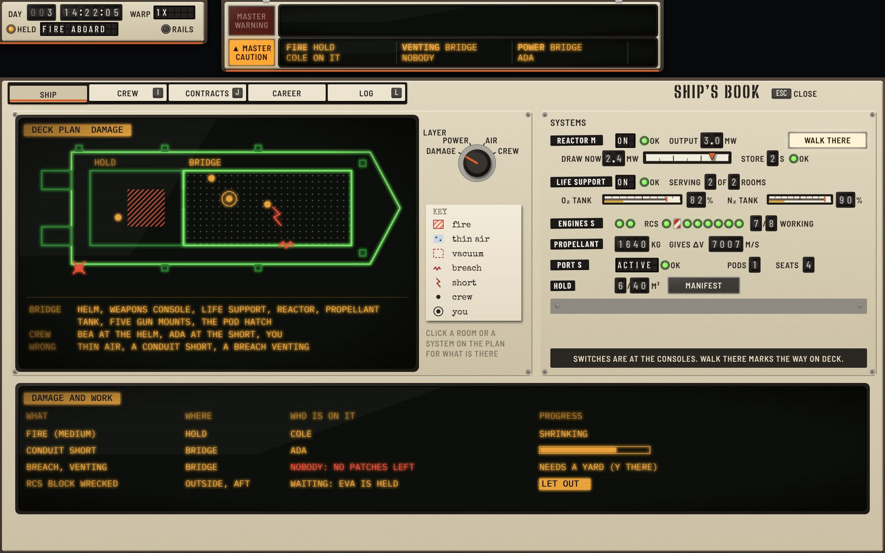
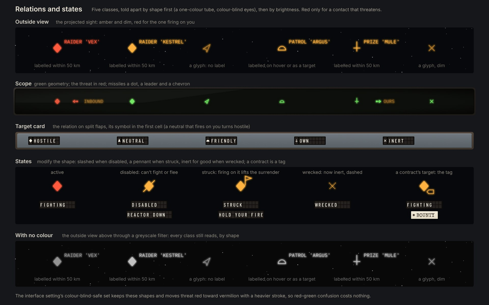

# Task-driven × Cassette-futurism

The **Task-driven** functional design ([functional-task.md](../../functional-task.md), round 9, branch `claude/project-thread-nfiuf0`) built in the **Yard Standard** design language ([style-cassette.md](../../style-cassette.md)).

**Status: round 2, the last mockup round.** The next step is the in-game build. This round's critique is at the end, after the round 1 critique it answered. The round log for all three Cassette variations is [cassette-round-log.md](../cassette-round-log.md).

The spec decides what is shown, where and when. This variation decides what each element is made of. Where the hardware needs something the spec doesn't say, or the spec asks for something the hardware does badly, it is listed under [Adaptations](#adaptations) and was sent to the task designer.

## The idea: each post is its own fit

The task spec changes the HUD by post: on deck it shows the ship around you, at the helm your motion, at the weapons the fight. In Cassette each post is a **fit**, a set of units in that post's own finish. A few **repeaters** are the same everywhere:

- **The repeaters** are in yard enamel (beige):
  - the master unit at top left carries the chronometer and the annunciator;
  - the visor at top centre carries the alert band;
  - the incoming rack at top right carries contracts and news;
  - the **key sill** along the bottom edge is the hint line, and every bottom unit stands on it.
- **The helm fit** is yard enamel too: the flight pod (FLT) and the scope (SNS).
- **The gun fit** is blue-grey: the weapons panel (WPN), the target plate (TGT), the helm line (HLM) and the schematic (SCH). Taking the weapons seat swaps the bottom units, so the change of post is a change of hardware.
- **The captain's own kit** is avocado: the personal unit (PER) under the annunciator, shown on deck.
- **Screens** (map, terminal, the ship's book) are framed consoles that start at 112 units, under the visor. Only the master unit and the visor stay above them.

Five rules carry through every unit:

- **An engraving never changes its words.** A word that changes goes on split flaps, a number on drums, a state on a lamp or lens with a fixed legend, and a record on typed paper. Names a refit changes (the gun on a mount, the reactor's size) are on Dymo tape.
- **Indicators and orders look different while dark.** An indicator (a lamp, a lens) keeps its legend faint while unlit: the dark cockpit. An order prints its legend bright on the smoked lens, so an order that can be given never looks greyed out. One that can't takes the barber strip along its lens and its reason on flaps beside it.
- **The tube draws by colour:** green geometry, amber words, red threats. These are beam-penetration tubes, so one tube does all three.
- **◆ and ▲ belong to lamps.** Ships are told apart by shape (sheet 09), burns are chevrons and the home marker is a bug.
- **A system the ship lacks is a blanking plate.** The corvette has no shield emitter, so the annunciator's tenth position is plated and the 2 × 5 grid never moves. Highport has no shipyard, so the terminal's shipyard tab is plated too.

## The screens

### 01 Helm at rest

The spec's at-rest test: the clock on two lines, nine dark lamps, FLT in CRUISE on three rows, the scope at 5 km, and four keys plus F1 on the sill. The frame is Highport, 3.0 km away, so the velocity markers are squares (a station frame). The neutral freighter is a notched dart, with no label. ROT ASSIST OFF is a dark lens, because it lights only when assist is off.

### 02 Gunnery in combat

The raider has just thrown two harpoons, so **MASTER WARNING** is lit. The warning row gives the missile count and the impact time in large red, then the action with its keycap (`F DECOY`). The caution row has FIRE and WOUNDED, each in a two-line slot. The chronometer holds warp with its reason on flaps (`HELD  FIRE ABOARD`).

In the outside view the raider is a filled red diamond, because it is firing on you, with the bounty's tag on its symbol. One lead reticle sits on its hull: the coilgun's, the gun in hand that needs the most lead.

The **target plate**:

- the relation on flaps with its symbol in the first cell, the owner, and the contract on a paper tag;
- the state on flaps, with a second run of flaps for its reason;
- FIRING ON YOU and HAS YOU LOCKED as two lenses with fixed legends;
- the hull estimate as a four-window strip with a pointer;
- range, closing and the closest pass on drums.

The **weapons panel** has one row per mount, point defence included:

- a trigger lens, lit while that gun is on the trigger;
- the mount, engraved, and the gun on Dymo tape;
- who works it on flaps, with HAND in amber;
- a state lamp, or a barber flag when the mount isn't working, and the state on flaps;
- a value block built for the mount's kind: a gun's time of flight, point defence's tracks, or a launcher's magazine and its LOCK lens.

The decoy row reads READY or a countdown, because decoys never run out. The helm line says Bea is holding heading. The schematic shows the fire in the Hold, the crew as dots with the captain ringed, and a hit flashing on the nose.

### 03 Deck in damage control

The deck view is drawn from the corvette's chassis data: the Hold aft, the Bridge forward, and the wall and door between them.

- A medium fire in the Hold has Cole on it.
- A conduit short in the Bridge has Ada on it.
- A breach in the starboard hull is venting, and its tag reads NOBODY in red.

Each hazard is outlined in its tiles with a progress bar. The crew carry no names: the band names whoever works a hazard, and hover shows a name and job. The pointer is on Bea.

The captain stands at the weapons console, so the **prompt plate** names the object once, then the key and its verb (`WEAPONS CONSOLE  V SIT`). The **personal unit** shows a light wound, the suit's air on drums, and the thin air in the Bridge. CREW is lit softly as an advisory, since the wound is under care. Each caution shows its full text where it fits its slot (`FIRE HOLD / COLE ON IT`) and its short form where it doesn't (`POWER BRIDGE / ADA`).

### 04 Docked: the station terminal

The terminal is a console framed under the visor. Its parts:

- **Header plate:** the station and its owner, a YOUR SPONSOR lens, then standing, credits, the hold and contracts held on drums.
- **Tabs:** CONTRACTS, MARKET and YARD with their keys, CREW, and a blanking plate where the shipyard would be, since Highport only repairs and refits.
- **Offers:** an amber tube, with soft keys under it for the sort.
- **Terms:** the selected offer's full terms are typed on a sheet, because they are a document. TAKE THE CONTRACT prints the sheet into the incoming rack.

The offers are the game's: an operation locked by rank, the bounty on the raider, ice to Freehold (with reach given as travel time and Δv from here), an escort and a patrol.

### 05 The map with a late plan

The orbit canvas is a green tube. Words are amber, and the apsides and the orbit's numbers are shown only here. Burns are chevrons. The right column has four cards:

- **MAP.1 Destination:** Shackleton Ice, its relation and owner on flaps, standing, and its services as a gang of lenses lit where it offers them (all five here). Then the distance, and the contract it serves on a tag.
- **MAP.2 Plan:** the plan's kind on flaps, Δv needed against left on drums, and a scale with the plan bracketed and the home bug. Arrival against the deadline, with the **LATE BY** lens lit and by how much on drums. The burns are on a tube.
- **MAP.3 Fly it:** who flies burn 1 (Bea, the helmsman), then WARP TO BURN 1 and AUTOPILOT as orders, with the autopilot's READY lamp.
- **MAP.4 Selected burn:** its components on thumbwheel drums.

The **plan timeline** is a paper strip chart on a log scale. Late events fan out on leader lines, and the stretch between the deadline and arrival is shaded red. Over the map the chronometer's NEXT window blanks, because the plan's times are the map's.

### 06 Crisis: the ship disabled

The visor carries the title and the reason (`SHIP DISABLED   NO REACTOR RUNNING`). The **crisis placard** starts with what the crew is doing, and has three choices:

- **WAIT:** Ada resetting the reactor short, about 20 s, and the breaker's own reclose time. The words change with the crisis, so they are on a tube.
- **CALL A TOW:** B twice, on a guarded switch, with its terms typed on a slip.
- **ABANDON SHIP:** P twice, on a guarded switch. The pod's seats are lamps and the people aboard are figures, so a shortfall shows. Here it is four seats for four.

Lifting the guard is the first press and throwing the switch the second, so the spec's "twice" is a guard standing open. Air aboard is a scale and a drum. FLT and the scope are on battery: they darken and each lights a BATT lamp. The sill shows only F1.

### 07 Sheet: FLT's four modes, rails warp, WPN compact, lamp states

**FLT** has one pod and a mode strip that reads like a gear indicator. Each mode keeps its own keys on its face:

- **DEPARTURE:** the berth, UNDOCK CLEARED, UNDOCK on a guarded switch, and four readiness checks, each `ok` or what is short with the key that fixes it.
- **DOCK:** the port and the one given, clearance on flaps with its lamp, range, HELM DOCKS, the alignment window with offset and turn on drums, and closing speed on a banded scale with SAFE UP TO. There is no H, because the corvette has one port.
- **BURN:** the countdown, the TURNING lamp, Δv to go, the nose-off scale, burn time, and who flies it when that is you or the computer.
- **CRUISE:** the frame on flaps (kind, name, distance), Δv left with the home bug, and speed.

In **rails warp** FLT hides and the chronometer carries the rate (RAILS lit), the next stop and its countdown. **WPN compact** is one lamp per mount, the missiles and the decoy. The last panel draws every lamp state, the three states of an order, and focus and hover.

### 08 The ship's book

The book opens on the Ship tab from any lamp or the schematic. Its parts:

- **The deck plan** full size on a tube, with a rotary layer switch (damage, power, air, crew) and a key card. Clicking a room types what is there and what is wrong under the plan.
- **The engineer's panel:** reactor output against draw and the store, life support, the tanks, engines and RCS (one block wrecked), propellant as Δv, the port, the pod and the hold. The shields row is a blanking plate. WALK THERE marks the console on deck, because switches stay at the consoles.
- **The damage and work table:** what, where, who is on it, and progress. The breach reads NOBODY in red with its way out (a yard), and the wrecked RCS block waits on EVA being held, with LET OUT beside it.

### 09 Relations and states

Five classes are told apart by shape first: hostile a filled diamond, neutral a notched dart along its heading, friendly a dome, own a cross with a heading tick, inert a saltire. Brightness comes second, and red is kept for a contact that threatens. States modify the shape: a slash when disabled, a pennant when struck, inert and dashed when wrecked. A contract is a tag on the symbol. The greyscale repeat shows every class still reads with no colour at all.

## The element kit

How each element of the spec is built.

| Spec element | Yard Standard object |
|---|---|
| CHR chronometer | The master unit's top: DAY and the time on drums, WARP on flaps, NEXT on flaps with days and hh:mm drums. HELD is an amber lamp with its reason on flaps, in place of NEXT. RAILS is a lamp |
| ALR alert band | The visor, 640 × 104: MASTER WARNING and MASTER CAUTION lenses at the left, a warning tube and a caution tube. Warning row: the title large in red, the action in amber with reversed keycaps. Caution row: three fixed two-line slots and a narrow `+n` slot |
| OBJ objectives | The incoming rack: each contract a paper slip with its time left on drums and a state flap. The navigation target's slip stands proud |
| NTF news | The telex strip under the rack |
| ANN annunciator | Ten push-light tiles, two rows of five. Dark, advisory (lit softly, no glyph), caution (amber, ▲), warning (red, ◆, glow), new (a ring, 3 s). A blanking plate where the ship lacks a system |
| PER personal | The avocado suit unit: health and suit on flaps, air on drums, the room and its air on flaps |
| SCH schematic | A green vector tube: hull, rooms, hazards hatched or dashed, crew as dots, the captain ringed, hits as a red starburst |
| FLT flight | The flight pod, 460 × 120, described under sheet 07 |
| HLM helm status | A name flap and an amber strip tube with the order. A pod of its own on the sill at gunnery and on deck, FLT's first line at the helm |
| SNS scope | A round green tube in a square pod: the AUTO lamp, the range on flaps between − and + keys, the hostile count on a drum |
| TGT target card | The target plate, described under sheet 02 |
| WPN weapons | The gun panel, described under sheet 02; compact, one lamp per mount, with missiles and decoy |
| HNT hint line | The key sill: a full-width chassis with an amber tube for the keycaps and their verbs, since the keys change by post |
| INT prompt | An engraved plate beside the object: the object's name once, then each key and its verb |
| OVL overlays | The reflector-sight projection: amber, threats red. Velocity markers are circles in the orbit frame and squares in a station or target frame. The lead reticle, missile tracks dashed red, relation symbols, deck hazards outlined in their tiles with progress bars |
| CRS crisis | The hazard-striped placard under the visor: press-twice choices on guarded switches, terms typed on slips |
| MAP | A console: the canvas on a green tube, layer toggles on a plate, four cards, the timeline on paper |
| TRM terminal | A console: the header plate on drums, index tabs with keys and blanking plates, an amber tube with soft keys, a typed terms sheet |
| BOOK ship's book | A console: index tabs, the plan on a tube with a rotary layer switch, the engineer's panel, the work table on a tube |

## Adaptations

Places where the hardware changes the spec's geometry or behaviour.

1. **The key sill uses the margin.** Z9's legend window is the spec's 24 units (y 773 to 797). Its chassis fills the margin from 762 to 800, so every bottom unit stands on it.
2. **The visor is 640 wide and 104 deep with its chassis.** Its two tubes take 84 of that, against Z2's 76, which is within the quarter the spec allows. Screens start below it, at 112, as section 5 provides for a taller band.
3. **Caution slots are fixed**, three across, each two lines of up to 19 characters, with `+n` in its own reserved slot. A caution shows its full text when it fits its slot and its short form when it doesn't, as spec section 9 allows.
4. **FLT is 460 × 120** against the wireframe's 440 × 96, and WPN 368 wide against 304, both within the quarter. HLM's flap and tube fit the wireframe's 26 units; its pod's chassis adds 10.
5. **A mount that isn't working shows a barber flag** in place of its lamp, as instruments show an OFF flag. An order that can't be given shows the same flag along its lens.
6. **The home marker is a bug, not a triangle**, because the triangle is the caution glyph.
7. **Drums carry no thousands separator** (7007). Text keeps the spec's formats.
8. **The tenth lamp position is a blanking plate**, so the grid never moves.
9. **A name longer than its flap is cut in its last cell**, and never wraps.

## Round 1 critique

Round 1 was drawn against task round 3. Its critique, and what round 2 did about it:

- **Unlit push-lights read as disabled.** Orders now print their legends bright, and an unavailable order takes the barber strip and its reason.
- **The burn markers were hollow triangles**, like neutral traffic. Burns are chevrons now.
- **The brown-out was only a darkening.** FLT and the scope now light a BATT lamp.
- **Flaps were cut to fit the samples.** Every flap was checked against the longest name in the game data.
- **Not drawn yet:** the relation set and the book are sheets 09 and 08. Pressed and unavailable states are on sheet 07.
- **Nine combination notes** went to the designer. Spec round 4 took all nine in: FLT lost its WARP mode, HLM lost its countdown, alerts got a short form, the departure check counts the roster aboard, and no key repeats on the hint line.

## Round 2 critique

Round 2 was drawn against task round 9. It redraws the seven round 1 sheets and adds the ship's book (08) and the relation set (09).

**What changed for the spec**

- The band is 640 wide with two-line cautions and a `+n` slot, and screens start under it.
- FLT has four modes and hides in rails warp. BURN names who flies only when it is you or the computer.
- HLM says what the helm is doing (`HOLDING HEADING`) and never counts down.
- The chronometer holds warp with its reason (`HELD  FIRE ABOARD`).
- The scope rests at 5 km, the lead reticle sits on the target's hull, and DOCK has no H with one port.
- The samples use the starter crew: Ada, Bea, Cole and the captain, so the abandon panel shows four aboard.
- The delivery is ice to Freehold.

**Style fixes found in the render and made in the round**

- **Words that changed were printed on legends:**
  - the target plate's relation and FIRING lens;
  - FLT's frame kind, DOCK's clearance and its OFF, TURN and SAFE UP TO text;
  - the departure check values;
  - MAP.2's LATE lens and plan kind;
  - the crisis WAIT text;
  - the sill's verbs.

  Each now sits on flaps, drums, a tube or a fixed-legend lens.
- **Lit white lamps barely read on the cream face.** Every small lamp now has a dark inner bezel ring, so lit reads as light. This is a change to the shared kit, so it applies to all three Cassette variations.
- **The weapons panel's mount names ran into the gun's tape.** The columns are respaced, and each value clears its label.
- **MAP.1's service lamps ran their legends together.** They are a gang of fixed-legend lenses now.
- **FLT rows overran:**
  - BURN's "flown by" moved to the bottom row;
  - CRUISE's HOME legend touched its drum;
  - DOCK showed H with one port;
  - DOCK's offset read side first and its turn read side last;
  - DOCK's closing scale was labelled `IN`, now `CLOSING`.
- **Lone size flaps were cryptic** (`POD 1 S`, `ENGINES ●● S`). The size moved onto the Dymo tape, as `REACTOR M` already had it, and the crisis panel counts pods only.
- **A struck ship's reason read `FIRING ON IT`**, as if the ship were firing. It reads `HOLD YOUR FIRE`, with the full text on hover.
- **The scope disagreed with the outside view** on the freighter's range in 01 and its bearing in 02. The lock mark also overlapped the contract tag. Both are fixed.

**What is left**

Nothing in the stills is left to fix. Three things can't be judged from a still and are for the in-game build to settle:

1. **Motion:** the flap and drum travel times, the 3 s blink of a new lamp, and a caution's change from full text to short form.
2. **Type at UI scale 1:** the four faces as bitmap fonts at 12 and 13 units. Barlow Semi Condensed and IBM Plex Mono need checking at 1× on a real display.
3. **Glow and scanlines:** whether the tube's bloom stays cheap enough in libGDX at 1080p, or bakes into the tube texture.

**Combination (sent to the designer)**

1. TRM's wireframe still shows a SHIPYARD tab at Highport, which sells no ships (`assets/data/shipyard.toml`: Anvil Yards is the Patrol's shipyard, and Highport's yard only repairs and refits).
2. The DOCK sample's "Highport port 6" is an M port. The corvette's port is S, and Highport's S ports are 1 and 2. The mockups use port 2.
3. MAP.1's services sample for Shackleton Ice ("market, yard, contracts") leaves out its shipyard (Selene's, in `shipyard.toml`) and hiring, which every station that isn't hostile offers.

## Files

- `mockups.html`: the nine sheets, drawn with the shared kit in `../../cassette/kit.js`.
- Render: `NODE_PATH=$(npm root -g) node ../../cassette/render.js mockups.html 1.5 jpeg`.
