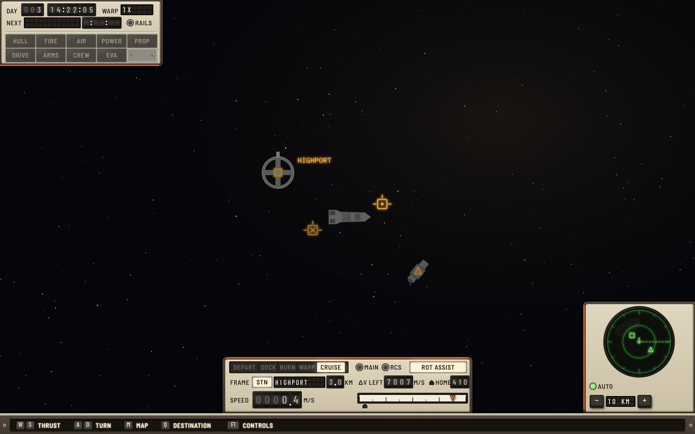
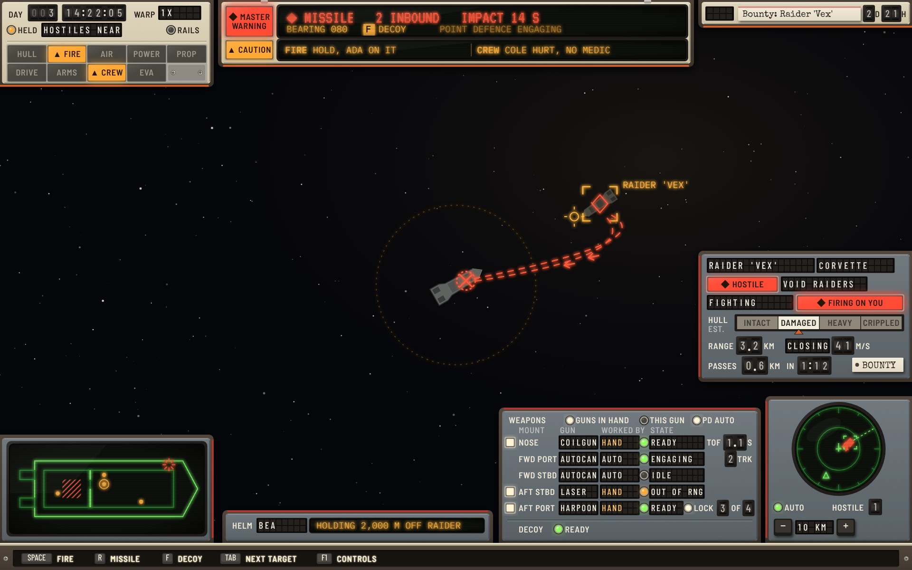
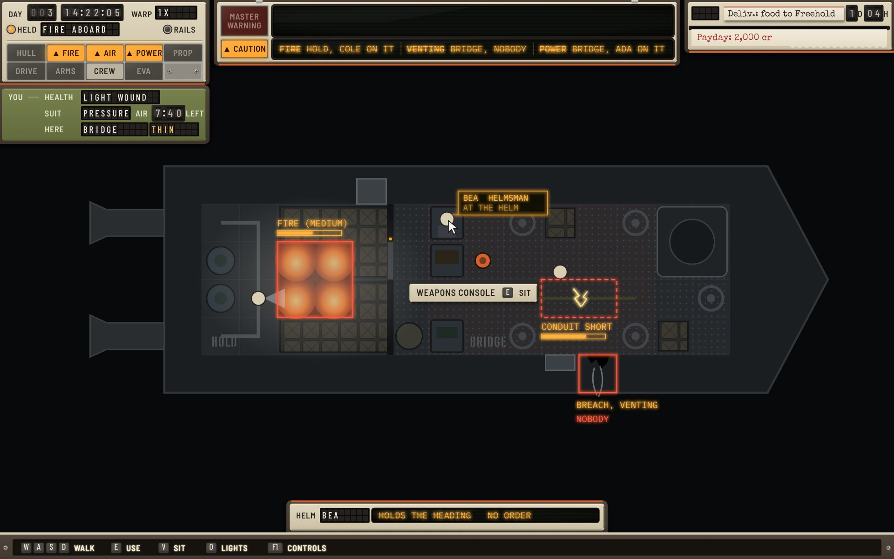
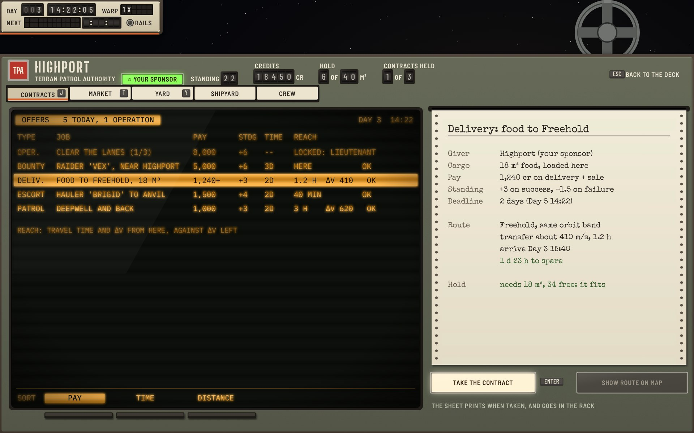
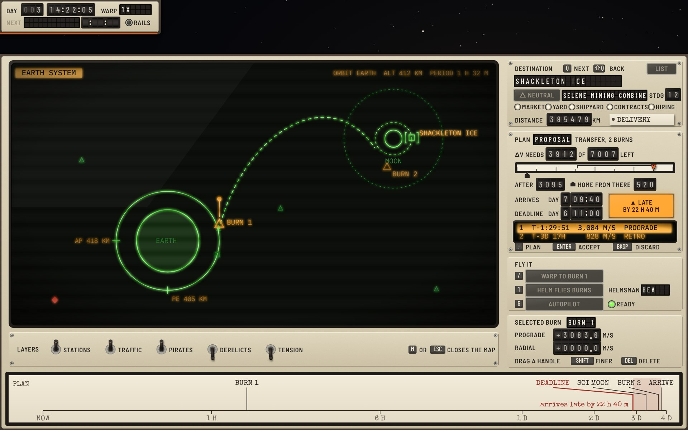
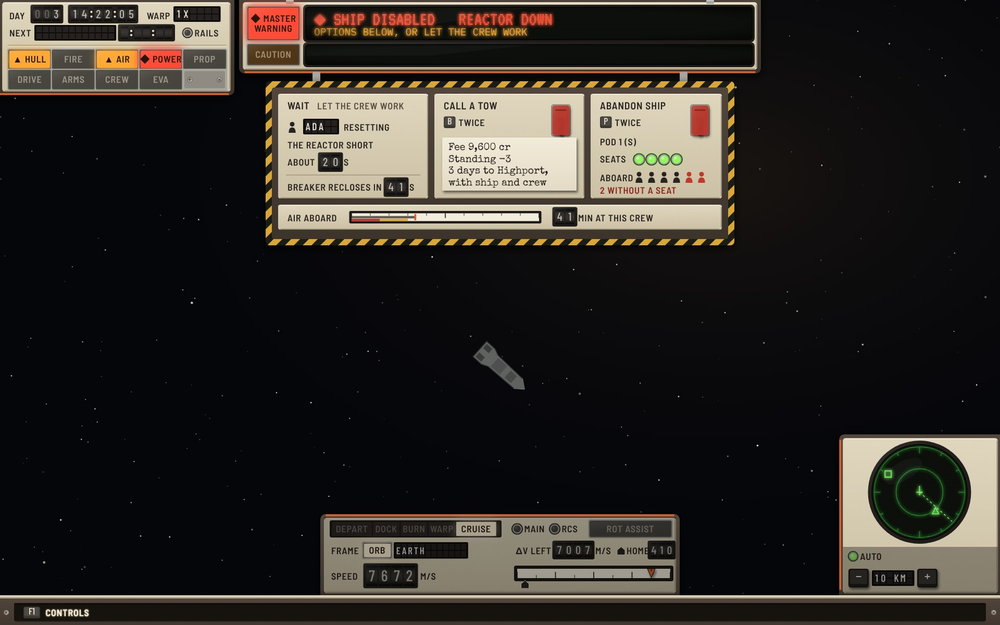
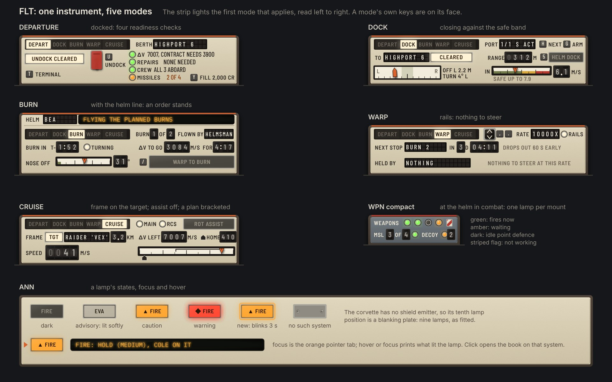

# Task-driven × Cassette-futurism

The **Task-driven** functional design ([functional-task.md](../../functional-task.md), round 3, branch `claude/project-thread-nfiuf0`) built in the **Yard Standard** design language ([style-cassette.md](../../style-cassette.md)).

**Status: round 1.** This round's critique and what changes next are at the end. The round log for all three Cassette variations is [cassette-round-log.md](../cassette-round-log.md).

The spec decides what is shown, where and when. This variation decides what each element is made of. Where the hardware needs something the spec doesn't say, or the spec asks for something hardware does badly, it is listed under [Adaptations](#adaptations) and was sent to the task designer.

## The idea: each post is its own fit

The task spec changes the HUD by post: on deck it is the ship around you, at the helm your motion, at the weapons the fight. In Cassette each post is a **fit**, a set of units in that post's own finish, and a few **repeaters** are the same everywhere:

- **The repeaters** are in yard enamel (beige). The master unit at top left carries the chronometer and the annunciator. The visor at top centre carries the alert band. The incoming rack at top right carries contracts and news. The **key sill** along the bottom edge is the hint line, and every bottom unit stands on it.
- **The helm fit** is yard enamel too: the flight pod (FLT) and the scope (SNS).
- **The gun fit** is blue-grey: the weapons panel (WPN), the target plate (TGT), the helm line (HLM) and the schematic (SCH). Taking the weapons seat swaps the bottom units, so the change of post is a change of hardware.
- **The captain's own kit** is avocado: the personal unit (PER) under the annunciator, shown on deck.
- **Screens** (map, terminal) are framed consoles that start 100 units down. Only the chronometer stays above them, as the spec says, and the visor when an alert stands.

The tenth annunciator position is a **blanking plate**. The starter corvette has no shield emitter, so the spec gives it nine lamps. The plate keeps the 2 × 5 grid fixed, so the lamps never move between ships.

## The screens

### 01 Helm at rest

The spec's at-rest test: the clock on two lines, nine dark lamps, FLT in CRUISE on three rows, the scope, and four keys plus F1 that fade. The frame is Highport, 3.0 km away, so the velocity markers are squares (a station frame). They would be circles in the orbit frame. The Δv scale has a **home bug**, a house-shaped index in ink, so it can't be read as the caution triangle.

### 02 Gunnery in combat

The raider is the player's own hull, refitted and darker. **MASTER WARNING** is lit. The warning row gives the missile count and impact time in large red, and the action with its keycap in amber (`F DECOY`). The caution row has two cautions, FIRE and CREW, each lit on the annunciator.

The **weapons panel** has one row per mount, point defence included:

- a trigger lens when the gun is in hand;
- the mount and the gun;
- who works it on flaps, with HAND in amber;
- a state lamp, or a barber flag when the mount isn't working;
- the state on flaps;
- the values: time of flight, tracks engaged, the launcher's rounds and its LOCK lamp.

The decoy row reads READY or a countdown, because decoys never run out. The **target plate** shows the hull estimate as a four-window strip with a pointer. FIRING ON YOU has its own red lens.

The **schematic** shows the fire in the Hold, the crew as dots with the captain ringed, and a hull hit flashing on the nose.

### 03 Deck in damage control

The deck view is drawn from the corvette's chassis data: the Hold aft, the Bridge forward, and the wall and door at x 8.

- A medium fire in the Hold has Cole on it.
- A conduit short in the Bridge has Ada on it.
- A breach in the starboard hull is venting, and its tag reads NOBODY in red.
- Each hazard is outlined in its tiles with a progress tag.
- The crew carry no names. The band names whoever works a hazard, and hover shows a name and job; the pointer is on Bea.

The captain stands at the weapons console, so the **prompt plate** reads `WEAPONS CONSOLE  E SIT`. The **personal unit** shows a light wound, the pressure suit's air on drums and the thin air in the Bridge. CREW is lit softly as an **advisory**, since the wound is under care.

Three cautions fit the caution row because each cell is sized to its text (Adaptation 3). The helm line stands on the sill, because Bea is flying.

### 04 Docked: the station terminal

The terminal is a console framed below the chronometer. Its parts:

- **Header plate:** the sponsor, standing, credits, the hold and contracts held, all on drums.
- **Tabs:** index tabs with their keys.
- **Offers:** an amber tube with soft keys under it for the sort.
- **Terms:** the selected offer's full terms are typed on a sheet. They read as a document, because they are one.
- **Take:** TAKE THE CONTRACT prints the sheet into the incoming rack.

The offers come from the game:

- an operation locked by rank;
- the bounty on the raider;
- the delivery of food to Freehold, with reach given as travel time and Δv from here.

### 05 The map with a late plan

The orbit canvas is a green tube. Words are amber, the hostile is red, and the apsides and the orbit's numbers are only here.

The right column has four cards:

- **MAP.1 Destination:** the destination as the target plate shows a station.
- **MAP.2 Plan:** Δv needed against left on drums and a scale with the plan bracketed and the home bug; arrival against the deadline; the **LATE lens**, amber, with by how much; the burns on a tube.
- **MAP.3 Fly it:** the three orders as push-lights, with the helmsman and the autopilot's READY lamp.
- **MAP.4 Selected burn:** its components on thumbwheel drums.

The **plan timeline** is a paper strip chart on a log scale. Late events fan out on leader lines, and the late stretch between the deadline and arrival is shaded red. Over the map the chronometer's NEXT window blanks, because the plan's times are the map's.

### 06 Crisis: the ship disabled

The visor carries the title and the reason (`SHIP DISABLED  REACTOR DOWN`). The **crisis placard** starts at what the crew is doing. It has three choices:

- **WAIT:** Ada resetting the reactor short, about 20 s, with the breaker's own reclose time.
- **CALL A TOW:** B twice, on a guarded switch, with its terms typed on a slip.
- **ABANDON SHIP:** P twice, on a guarded switch. Pod seats are lamps and the crew aboard are figures, with two without a seat in red.

Lifting the guard is the first press and throwing the switch the second, so the spec's "twice" is a guard standing open. Air aboard is a scale and a drum. FLT and the scope are browned out on battery. The sill shows only F1.

The two caution lamps (HULL, AIR) are lit, but the caution row is empty. They are older than 10 s, so the spec has them leave the band and live on as lamps.

### 07 Sheet: FLT's five modes, WPN compact, ANN states

**FLT** has one pod and a mode strip that reads like a gear indicator. Each mode keeps its own keys on its face:

- **DEPARTURE:** four readiness lamps, each with what is short and the key that fixes it, and UNDOCK on a guarded switch.
- **DOCK:** an alignment bar with the ship symbol, and closing speed on a banded scale with SAFE UP TO under it.
- **BURN:** the helm line above when an order stands, the TURNING lamp, and the nose-off scale with its tolerance.
- **WARP:** the rate on flaps and the , and . keys on a rocker.
- **CRUISE:** the frame on a lens and flaps, and the Δv scale with the plan bracketed and the home bug.

**WPN compact** is one lamp per mount: green fires now, amber waiting, dark idle point defence, and a striped flag for not working.

**ANN** has every lamp state:

- dark;
- advisory, lit softly;
- caution and warning, each with its glyph;
- new, which blinks for 3 s;
- the blanking plate.

Focus is an orange pointer tab, and hover prints what lit the lamp.

## The element kit

How each element of the spec is built.

| Spec element | Yard Standard object |
|---|---|
| CHR chronometer | The master unit's top: DAY and the time on drums, WARP on flaps, NEXT on flaps and drums. HELD is an amber lamp with the reason on flaps, replacing NEXT. RAILS is a lamp |
| ALR alert band | The visor: two windows, as section 9.1 allows. MASTER WARNING and CAUTION lenses at the left are lit by their row, and clicking either acknowledges the band. Warning row: the title large in red, the action in amber with reversed keycaps. Caution row: up to three cells, code in bold |
| OBJ objectives | The incoming rack: each contract a paper slip with its time left on drums and a four-letter state flap (blank, NAV, LATE, DONE). The navigation target's slip stands proud, and its second line is on flaps |
| NTF news | The telex strip under the rack, newest at the bottom, important lines in the red ribbon |
| ANN annunciator | Ten lamp tiles, 52 × 22, two rows of five. Dark, advisory (lit softly, no glyph), caution (amber, ▲), warning (red, ◆, glow), new (a ring, 3 s). A blanking plate where the ship lacks a system |
| PER personal | The avocado suit unit: health and suit on flaps, air on drums, the room and its air on flaps (amber when not breathable) |
| SCH schematic | A green vector tube in the lower-left unit: hull, rooms, hazards hatched or dashed, crew as dots, the captain ringed, hits as a red starburst |
| FLT flight | The flight pod, described under sheet 07. Guarded switch for UNDOCK, edgewise scales with bugs and brackets, alignment bar |
| HLM helm status | A name flap and an amber strip tube with the order. On deck and gunnery a pod of its own on the sill; at the helm FLT's first line |
| SNS scope | A round green tube in a square pod. AUTO lamp (green while it ranges on threats), the range on flaps between − and + keys, the hostile count on a drum |
| TGT target card | The target plate: name and class on flaps, relation on a lens with its glyph, state on flaps, FIRING ON YOU on a red lens, the hull band as a four-window strip with a pointer, range, closing and passes on drums, the contract on a paper tag |
| WPN weapons | The gun panel, described under sheet 02; compact, one lamp per mount, with missiles and decoy |
| HNT hint line | The key sill: a full-width chassis with keycaps and legends, four keys and F1. Fades at rest |
| INT prompt | An engraved plate beside the object, with keycaps |
| OVL overlays | The reflector-sight projection: amber, threats red. Velocity markers are circles in the orbit frame and squares in a station or target frame. Lead reticle, missile tracks dashed red with chevrons, deck hazards outlined in their tiles with progress tags |
| CRS crisis | The hazard-striped placard under the visor; press-twice choices on guarded switches; terms typed on slips |
| MAP | A console: the canvas on a green tube, layer toggles on a plate, four cards, the timeline on paper |
| TRM terminal | A console: header plate on drums, index tabs with keys, an amber tube with soft keys, a typed terms sheet |

## Adaptations

Places where the hardware changes the spec's geometry or behaviour. These went to the task designer as round 1 notes.

1. **The key sill uses the margin.** Z9's legend window is the spec's 24 units (y 772 to 796). The chassis around it fills the margin from 762 to 800, so every bottom unit can stand on it. No zone loses space.
2. **The visor is 668 × 94**, against Z2's 560 × 76, because it carries the two master lenses. That is within the quarter the spec allows.
3. **Caution cells are sized to their text** when the three fit at 13 units, and are equal cells cut with an ellipsis when they don't.
4. **OBJ's state is a flap**, blank when normal, not a highlight.
5. **A mount that isn't working shows a barber flag** in place of its lamp, as instruments show an OFF flag.
6. **The home marker is a bug, not a triangle.** The triangle is the caution glyph.
7. **Drums carry no thousands separator** (7007). Text keeps the spec's formats.
8. **The tenth lamp position is a blanking plate**, so the grid never moves.
9. **A name longer than its flap is cut in the last cell** with an ellipsis, and never wraps, as section 12 asks.

## Round 1 critique

What this round got wrong or left weak, in the style and in the combination.

**Style**

- **Unlit push-lights read as disabled.** MAP.3's three orders and WARP TO BURN are dark keys with grey legends, which look greyed out, but they are available. Round 2: an unlit push-light gets a black legend on its milky lens. Unavailable gets the barber flag and its reason on the card, which the spec requires ("greyed with its reason").
- **The burn markers on the map are hollow triangles**, the same shape as neutral traffic on the same tube, and close to the caution glyph. The handle and the colour tell them apart, but shape should do it alone. Round 2: burns become chevrons.
- **The brown-out on the crisis sheet is only a darkening.** A reader can miss that FLT and the scope are on battery. Round 2: the tubes drop to half brightness and a BATT lamp lights on each pod.
- **Most flaps are cut to fit the samples**, so long names show the ellipsis rule rather than the 1.5× rule. TGT and MAP.1 were widened this round, because the game's real names ("Selene Mining Combine", "Void Raiders") are longer than the spec's samples. Round 2 checks every flap against its longest name in the data.
- **Not drawn yet:**
  - the relation classes as a set (only hostile and neutral appear);
  - pressed and unavailable states beyond the lamps;
  - a colour-blind check of the green and amber map tube;
  - the book, the boarding panel and the console panel;
  - keyboard focus beyond the annunciator.

  Round 2 draws the relation set and the book.

**Fixed during the round**

- The incoming rack's state lens was a blank grey box while the contract was normal. It is a split-flap now, blank by default, as the NEXT window is.
- Three cautions were cut ("POWER BRIDGE SHORT, A…"). Cells are now sized to their text.
- The home marker was an orange triangle that read as a caution. It is an ink bug now.
- The deck labelled every crew figure, but the spec gives names on hover only. The figures are bare now, with one hover card drawn.
- The map had no orbit numbers, though the spec makes it their only home. The apsides are ticked on the path, and the altitude and period are in the corner.
- DEPARTURE read CREW 6 OF 6. The game starts with three crew, so it reads ALL 3 ABOARD.
- The game data corrected three samples. The raider's owner is the Void Raiders. Shackleton Ice's owner is the Selene Mining Combine, and it has Selene's shipyard and a hiring pool, so all five service lamps are lit.

**Combination (sent to the designer)**

1. WARP repeats CHR: the rate and the next stop show in both at once.
2. BURN repeats HLM. HLM's "next in 1:52" repeats BURN's countdown, and BURN's "flown by" repeats HLM whenever a helmsman flies.
3. The flight-modes wireframe shows BURN's "end Ap" (the apsides are map-only) and CRUISE's "41 m/s closing" (closing is TGT's).
4. Crisis keys: section 8 says the crisis hint line carries them, but HNT says CRS's own keys never repeat there. Cassette drew F1 only.
5. An alert's action key repeats in HNT: "F decoy" at gunnery is in both. On deck, INT's "E sit" repeats HNT's E and V.
6. Caution room: three cautions at 13 units get about 22 characters each, and the samples run to 50. They need a short form (code, room, who) with the full text on hover and in the book.
7. DEPARTURE's "crew aboard against berths": berths are a capacity. The corvette has 8 berths and 3 crew, so the check never reads ok. It wants the roster aboard, or roles filled.
8. "Bo" in the FIRE samples isn't a crew name the game gives.
9. The gunnery wireframe's "missile path, 14 s" repeats the band's impact time in the world.

## Files

- `mockups.html`: the seven sheets, drawn with the shared kit in `../../cassette/kit.js`.
- Render: `NODE_PATH=$(npm root -g) node ../../cassette/render.js mockups.html 1.5 jpeg`.
