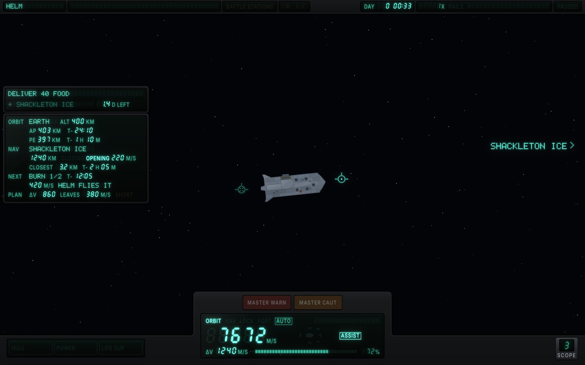
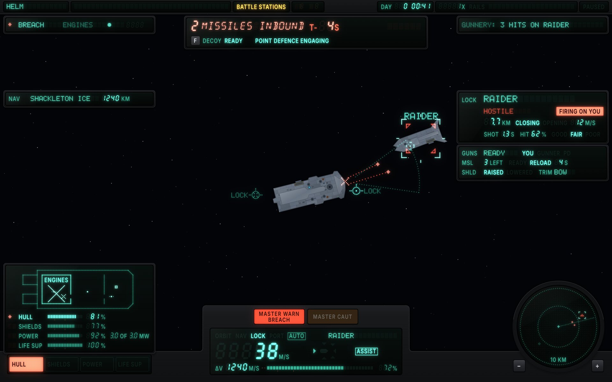
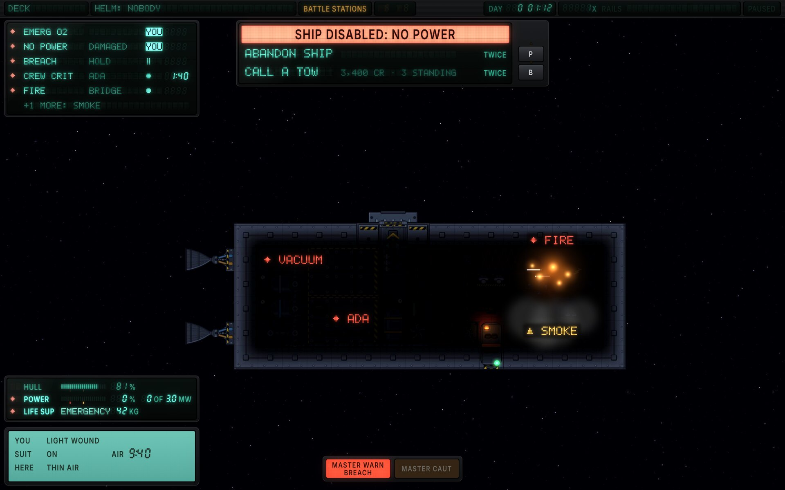
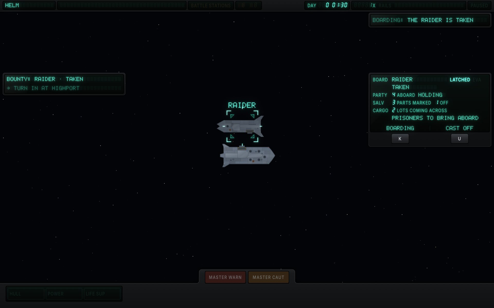
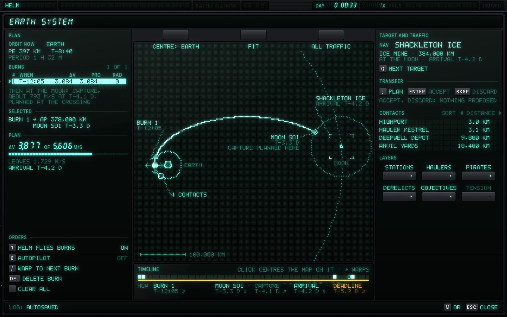
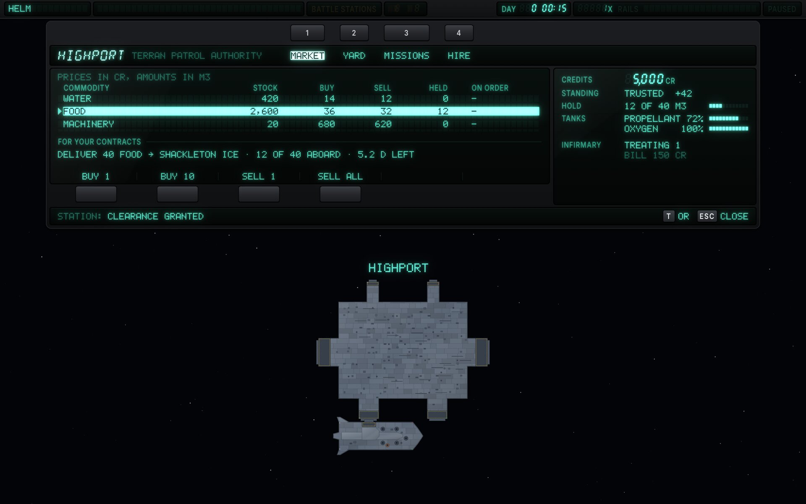
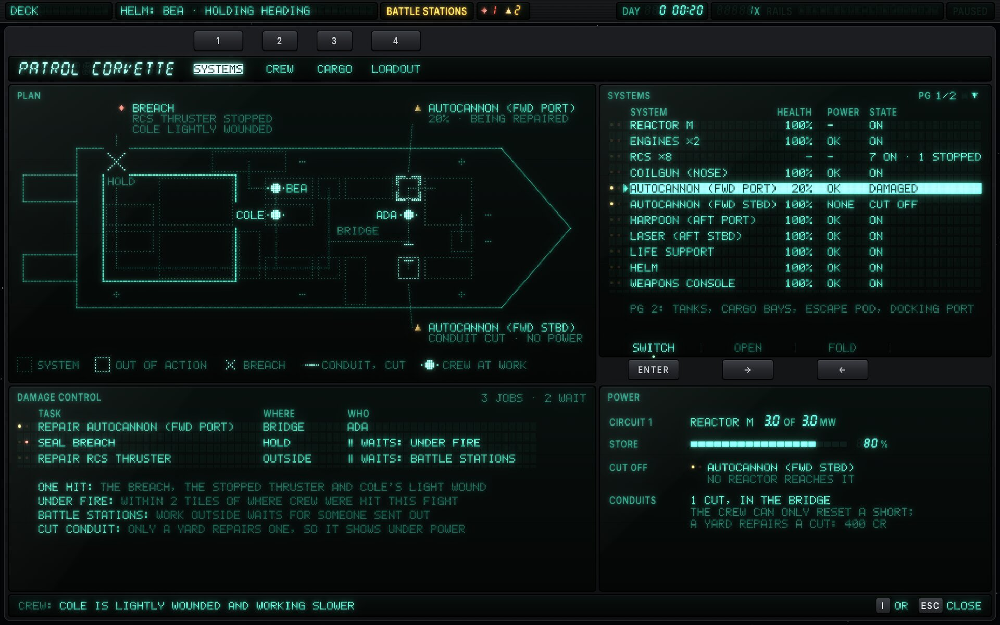
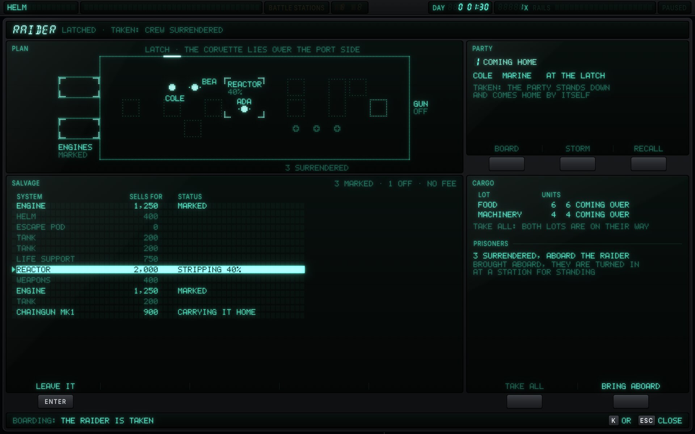
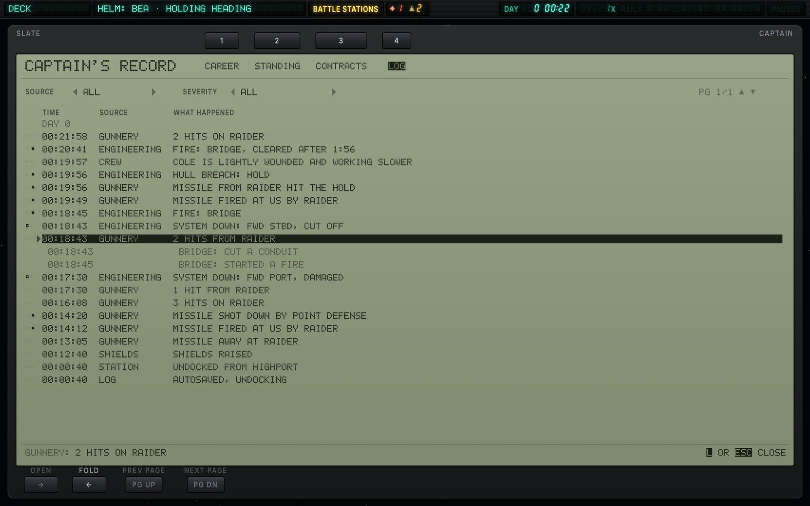
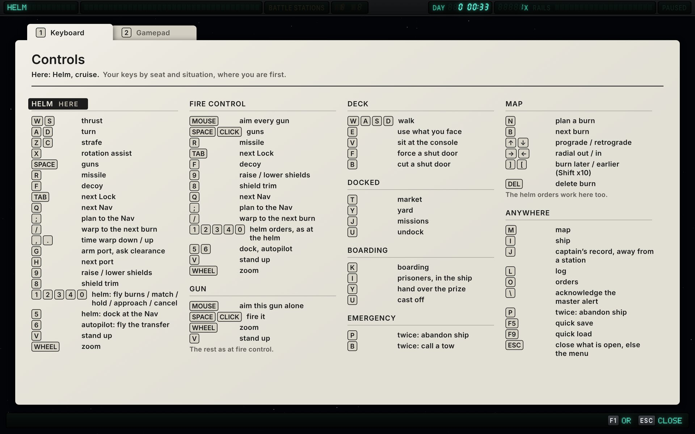

# FILAMENT × Context-driven

The context-driven functional design (`functional-context.md`, version 17) built in the FILAMENT style ([`style-vfd.md`](../style-vfd.md)). The spec decides what each widget shows, where and when; this page records how FILAMENT builds it, what the style changes beyond the look, and the critique of each round.

Mockups are drawn by [`vfd/src/context.js`](../vfd/src/context.js) over the game's hull art and a real deck capture; `vfd/src/export.sh` re-renders them.

## Screens

**11.1 Helm, cruise.** About ten lines of text: the status strip; the objective; navigation (the orbit now; the Nav, Shackleton Ice, 384,000 km off at the Moon with its arrival; burn 1 of 1, which the helm flies; the plan's Δv and what it leaves, `SHORT` dark); the flight tower with its master lamps dark on the shelf; three dark ship lights. The scope is open at its 5 km step, the smallest that holds Highport, which the ship has just left, and the Hauler Kestrel, both 3 km off.

**11.4 Helm, combat.** A gunship (it has a shield emitter, which the starter corvette lacks) under fire: a raider 3.4 km off has fired two missiles, now about halfway and 4 s out under a harpoon's burn, and holed the ENGINES room. P3 powers up behind red glass with the decoy and point defense; the lock card and armament fill the right, and the scope opens at its 5 km step; the ship-condition face has risen over its lights because the hull light is lit, the plan showing the breach; `MASTER WARN` on the tower's shelf carries the breach. H2 keeps the Nav, Shackleton Ice at 384,000 km, and H1 has the gunship's Δv, 6,831 m/s.

**11.7 Deck, emergency.** The corvette disabled, its reactor damaged and its hold airless. The emergency card offers the two ways out with their presses and costs; P2 lists, in order, what needs the captain (emergency oxygen, the power, both `YOU`), what is held (the hold's open breach, `‖`: the crew keep clear of where crew were hit; D3's tag marks its vacuum), what the crew are on (Ada's bleed-out, 1:40 and under the two minutes that send the crew in anyway, and the fire, a dot each) and `+1 MORE: SMOKE`; each hazard in view carries a tag; the captain's own kit is LCD; the master lamps stand alone at the bottom centre. The strip is on the dimmer bus.

**11.13 Boarding, latched.** The fight is over and the ship is latched to the beaten raider. The flight instruments have sunk into the rack and only the shelf with the master lamps stands proud; X2 names the raider, its state and the party (Cole alone, coming home now the raider is taken), with its two keys under the glass; the objective has the bounty's next step.

The full-screen modes (spec section 10) are built in the mode frame of the guide's section 18.2: a terminal across the screen with its title strip, its tabs as keys in the bezel over the strip, its panes, and a foot strip with the feed and the closing keys. The captain's record is the captain's own book, so it is a slate (18.4), and the controls are the printed card (18.6); each keeps the frame's title row with its tabs and its foot row.

**11.9 Map (M1).** The plan to Shackleton Ice at the moment of 11.1. The Plan pane at the left: the orbit now, burn 1 in the burns list with the capture still to come as an estimate, the selected burn's result, the plan's Δv against what is left, and the orders on their keys (the map has no tabs, so 1 and 6 keep the helm orders). Target and traffic at the right: the Nav card, the transfer keys with nothing proposed, the contacts by distance, the layer keys with their LEDs, tension off. The view keys sit in the bezel over the plot and the timeline under it, run to the contract's deadline with the capture a hollow cell. The plot draws Earth and the orbit now larger than the scale (at it, the orbit would lie inside the disc), and the Moon twice, as the game draws a body the plan meets: where it is now, 54° back along its orbit with the Nav's brackets on Shackleton Ice, and as the ghost the leg runs into, its outline and sphere where the Moon will be at the closest approach, labelled with that time. The leg is solid to the ghost's sphere and no further, and the traffic near the ship is one cluster label; each label keeps its ground and leaves on a leader that never crosses its text.

**11.10 Station (M3).** Docked at Highport, M3 is a terminal 1,120 wide over the docked view, as tall as its tab: the tab keys 1 to 4 in the bezel (Highport has no shipyard), the Market's three rows with food focused and nothing on order, the delivery this market can supply under the table (12 of 40 food aboard, so 28 more fill the hold), the trade keys acting on the focused row, and the rail: credits, standing, the hold, the tanks and the infirmary's bill. T closes it from the Market.

**11.11 Ship, systems (M2).** Battle stations aboard the patrol corvette, Systems showing. The plan draws every system where the corvette's chassis mounts it, with its conduits, RCS blocks and crew. One hit wrecked the hull tile under the hold's port-aft RCS quad: a wrecked hull tile is a breach, and a block stops while its tile is down, so the breach, the stopped thruster and Cole's light wound are the one hit, and the breach's callout names all three. The FWD PORT autocannon is out of action at 20% with Ada repairing it, and the FWD STBD one is cut off, its conduit broken in its tile. What is wrong is called out with its severity glyph, the gun in the list's focus is bracketed, and the plan's key runs along its foot. The list pages at eleven rows with the guns' amber pips and a dash where the game has no value. Every system has its switch, and the keys act on the focused row: `SWITCH` (Enter), its LED green while that system is on, and `OPEN` (→) and `FOLD` (←), which list a group's members under its row, each with its own switch, and put them away, so on a single gun's row both are dim. On the reactor's row `SWITCH` is guarded as 7.7's keys are: the first press sets its LED blinking amber and the second switches. The RCS blocks are not systems, so on their row `SWITCH` is dim. Damage control lists the three jobs with who has each or why it waits (`‖`), and its notes say what the hit did, what each wait means and why the cut conduit is not on the board; Power gives the reactor against its rating, the store, what no reactor reaches and the yard's price for the cut. The feed is the game's wound notice.

**M4 Boarding (10.4).** The raider taken, the mode open on it. Its plan is a graphic dot panel: the corvette latched over its port side, the parts marked for stripping in brackets (both engines marked, the reactor 40% stripped with Ada at work on it), the gun's place dotted since it is off and Bea is carrying it home, Cole at the latch, and the three who surrendered, hollow. Beside it the party, coming home, with board, storm and recall kept in their places as dim keys; under it the salvage list in the game's order with what each part sells for and its state, and the cargo coming over with the prisoners to bring aboard.

**M5 Captain's record (10.5).** A slate across the screen in the mode's frame: its tab keys in the housing over the glass's title row, the feed and the closing keys in the glass's last row. The Log is showing, two minutes after M2: the record so far, newest first, under its two filters (one source or all, and a severity threshold, each a value between ◀ and ▶ stepped with ← and →). With the messages are the Log-only rows, each under the source of what it is about and at its row's severity: the conditions P2 raised and cleared, in the catalogue's long form (`FIRE: BRIDGE`, then `FIRE: BRIDGE, CLEARED AFTER 1:56`), each missile P3 counted, when it was fired at the ship and how it ended (shot down by point defense, or into the HOLD), and the hits the ship took from guns. Merged gunnery lines are kept, each at its first event's time, and the one in focus is open to where each hit landed and what it did: the two in the BRIDGE that cut the FWD STBD autocannon's conduit and started the fire. The list pages rather than scrolls, as every FILAMENT list does: ↑ and ↓ move the focus, Page Up, Page Down and the wheel turn the page, and → and ← open and fold a merged line.

**M6 Controls (10.6).** The F1 card as the mode: Keyboard and Gamepad are index tabs printed along its top edge, each with its number, Keyboard in front. P1 above and the mode's foot strip stay on the glass, since a card can't show what is live. The sections are the seats and situations in P1's order, the captain's own first (`HERE`, and "Here: Helm, cruise" under the title): helm, fire control, the gun seat with its own section (the pointer aims that gun alone, Space or a click fires it, the rest as at fire control), deck, docked, boarding, emergency, the map and anywhere. The keys are the game's with the design's new ones: O for the orders menu, which the deck lights give up to Settings; `\` to acknowledge; the modes' keys. The Lock and the Nav are named apart.

## How it is built

| Spec widget | FILAMENT part |
|---|---|
| P1 status strip | A thin rack across the top: the seat as fixed legends with the one in use lit; helm authority in dot matrix; `BATTLE STATIONS` behind amber; the full-screen chip, which is the master alert cue while a full-screen mode is open; clock and warp in seven segments; `PAUSED` |
| P2 caution and warning | A slab in L-TOP, six rows of fixed fields: severity in two filtered pip columns, the code (11 cells), a cell's space, the detail at L1 (10), handling in 3 cells (`YOU` inverse; `‖` for held; a dot per crew member up to three, from four a dot and the count; or `BACK` and the recovery time across handling and timer), and the timer in seven segments. The sixth row is `+n MORE:` with the codes that fit |
| P3 threat | A slab: the count, `MISSILES INBOUND` and the soonest impact on one line behind red glass; the decoy behind its key cap and point defense's state below |
| P4 message feed | A slab of dot-matrix lines, speaker at L1 |
| P5 objective | A slab of two lines: the job, then where and the time left in seven segments with an inline unit |
| H1 flight display | The tower of the bottom rack: frame legends with `AUTO` and the frame's name, speed in large seven segments, six thrust lamps around a hull glyph, `ASSIST`, Δv with the propellant bar. The prograde and retrograde markers carry the frame's tag in the world, on the side away from the ship |
| Master alert cue | Two lamp keys: `MASTER WARN` with the newest warning's code, `MASTER CAUT`; a press acknowledges. On the tower's shelf at the helm; on deck, docked or latched, on a plate of their own at the bottom centre |
| H2 navigation | A slab of labelled rows: labels legends at L1, words dot matrix, numbers seven segments with legend units and thousands commas; for a Nav around another body, the body and the arrival on the rows closing and the closest approach would take; `SHORT` behind amber |
| H4 ship condition | Compact face: a lamp cell per light on the rack's left wing (hardware, always there; three on a hull with no shield emitter). Expanded face: a slab above them with the ship's own plan on a graphic dot panel and a row per light, pips leading. POWER gives the store and the reactors' output; `OF` and the rating stay dark glass in their place until damage holds the output under it |
| H5 contact scope | Collapsed: a key on the right wing with the count beyond 50 km. Open: a round pod with a plotting scope at the smallest step that holds every contact inside 50 km, and its zoom keys |
| H6, H7 lock and armament | Slabs in R-MID. H6: the state in one word (`HOSTILE` behind red), `FIRING ON YOU` as its own red flag, range with closing or opening, time of flight and hit chance with its word. H7: guns, missiles (left across every launcher, in two seven-segment cells, and ready while any launcher can fire or the second until one can) and shields as rows of fixed state words |
| X2 boarding | A slab where the station panel would be: six rows of glass (the target with `LATCHED` or `EVA`, its state, the party, salvage, cargo, prisoners), then two keys under the glass printed with their key and action, `K  BOARDING` and `U  CAST OFF`, as the station board's keys are |
| X3 emergency | A slab under P3 headed by a red bar with the state cut out of it; each way out on its own row with its cost, its key on the bezel beside it with an LED that blinks while the first press holds |
| D1 captain vitals | Reflective LCD, backlit while it warns |
| D3 hazards | Projected tags on each hazard in view (red `♦` warning, amber `▲` caution); edge pointers for the rest |
| Mode frame (10) | A terminal across the screen (guide 18.2): the title in fourteen segments with a dim subtitle; the tabs as keys in the bezel over the title strip, each tab's name in the strip under its key and its number on the cap, the tab showing inverse; panes of glass; a foot strip with the one-line feed and `[key] OR [ESC] CLOSE` |
| M1 map | The Plan pane (320) and Target and traffic (320) at the sides; the plot between them, a graphic dot panel with the guide's line rules (18.3), the Moon drawn now and as the ghost the leg meets, and its view keys in the bezel over it; the timeline pane under it, 90 tall. Orders, transfer keys and layer toggles are fixed keys, an order the plan can't take a dim label |
| M3 station | A terminal 1,120 wide over the docked view: the Market a cell grid (commodity, stock, buy, sell, held, on order) with the focused row inverse across it and the trade keys under it acting on that row; the held deliveries under the table; the rail a column of glass with credits in seven segments, standing, and the hold and tanks with their bars |
| M2 ship | The plan on a dot panel at pitch 2 (guide 18.3): systems as boxes where the chassis mounts them, solid when out of action; conduits as a fine chain, a cut one broken; the breach an X on its hull tile; the crew as blocks with their names; callouts with their severity glyphs, and a printed key. The systems list is a paged cell grid with severity pips and one key on the focused row; damage control a cell grid with pips and the reasons a job waits; power in legends, seven segments and a bar |
| M5 captain's record | A slate across the screen in the mode's frame (guide 18.4): the tab keys in the housing over the glass's title row, the title in large dot matrix; the Log a paged LCD cell grid of severity squares, time, source and what happened, a merged line opening under its row; the filters as choices at the top; the feed and the closing keys, inverse cells, in the glass's last row; open, fold and the page keys under the glass |
| M6 controls | The printed card (guide 18.6) with its tabs as index tabs, the sections in four columns with the captain's own first and tagged `HERE`; P1 and the foot strip on the glass |
| M4 boarding | The other ship's plan on a dot panel (its hull, rooms, systems as faint boxes, marked parts in brackets, our crew as blocks with their names, prisoners hollow), the party pane with its three orders, the salvage list as a cell grid, and the cargo and prisoners with their keys |

## What FILAMENT changes beyond the look

- **Two racks, not a floating set.** P1 is a thin rack along the top and the seat's instruments sit in a rack along the bottom with H1 as a tower in the middle. Everything conditional is a slab that powers up in its zone's slot and is gone when empty.
- **Retired instruments sink.** Docked or latched, H1's tower sinks into the rack and its master-lamp shelf stays proud: the cue never moves and never vanishes.
- **H4's compact face is hardware.** The lights are lamp cells on the rack, always present; the expanded face is a slab that rises above them. The player never loses the lights' positions.
- **The emergency spotlight is the dimmer.** While X3 shows, everything the spec dims is on the dimmer bus at 45%; P2, P3, H4, D1, D3 and the master lamps stay at full drive.

## Round 1 critique (resolved in round 2)

1. **Type below the minimums.** Every slab re-laid at the guide's round-2 minimums and the spec's 12-unit labels; content cut by priority where it no longer fit.
2. **H6's state row didn't survive the size fix.** The state is one dot-matrix word and `FIRING ON YOU` its own flag (the spec made the same change in version 3).
3. **The H4 plan was generic.** It is the ship's own deck plan on the dot grid.
4. **P3 was mostly empty glass.** P3 is two lines now (the spec's version 3), and the ghost cells are its capacity.

## Round 2 critique

The mockups were rebuilt against version 4: P2's fixed-field rows with handling and timers, P3 on two lines, the boarding screen, the master cue on the shelf or standing alone, on-screen hazard tags, the gunship in combat and the corvette everywhere else.

1. **The retrograde marker's frame tag crossed the hull** (`LOCK` over the stern). *Fixed:* a frame tag reads on the side away from the ship; the guide's marker table says so.
2. **Sample data the game doesn't have.** P5 delivered 120 water to Shackleton Ice: an ice mine produces water and buys food and machinery (`economy.json`), and the corvette's hold takes 40 units of food. P3 counted 37 s to impact from 7.7 km, but a harpoon (60 kN on 400 kg) or a dart crosses that in under 10 s. *Fixed in the mockups:* `DELIVER 40 FOOD`, and `T-4 S` with the missiles a third of the way in.
3. **Kept:** the master lamps on deck stand alone at the bottom centre with nothing around them. That is the spec's point (the cue never moves), and the plate keeps them hardware.

No meaningful criticism of the visual build remains open. The notes below are functional.

## Round 3

Version 5 took all four round-2 notes: X2 has seven rows with the state on its own; X3 waits while power is due back by itself, and 11.7's reactor is now damaged, so `NO POWER  DAMAGED  YOU` sits third in P2, after the vacuum; the master alert cue stays lit under X3; the delivery is 40 food and P3 reads `T-4 S`. The mockups follow: P2 reordered, X2's state row reads `TAKEN: CREW SURRENDERED`.

One fix from this round's check of version 5: X2 with its soft-key row was 182 units tall against the zone's 150 (the spec allows 10%). Its keys now carry their actions printed on them, under the glass, as the station board's do, so the slab is 155.

Nothing meaningful remains to criticise, visually or functionally: this variation has converged. It reopens if the spec changes something visible.

## Round 4

Version 6 (the NASA-punk direction's round-2 notes) changes five things on FILAMENT's screens:

1. **P2's code field is 11 cells and handling 3**, so codes read as whole words (`SHIELD WEAK`, `O2 LOW`). The row keeps its width; the detail moves right so a full code still has a cell of space after it, and `BACK 0:12` still spans handling and timer. A test row (`SHIELD WEAK  STERN  ●5`) checked the widest case.
2. **11.4's numbers.** The lock is at 3.4 km, closing 85 m/s, a 2.1 s shot at 62%; H7 shows 4 missiles left and ready (a launcher throws one a second). The example `T-4 S` stays, so the missiles are drawn where a harpoon under its 30 m/s² burn is 4 s from impact: 1.6 km out, about halfway from the raider. H5 opens at the new 5 km step.
3. **The corvette's three crew.** 11.7's fire has one dot (Bea alone); X2's party is two.
4. **Point defense** is printed the game's way: `POINT DEFENSE ENGAGING`.
5. Already as drawn: the latched raider over the port side, nose aft; no context screen draws a burn arrow, so W3's dropped countdown changes nothing.

No meaningful criticism of the visual build remains; the notes below are functional.

## Round 5

Version 7 took both round-3 notes. Point defense is spelled the game's way, as FILAMENT already printed it. H7's missile row is the total across every launcher, ready while any can fire, so 11.4's gunship reads `MSL 7 LEFT READY` (F2 keeps the split, 3 and 4). Checking the row as a total found its count one seven-segment cell wide; a total can pass 9 (a dart rack alone holds 6), so it now has two, the tens a ghost until needed.

Nothing meaningful remains to criticise, visually or functionally: this variation has converged. It reopens if the spec changes something visible.

## Round 6

Version 8 (the Cassette and NASA-punk directions' notes) changes four things on FILAMENT's screens:

1. **The kiter's numbers.** 11.4's raider holds its range, moving along the line of sight: H6 reads `CLOSING 12 M/S` and `SHOT 2.2 S`. H1's speed in the LOCK frame is the speed relative to the raider, so it reads 12 too (the spec's wireframe still has 38, F1's figure before version 8; a note went to the designer). Closing straight in, the LOCK-frame prograde marker points at the raider; FILAMENT's sat 23° off that line, nudged clear of the missiles, so it now sits on the line and the missiles swing in just below it, as harpoons thrown from a flank launcher do.
2. **H4's power row** gives the store and the output, `92 % 3.0 MW`; `OF` and the rating stay dark glass in their place until damage holds the output under it, as in 11.7, where the dead reactor reads `0 OF 3.0 MW`.
3. **The lead reticle sits on the target** (W5): the lead is tens of metres at fight ranges, 26 m here, 2 units at this zoom. Drawn there first, its dots read as the raider's own lights, so the world view now dims a soft disc under it, as the deck view does under a tag (guide section 8). The stations and task sheets had the same fault the other way: their reticles sat 200 to 500 m of lead off their targets. All three now sit on the target.
4. **Values at 15** (12.4): FILAMENT's values were already seven segments 12 tall or more, taller than a 15-unit typeface's cap; the guide now says so (section 15).

The approach, docked, fire-control and station changes (port 2, `T-19 s`, the hire line, F4's shooters, the cue above the rack) are on screens FILAMENT doesn't mock.

No meaningful criticism of the visual build remains; the notes below are functional.

## Round 7

Version 9 took both round-4 notes: H6's example closes at 12 m/s with a 2.2 s shot, and wireframe 04's H1 reads 12 m/s in the LOCK frame, since 11.4 and 11.5 are the same fight three seconds apart. Both are as FILAMENT drew them, so no screen changed.

Nothing meaningful remains to criticise, visually or functionally: this variation has converged. It reopens if the spec changes something visible.

## Round 8

Versions 10 to 13 (the other directions' notes, checked against the game's geography, ships and crews) change the four HUD screens and design the modes FILAMENT now draws.

1. **11.1's numbers.** Shackleton Ice orbits the Moon, so the Nav is 384,000 km off and H2 names the body and the arrival (T-4.2 d) in place of closing and the closest approach; burn 1 of 1 is at T-12:05 for 3,084 m/s, flown by the helm; the plan's 3,877 m/s leaves 1,729. H1's Δv is 5,606 (6,831 on 11.4's gunship). Figures this long needed a thousands comma in seven segments: it lights at the foot of the digit before it, as a decimal point does, and takes no cell, so every field keeps its width (guide 5.1). Every FILAMENT sheet now carries it.
2. **H5's cruise range** is the smallest step that holds every contact inside 50 km: 5 km in 11.1, with Highport and the Hauler Kestrel 3 km off. At the fixed 50 km, Highport had sat under the own-ship mark.
3. **P2's Held.** The fourth handling state is `‖` in the handling cells; 11.7's rows follow wireframe 07, the vacuum held and Ada's bleed-out under the two minutes that send the crew in anyway.
4. **X2's party** is the ship's marines, Cole alone, coming home once the raider is taken.
5. **The modes.** M1 (11.9), M3 (11.10) and M4 are drawn, in the mode frame. Version 13's one change is in wireframe 11, M2's systems tab, which FILAMENT draws next.

The guide gained section 18, the screens beyond the flight HUD: the four housings, the terminal and the mode frame, the plot's line and label rules, the slate, setup mode and the cards.

## Round 9

Version 14 took both round-5 notes. M1 draws the Moon twice, as the game does, the ghost 54° along the Moon's orbit at the closest approach (T-4.1 d); the plot now runs anticlockwise, the leg under Earth to the ghost's sphere, as the wireframe has it. The Nav card already followed H2's rule. M2's systems tab (wireframe 11, version 13) is drawn: drawing its plan from the corvette's own mounts, conduits and RCS blocks turned up one note, and the list's switches a second (round 6, below).

The guide gained the ship's plan (18.3) and a wider fourteen-segment field for a screen's title, up to 16 cells (5.2): `PATROL CORVETTE` is 15.

## Round 10

Version 15 took both round-6 notes: 11.11's stopped RCS quad, the HOLD's breach and Cole's light wound are one hit on one hull tile, and every system takes the switch, a group's row switching the group and the reactor's guarded. M2 is redrawn for them: the breach's callout names Cole's wound; the board's notes give the hit, the two waits and why a cut conduit shows under Power; the feed is the game's wound notice (`CrewMedical`); and `OPEN` and `FOLD` sit beside `SWITCH` for a group's members. Checking version 15 against the game found nothing more: the RCS blocks belong to the ship's grid, not its systems (`ShipGridComponent.rcsThrusters`), and sealing the breach leaves the quad stopped until the repair outside frames its tile again, as 11.11 now says.

Version 16 gave the Log a fight's record and the gun seat its own controls, so the last two modes are drawn: M5 on the slate with the Log showing, and M6 as the card with its tabs. Every screen the spec has is now drawn. Drawing the Log turned up one note (round 7, below), which version 17 took, filing a condition's row by what it is about much as FILAMENT had. Version 17 also writes the Log's conditions in the catalogue's long form, adds the hits the ship takes from guns as merged lines, makes the severity filter a threshold, and shows a room's air as one P2 row at a time, so 11.7's row and master cue read `BREACH` for the open hold (D3's tag still marks the vacuum where people walk into it). M5 and 11.7 are redrawn for them. Converged.

The guide gained the slate and the card as modes (18.4, 18.6) and a group's row with `OPEN` and `FOLD` (18.2).

## Functional notes sent to the context designer

Round 1 (all answered by version 3): keep P2 lit under X3, decoys have no stock, shields as a share, on-screen hazard tags for D3, states as one word.

Round 2 (all taken in version 5):

1. **X2's state line overflows.** Its worst case (the target, `LATCHED`, the party's activity and the salvage) runs past 34 characters at 12.4's sizes. FILAMENT gives the party, salvage and cargo a row each (seven rows). Suggest the spec size X2 for that.
2. **X3 offers costly exits while power is coming back.** In 11.7 P2 says power is back in 12 s while X3 offers abandon ship and a 3,400 cr tow. Suggest X3 wait while a recovery timer runs, or show the time beside the choices.
3. **Keep the master cue lit under X3.** The dim list doesn't name it, and on deck it stands alone and is the acknowledge control.
4. **Sample data.** "Deliver 120 Water → Shackleton Ice": an ice mine sells water and buys food and machinery, and a delivery posted to the corvette is at most 40 units (`ContractPostings` caps it by the hold). P3's "T-37 s" at 7.7 km: harpoons and darts arrive in under 10 s (`weapons.toml`); the stations design corrected the same number in its round 6.

Round 3 (after version 6; both taken in version 7):

1. **Point defense, as the game spells it.** The game writes `point_defense`, and the stations and task specs now spell it that way; version 6 still has "point defence" (P3's line, F2, H7). FILAMENT prints `POINT DEFENSE ENGAGING`. Suggest the spec follow the game, so the three designs share one string.
2. **H7's missile row on a hull with two launchers.** The gunship has two (AFT PORT and AFT STBD), and F2's sample has them at 3 and 4 left, while 11.4's H7 reads "4 left · ready". Suggest H7 say whether its row is the total across launchers (7) and ready when any launcher is, or one row per launcher.

Round 4 (after version 8; both taken in version 9):

1. **H6's sample block.** H6's example still reads "closing 85 m/s" and "shot 2.1 s", while 11.4's wireframe and F1 read 12 m/s and 2.2 s, and W5 says pilots close at 80 m/s at most. Suggest the block follow.
2. **H1's speed in 11.4.** The wireframe's H1 reads 38 m/s in the LOCK frame, F1's relative speed before version 8. With the kiter moving along the line of sight at 12 m/s, H1 would read 12, as FILAMENT draws it. Suggest the wireframe follow, unless 11.4 is meant as a different moment from 11.5.

Round 5 (after version 13; both taken in version 14):

1. **M1's ghost.** The game's map draws the Moon where it is now and, where the leg meets its sphere, a ghost: the Moon's outline and sphere where it will be by then (`MapPainter.ghost`, the Centre key's encounter). At T-3.3 d that is about 43° further along its orbit, and the Nav's brackets stay on Shackleton Ice where it is now. Wireframe 09 draws one Moon, at the meeting, and FILAMENT follows it. Suggest the wireframe show both, or the text say which one the plot shows.
2. **M1's Nav card.** 10.1's table gives it a closest approach; for a Nav around another body, wireframe 09 gives the body and the arrival, as H2 does since version 10. Suggest the table say so.

Round 6 (after version 14; both taken in version 15):

1. **The stopped RCS block is on the breach.** The game stops a block only while the hull tile it is bolted to is wrecked (`RcsThruster.fieldRepairable`), and a wrecked hull tile beside the interior is a breach (`Tile.isHullBreach`, the `SealBreachTask` the scan posts). Every block on the corvette stands on such a tile, so 11.11's one stopped block puts a breach on its tile, and with the only breach in the HOLD, the block is one of the hold's two aft quads. FILAMENT draws the port one: one hit made the breach, stopped the quad and wounded Cole, and its two jobs are the seal from inside and the thruster's repair outside. Suggest 11.11's text say so, or the sample's breach move to where it can't stop a block.
2. **Which systems have a switch.** Wireframe 11 gives `[off]` to the reactor and the coilgun only; the game lets every system be switched off (`SubsystemComponent.switchedOn`, `ConsoleWindow`'s switch). FILAMENT has one `SWITCH` key on the focused row, its LED lit while that system is on. Suggest 10.2 say which systems take the switch: all, as the game has it, or a subset and why.

Round 7 (after version 16; taken in version 17):

1. **The source of a Log-only row.** The Log filters by source, but P2's conditions and P3's missiles are not notices, and neither 10.5 nor P4 says which source their rows take, or what severity a missile's row has (P3's rows have none). FILAMENT files each by what it is about, as P4 does a notice: fire, breaches, vacuum and systems under Engineering, a crew member's wound under Crew, shields under Shields, the orbit, the approach and the plan under Helm, boarders under Boarding, and a missile fired at the ship, shot down or hitting it under Gunnery, as a warning. Suggest 10.5 say so, or name the sources it means.
