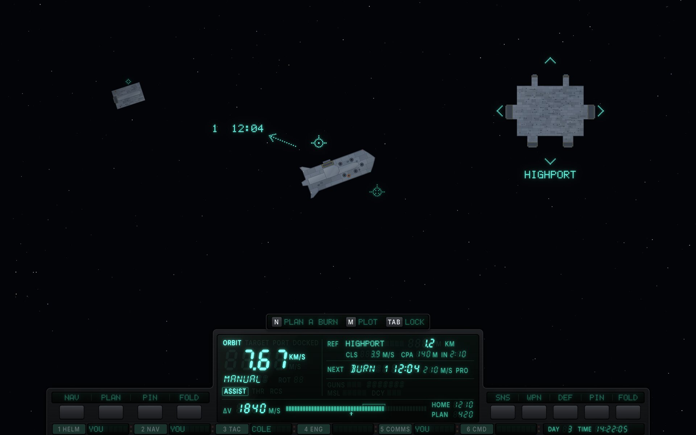
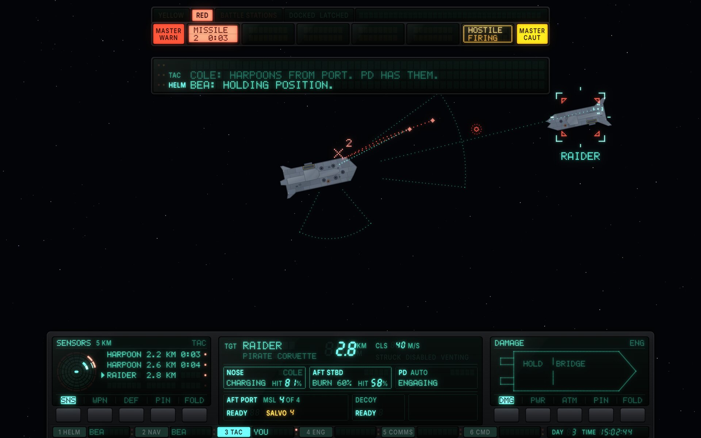
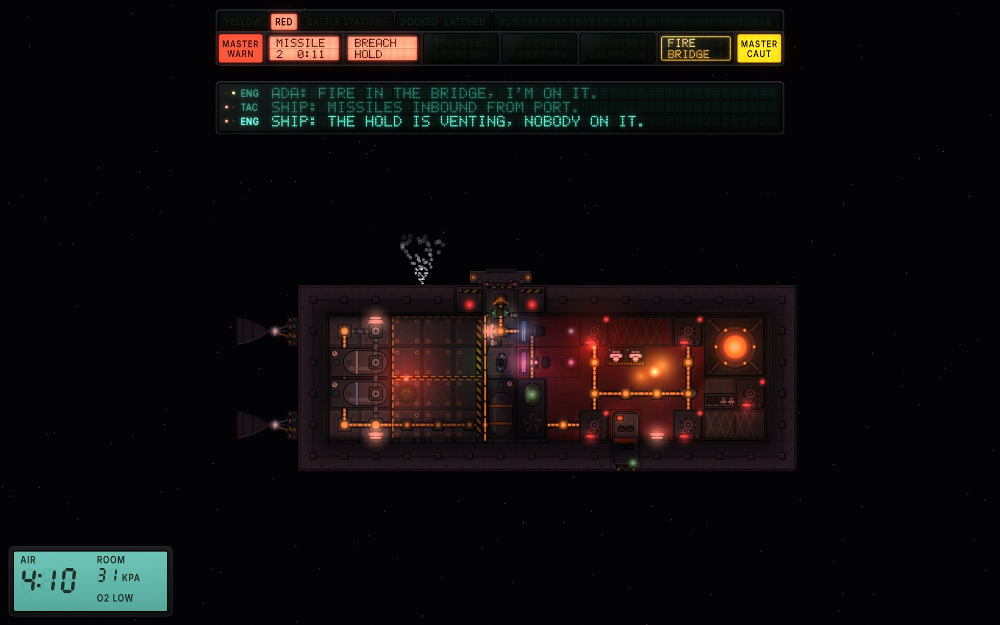
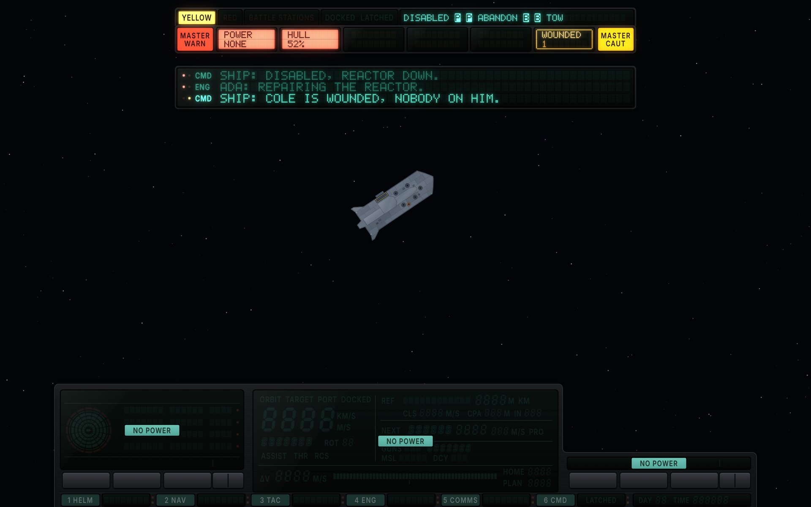

# FILAMENT × Ship stations

The ship-stations functional design (`functional-stations.md`, round 13) built in the FILAMENT style ([`style-vfd.md`](../style-vfd.md)). The spec decides what each widget shows, where and when; this page records how FILAMENT builds it, what the style changes beyond the look, and the critique of each round.

Mockups are drawn by [`vfd/src/stations.js`](../vfd/src/stations.js) over real game captures and the game's own hull art; `vfd/src/export.sh` re-renders them.

## Screens

**C. Seated at the helm, cruising (Green).** The ship is well, so the console is dark: the cluster shows the reference, the next burn and Δv against the trip home, and the burn's arrow in the world carries only its number; both MFDs are folded to their soft-key rails; the station board is dim, `YOU` included, with Cole named at TAC; the prompt line offers three keys.

**E. At the weapons console, in a fight (Red).** The First Play fight: the corvette against the pirates' corvette, which has just thrown two harpoons; 2.4 and 2.5 km out and swinging wide to port, they land in 8 and 9 s under their burn. The missile warning fills from `MASTER WARN`, the hostile caution from `MASTER CAUT`; the tactical cluster carries the target, the two guns in hand with their own hit chances (Cole has the nose gun), point defense, the launcher's salvo behind amber and the decoy; the shield slot is blank glass, since the corvette has no emitter. SENSORS (at its 5 km step) and DAMAGE are up on the MFDs, each soft key carrying its page's full name.

**B. On deck, fire and missiles inbound.** The deck view in battle lighting with the fire in the bridge and the hold venting drawn on the hull, the same top column, three callouts in the ticker (the SHIP lines say only where and who) and the suit readout as the captain's LCD: the player is in the hold, its pressure falling.

**Blackout at the helm (Yellow, in Emergency).** The kit's blacked-out seat (spec 5.1, rule 4). After the First Play fight a harpoon got through: the reactor is damaged, no reactor runs, and the ship is disabled. The status strip names the state and the two ways out, each key one inverse cell: `DISABLED`, P twice, `ABANDON`, B twice, `TOW` (nothing is inbound, so the beacon would answer); the prompt line shows neither key, since the strip carries them. The causes are on their own tiles, POWER / NONE and HULL / 52%, both warnings, and the SHIP line says "disabled, reactor down" in the game's words. Every instrument of the seat is dark with its ghosts still showing, and its NO POWER face is lit behind the glass; the overlay stays up on the emergency bus. The projected HUD is the seat's, so the world is bare.

## How it is built

| Spec widget | FILAMENT part |
|---|---|
| Z1s status strip | A rack module of fixed legends: `YELLOW`, `RED`, `BATTLE STATIONS`, `DOCKED`, `LATCHED`, then a 39-cell dot-matrix field for the emergency text, each key it names drawn as one inverse cell (the longest form, 34 characters as the spec writes it, takes 28). Dark in Green |
| Z1 annunciator | One row: `MASTER WARN` and `MASTER CAUT` lamp keys at the ends, six dual-filtered tiles between. Warnings fill inward from WARN as red inverse blocks, cautions inward from CAUT as amber outlines; past six, the tile where they meet reads `+n MORE` |
| Z1w warp strip | A single dot-matrix line with the rate in seven segments |
| Z2 callout ticker | Three dot-matrix lines at pitch 2 behind one glass, each led by a severity pip pair and the station tag; 54 cells for the speaker and the text |
| Z3b helm cluster | One module, five fixed slots: velocity (frame legends, seven segments autoranging `M/S` to `KM/S`, control chip, `ASSIST`, thrust lamps), reference, next event, trigger, Δv. Δv is a two-rail bar: the fill, the home notch, the plan bracket |
| Z3b tactical cluster | The target block on top; a chip per gun in hand (state, its own hit chance in seven segments, the crew member seated at it); one `PD AUTO` chip; the launcher (`MSL 4 OF 4`, ready or seconds, `SALVO` behind amber when one press empties it), the decoy, the shields (blank glass on a hull with no emitter) |
| Z3a, Z3c MFDs | Modules with a rail of soft keys: three page keys, each carrying its page's full name in the glass over it, and a split key whose halves pin and fold. A page not needed folds: the glass sinks into the rack, the rail stays at L1 |
| Z3d station board | Six cells: the station's number and name on a key, the holder in dot matrix. Dim in Green; `YOU` lit in Yellow and Red; an alert lights the cell's own pip in any condition. Command has no holder: its window carries the printed `LATCHED` badge, lit while latched |
| Z7 prompt line | Learning hints on a small plate over the cluster: key caps and words |
| Z6 suit readout | Reflective LCD, backlit only while it warns |
| World symbology | The projected HUD: dot sprites, zinc and red channels, drawn under the band |
| Blackout (5.1, rule 4) | The seat's instruments, board and projector drawn unpowered, every ghost showing and nothing lit, each instrument with its NO POWER face: a backlit LCD behind the glass. The overlay runs on the emergency bus |

## What FILAMENT changes beyond the look

- **The band is a rack.** The seated band is an opaque moulded rack across the bottom, not panels over the world; the camera already lifts the ship by half the band's height (spec 6.2), which FILAMENT relies on.
- **Severity has an end of the row.** Warnings grow from one end and cautions from the other, so severity reads by position as well as colour and form.
- **Folded MFDs keep their rail.** "Fold" is literal: the glass sinks, the soft-key rail stays where the hand learned it.
- **Missing hardware is blank glass.** A system the hull doesn't carry (the corvette's shields) leaves its place as glass with nothing printed on it, so the player never reads it as "off".
- **The suit is LCD.** The captain's own kit reflects; the ship glows.
- **A dead instrument keeps its face.** Unpowered, a module still shows its ghosts, so the player sees what it would hold, and a backlit LCD behind the glass says NO POWER.

## Round 1 critique (resolved in round 2)

1. **Type below the minimums.** The band re-laid at the guide's round-2 minimums; the cluster's slots lost their least useful secondary values first.
2. **Inverse text filled in.** Cut letters are re-darkened after the bloom (guide 7.8), so the warning tiles read.
3. **Folded MFD rails too bright.** A folded rail idles at L1.
4. **The station board talked in Green.** The spec now dims it in Green (its round 6), and the mockup does.
5. **The top column was a 192-unit block.** The spec moved to one annunciator row with `+n MORE` (its round 6); the ticker sits at y 108.

## Round 2 critique

The mockups were redrawn against spec round 8: the corvette's real mounts (coilgun, point-defense autocannons, harpoon launcher, laser), harpoons arriving in seconds, the starter crew, the rooms BRIDGE and HOLD, one annunciator row, SHIP lines that add only what a tile can't, a dim board in Green.

1. **The shield slot was ghosted** (`SHLD`, `RAISED`, `88%` printed dark) on a corvette that has no emitter, so it read as shields switched off. *Fixed:* blank glass, as the tell-tales already do.
2. **The annunciator's zones were fixed at three and three.** A fourth warning had nowhere to light while amber tiles stood empty, though the spec lets any mix fill six. *Fixed:* every tile is dual-filtered and the split moves; past six, the tile where warnings and cautions meet counts the rest (guide 7.8).
3. **The deck didn't show its own trouble.** The fire and the venting were told only by tiles and beacons. *Fixed:* the fire's glow in the bridge and the vented air fanning out of the hold are drawn on the deck, as the game draws them.
4. **Kept:** the missile impact mark carries its count (`2`) in the world: the stations spec doesn't forbid it, and it is the only place on deck that says how many will hit where.

No meaningful criticism of the visual build remains open. The note below is functional.

## Round 3

Spec round 9 took the round-2 note: a callout is at most 50 characters after the station tag, the speaker's name included, and a longer one is the style's to wrap or scroll, never to cut. E's line is now "Cole: harpoons from port. PD has them." (38), and the mockup carries it. The spec also adopted FILAMENT's two choices: a slot for a system the hull lacks is blank with no legend, and `+n MORE` goes on the last tile to fill, so warnings and cautions may fill from opposite lamps.

Nothing meaningful remains to criticise, visually or functionally: this variation has converged. It reopens if the spec changes something visible.

## Round 4

Spec round 10 (from the Cassette artist's notes) changed four things a FILAMENT stations screen shows:

1. **Burn arrows carry their number only;** the time is in the Next event slot. C's arrow now reads `1`.
2. **The emergency text has a 44-character short form,** keys first: "DISABLED: NO POWER [P][P] ABANDON [B][B] TOW". No mocked screen is in an emergency, so it was checked by rendering the strip with it: at first it needed 38 cells where the field held 37. The strip's legend cells lost a little padding, so the field holds 39, and each key is one inverse cell, the display's own key cap (guide 7.7).
3. **Command's board tile has no occupancy.** Its window now holds only the printed `LATCHED` badge, dark until the ship latches.
4. **On deck, a crew member who speaks shows a speaking mark** for 3 s instead of a bubble. B's crew line is the ticker's oldest, so no mark is lit there; the guide's marker table now defines it (three dots that light in turn).

The DOCK page (D), the station terminal (G) and the two-to-a-row gun chips for bigger hulls aren't on a mocked screen; the corvette's screens are unchanged by them. Nothing meaningful remains to criticise: converged again.

## Round 5

Spec rounds 11 and 12 (a disabled ship, then the Nasa-punk artist's round-3 notes) change five things a FILAMENT stations screen shows:

1. **The emergency text names the state, not the cause:** `DISABLED`, P twice, `ABANDON`, B twice, `TOW` (34 characters), without the tow while missiles are inbound, and `ABANDON SHIP`, P, `LAUNCH NOW` once ordered. The longest takes 28 of the strip's 39 cells. The cause is on its tile: POWER / NONE, or the new HULL tile, a warning under 55%.
2. **A blacked-out seat joins the kit.** It is drawn as a fourth screen, the first in an emergency: the blackout at the helm above. FILAMENT draws a dead instrument unpowered, every ghost showing and nothing lit, with a backlit LCD behind the glass reading NO POWER (guide 7.11); the overlay runs on the emergency bus. Drawing it found that the renderer left a lit digit's segments blank once its power was cut (a lit segment has no ghost under it), so the renderer now draws a dead module from scratch, unpowered.
3. **Soft keys carry full page names.** Each MFD rail is three page keys with room for nine cells each (CONTRACTS is the longest name) and one split key for pin and fold, each half a 24-unit target with its glyph over it (guide 7.7). The specimen's keys follow.
4. **E's harpoons count their burn:** thrown 5 s and 4 s ago, 2.4 and 2.5 km out, they land in 8 and 9 s (the tile reads `2  0:08`). They are drawn just off the Raider, swinging wide to port; the kill burst of a third harpoon is gone, since these are the first two thrown. SENSORS opens at the new 5 km step.
5. **Point defense** is spelled the game's way, on screen and in the guide.

Callouts now carry no countdown; FILAMENT's already didn't. Nothing else on C, E or B moves. No meaningful criticism of the visual build remains; the notes below are functional.

## Round 6

Spec round 13 took both round-3 notes, and each matches what FILAMENT already drew: the seat's station board and its world symbology go dark with the seat, and while the ship is disabled the prompt line shows neither the tow nor abandoning, which the strip carries. It also gives the deck's side of a blackout, which no FILAMENT screen shows: the deck's marks stay, being the suit's own, and the deck goes to emergency lighting with its door lights and alarm beacons lit. The guide's emergency bus now says so (7.11). No screen changed.

Nothing meaningful remains to criticise, visually or functionally: this variation has converged. It reopens if the spec changes something visible.

## Functional notes sent to the stations designer

Round 1 (all taken in round 6): one annunciator row with `+n MORE`, SHIP callouts that don't restate tiles, the station board dim in Green.

Round 2 (taken in round 9):

1. **Callouts need a length.** FILAMENT's ticker holds 54 characters after the station tag at pitch 2; E's line "Cole: harpoons off the Raider, port side. PD has them." is exactly 54. Suggest 13.5 cap a callout at about 50 characters with the speaker's name counted, and say what happens past it (FILAMENT marquees it, one cell at a time with a hold at each end).

Round 3 (after spec round 12; both taken in round 13):

1. **What else goes dark in a blackout.** Rule 4 names the clusters and MFDs (dark) and the overlay (up), but not the station board (8.5) or the world symbology (11). FILAMENT darkens both with the seat, since the board sits in the seat's rack and the projected HUD is the seat's. If either should stay up (the ENG tile's pip points at the reactor; a hostile still near would be worth its bracket), suggest 5.1 say so.
2. **The tow's hint while disabled.** 7.3 keeps "[B][B] Call a tow" on the prompt line "while a tow is on offer", which includes a disabled ship, whose status strip already shows B twice; 13.4 keeps it "then", in the stranded case only. Suggest 7.3 say the stranded case, so the keys aren't on screen twice.
