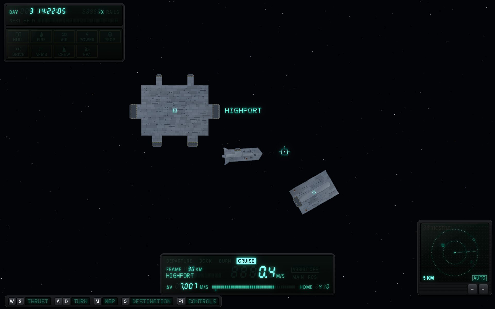
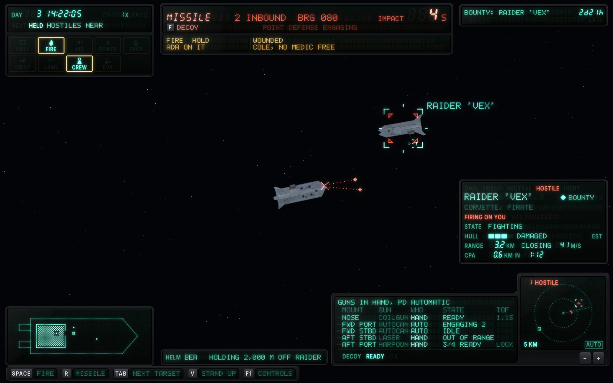
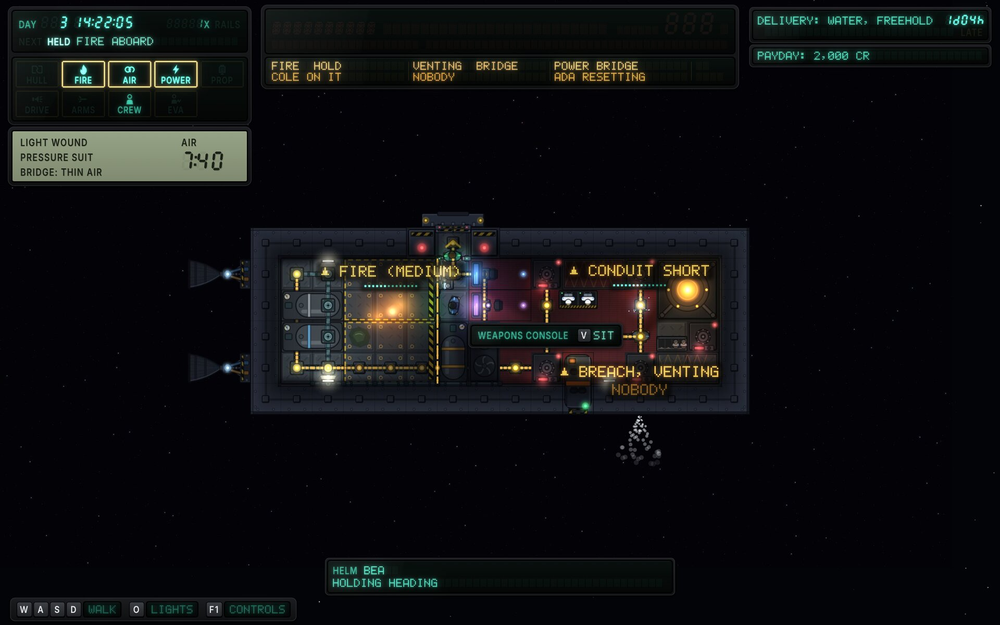

# FILAMENT × Task-driven

The task-driven functional design (`functional-task.md`, round 6) built in the FILAMENT style ([`style-vfd.md`](../style-vfd.md)). The spec decides what each widget shows, where and when; this page records how FILAMENT builds it, what the style changes beyond the look, and the critique of each round.

Mockups are drawn by [`vfd/src/task.js`](../vfd/src/task.js) over the game's hull art and a real deck capture; `vfd/src/export.sh` re-renders them.

## The idea: a 90s digital dash

The other two FILAMENT variations are built like consoles: racks along the edges. The task design's widgets live in corners and sides, by what the player is doing, so this variation is built like the dashboard of a 1990s car with a digital cluster: **no rack spans the view; each corner carries its own moulded pod.**

- The **cluster** (top left) holds the clock and the annunciator, which becomes a block of **tell-tales**: a lamp per system, each an icon over its word, the way a dashboard shows its warning lamps.
- The **message centre** (top centre) is the alert band: a window behind red glass for the one warning, a row behind amber glass for up to three cautions and a narrow cell for `+n MORE`.
- The **flight instrument** (bottom centre) is the speedometer: its four modes are fixed legends along the top, the one in use lit inverse, like a deck's PLAY and REC row.
- The **weapons pod** (bottom right) is the trip computer: a table of mounts, with the scope as a square graphic panel beside it.
- The **hint line** is a printed legend strip: rubber key caps, each with its word in a small window that goes dark as the player learns the key.

## Screens

**Helm at rest.** No target, no plan, nothing wrong: the clock, nine dark tell-tales, the flight instrument in CRUISE in Highport's frame (3.0 km off, so the prograde marker is a square), the scope at 10 km and the hint strip. Highport is labelled because stations always are; the passing freighter is a glyph.

**Gunnery in combat.** Two harpoons inbound, 1.4 km out on bearing 080 and 4 s from impact under their burn: the red window carries the warning with the action that fits the post (`F DECOY`) and point defense's state; the fire in the hold and Cole's wound are the cautions, and the FIRE and CREW tell-tales are lit. The target card, the weapons table and the scope fill the right, the scope at its 5 km step; Bea's standing order sits where the flight instrument would be; the schematic shows the fire and the crew.

**Deck during damage control.** A fire in the hold with Cole on it, a conduit short in the bridge with Ada resetting it, the bridge venting with nobody to patch it, and the captain in a pressure suit in thin air beside the weapons console. Each hazard is tagged on the deck with its progress or `NOBODY`; the console's prompt is a small slab; the clock says why warp is held. The red window is dark glass: no warning stands.

## How it is built

| Spec widget | FILAMENT part |
|---|---|
| CHR chronometer | The cluster's top module: day and time in seven segments with colon cells; warp rate, `X` and `RAILS`; `NEXT` and `HELD` as a pair of legends saying what the dot-matrix window beside them holds |
| ANN annunciator | Tell-tales in a 5 × 2 block, each cell printed in register: an amber frame, a red block, the icon over the word on clear glass. Four states: dark (ghost), advisory (L1 zinc), caution (amber frame), warning (red block, icon and word cut out). The corvette has no shield emitter, so the tenth cell (SHIELD) is blank glass |
| PER personal status | Reflective LCD under the cluster: health, suit, the room and its air, suit air in LCD segments |
| ALR alert band | The message centre. The warning window: title in fourteen segments, the detail in dot matrix, the one number in large seven segments with its label and unit, then the action behind its key cap and a note. The caution row: three cells of two dot-matrix lines (19 characters each; each line is the full text's part when it fits and the short form's when it doesn't), then a narrow `+n MORE` cell. The warning window keeps its place, dark, when no warning stands |
| OBJ, NTF | The trip computer's slabs in Z3: the title in dot matrix, time left in seven segments with inline units (`2d21h`), `LATE` with its own amber place under the time |
| TGT target card | A slab: the five relations as fixed words with `HOSTILE` behind red; name and contract; class at L1; `FIRING ON YOU` and `HAS YOU LOCKED` behind red; state as a word; hull as a four-step bar with its band word and `EST`; range and closing rate; closest approach and when |
| WPN weapons cluster | A table: a pip pair leading each mount, then `MOUNT`, `GUN`, `WHO`, `STATE`, `TOF`, the columns told apart by drive level (gun type and time of flight at L1, the rest at L2, a gun in hand at L3); under a rule, the decoy as `READY` or seconds |
| SNS sensor scope | A square graphic dot panel, range rings in dots, the hostile count in two seven-segment cells behind red, range and `AUTO` in the corners, 24-unit zoom keys under it |
| SCH ship schematic | A graphic dot panel (300 × 112) in its own pod: the corvette's plan with fire and smoke as dot patterns and the crew as dots, the pattern cleared around each crew dot |
| FLT flight instrument | The four modes along the top; the frame as `FRAME` with its distance and its name in dot matrix; speed in large seven segments; `ASSIST OFF` (lit only when it is off), `MAIN` and `RCS` lit while firing; Δv with its bar, the home notch and `HOME` |
| HLM helm status | A one-line slab: `HELM`, who has it, the standing order |
| HNT hint line | A legend strip: key caps, each with its word in a small window at L1 |
| INT prompt | A small slab by the console (guide 7.10): its name in legend type, then each verb behind its key cap |
| OVL deck overlays | Projected hazard tags: the severity glyph and the name in 5x7 at pitch 2, under it a bar of dots for the work done or `NOBODY`, over a darkened pill |

## What FILAMENT changes beyond the look

- **Pods, not racks.** Each zone's widgets share a moulded housing; between them the world reaches the screen edges.
- **The band's colours are places.** The warning window is red glass and the caution row amber glass, so the band's rows can't swap. With only cautions standing, the red window stays as dark glass and the cautions keep their row (the spec says so too, from round 3).
- **Tell-tales.** The annunciator's lamps carry icons, so the block is learned by shape as well as position and word, and an advisory (crew outside) reads as normal because it lights without a frame.
- **The hint line is printed.** It can't fade like a text line, so its words go dark one by one as they're learned, and the strip is as long as what it holds.
- **The band is taller than Z2.** At the guide's minimum sizes the message centre is 600 × 96, inside Z2's 640-unit width with its bezel, so screens start 112 units down; the spec lets a screen start below the band wherever a style puts it (round 5).

## Round 1 critique (resolved in round 2)

1. **Type below the minimums.** Every module re-laid at the guide's round-2 minimums (legends 13, segments 12, dot matrix pitch 1.5 in columns and 2 for running text, clickables 24); content cut by priority where it no longer fit.
2. **The caution row floated when no warning stood.** The red window stays as dark glass, so the row hangs from hardware.
3. **The weapons table was dense.** It is wider (380 units in its own pod) with a header row, and the drive levels separate the columns.
4. **Scope keys too small to click.** 24-unit keys.

## Round 2 critique

The mockups were redrawn against spec round 4: four FLT modes, `ASSIST OFF` only when it is off, markers that carry names but no numbers, the starter crew (Ada, Bea, Cole), the corvette's rooms and nine lamps, and the alerts' short forms.

1. **WPN's gun and crew columns ran together** (`COILGUNHAND`): both were dot matrix with one cell between them. *Fixed:* `WHO` at L2 against the gun type at L1.
2. **The deck prompt was a sentence** (`V SIT AT THE WEAPONS CONSOLE`, 26 characters projected over the deck), the longest line on the screen. *Fixed:* a console prompt slab per guide 7.10: `WEAPONS CONSOLE [V] SIT`.
3. **The scope's hostile count read as a slash**: one slanted seven-segment `1` with nothing beside it. *Fixed:* two cells, so the ghost `8` shows it is a digit.
4. **Sample data the game doesn't have.** The deck's delivery carried ice, which isn't a commodity (`economy.json` has water, food, ore, steel, machinery and reaction mass). *Fixed:* `DELIVERY: WATER, FREEHOLD` (Freehold is a free port and buys water).
5. **Kept:** the dark red window on the deck (its fixed place is the point); `EST` at the end of the hull row (it qualifies the field the way a unit does, and the field holds `HEAVILY DAMAGED`).

No meaningful criticism of the visual build remains open. The notes below are functional.

## Round 3

Spec round 5 took all four round-2 notes: every short form is two parts joined by a double space, each within 19 characters, which a style may break into two lines; `+n` has a reserved slot at the end of the caution row; a screen starts below the band wherever the style puts it; the prompt names its object once (`Weapons console   V sit`). Each matches what FILAMENT already drew, so the screens are unchanged; the one sample that moved (`WOUNDED Cole  no medic`) shows its full text in the mockup.

Nothing meaningful remains to criticise, visually or functionally: this variation has converged. It reopens if the spec changes something visible.

## Round 4

Spec round 6 (the Nasa-punk thread's round-3 notes) changes four things on FILAMENT's screens:

1. **The shield lamp is SHIELD.** The corvette's tenth cell is blank glass either way.
2. **The scope's automatic range holds every inbound missile and the target**, with a new 5 km step. At gunnery it reads `5 KM`: the raider at 3.2 km and the two harpoons at 1.4 km well inside it, the station past the rim drawn on it.
3. **Impact times count the missile's burn.** Under 9.2's formula a harpoon 1.4 km out can't be 14 s from impact: thrown from the raider 3.2 km off, it is closing at about 330 m/s by then and lands in about 4. The mockup keeps the scope's 1.4 km and shows `IMPACT 4 S`, the harpoons drawn just ahead of the bow on bearing 080.
4. **Point defense** is printed the game's way: `POINT DEFENSE ENGAGING`.

No meaningful criticism of the visual build remains; the notes below are functional.

## Functional notes sent to the task designer

Round 1 (all answered by spec rounds 2 and 3): SCH at gunnery, WPN under the key strip, speed at rest in the orbit frame, decoys have no stock, cautions keep their row, room names from the chassis.

Round 2 (all taken in round 5):

1. **The short form's double space is a line break.** FILAMENT's caution cells are two lines of 19 characters, and they split each alert at the short form's double space (`FIRE Hold  Cole`, `POWER Bridge  Ada`): what and where above, who or the key below. Suggest the spec keep that double space in every short form, as it does now.
2. **`+n more` has no place in Z2.** ALR says `+n more` shows when there are more than three cautions, but Z2's wireframe has no room for it, so it would push or cover the third cell. FILAMENT gives it a narrow fourth cell (44 units). Suggest the wireframe reserve it.
3. **INT: name the object once.** The samples mix the object as the action (`E  Reactor console`) with verb phrases (`V  sit at the helm`); with two actions per object the second repeats the name. Suggest the object's name, then each key with a verb: `Helm: V sit, E panel`.
4. **Z2 at the minimum sizes.** Built at the style guide's minimum type, the band needs about 600 × 96, so "a screen starts below the band's second row (100 units down)" holds only if the band starts at y 4. Suggest section 5 let the band's second row end by y 110.

Round 3 (after round 6):

1. **The gunnery sample's impact time.** Under 9.2's own formula, `impact 14 s` can't go with SNS's two harpoons at 1.4 km: from rest a harpoon covers 1.4 km in under 10 s, and one thrown from the raider at 3.2 km closes at about 330 m/s by then and lands in about 4 s. 14 s fits harpoons about 3 km out, just thrown. Suggest `impact 4 s` (as FILAMENT draws it), or the harpoons at 3 km.
2. **Say what a bearing is measured from.** `bearing 080` has no reference. The view and the scope are north up, so FILAMENT reads it as clockwise from that north, which puts the harpoons nearly dead ahead of a corvette heading 078. A player used to ships reads 080 as off the starboard bow, and the game's only bearing today (the dev console's `shoot`) counts off the bow counterclockwise. Suggest ALR give the reference.
